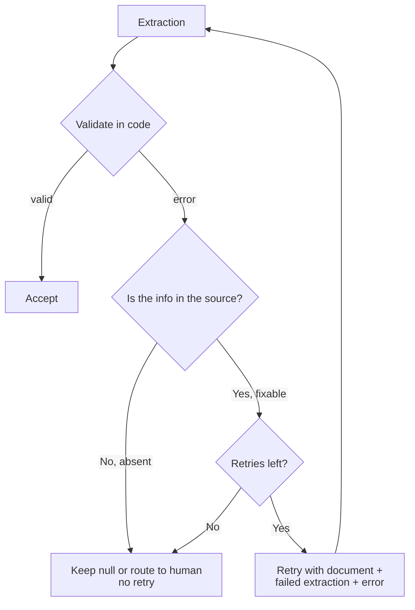

# Task Statement 4.4: Validation, Retry and Feedback Loops

> Scenario: Scenario 6 (Structured Data Extraction); also Scenario 5 for finding feedback.

## In One Minute
- **What**: Validate every extraction in code. If it fails, decide whether a retry can help.
- **Why**: A retry fixes format and structure mistakes. It cannot create information that is not in the document.
- **How**: Retry with three things: the original document, the failed extraction, and the specific validation error.
- **Also**: Track `detected_pattern` on findings, and use `calculated_total`, `stated_total`, `conflict_detected` for arithmetic checks.
- **Exam answer in one line**: *Retry fixable errors with specific feedback; route absent data to a human.*

---

## 🧒 Explain Like I'm 13

**The picture:** A teacher marking homework. "Wrong, try again" teaches nothing. "Question 3: you wrote 03/04/26, we need YYYY-MM-DD. Here is the worksheet again" does. And if the answer is not in the textbook at all, ten more tries will not help, the student will just guess.

**In plain steps:**
1. Validate in code (format, sums, required info).
2. On a fixable error, retry with: the original document, the failed output, and the exact error.
3. Cap the retries (for example 2).
4. If the info is not in the source, stop: keep `null` or ask a human.

**Tiny example:** `po_number: null` and the document has no PO number. Retrying three times invites a made-up PO number.

---

## 📖 Concepts Explained

### 1. The Anatomy of Self-Correction in Extraction Pipelines
When an extraction pipeline detects an anomaly, naive implementations make one of two critical mistakes: they either retry the exact same prompt blindly (which simply causes the model to regenerate the identical error), or they retry infinitely until rate limits are exhausted. Worse, if the required information is physically missing from the document, retrying actively trains the model to fabricate plausible values to satisfy the schema.

Effective architectural retry loops operate on a **deterministic feedback contract**: the application layer detects errors, categorizes whether they are structurally recoverable, and constructs an explicit feedback message guiding the model to correct its reasoning.

### 2. Schema Syntax Errors vs Semantic Business Invariants
In production data pipelines, errors fall into three fundamentally distinct categories:
1. **Schema Syntax Errors (Format Mismatches)**: The model extracted the value, but formatted it incorrectly (e.g. `issue_date` returned as `"October 6, 2026"` instead of ISO 8601 `"2026-10-06"`). These errors are **100% recoverable via retry**.
2. **Semantic Arithmetic Errors (Cross-Field Invariants)**: The JSON schema is perfectly valid, but internal business logic is violated (e.g. line items sum to \$450.00 while the invoice `total_amount` states \$500.00). Strict JSON schemas cannot detect this because both numbers are valid floats. The post-extraction validation layer must cross-check fields and provide specific arithmetic feedback: *"Line items sum to 450.00, which contradicts stated total of 500.00. Re-examine the document for omitted line items or shipping discounts."*
3. **Physically Absent Facts**: The supplier simply did not print a VAT registration number on the receipt. **Retries are completely ineffective here**. Retrying an absent fact forces the model into a hallucination trap. The pipeline must fast-fail, assign `null`, and route the record to human review.

### 3. Constructing an Actionable Retry Payload
When requesting a self-correction pass, Claude requires complete context to re-evaluate its extraction. A compliant retry prompt must contain:
- **The Original Source Text**: Preserves full contextual grounding.
- **The Failed Extraction JSON**: Shows Claude what it extracted in the previous turn.
- **The Specific Validation Error Message**: Pinpoints the exact field, the observed value, and the expected constraint.

### 4. The Self-Correction Dual-Extraction Pattern
To catch discrepancies before shipping data to accounting databases, design extraction schemas with built-in verification pairs:
- Extract `stated_total` (the printed bottom-line number) alongside `calculated_total` (the programmatic sum of extracted item rows).
- Include a `conflict_detected: bool` flag. When the model detects that the printed total contradicts the arithmetic sum of line items in the source text, it sets `conflict_detected: true`, alerting downstream workflows without crashing the pipeline.

### 5. Tracking Dismissals via `detected_pattern`
When Claude Code or an agent generates review findings, every finding must carry a `detected_pattern` tag (e.g. `detected_pattern: "raw_sql_in_orm_repository"`). Tracking developer dismissals across thousands of PRs allows teams to analyze which specific prompt rules generate noisy false alarms, enabling targeted rubric revisions.

---

## 🧪 Worked Example

### ❌ Invalid Example (Anti-Pattern: Blind Retries on Missing Data)
```text
# BROKEN: Retrying blindly without diagnostics, or retrying physically absent facts
Document: "Coffee Shop Receipt. Total: $5.00." (No tax ID printed on the paper)

Attempt 1 Output:
  {"total": 5.0, "tax_id": null}

Pipeline Validation Check:
  "tax_id is null! Re-running prompt..."

Retry 1 Prompt sent to Claude:
  "Extract invoice details again. Make sure tax_id is filled!"

What happens:
  Claude feels forced to satisfy the required field and invents "TX-0012345" out of thin air!
  
Why it fails in production:
1. Retrying missing facts induces hallucinations.
2. Repeating the exact same prompt without specific error feedback wastes tokens and API budget.
```

### ✅ Valid Example (Production Pattern: Targeted Diagnostic Feedback & Fast-Fail on Absent Data)
```text
# CORRECT: Targeted diagnostic feedback for recoverable errors, fast-fail for absent facts

Scenario A (Recoverable Math Error):
  Document: "Invoice 101. Subtotal $100. Tax $10. Total $110. Tax ID: TX-999"
  Attempt 1 Output: {"subtotal": 100.0, "total": 90.0, "tax_id": "TX-999"}
  
  Code Validation Check:
    subtotal (100.0) cannot be greater than total (90.0). Recoverable arithmetic mismatch!

  Retry Payload sent to Claude:
    <document>Invoice 101. Subtotal $100. Tax $10. Total $110. Tax ID: TX-999</document>
    <failed_extraction>{"subtotal": 100.0, "total": 90.0, "tax_id": "TX-999"}</failed_extraction>
    <validation_error>
      Total ($90.00) cannot be less than Subtotal ($100.00). Re-examine line items and grand total.
    </validation_error>

  Attempt 2 Output:
    {"subtotal": 100.0, "total": 110.0, "tax_id": "TX-999"}  -> PASSED!

Scenario B (Physically Absent Fact):
  Document: "Coffee Shop Receipt. Total: $5.00." (Tax ID is physically absent)
  Attempt 1 Output: {"total": 5.0, "tax_id": null}

  Code Validation Check:
    tax_id is physically absent from document text -> Abort retry immediately -> route_to_human_triage.
```

**Dismissal telemetry tracking (`detected_pattern`)**:
```text
print_in_cli      4 findings, 3 dismissed -> 75% dismissal rate -> Noisy rule! Disable or rewrite.
none_deref        3 findings, 0 dismissed ->  0% dismissal rate -> High-value rule! Keep.
```

---

## 🔑 Key Terms

- **Validation-Retry Feedback Loop**: A bounded, closed-loop architectural pattern where client application code validates model output and returns specific diagnostic error feedback for self-correction.
- **Recoverable Extraction Defect**: An error (such as an arithmetic mismatch or bad date formatting) where the underlying facts physically exist in the source document and can be resolved by re-examination.
- **Physically Absent Fact**: An attribute that was never printed or recorded in the source text, making automated retries futile and requiring immediate fast-fail routing to human exception triage.
- **Diagnostic Retry Payload**: A targeted prompt structure providing three essential context elements: the original document, the failed extraction JSON, and the exact validation failure message.
- **Pattern Telemetry (`detected_pattern`)**: A structured metadata tag tracking which specific review rule triggered a finding, used to calculate dismissal rates and eliminate noisy prompt rules.
- **Semantic Cross-Field Validation**: Client-side code logic that verifies relational invariants (such as line items summing to total amount) that strict JSON Schemas cannot enforce alone.

---

## 🏗️ Architecture



---

## ⚠️ Exam Traps and Correct Patterns

### Trap 1: "That was invalid, try again"

```text
ANTI-PATTERN retry message: "Your output was invalid. Try again."
  -> The model has no idea what to change and often repeats the same output.

PATTERN retry message (everything needed to fix it):
  1. The original document
  2. The failed output
  3. The specific error: "date_issued '03/04/26' is not ISO 8601 (YYYY-MM-DD).
                           Line items sum to 480.00 but total is 840.00."
```

Sending only the error leaves out the source. The model cannot correct a value it cannot see.

### Trap 2: Retrying when the information is not in the source

**Exam scenario**: Extraction returns `po_number: null`. A validation rule says the field is required, so the pipeline retries three times.

Each retry pushes the model to produce *something*, so the likely outcome is a hallucinated PO number. Retry fixes **format and arithmetic** errors (the info exists, the output is wrong). It does not fix absent data.

| Error type | Action |
|---|---|
| Wrong date format, bad enum, malformed shape | Retry with specific feedback |
| Totals disagree | Retry with both totals, or flag `conflict_detected` |
| Value is not in the document | No retry. Keep `null` or route to a human |
| Retry budget used up | Escalate to a human |

Always set a retry limit (for example 2).

### Trap 3: Trusting that valid-looking means correct

A schema-valid object with the wrong sum passes shape checks. Recompute totals in code and compare them. Semantic checks belong in your validator, not in the schema.

### Trap 4: Throwing away dismissed findings

When reviewers dismiss findings, store each finding with a `detected_pattern` (the code pattern that triggered it). If 80% of dismissals share `detected_pattern: "unused_variable_in_test"`, you know exactly which criterion to rewrite or disable. Deleting dismissals removes that data.

---

## 📝 Exam-Style Practice Questions

**Q1 (Scenario 6).** Extracted `issue_date` is "6th Oct" but your validator needs `YYYY-MM-DD`. The document clearly shows the date. What is the best retry?
- A) Resend the same request unchanged.
- B) Send the original document, the failed extraction, and the error "issue_date must be YYYY-MM-DD".
- C) Send only "Try again".
- D) Drop the field and continue.

**Q2 (Scenario 6).** A validator requires `tax_id`. The receipt has no tax information. Retries 1 and 2 return `null`; retry 3 returns a plausible-looking ID. What should the design do?
- A) Allow more retries until the ID looks valid.
- B) Detect that the data is absent from the source, stop, keep `null` (nullable), and route to human review if it is mandatory.
- C) Raise the temperature.
- D) Accept the invented ID.

**Q3 (Scenario 5).** Developers dismiss many review findings. You want to see which kinds of code trigger false positives. What should the finding schema include?
- A) A free-text "mood" field.
- B) A `detected_pattern` field recording the construct that triggered each finding.
- C) Only the severity.
- D) Nothing; delete dismissed findings.

### Answers
**Q1: B.**
- A fails: same input, same error.
- C fails: no information about what is wrong.
- D fails: loses a value that is present in the source.

**Q2: B.**
- A fails: retries on absent data push the model to invent a value.
- C fails: randomness increases fabrication.
- D fails: an invented ID is worse than `null`.

**Q3: B.**
- A fails: not analysable.
- C fails: severity does not say what triggered the finding.
- D fails: deleting dismissals removes the evidence you need.

---

## ✅ Self-Check Checklist
- [ ] I can list what a good retry message contains.
- [ ] I can say when a retry is useless.
- [ ] I can explain `calculated_total`, `stated_total`, `conflict_detected`.
- [ ] I can explain why `detected_pattern` helps.
- [ ] I know to bound the number of retries.

**Memory hook**: *Retry what the document can answer; escalate what it cannot.*

---

## 🛠️ Hands-on Workbook Guide

In [`ts_4_4_validation_retry_feedback.ipynb`](ts_4_4_validation_retry_feedback.ipynb):
1. **Step 1: Setup**: finds the repo root and adds it to the import path.
2. **Step 2: Validator and loop**: imports the validator, `decide_retry`, retry-prompt builder and dismissal analyser from `main.py`.
3. **Step 3: Simulation**: runs the fixable case, the absent-data case, and a dismissal analysis.
4. **Step 4: Verification**: asserts the retry decisions, the human-review route, and the noisy-pattern detection.

Everything runs offline; no API calls.

---

## 🧭 Navigation & Study Links
- ⬅️ **Previous Topic**: [TS 4.3: Reliable Structured Output via Tool Use](../ts_4_3_structured_output_tool_use/README.md)
- 📋 **Domain Overview**: [Domain 4: Prompt Engineering & Structured Output](../README.md)
- ➡️ **Next Topic**: [TS 4.5: High-Throughput Batch Processing via Message Batches API](../ts_4_5_message_batches_api/README.md)
- 🎯 **Scenario Practice**: [Master Scenario Practice](../../scenarios/MASTER_SCENARIO_PRACTICE.md)
