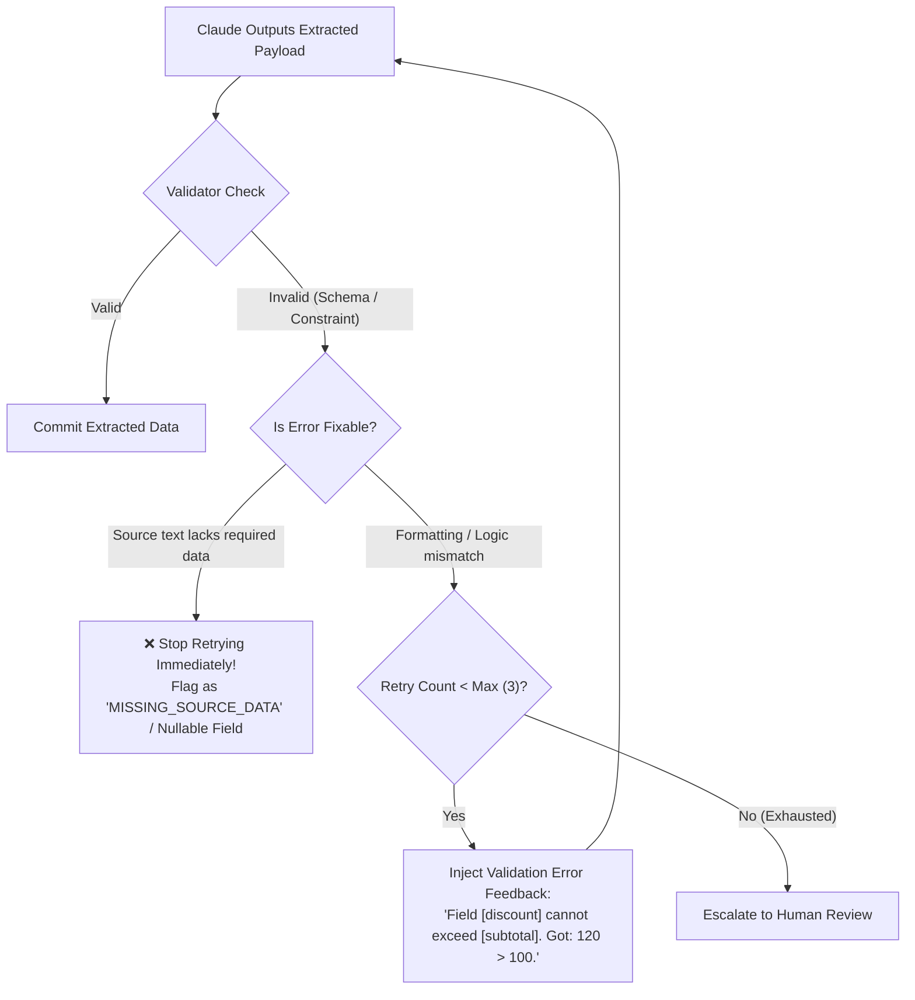

# Task Statement 4.4: Validation & Retry Feedback Loops

## 🎯 Exam Objective
Understand how to design closed-loop validation with targeted error feedback, bounded retries, and early termination on missing source data.

---

## 🏗️ Architecture: Closed-Loop Validation with Early Exit

---

## ⚠️ The "Unfixable Error" Exam Trap

### Trap:
A question presents a document missing a Customer VAT Number. The schema marks `vat_number: str` as required. Claude fails validation. The system blindly retries 3 times.

### Exam Insight:
- Retrying **cannot invent data that is absent from the input document**.
- Retrying will either cause Claude to **hallucinate** a plausible-looking VAT number or repeatedly fail.
- **Correct Solution**:
  1. Schemas for extractions must mark non-guaranteed fields as **`Optional` / nullable**.
  2. The validation feedback loop must distinguish between **correctable syntax/logic errors** and **unrecoverable missing source facts**.
