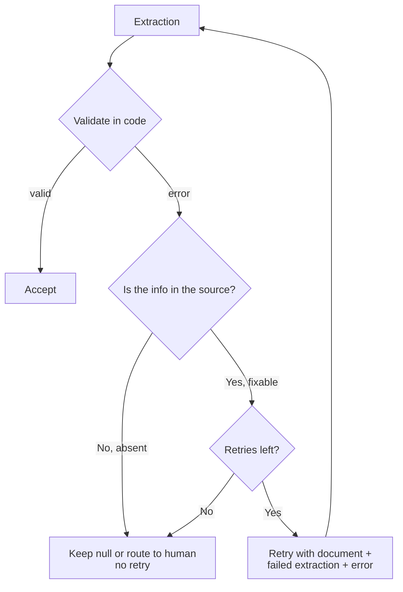

# Task Statement 4.4: Validation, Retry and Feedback Loops

> Scenario: Scenario 6 (Structured Data Extraction); also Scenario 5 for finding feedback.

## In One Minute
- **What**: Validate every extraction in code. If it fails, decide whether a retry can help.
- **Why**: A retry fixes format and structure mistakes. It cannot create information that is not in the document.
- **How**: Retry with three things: the original document, the failed extraction, and the specific validation error.
- **Also**: Track `detected_pattern` on findings, and use `calculated_total`, `stated_total`, `conflict_detected` for arithmetic checks.
- **Exam answer in one line**: *Retry fixable errors with specific feedback; route absent data to a human.*

---

## 🧒 Explain Like I'm 13

**The picture:** A teacher marking homework. "Wrong, try again" teaches nothing. "Question 3: you wrote 03/04/26, we need YYYY-MM-DD. Here is the worksheet again" does. And if the answer is not in the textbook at all, ten more tries will not help, the student will just guess.

**In plain steps:**
1. Validate in code (format, sums, required info).
2. On a fixable error, retry with: the original document, the failed output, and the exact error.
3. Cap the retries (for example 2).
4. If the info is not in the source, stop: keep `null` or ask a human.

**Tiny example:** `po_number: null` and the document has no PO number. Retrying three times invites a made-up PO number.

---

## 📖 Concepts Explained

### 1. Why it matters
- Retrying without feedback repeats the same mistake.
- Retrying for absent data teaches the model to guess.
- Unbounded retries waste tokens.

### 2. How it works

**a. Two kinds of validation error**

| Kind | Example | Action |
|---|---|---|
| Schema or syntax | Wrong date format, missing key | Retry with the error |
| Semantic | Items sum to 400, total says 500; `total < subtotal` | Retry with the numbers |
| Absent in source | Receipt has no tax ID | **Do not retry.** Keep `null` and route to a human if the field is mandatory |

**b. A useful retry message** contains:
1. The original document.
2. The failed extraction.
3. The specific error ("`issue_date` is 'Oct 6'; expected YYYY-MM-DD").

**c. Retry eligibility rule** (`decide_retry()` in [main.py](main.py)):
- valid → accept
- absent in source → route to human
- fixable error and retries left → retry with feedback
- retries used up → give up and escalate

**d. Semantic cross-check.** Extract both `calculated_total` (sum of items) and `stated_total` (printed), and a `conflict_detected` boolean. Schema validation alone does not catch this.

**e. `detected_pattern`.** For review findings, record which code construct triggered each one. When developers dismiss findings, group dismissals by pattern. A pattern with a high dismissal rate is a candidate to rewrite or disable (see TS 4.1).

---

## 🧪 Worked Example

**Case 1: fixable**
```text
Document:  Invoice 101. Subtotal $100. Tax $10. Total $110. Tax ID: TX-999
Attempt 1: {"subtotal": 100, "total": 90, "tax_id": "TX-999"}
Error:     total (90) cannot be less than subtotal (100)
Retry sends: <document>...</document> <failed_extraction>{...}</failed_extraction>
             <validation_errors>- total (90) < subtotal (100)</validation_errors>
Attempt 2: {"subtotal": 100, "total": 110, "tax_id": "TX-999"}  -> accepted
```

**Case 2: absent**
```text
Document:  Receipt from Coffee Shop: Total $5. No tax details.
Attempt 1: {"subtotal": 5, "total": 5, "tax_id": null}
Decision:  tax_id is absent in the source -> no retry -> route_to_human
```
A retry here would only push the model to invent a tax ID.

**Case 3: model missed it**
```text
Document:  Receipt. VAT ID: GB123
Attempt 1: tax_id null  -> the source does mention VAT -> retry is useful
```

**Dismissal analysis**
```text
print_in_cli      4 findings, 3 dismissed -> 75%  -> noisy, rewrite or disable
none_deref        3 findings, 0 dismissed ->  0%  -> keep
```

---

## 🔑 Key Terms

- **Validation-retry loop**: validate, send specific feedback, retry (bounded).
- **Retryable**: the model can fix it by re-reading the source.
- **Absent in source**: the document never states the value.
- **Semantic error**: valid structure, inconsistent meaning.
- **`detected_pattern`**: the construct that triggered a finding; used to analyse dismissals.
- **`conflict_detected`**: true when calculated and stated totals differ.

---

## 🏗️ Architecture



---

## ⚠️ Exam Traps and Correct Patterns

### Trap 1: "That was invalid, try again"

```text
ANTI-PATTERN retry message: "Your output was invalid. Try again."
  -> The model has no idea what to change and often repeats the same output.

PATTERN retry message (everything needed to fix it):
  1. The original document
  2. The failed output
  3. The specific error: "date_issued '03/04/26' is not ISO 8601 (YYYY-MM-DD).
                           Line items sum to 480.00 but total is 840.00."
```

Sending only the error leaves out the source. The model cannot correct a value it cannot see.

### Trap 2: Retrying when the information is not in the source

**Exam scenario**: Extraction returns `po_number: null`. A validation rule says the field is required, so the pipeline retries three times.

Each retry pushes the model to produce *something*, so the likely outcome is a hallucinated PO number. Retry fixes **format and arithmetic** errors (the info exists, the output is wrong). It does not fix absent data.

| Error type | Action |
|---|---|
| Wrong date format, bad enum, malformed shape | Retry with specific feedback |
| Totals disagree | Retry with both totals, or flag `conflict_detected` |
| Value is not in the document | No retry. Keep `null` or route to a human |
| Retry budget used up | Escalate to a human |

Always set a retry limit (for example 2).

### Trap 3: Trusting that valid-looking means correct

A schema-valid object with the wrong sum passes shape checks. Recompute totals in code and compare them. Semantic checks belong in your validator, not in the schema.

### Trap 4: Throwing away dismissed findings

When reviewers dismiss findings, store each finding with a `detected_pattern` (the code pattern that triggered it). If 80% of dismissals share `detected_pattern: "unused_variable_in_test"`, you know exactly which criterion to rewrite or disable. Deleting dismissals removes that data.

---

## 📝 Exam-Style Practice Questions

**Q1 (Scenario 6).** Extracted `issue_date` is "6th Oct" but your validator needs `YYYY-MM-DD`. The document clearly shows the date. What is the best retry?
- A) Resend the same request unchanged.
- B) Send the original document, the failed extraction, and the error "issue_date must be YYYY-MM-DD".
- C) Send only "Try again".
- D) Drop the field and continue.

**Q2 (Scenario 6).** A validator requires `tax_id`. The receipt has no tax information. Retries 1 and 2 return `null`; retry 3 returns a plausible-looking ID. What should the design do?
- A) Allow more retries until the ID looks valid.
- B) Detect that the data is absent from the source, stop, keep `null` (nullable), and route to human review if it is mandatory.
- C) Raise the temperature.
- D) Accept the invented ID.

**Q3 (Scenario 5).** Developers dismiss many review findings. You want to see which kinds of code trigger false positives. What should the finding schema include?
- A) A free-text "mood" field.
- B) A `detected_pattern` field recording the construct that triggered each finding.
- C) Only the severity.
- D) Nothing; delete dismissed findings.

### Answers
**Q1: B.**
- A fails: same input, same error.
- C fails: no information about what is wrong.
- D fails: loses a value that is present in the source.

**Q2: B.**
- A fails: retries on absent data push the model to invent a value.
- C fails: randomness increases fabrication.
- D fails: an invented ID is worse than `null`.

**Q3: B.**
- A fails: not analysable.
- C fails: severity does not say what triggered the finding.
- D fails: deleting dismissals removes the evidence you need.

---

## ✅ Self-Check Checklist
- [ ] I can list what a good retry message contains.
- [ ] I can say when a retry is useless.
- [ ] I can explain `calculated_total`, `stated_total`, `conflict_detected`.
- [ ] I can explain why `detected_pattern` helps.
- [ ] I know to bound the number of retries.

**Memory hook**: *Retry what the document can answer; escalate what it cannot.*

---

## 🛠️ Hands-on Workbook Guide

In [`ts_4_4_validation_retry_feedback.ipynb`](ts_4_4_validation_retry_feedback.ipynb):
1. **Step 1: Setup**: finds the repo root and adds it to the import path.
2. **Step 2: Validator and loop**: imports the validator, `decide_retry`, retry-prompt builder and dismissal analyser from `main.py`.
3. **Step 3: Simulation**: runs the fixable case, the absent-data case, and a dismissal analysis.
4. **Step 4: Verification**: asserts the retry decisions, the human-review route, and the noisy-pattern detection.

Everything runs offline; no API calls.
