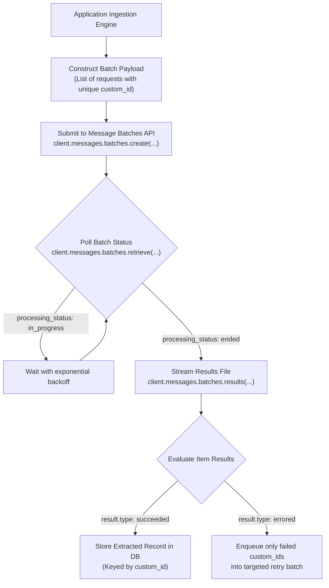

# Task Statement 4.5: Design Efficient Batch Processing Strategies (Message Batches API)

## 📌 Executive Overview: Goal, Scope & Exam Importance

### Certification Domain & Weight
- **Domain**: Domain 4: Prompt Engineering & Structured Output
- **Domain Weight**: 18% of total CCAR-F exam score
- **Scenario Alignment**: Scenario 5 (Continuous Integration) & Scenario 6 (Structured Data Extraction)

### The Core Goal
To design cost-optimized asynchronous data processing pipelines using the Anthropic **Message Batches API**, evaluate the architectural trade-off between the **50% token cost discount** and the **24-hour turnaround SLA**, correlate requests via **`custom_id`**, and handle partial batch failures without reprocessing successful items.

### Why This Matters in Production
Enterprise AI workloads fall into two distinct operational profiles:
1. **Interactive / Blocking Workloads**: A user waiting at a customer support chat, or an engineer waiting for a pre-merge PR review check. These require sub-minute response times and must use the standard, synchronous Messages API.
2. **Asynchronous / Non-Blocking Workloads**: Nightly repository security scans, indexing 100,000 historical PDF contracts, or backfilling embeddings.
If an architect executes a 100,000-document backfill using the synchronous Messages API:
- The organization pays 100% full list price for tokens, wasting \$10,000s in unnecessary spend.
- Synchronous calls trigger aggressive HTTP 429 rate limits and thread starvation.
By adopting the Message Batches API, the organization achieves an immediate **50% cost reduction** on all input and output tokens, while offloading rate limit queueing to Anthropic's distributed infrastructure.

### Exam Importance
Task Statement 4.5 questions test architectural cost-optimization and SLA trade-offs. The exam will ask when to select the Message Batches API versus the synchronous API, how to track requests using `custom_id`, and how to recover when a small fraction of batch items fail.

---

## 📖 Deep Narrative: Why We Do What We Do

### 1. The Cost vs. Latency Trade-Off Matrix
The Message Batches API introduces a fundamental architectural contract:
- **The Benefit**: **50% discount** on all token pricing (both prompt inputs and completion outputs).
- **The Constraint**: Results are delivered asynchronously within a window of up to **24 hours** (though many finish much faster).
- **The Rule of Thumb**:
  - If a human or CI blocker is waiting $\rightarrow$ **Synchronous Messages API**.
  - If the job runs overnight, in background queues, or on non-blocking backfills $\rightarrow$ **Message Batches API**.

### 2. Request Correlation via `custom_id`
Because batch processing is asynchronous, thousands of requests run concurrently across distributed clusters. Results do not necessarily finish in the order they were submitted:
- Every request payload must declare a unique, application-controlled identifier:
  ```json
  {
    "custom_id": "inv_rec_2025_99812",
    "params": {
      "model": "claude-sonnet-4-5",
      "max_tokens": 1024,
      "messages": [{"role": "user", "content": "..."}]
    }
  }
  ```
- When the batch finishes and results are streamed, each result record includes its matching `custom_id`. This allows the host application to write extracted facts directly into the correct database row with zero index-shifting errors.

### 3. Partial Failure Recovery Protocol
In a batch of 10,000 documents, 9,995 may succeed while 5 fail due to transient carrier timeouts:
- **Anti-Pattern**: Re-submitting the entire 10,000-item batch (wastes tokens and creates duplicate records).
- **Production Standard**: Inspect individual item statuses in the results stream. Filter for `result.type == "errored"`, extract only those 5 `custom_id`s, and compile a small targeted retry batch.

---

## 🔑 Key Technical Terminology Explained

- **Message Batches API**: Anthropic's asynchronous batch processing endpoint (`/v1/messages/batches`) designed for high-volume, non-time-critical workloads with a 50% token cost reduction.
- **50% Token Discount**: The discounted pricing applied automatically to all input tokens, output tokens, and cache writes/reads executed through the Message Batches API.
- **`custom_id`**: A mandatory client-provided string attached to each batch item, used to correlate asynchronous results with external database records.
- **Batch Processing Status**: The lifecycle states of a batch: `in_progress` (processing), `canceling`, `ended` (completed).
- **Targeted Partial Resubmission**: The recovery practice of isolating only the specific `custom_id` items that experienced errors and submitting a minimal follow-up batch.

---

## 🏗️ Architecture: Asynchronous Message Batches Lifecycle



---

## ⚠️ Critical Exam Distinctions & Distractor Teardown

| Dimension | Message Batches API | Standard Messages API | Exam Trap to Reject |
|---|---|---|---|
| **Pricing** | **50% cost discount** on all tokens. | Standard list pricing. | **TRAP**: Using synchronous calls for massive non-urgent backfills, wasting 50% of budget. |
| **SLA / Turnaround** | Up to **24 hours** (asynchronous). | Real-time (seconds). | **TRAP**: Selecting Message Batches for interactive developer tooling or blocking PR checks. |
| **Request Correlation** | Correlate results using **`custom_id`**. | Immediate variable assignment. | **TRAP**: Assuming batch results return in the identical order they were submitted. |
| **Failure Recovery** | **Retry only failed `custom_id` items**. | Retry individual API call. | **TRAP**: Resubmitting the entire batch of 10,000 items when only 5 experienced errors. |

---

## 💡 Architectural Decision Matrix: API Selection

| Workload Scenario | Optimal API | SLA Requirement | Cost Benefit |
|---|---|---|---|
| **Blocking Pre-Merge PR Review** | Standard Messages API | < 3 minutes | Real-time feedback |
| **Overnight Full Repo Audit** | Message Batches API | 24 hours | 50% Token Discount |
| **Live Customer Chatbot** | Standard Messages API | < 2.5 seconds | Streaming real-time |
| **Backfilling 100k Legal Contracts** | Message Batches API | 24 hours | 50% Token Discount |

---

## 🧠 Claude 4.5 Extended Thinking & Parameter Standards

- **Extended Thinking in Batches**: Message Batches fully support Extended Thinking (`budget_tokens`). The 50% discount applies to thinking tokens as well!
- **Sampling Rules**: Omit `temperature` whenever thinking is enabled in batch payloads.
- **Batch Payload Uniformity**: Ensure all items in the batch omit `temperature` when thinking is enabled to prevent individual item rejections.

---

## 🛠️ Hands-on Workbook Guide: Following the Code Step-by-Step

When exploring [`ts_4_5_message_batches_api.ipynb`](ts_4_5_message_batches_api.ipynb):
1. **Step 1: Setup & Batch Simulator**: Initializes the offline Message Batches lifecycle simulator.
2. **Step 2: Constructing Batch Payloads**: Builds batch payloads with unique `custom_id` identifiers.
3. **Step 3: Simulating Batch Ingestion & Results**: Demonstrates polling batch status and streaming results.
4. **Step 4: Partial Failure Resubmission**: Demonstrates filtering failed items and resubmitting only affected `custom_id`s.
5. **Step 5: Verification Assertions**: Verifies that 100% of records correlate with database rows and zero duplicates occur.
