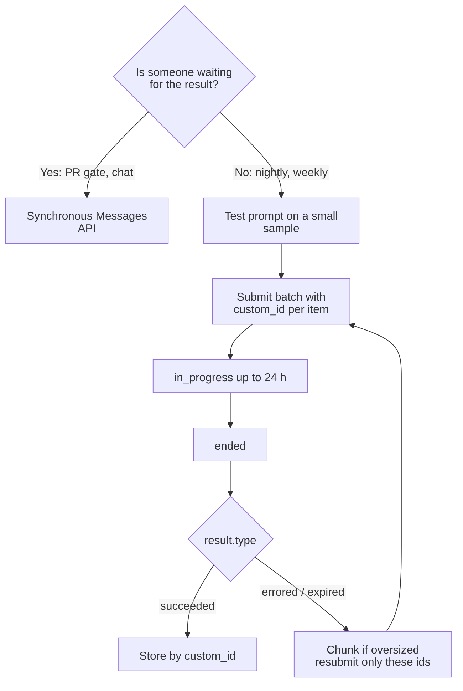

# Task Statement 4.5: Batch Processing with the Message Batches API

> Scenarios: Scenario 5 (CI) and Scenario 6 (Structured Data Extraction).

## In One Minute
- **What**: The Message Batches API runs many requests asynchronously.
- **Why**: **50% cheaper**, but results can take **up to 24 hours** and there is **no latency SLA**.
- **Use for**: overnight reports, weekly audits, nightly test generation. **Not for** blocking work such as a pre-merge check.
- **Handle failures**: match results by `custom_id`, resubmit only the failed ones (chunk oversized documents), and test your prompt on a small sample first.
- **Exam answer in one line**: *Batch the latency-tolerant job; keep anything a human or a merge is waiting on synchronous.*

---

## 🧒 Explain Like I'm 13

**The picture:** Post. **Express** (normal API) arrives now at full price. **Bulk freight** (Batches API) costs 50% less but may take up to 24 hours. Boxes can arrive in any order, so each one needs a **label** (`custom_id`).

**In plain steps:**
1. Is a person or a merge waiting? Use the normal call.
2. Can it wait overnight? Use a batch.
3. Match results using `custom_id`, never position.
4. If some failed, resubmit only those.
5. Check the SLA: waiting time before you submit counts too.

**Tiny example:** 30-hour SLA. Submit every 4 hours: worst case 4 + 24 = 28 hours. One big batch at the deadline can miss.

---

## 📖 Concepts Explained

### 1. Why it matters
- Half price on large, non-urgent jobs.
- Wrong fit for blocking work: a PR that waits up to a day for its review stalls the team.

### 2. How it works

**a. Shape of a batch**
```python
requests = [{"custom_id": "doc-001", "params": {"model": "claude-haiku-4-5", "max_tokens": 1024,
             "messages": [{"role": "user", "content": "..."}]}}, ...]
batch = client.messages.batches.create(requests=requests)   # real call: manual run only
# batch.processing_status: "in_progress" -> "ended"; batch.request_counts has per-type counts
```
Each result has the same `custom_id` and a `result.type` of `succeeded`, `errored`, `canceled` or `expired`. Results may come back in a different order, so always match on `custom_id`.

**b. No tools mid-batch.** A batch request is one shot. If Claude answers with `tool_use`, nothing runs the tool and sends the result back inside that request. Run the tool yourself and send a **new** request. Multi-turn tool calling does not fit a single batch request.

**c. SLA maths.** A document may arrive just after a submission. It waits up to one **submission interval**, then up to the **24-hour window**:

$$\text{worst case} = \text{interval} + 24\text{h} + \text{margin}$$

For a 30-hour SLA: the interval can be at most $30 - 24 = 6$ h. Leave a 2-hour margin for resubmitting failures and collecting results, and you submit **every 4 hours**. (`max_submit_interval_hours(30, 24, 2) == 4`.)

**d. Failures.** Resubmit only the `errored` or `expired` `custom_id`s. If a document was too large, split it into chunks, with new ids such as `doc-002-chunk1of3`, and map them back to `doc-002`.

**e. Refine on a sample.** Run 50 to 100 representative items first. Fix the prompt. Then submit the large batch. This avoids paying to redo 100,000 bad results.

---

## 🧪 Worked Example

**Q11-style decision.** A team wants lower cost on two workloads.
- A pre-merge check that blocks the PR until Claude's review passes.
- A weekly technical-debt report.

Decision: batch **only the technical-debt report**. The pre-merge check is blocking and needs an answer in minutes, so it stays on the synchronous API.

**Timeline for a 30-hour SLA (submit every 4 hours)**
```text
00:00  submit batch 1 (docs that arrived 20:00-00:00)
...    batch window: up to 24 h, often much sooner
04:00  submit batch 2 ...
Worst case for one document:  4 h wait + 24 h batch + 2 h margin = 30 h
```

**Partial failure**
```text
Submitted 3 requests:  doc-01 ok | doc-02 errored (150,000 tokens) | doc-03 ok
Resubmit only doc-02 as: doc-02-chunk1of3, doc-02-chunk2of3, doc-02-chunk3of3
```

[main.py](main.py) mirrors these shapes offline (`create_batch`, `complete`, `results`, `request_counts`, result types) without importing `anthropic`.

---

## 🔑 Key Terms

- **Message Batches API**: asynchronous endpoint, 50% cost saving, up to 24 h.
- **`custom_id`**: your id on each request, returned on each result. It must be 1 to 64 characters: letters, digits, `_` or `-`, and unique in the batch.
- **Limits**: a batch holds up to 100,000 requests or 256 MB, whichever comes first. Results stay downloadable for 29 days. Most batches end within an hour; at 24 hours unfinished requests `expire`.
- **Result types**: `succeeded`, `errored`, `canceled`, `expired`. An `errored` result of type `invalid_request_error` needs a fixed request; other errors and `expired` requests can be resubmitted. You are not billed for errored, canceled or expired requests.
- **No tool loop inside a batch**: each request is one call. If Claude returns `tool_use`, you run the tool yourself and send a follow-up request; a batch cannot execute tools mid-request.
- **`processing_status`**: `in_progress` or `ended` (also `canceling`).
- **`result.type`**: `succeeded`, `errored`, `canceled`, `expired`.
- **Submission interval**: time between batch submissions; sets the SLA.
- **Chunking**: splitting an oversized document into several requests.

---

## 🏗️ Architecture



---

## ⚠️ Exam Traps and Correct Patterns

### Trap 1: Batch versus synchronous

| Workload | Choice | Reason |
|---|---|---|
| Nightly audit of 50,000 documents | Batch | 50% cheaper. Nobody waits |
| Pre-merge PR check | Synchronous | Developers wait. A batch may take up to 24 hours and has no latency SLA |
| Interactive chat | Synchronous | Needs a reply now |

"Save 50%" is the bait. If a person or a merge is waiting, the answer is not batch.

### Trap 2: Assuming results come back in request order

```python
# ANTI-PATTERN
for doc, result in zip(docs, batch_results): ...   # order is not guaranteed

# PATTERN: match on custom_id
requests = [{"custom_id": f"doc-{d.id}", "params": {...}} for d in docs]
by_id = {r.custom_id: r for r in batch_results}
```

`custom_id` is 1 to 64 characters of letters, digits, `_`, `-`.

### Trap 3: Resubmitting the whole batch after partial failure

If 120 of 10,000 requests failed (for example some exceeded the context limit), read each result's type, collect the failed `custom_id`s, fix the cause (chunk the large documents), and resubmit **only those**. Rerunning all 10,000 pays twice and duplicates work.

### Trap 4: SLA arithmetic

**Exam scenario**: results are needed within 30 hours of the data arriving. Batch window is up to 24 hours.

```text
One big batch submitted at the deadline: wait up to 24h + wait for submission -> can exceed 30h.
Submit every 4 hours: worst case 4h waiting for the next submission + 24h = 28h <= 30h. OK.
```

Include the time before submission in the calculation. If the SLA is shorter than the window, do not batch.

### Trap 5: Expecting a tool loop inside a batch

A batch request is one message. It cannot pause, run your tool, and continue. If the model returns `tool_use`, run the tool yourself and submit a **new** request, or use a synchronous agent loop.

### Trap 6: Launching the full batch first

Test the prompt on a small sample synchronously. A prompt bug found after 50,000 batch requests costs the whole batch.

---

## 📝 Exam-Style Practice Questions

**Q1 (Scenario 5).** Your team wants to cut cost on two jobs: (1) a pre-merge review that blocks the PR, and (2) a weekly technical-debt report. What should you do?
- A) Batch both.
- B) Batch only the technical-debt report.
- C) Batch only the pre-merge review.
- D) Batch neither; batches are never cheaper.

**Q2 (Scenario 6).** Invoices must be processed within 30 hours of arrival, using batches with a 24-hour window. How often must you submit batches, at most?
- A) Every 24 hours.
- B) Every 12 hours.
- C) Every 6 hours at most (every 4 hours if you want a 2-hour safety margin).
- D) Only once, at the deadline.

**Q3 (Scenario 6).** In a 10,000-item batch, 40 items fail: 12 because the document was too long. What is the best recovery?
- A) Resubmit all 10,000 items.
- B) Resubmit only the 40 failed `custom_id`s, chunking the 12 long documents.
- C) Ignore the failures.
- D) Move all 10,000 to the synchronous API.

### Answers
**Q1: B.**
- A fails: the pre-merge check would wait up to 24 hours.
- C fails: it batches the blocking job and leaves the report at full price.
- D fails: batches do save 50% on latency-tolerant work.

**Q2: C.**
- A fails: a 24 h wait plus a 24 h window is 48 h.
- B fails: 12 + 24 = 36 h, over the SLA.
- D fails: one submission at the deadline cannot meet any SLA shorter than the window plus arrival wait.

**Q3: B.**
- A fails: pays again for 9,960 good results and risks duplicates.
- C fails: the data stays missing.
- D fails: it gives up the 50% saving and still does not fix the oversized documents.

---

## ✅ Self-Check Checklist
- [ ] I can state the saving (50%) and the window (up to 24 h, no latency SLA).
- [ ] I can explain why a pre-merge check must not be batched.
- [ ] I can compute a submission interval from an SLA.
- [ ] I know to resubmit only failed `custom_id`s and chunk oversized documents.
- [ ] I know a batch cannot run tools mid-request.

**Memory hook**: *Half price, day late: only if nobody is waiting.*

---

## 🛠️ Hands-on Workbook Guide

In [`ts_4_5_message_batches_api.ipynb`](ts_4_5_message_batches_api.ipynb):
1. **Step 1: Setup**: finds the repo root and adds it to the import path.
2. **Step 2: Simulator**: imports the API-shaped batch simulator and SLA helpers from `main.py`.
3. **Step 3: Simulation**: creates a batch, completes it, inspects `request_counts` and result types, and builds the retry batch.
4. **Step 4: Verification**: asserts the SLA numbers, the failed-only resubmission, and that tool calls are not executed mid-batch.

Everything runs offline; the simulator never imports `anthropic`.
