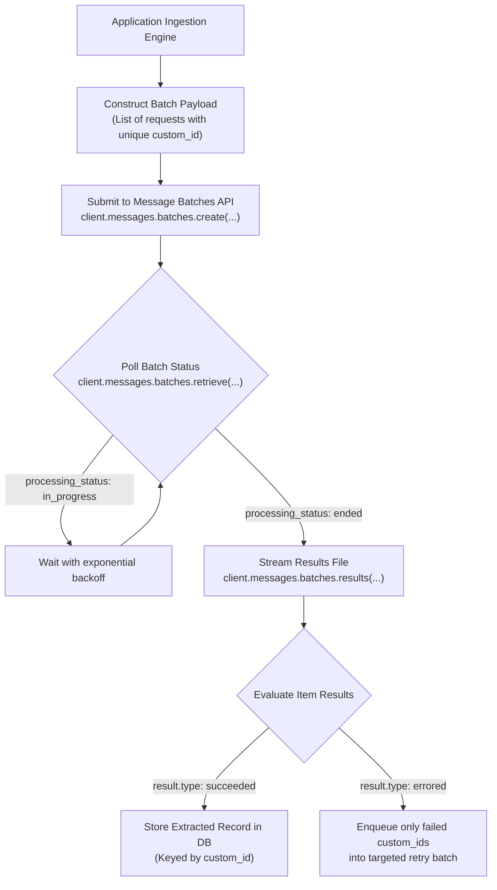

# Task Statement 4.5: Design Efficient Batch Processing Strategies (Message Batches API)

## 🎯 Exam Objective
Understand how to leverage the Anthropic **Message Batches API** for cost-optimized asynchronous processing, evaluate the **50% discount** versus 24-hour SLA trade-off, track requests via `custom_id`, and handle partial batch failures.

---

## 🏗️ Architecture: Asynchronous Message Batches Lifecycle

---

## ⚠️ Critical Exam Distinctions & Anti-Patterns

| Dimension | Message Batches API | Standard Messages API | Exam Trap to Reject |
|---|---|---|---|
| **Pricing** | **50% cost discount** on both input and output tokens. | Standard list pricing. | **TRAP**: Using synchronous API calls for massive non-urgent batch extractions, wasting 50% of token budget. |
| **SLA / Turnaround** | Up to **24 hours** (asynchronous processing). | Real-time (seconds). | **TRAP**: Choosing Message Batches for interactive developer tooling or pre-merge PR blocking checks that require sub-minute response times. |
| **Request Correlation** | Correlate results with source inputs using `custom_id`. | Immediate synchronous response variable. | **TRAP**: Generating temporary random indices that cannot be mapped back to source database records. |
| **Failure Recovery** | Check individual item status and **retry only failed `custom_id` items**. | Entire API call succeeds or fails. | **TRAP**: Resubmitting the entire batch of 10,000 requests when only 5 items experienced transient failures. |

---

## 💡 Architectural Decision Matrix

| Workload Type | Optimal Choice | Rationale |
|---|---|---|
| **Pre-Merge CI Security Audit** | Standard Messages API (Synchronous) | Developer is waiting for PR approval; turnaround must be under 3 minutes. |
| **Historical Archive Backfill (100k docs)** | Message Batches API | 50% cost reduction; 24-hour SLA is fully acceptable. |
| **Nightly Codebase Dependency Scan** | Message Batches API | Scheduled overnight run; cost efficiency prioritized over immediate latency. |
| **Interactive Customer Chatbot** | Standard Messages API (Streaming) | Real-time human interaction requires low time-to-first-token. |

---

## 🛠️ Production Code Reference
- Interactive Workbook: [`ts_4_5_message_batches_api.ipynb`](ts_4_5_message_batches_api.ipynb)
- Runnable Script: [`main.py`](main.py)
- Offline Verification: Run via `uv run pytest tests/test_domain4_full.py` in WSL.
