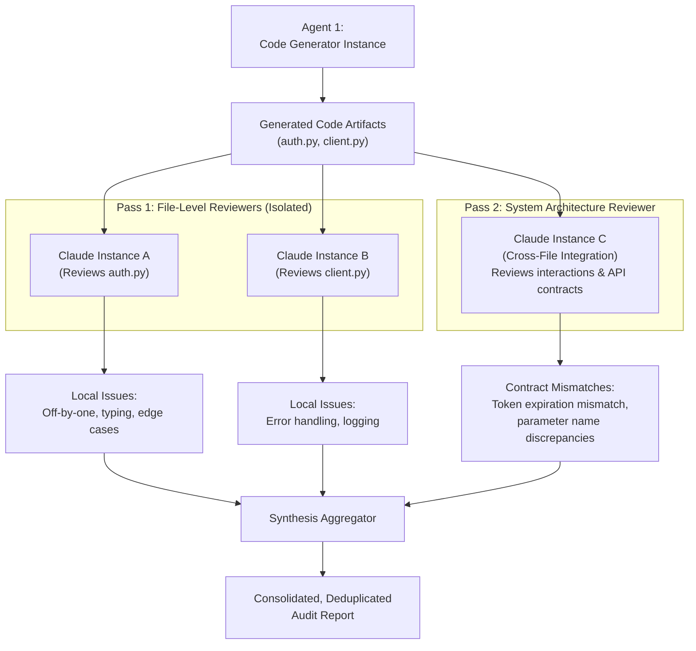

# Task Statement 4.6: Multi-Instance & Multi-Pass Review Architectures

## 🎯 Exam Objective
Understand how to eliminate author bias through independent Claude review instances and implement a two-pass review architecture (per-file local pass + cross-file integration pass).

---

## 🏗️ Architecture: Multi-Instance Two-Pass Review Pipeline

---

## ⚠️ Anti-Patterns vs Best Practices

| Anti-Pattern (Fails on Exam) | Recommended Architectural Practice |
|---|---|
| **Author Self-Review**: The same agent generates code and then in the same prompt is asked "Now check if there are bugs in your code". (Symptom: confirmation bias). | **Independent Fresh Instances**: Spawn fresh review instances with zero generation memory. |
| **Monolithic Single Pass**: Reviewing a 20-file PR in a single prompt. (Symptom: misses both local syntax bugs and cross-module interface drifts). | **Two-Pass Architecture**: Pass 1 reviews individual files for micro-correctness; Pass 2 reviews cross-file contracts. |
