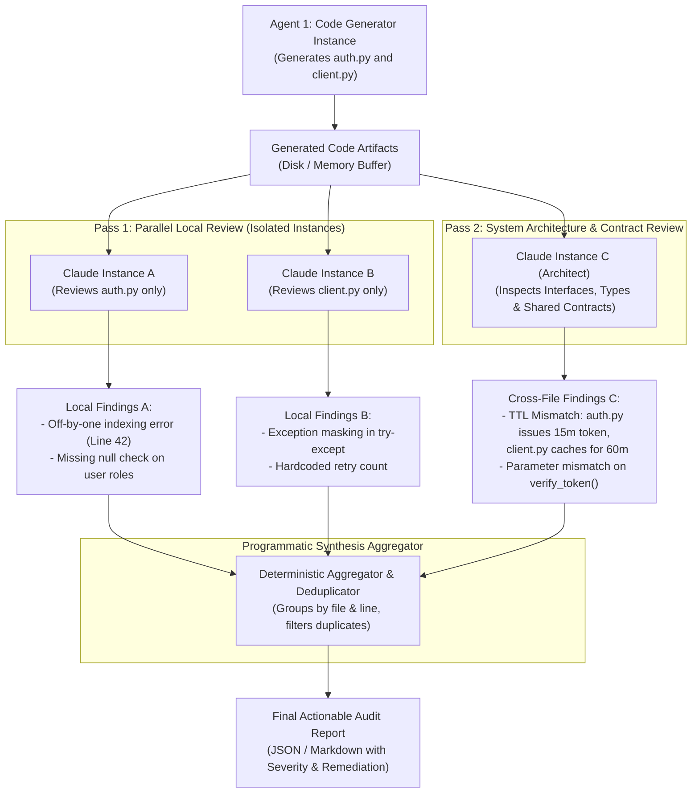

# Task Statement 4.6: Multi-Instance & Multi-Pass Review Architectures

## 📌 Executive Overview: Goal, Scope & Exam Importance

### Domain & Exam Weight
- **Domain**: Domain 4 — Prompt Engineering & Output Validation (20% of exam weighting)
- **Scenario Alignment**: Scenario 2 (Code Generation with Architectural Gates) & Scenario 6 (Automated Refactoring & Cross-Module Review)
- **Core Goal**: Architect high-fidelity review pipelines that eliminate author confirmation bias using isolated Claude instances and decompose complex code reviews into a deterministic two-pass review architecture (per-file micro-correctness + cross-file contract coherence).

### Why This Matters in Production
When an agent writes code and is immediately asked in the same context "Is there any bug in your code?", it suffers from severe **confirmation bias**—the model generates justifications for its previous output rather than independently verifying it. Furthermore, feeding a 20-file pull request into a single monolithic prompt overwhelms the attention mechanism: the model either catches shallow syntax bugs while missing cross-module API contract drift, or hallucinates high-level architectural praise while missing critical off-by-one errors and null pointer exceptions.

In enterprise software engineering pipelines, production reviews require **independent reviewer instances** with clean context and a **two-pass review workflow**:
1. **Pass 1 (Parallel Local Pass)**: Specialized, isolated Claude instances audit individual files for syntax correctness, typing, null-safety, and edge-case handling.
2. **Pass 2 (Cross-File Integration Pass)**: A dedicated architecture review instance inspects interface contracts, data models, import hierarchies, and token lifecycle assumptions across files.
3. **Synthesis Aggregation**: A programmatic aggregator consolidates, deduplicates, and triages findings into an actionable, non-hallucinated audit report.

---

## 📖 Deep Narrative: Why We Do What We Do

### The Naive Production Failure: Author Bias & Monolithic Attention Dilution
Consider an autonomous coding agent tasked with generating a multi-file authentication module (`auth.py` and `client.py`).
- In `auth.py`, the token generation function creates a JWT with a 15-minute expiration (`exp = now + 900`).
- In `client.py`, the API client caches the token for 60 minutes (`cache_ttl = 3600`), causing 45 minutes of unauthorized 401 request failures in production.
- In addition, `auth.py` has a local off-by-one error when indexing role permissions (`roles[user_role_idx + 1]`).

If the engineering team implements a naive review pattern:
```python
# NAIVE ANTI-PATTERN: Author Self-Review in Same Context
response = client.messages.create(
    model="claude-sonnet-4-5",
    messages=[
        {"role": "user", "content": "Write auth.py and client.py for our service."},
        {"role": "assistant", "content": "<generated code for both files>"},
        {"role": "user", "content": "Now review your own code. Are there any bugs or contract mismatches?"}
    ]
)
```
The model will almost invariably respond: *"The code looks solid, adhering to clean architecture standards with proper separation of concerns."* Because the generation tokens and reasoning traces already exist in its conversation context, the self-attention weights prioritize consistency with its prior self-generated solution.

If the team instead passes both files to a new prompt but asks for everything at once (local bugs, security, typing, and architecture):
```python
# NAIVE ANTI-PATTERN: Monolithic Single-Pass Review
response = client.messages.create(
    model="claude-sonnet-4-5",
    messages=[
        {"role": "user", "content": f"Review all 20 files in this PR for syntax, security, and architecture:\n{all_files_code}"}
    ]
)
```
The model suffers from **attention dilution**. It spots superficial style issues (e.g., "Add docstrings to client.py") but completely misses the subtle 15-minute vs 60-minute TTL mismatch between `auth.py` and `client.py`, as well as the off-by-one indexing bug.

### The Architectural Solution: Isolated Multi-Instance Two-Pass Review
To achieve 99%+ defect detection in production pipelines, we decouple generation from review and separate micro-concerns from macro-contracts:



1. **Context Isolation**: Each reviewer instance is spawned with a clean message history. Instance A has no idea why or how the generator wrote `auth.py`; it evaluates the code strictly against a rigorous linting/correctness checklist.
2. **Pass 1 (Local Micro-Correctness)**: Focuses exclusively on local semantics within each file boundary:
   - Boundary conditions, index offsets, typing consistency.
   - Resource cleanup (closing file handles, database connections).
   - Local exception handling and logging.
3. **Pass 2 (Cross-Module Contract Coherence)**: Focuses exclusively on module boundaries and systemic integration:
   - Function signatures, parameter types, and return types across caller and callee.
   - Shared constants, environment variable naming, and configuration lifecycles (e.g., token TTLs).
   - Deadlocks, race conditions, or asynchronous ordering assumptions.
4. **Programmatic Aggregation**: Outputs from all instances are emitted via structured tool calling (`report_review_finding`), allowing a deterministic Python layer to deduplicate findings and prioritize blocking defects over minor stylistic recommendations.

---

## 🔑 Key Technical Terminology Explained

- **Author Confirmation Bias**: The systemic tendency of an LLM to evaluate its own outputs favorably when queried within the same conversational context, rationalizing bugs instead of flagging them.
- **Reviewer Isolation**: Instantiating a brand-new Claude API session with zero prior generation context, ensuring strictly objective and adversarial evaluation.
- **Two-Pass Review Pattern**: An architectural decomposition pattern where Pass 1 audits micro-correctness within isolated file boundaries, and Pass 2 audits cross-file interface contracts and system coherence.
- **Attention Dilution**: Degradation of model attention and instruction adherence that occurs when an LLM is asked to simultaneously analyze multiple complex files and evaluate contradictory criteria in a single prompt.
- **Interface Contract Drift**: Discrepancies between what a producer module emits and what a consumer module expects (e.g., parameter names, payload shapes, cache invalidation timeouts).
- **Synthesis Aggregator**: A programmatic post-processing layer that collects structured findings from all review instances, removes redundant entries, groups by severity (`BLOCKER`, `WARNING`, `INFO`), and formats the final gate verdict.

---

## ⚠️ Critical Exam Distinctions & Distractor Teardown

| Review Architecture Technique | Correct Implementation (Exam Standard) | Exam Trap / Distractor to Reject |
|---|---|---|
| **Eliminating Author Bias** | **Fresh Claude Instances**: Spin up separate Claude calls with clean histories for review tasks. Pass generated code as external input. | **TRAP: Prompting the Author**: Asking the generator agent in Turn 2: *"Please reflect on your code and fix any bugs you made."* The model will defend its mistakes. |
| **Review Scope Decomposition** | **Two-Pass Pipeline**: Run per-file reviewers in parallel for local bugs (Pass 1), followed by a system reviewer for integration contracts (Pass 2). | **TRAP: Single Monolithic Prompt**: Stuffing 25 PR files into one prompt and asking for local syntax, security, performance, and architecture all at once. |
| **Finding Collection & Schema** | **Structured Tool Calling**: Force each review instance to emit findings via `report_review_finding(file, line, severity, description, remediation)`. | **TRAP: Free-Form Markdown Parsing**: Letting instances write markdown text and using regex to parse out bugs. Regex breaks on unstructured text. |
| **Cross-Module Verification** | Feed Pass 2 only interface definitions, public API signatures, and shared configurations to maximize focus on boundaries. | **TRAP: Re-reading full implementations**: Flooding Pass 2 with millions of tokens of internal implementation details that distract from interface boundaries. |

---

## 💡 Architectural Decision Matrix: Rules of Thumb

| Scenario / Codebase Size | Review Strategy | Instance Count | SLA / Latency Expectation |
|---|---|---|---|
| **Single Script (< 100 lines)** | Single Independent Review Instance | 1 fresh reviewer | $\le 5$ seconds |
| **Small Feature (2–5 files, related)** | Two-Pass Review (Pass 1 parallel per file + Pass 2 cross-file) | $N + 1$ instances (e.g., 3 to 6 instances) | $\approx 10$ seconds (Pass 1 in parallel) |
| **Large PR (> 15 files, complex refactor)** | Chunked Two-Pass Review with Programmatic Gate | Batching Pass 1 across files + 1 System Pass | $\approx 20\text{--}30$ seconds (or Message Batches API) |
| **Nightly CI/CD Security Audit** | Message Batches API with Two-Pass Review Pipeline | Hundreds of parallel batch requests (50% cost savings) | Async turnaround within 24 hours |

---

## 🧠 Claude 4.5 Extended Thinking & Parameter Standards

When configuring Claude 4.5 for high-recall code review:
- **Model Standard**: Use `claude-sonnet-4-5` for deep code analysis and contract auditing; use `claude-haiku-4-5` for high-speed Pass 1 syntax and style checks.
- **Thinking Configuration**: Enable Extended Thinking with a minimum budget of 4,000 to 8,000 tokens for Pass 2 contract analysis:
  ```python
  thinking = {"type": "enabled", "budget_tokens": 6000}
  ```
- **Temperature Omission**: **Do NOT provide `temperature`**, `top_p`, or `top_k`. The Anthropic API will return an HTTP `400 Bad Request` error if custom sampling parameters accompany `thinking`.
- **Structured Findings via Tool Use**: Bind a structured tool `submit_code_review` with required fields `file_path`, `line_start`, `line_end`, `category` (`SYNTAX`, `SECURITY`, `CONTRACT`, `LOGIC`), `severity` (`CRITICAL`, `WARNING`, `SUGGESTION`), and `suggested_patch`.

---

## 🛠️ Hands-on Workbook Guide: Following the Code Step-by-Step

In the accompanying notebook [`ts_4_6_multi_pass_review.ipynb`](ts_4_6_multi_pass_review.ipynb), you will explore the full offline-executable multi-pass review implementation:

- **Step 1: Code Generator Simulation**: Generate a realistic multi-file codebase (`auth_service.py` and `api_client.py`) containing both a local indexing defect and an interface contract mismatch.
- **Step 2: Naive Self-Review Failure**: Demonstrate how the generating agent suffers from confirmation bias and fails to detect its own bugs.
- **Step 3: Pass 1 — Parallel Local File Reviews**: Execute isolated reviewer instances on each file to extract local syntax and boundary findings.
- **Step 4: Pass 2 — Cross-Module Integration Review**: Run the architecture reviewer to pinpoint contract mismatches, token expiration discrepancies, and parameter drifts.
- **Step 5: Synthesis Aggregation & Triage**: Consolidate findings into a unified, deduplicated audit report and execute programmatic pass/fail gates.

Verify your implementation anytime with offline unit tests in WSL Ubuntu-26.04:
```powershell
wsl -d Ubuntu-26.04 bash -c "~/.local/bin/uv run pytest tests/test_domain4_full.py"
```
