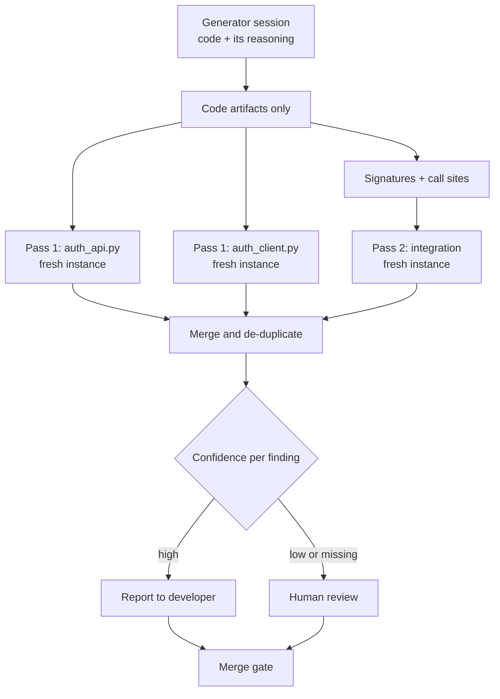

# Task Statement 4.6: Multi-Instance and Multi-Pass Review

## In One Minute
- **What**: Review code with a *separate* Claude instance, and split big reviews into passes.
- **Why**: The model that wrote the code keeps its own reasoning in context, so it tends to defend it. A fresh reviewer sees only the code.
- **How**: Pass 1 reviews each file alone. Pass 2 checks how files fit together (signatures and call sites). An optional verification pass reports a confidence per finding.
- **Better than**: asking the author to "review again", or turning on extended thinking in the same session.
- **Exam answer in one line**: *Independent second instance, per-file passes plus one integration pass.*

---

## 📌 Overview

- **Domain**: Domain 4: Prompt Engineering & Structured Output (**20%** of the exam; D1 27%, D2 18%, D3 20%, D5 15%).
- **Scenario**: Scenario 5 (Claude Code for Continuous Integration).
- **Goal**: Catch bugs the author misses, including cross-file ones, without overloading one prompt.
- **Exam focus**: Why self-review is weak and why one big prompt misses integration bugs.

---

## 📖 Concepts Explained

### 1. The simple idea
Do not mark your own homework. A reviewer who has not seen the author's reasoning is more likely to challenge it.

### 2. Why it matters
- **Self-review**: the author's reasoning ("I chose a 60-minute cache because it is fast") stays in context and tends to be repeated, not tested.
- **One big prompt for 20 files**: attention spreads thin. Style nits get caught; a signature mismatch between two files does not.
- **Extended thinking is not a fix**: more thinking in the same session still starts from the same reasoning. A separate instance is the stronger remedy.

### 3. How it works

**a. Independent instance.** A new conversation whose only input is the code and a checklist.
- `build_self_review_messages()`: three messages, including the author's reasoning.
- `build_independent_review_messages()`: one message, code and checklist only.
- `shares_generator_context()` shows the difference.

**b. Pass 1: per file.** One fresh review per file for local bugs: null checks, swallowed exceptions, off-by-one. Files can run in parallel and never see each other.

**c. Pass 2: integration.** One review for cross-file issues. Input: function signatures plus the lines where other files call them (`extract_interfaces()`, `extract_call_sites()`). This finds a client sending `auth_token` to a server expecting `bearer_token`, which Pass 1 cannot see.

**d. Verification pass.** Ask the model to report a `confidence` per finding. Use it to **route**:
- high confidence → report to the developer;
- low or missing confidence → human review.

Do **not** use it to silently drop findings. This matches TS 4.1: model confidence is not a good reason to delete findings; here it only decides who looks at them.

**e. Structured findings.** Each reviewer reports through a tool (`report_review_finding`) so Python can merge and de-duplicate. If you also turn on extended thinking for the integration pass, `tool_choice` must be `auto` (forced `any` or a named tool is rejected with thinking), so you cannot force the findings tool in that call.

---

## 🧪 Worked Example

**Setup.** `auth_api.py` defines `verify_session(bearer_token)`. `auth_client.py` calls `verify_session(auth_token='jwt')`. `auth_api.py` also has `except Exception: pass`.

**Self-review (same session)**
```text
Context seen: task + author's reasoning + code
Typical reply: "The code follows the design I described. Looks fine."
```

**Independent reviewer**
```text
Context seen: code + checklist only
Pass 1 (auth_api.py):    HIGH  silent exception swallowing
Pass 1 (auth_client.py): nothing local
Pass 2 (interfaces + call sites):
                         CRITICAL  client sends auth_token, server expects bearer_token
```

**Verification routing**
```text
HIGH     auth_api.py:3      confidence 0.90 -> report
CRITICAL auth_client.py:2   confidence 0.50 -> human review (still shown, not dropped)
```

In [main.py](main.py) the mock client scripts the model replies, so the tests prove which context each reviewer **receives** (and that stop reasons are handled), not how good a real model's review is.

---

## 🔑 Key Terms

- **Self-review bias**: the author defends its own work because its reasoning is in context.
- **Independent instance**: a new conversation with no generator history.
- **Pass 1 / Pass 2**: per-file local review / cross-file integration review.
- **Attention dilution**: quality drops when too many files share one prompt.
- **Verification pass**: model reports confidence per finding to route review.
- **Interface contract drift**: caller and callee disagree on names, types or timing.

---

## 🏗️ Architecture



---

## ⚠️ Exam Traps and Correct Patterns

| Goal | Correct pattern | Trap | Why the trap fails |
|---|---|---|---|
| Find author's blind spots | Independent instance | "Review your own code" | Reasoning stays in context |
| Same, with more effort | Independent instance | Self-review with extended thinking | Same starting reasoning |
| Large PR | Per-file passes + integration pass | One prompt with all files | Attention dilution |
| Cross-file bugs | Pass 2 with signatures and call sites | Only per-file review | Local passes cannot see the mismatch |
| Use confidence | Route to human review | Drop low-confidence findings | Calibration is poor; real bugs vanish |
| Parse findings | Findings through a tool schema | Regex over free text | Fragile |

### Common Mistakes
- Letting the generator review its own output.
- Sending all files to one reviewer.
- Giving Pass 2 only one file.
- Filtering by confidence instead of routing.
- Forcing the findings tool while thinking is enabled.

---

## 💡 Quick Decision Rules

| Situation | Choose |
|---|---|
| Single small script | One independent reviewer |
| 2-5 related files | Per-file passes + one integration pass |
| Large PR | Chunked per-file passes + integration pass |
| Nightly audit | Batch the passes (TS 4.5) |
| Low-confidence findings | Human review, not deletion |

---

## 🧠 Claude 4.5 Notes

- `claude-haiku-4-5` for the per-file passes; `claude-sonnet-4-5` for the integration pass.
- Thinking: omit `temperature`; leave `top_k`/`top_p` unset; `budget_tokens` at least 1024 and below `max_tokens`.
- With thinking, only `tool_choice` `auto`/`none`. Without thinking you can force the findings tool with `any`.
- In tool loops echo assistant content, including thinking blocks and signatures, unchanged.
- The loop in `main.py` handles `tool_use`, `end_turn`, `max_tokens`, `pause_turn`, and `refusal` explicitly.

---

## 📝 Exam-Style Practice Questions

**Q1 (Scenario 5).** Claude generates a feature. In the same session you ask it to "review your code for bugs", and it finds nothing. A human then finds two defects. What is the best architectural change?
- A) Ask the same session to review again, more carefully.
- B) Run the review in a new instance that receives only the code and a checklist.
- C) Enable extended thinking in the same session.
- D) Increase `max_tokens`.

**Q2 (Scenario 5).** A 20-file PR reviewed in one prompt gets style comments but misses a signature mismatch between two modules. What is the best design?
- A) Per-file passes for local bugs plus one integration pass using signatures and call sites.
- B) One prompt with a longer checklist.
- C) Only per-file passes.
- D) Review only the largest file.

**Q3 (Scenario 5).** Your reviewer reports a `confidence` per finding. How should you use it?
- A) Delete every finding below 0.8.
- B) Route low-confidence findings to human review and report the rest; do not drop any silently.
- C) Ignore the field.
- D) Use it to set `temperature`.

### Answers
**Q1: B.**
- A fails: same context, same defence of its own reasoning.
- C fails: thinking in the same session starts from the same reasoning.
- D fails: output length is not the problem.

**Q2: A.**
- B fails: a longer checklist still dilutes attention.
- C fails: local passes cannot see cross-file contracts.
- D fails: the bug may be in any file; skipping files loses coverage.

**Q3: B.**
- A fails: confidence is poorly calibrated, so real bugs are lost.
- C fails: it wastes a useful routing signal.
- D fails: temperature is unrelated, and it is rejected with thinking.

---

## ✅ Self-Check Checklist
- [ ] I can explain why self-review is weak.
- [ ] I know why extended thinking is not a substitute for an independent instance.
- [ ] I can describe what Pass 1 and Pass 2 each see.
- [ ] I know what to do with per-finding confidence.
- [ ] I know the thinking vs forced-tool restriction.

**Memory hook**: *New eyes, small scope, then the big picture.*

---

## 🛠️ Hands-on Workbook Guide

In [`ts_4_6_multi_pass_review.ipynb`](ts_4_6_multi_pass_review.ipynb):
1. **Step 1: Setup**: finds the repo root and adds it to the import path.
2. **Step 2: Pipeline**: imports the rule-based pipeline, the self-review/independent message builders, and the mock-client pipeline from `main.py`.
3. **Step 3: Simulation**: compares what each setup sees, runs both passes, and routes by confidence using the offline mock client.
4. **Step 4: Verification**: asserts the context difference, one finding per pass, and that low confidence is routed, not dropped.

Everything runs offline; the mock client scripts replies, so this demonstrates architecture, not model quality.
