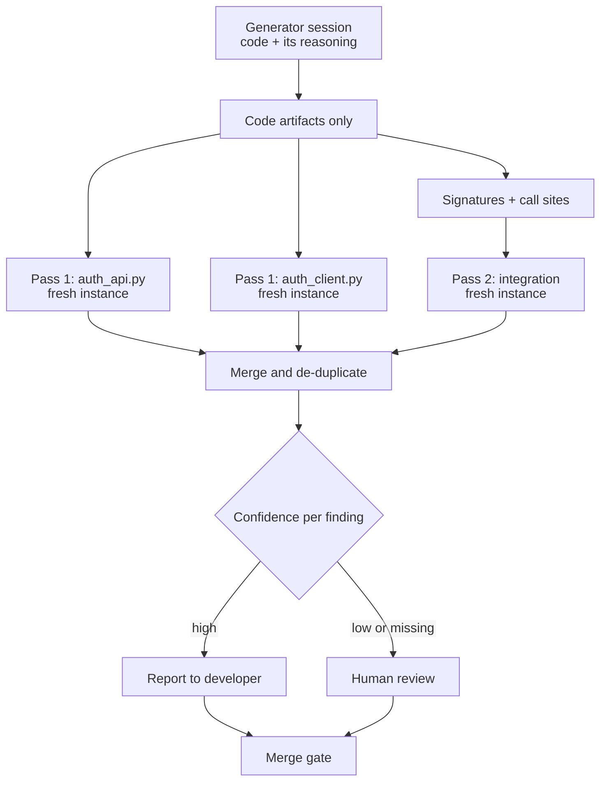

# Task Statement 4.6: Multi-Instance and Multi-Pass Review

> Scenario: Scenario 5 (Claude Code for Continuous Integration).

## In One Minute
- **What**: Review code with a *separate* Claude instance, and split big reviews into passes.
- **Why**: The model that wrote the code keeps its own reasoning in context, so it tends to defend it. A fresh reviewer sees only the code.
- **How**: Pass 1 reviews each file alone. Pass 2 checks how files fit together (signatures and call sites). An optional verification pass reports a confidence per finding.
- **Better than**: asking the author to "review again", or turning on extended thinking in the same session.
- **Exam answer in one line**: *Independent second instance, per-file passes plus one integration pass.*

---

## 🧒 Explain Like I'm 13

**The picture:** Proofreading. You miss your own typos because your brain fills in what you meant. A friend sees them. For a big report, check each chapter alone, then do a final read for places where chapters disagree. Not sure about a finding? Show it to a teacher, do not throw it away.

**In plain steps:**
1. A different Claude instance reviews (it never saw the author's reasoning).
2. Pass 1: each file alone.
3. Pass 2: signatures and call sites across files.
4. Low-confidence findings go to a human.
5. Return findings through a schema so they are easy to parse.

**Tiny example:** `format_total` now takes cents but `report.py` passes dollars. Only the cross-file pass can see that.

---

## 📖 Concepts Explained

### 1. Why it matters
- **Self-review**: the author's reasoning ("I chose a 60-minute cache because it is fast") stays in context and tends to be repeated, not tested.
- **One big prompt for 20 files**: attention spreads thin. Style nits get caught; a signature mismatch between two files does not.
- **Extended thinking is not a fix**: more thinking in the same session still starts from the same reasoning. A separate instance is the stronger remedy.

### 2. How it works

**a. Independent instance.** A new conversation whose only input is the code and a checklist.
- `build_self_review_messages()`: three messages, including the author's reasoning.
- `build_independent_review_messages()`: one message, code and checklist only.
- `shares_generator_context()` shows the difference.

**b. Pass 1: per file.** One fresh review per file for local bugs: null checks, swallowed exceptions, off-by-one. Files can run in parallel and never see each other.

**c. Pass 2: integration.** One review for cross-file issues. Input: function signatures plus the lines where other files call them (`extract_interfaces()`, `extract_call_sites()`). This finds a client sending `auth_token` to a server expecting `bearer_token`, which Pass 1 cannot see.

**d. Verification pass.** Ask the model to report a `confidence` per finding. Use it to **route**:
- high confidence → report to the developer;
- low or missing confidence → human review.

Do **not** use it to silently drop findings. This matches TS 4.1: model confidence is not a good reason to delete findings; here it only decides who looks at them.

**e. Structured findings.** Each reviewer reports through a tool (`report_review_finding`) so Python can merge and de-duplicate. If you also turn on extended thinking for the integration pass, `tool_choice` must be `auto` (forced `any` or a named tool is rejected with thinking), so you cannot force the findings tool in that call.

---

## 🧪 Worked Example

### ❌ Invalid Example (Anti-Pattern / What Breaks)
*(Anti-Pattern: Author Self-Review & Single Mega-Prompt)*
```python
# BROKEN: Asking the same generator session to review its own generated code
generator_messages = [
    {"role": "user", "content": "Write auth_api.py and auth_client.py with JWT auth."},
    {"role": "assistant", "content": "Here is the code... I used a silent try/except block for resilience..."},
    {"role": "user", "content": "Now review your own code for bugs and security issues."}
]
response = client.messages.create(messages=generator_messages, ...)
# What Claude replies:
# "The implementation strictly follows the architecture I outlined. Everything looks solid!"

Why it fails in production:
1. Author confirmation bias: The model's own prior reasoning tokens are in context; it rationalizes its previous decisions and overlooks its own bugs (e.g. 'except Exception: pass').
2. Attention dilution: Dumping 20 modified files into a single prompt causes cross-file contract bugs (caller using 'auth_token' while callee expects 'bearer_token') to be completely missed.
```

### ✅ Valid Example (Production Pattern)
*(Production Pattern: Clean-Context Independent Two-Pass Review)*
```python
# CORRECT: Independent Claude instance + Two-Pass architecture

# Pass 1: Per-File Local Bug Inspection (Independent instance, zero author history)
pass1_prompt = f"""
Review this single file for local bugs: unhandled nulls, swallowed exceptions, off-by-one errors.
Code:
{auth_api_code}
"""
pass1_findings = run_independent_review(pass1_prompt)
# Output: HIGH | auth_api.py:14 | Swallowed exception ('except Exception: pass') hides auth failures!

# Pass 2: Cross-File Integration Review (Interface contracts & call sites)
pass2_prompt = f"""
Review cross-file call site compatibility:
Signatures:
  auth_api.py -> def verify_session(bearer_token: str)
Call sites:
  auth_client.py:22 -> verify_session(auth_token=user_jwt)
"""
pass2_findings = run_independent_review(pass2_prompt)
# Output: CRITICAL | Argument name mismatch: client passes 'auth_token', server expects 'bearer_token'!

# Verification & Routing:
# High-confidence findings -> Automated report to engineer
# Low-confidence findings -> Routed to human reviewer for triage (never silently dropped)
```

---

## 🔑 Key Terms

- **Self-Review Bias**: An architectural failure mode where an agent evaluating its own freshly written code rationalizes prior decisions because its author reasoning remains in context, causing it to overlook obvious bugs.
- **Independent Instance**: A brand new Claude conversation initialized with zero generator history, receiving only clean source code and an objective review checklist to ensure impartial evaluation.
- **Pass 1 (Per-File Local Review)**: A parallelized review stage where isolated Claude instances inspect individual files for localized bugs such as unhandled nulls, syntax slips, and swallowed exceptions.
- **Pass 2 (Cross-File Integration Review)**: A second-stage review where a fresh Claude instance inspects interface signatures and call sites across files to catch breaking contract mismatches that single-file reviews miss.
- **Attention Dilution**: The degradation of reasoning and recall accuracy that occurs when too many files or overly long instructions are stuffed into a single prompt context.
- **Verification Routing**: Using model-reported confidence scores to route ambiguous or low-confidence findings to human triage, rather than using confidence to silently suppress issues.
- **Interface Contract Drift**: A defect where caller code and callee services disagree on parameter names, types, or calling conventions because components evolved out of sync.

---

## 🏗️ Architecture



---

## ⚠️ Exam Traps and Correct Patterns

### Trap 1: Asking the author to review its own output

**Exam scenario**: The model writes a function, then "review your code" in the same conversation finds nothing. A fresh instance finds an off-by-one.

The generating session keeps its own reasoning in context and tends to agree with it. Adding extended thinking to the same session does not change that starting point. Use an **independent instance** that sees only the code (and requirements), not the author's reasoning.

### Trap 2: One reviewer for a large PR, or only per-file review

```text
PASS 1 (per file): each file reviewed alone -> local bugs.
PASS 2 (integration): all changed signatures + call sites + data contracts -> cross-file bugs.
```

Example bug visible only in pass 2: `format_total(cents)` now takes cents, but `report.py` still passes dollars. Each file looks fine alone.

When pass 2 sees only one file, it is not an integration pass. Give it signatures and call sites from several files.

### Trap 3: Filtering by confidence

```text
ANTI-PATTERN: drop every finding with confidence < 0.7.
  Calibration is poor, so real bugs with a low number vanish silently.
PATTERN: route low-confidence findings to human review; keep them visible.
```

### Trap 4: Regex over free-text findings

Return findings through a tool schema (`file`, `line`, `severity`, `category`, `evidence`). Regex over prose breaks when wording changes. If the findings tool is forced with `tool_choice`, do not enable extended thinking on that call.

### Trap 5: Doing everything synchronously for audits

A nightly audit with many passes is a good batch candidate (TS 4.5). A blocking pre-merge review is not.

---

## 📝 Exam-Style Practice Questions

**Q1 (Scenario 5).** Claude generates a feature. In the same session you ask it to "review your code for bugs", and it finds nothing. A human then finds two defects. What is the best architectural change?
- A) Ask the same session to review again, more carefully.
- B) Run the review in a new instance that receives only the code and a checklist.
- C) Enable extended thinking in the same session.
- D) Increase `max_tokens`.

**Q2 (Scenario 5).** A 20-file PR reviewed in one prompt gets style comments but misses a signature mismatch between two modules. What is the best design?
- A) Per-file passes for local bugs plus one integration pass using signatures and call sites.
- B) One prompt with a longer checklist.
- C) Only per-file passes.
- D) Review only the largest file.

**Q3 (Scenario 5).** Your reviewer reports a `confidence` per finding. How should you use it?
- A) Delete every finding below 0.8.
- B) Route low-confidence findings to human review and report the rest; do not drop any silently.
- C) Ignore the field.
- D) Use it to set `temperature`.

### Answers
**Q1: B.**
- A fails: same context, same defence of its own reasoning.
- C fails: thinking in the same session starts from the same reasoning.
- D fails: output length is not the problem.

**Q2: A.**
- B fails: a longer checklist still dilutes attention.
- C fails: local passes cannot see cross-file contracts.
- D fails: the bug may be in any file; skipping files loses coverage.

**Q3: B.**
- A fails: confidence is poorly calibrated, so real bugs are lost.
- C fails: it wastes a useful routing signal.
- D fails: temperature is unrelated, and it is rejected with thinking.

---

## ✅ Self-Check Checklist
- [ ] I can explain why self-review is weak.
- [ ] I know why extended thinking is not a substitute for an independent instance.
- [ ] I can describe what Pass 1 and Pass 2 each see.
- [ ] I know what to do with per-finding confidence.
- [ ] I know the thinking vs forced-tool restriction.

**Memory hook**: *New eyes, small scope, then the big picture.*

---

## 🛠️ Hands-on Workbook Guide

In [`ts_4_6_multi_pass_review.ipynb`](ts_4_6_multi_pass_review.ipynb):
1. **Step 1: Setup**: finds the repo root and adds it to the import path.
2. **Step 2: Pipeline**: imports the rule-based pipeline, the self-review/independent message builders, and the mock-client pipeline from `main.py`.
3. **Step 3: Simulation**: compares what each setup sees, runs both passes, and routes by confidence using the offline mock client.
4. **Step 4: Verification**: asserts the context difference, one finding per pass, and that low confidence is routed, not dropped.

Everything runs offline; the mock client scripts replies, so this demonstrates architecture, not model quality.

---

## 🧭 Navigation & Study Links
- ⬅️ **Previous Topic**: [TS 4.5: High-Throughput Batch Processing via Message Batches API](../ts_4_5_message_batches_api/README.md)
- 📋 **Domain Overview**: [Domain 4: Prompt Engineering & Structured Output](../README.md)
- ➡️ **Next Domain**: [Domain 5: Context Management & Reliability](../../domain5/README.md)
- 🎯 **Scenario Practice**: [Master Scenario Practice](../../scenarios/MASTER_SCENARIO_PRACTICE.md)
