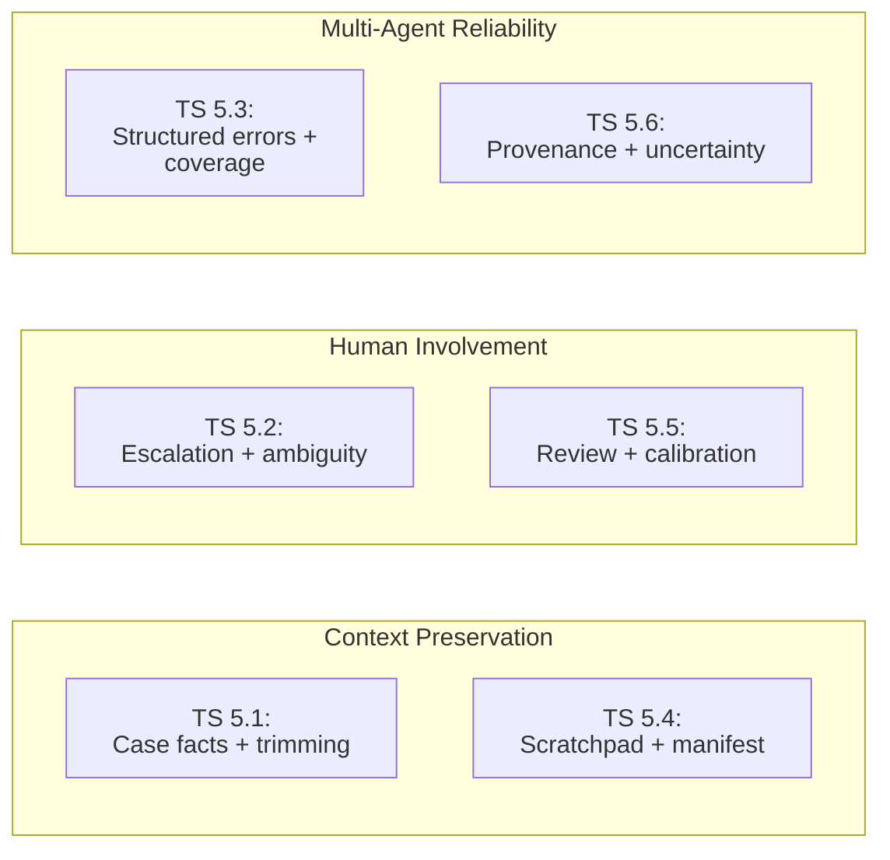
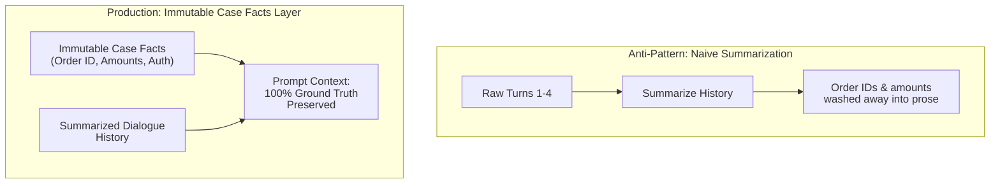
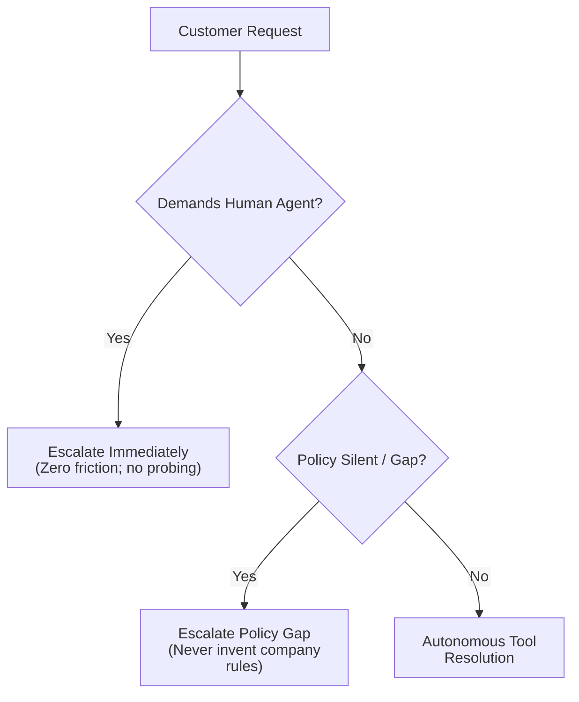
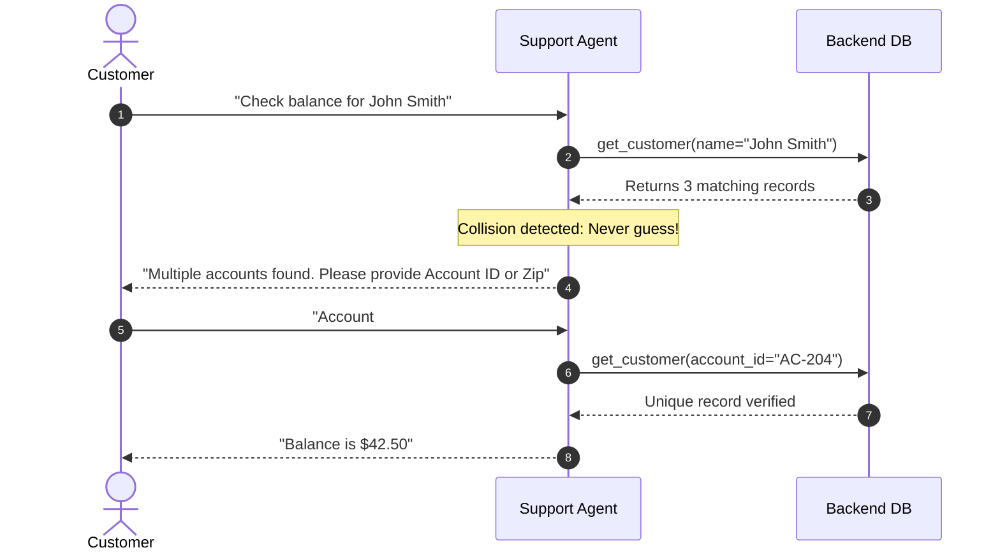
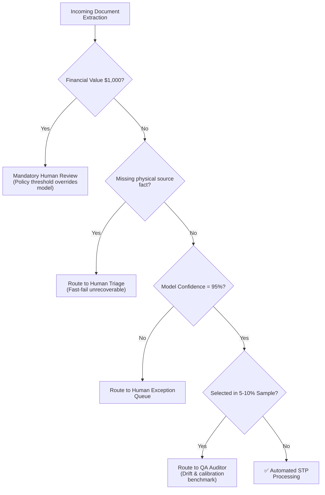
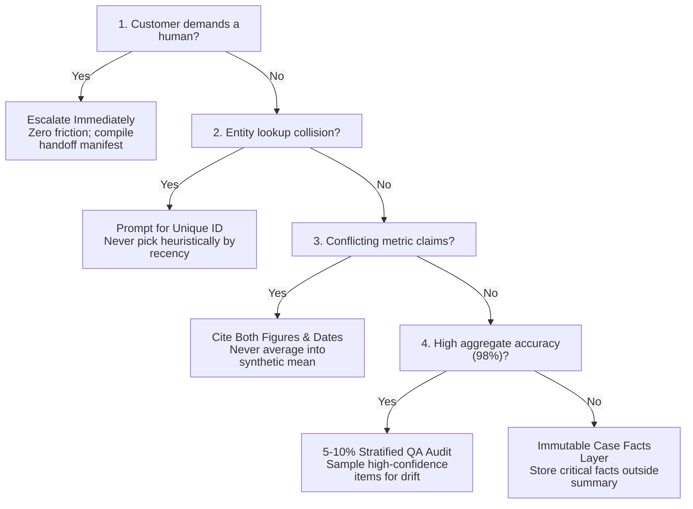

# Domain 5: Context Management & Reliability (15% of Exam)
**Master Blueprint & Deep Architectural Guide** | **Certification Weight**: 15%

---

> Quick version: [README.md](README.md). Per-task guides with worked examples and practice MCQs: [5.1](ts_5_1_context_preservation/README.md) | [5.2](ts_5_2_escalation_and_provenance/README.md) | [5.3](ts_5_3_error_propagation_coverage/README.md) | [5.4](ts_5_4_scratchpads_and_human_review/README.md) | [5.5](ts_5_5_human_review_calibration/README.md) | [5.6](ts_5_6_provenance_and_uncertainty/README.md).

---

## Study Order and Folder Map

Exam weights: D1 27%, D2 18%, D3 20%, D4 20%, **D5 15%**. Folder names are unchanged because tests import them. Each guide follows the **official task statement**.

| Study order | Task statement | Folder | Note |
|:---:|---|---|---|
| 1 | TS 5.1 Context across long interactions | `ts_5_1_context_preservation` | Matches |
| 2 | TS 5.2 Escalation and ambiguity | `ts_5_2_escalation_and_provenance` | Provenance content lives in 5.6 |
| 3 | TS 5.3 Error propagation | `ts_5_3_error_propagation_coverage` | Matches |
| 4 | TS 5.4 Large-codebase context | `ts_5_4_scratchpads_and_human_review` | Human review lives in 5.5 |
| 5 | TS 5.5 Human review and calibration | `ts_5_5_human_review_calibration` | Matches |
| 6 | TS 5.6 Provenance and uncertainty | `ts_5_6_provenance_and_uncertainty` | Matches |

## One Line Per Task Statement

| TS | What it tests | Key trap |
|---|---|---|
| 5.1 | Case facts, trimming tool output, key findings first, structured subagent output | Trusting summaries for exact numbers |
| 5.2 | Escalate on human request / policy gap / stuck; ask on multiple matches | Sentiment or confidence-score escalation |
| 5.3 | Structured error context, failure vs valid empty, local recovery, coverage notes | Empty-as-success; aborting the workflow |
| 5.4 | Scratchpad, subagents, phase summaries, manifest recovery, `/compact` | "Remind the model" instead of external memory |
| 5.5 | Per-segment accuracy, stratified sampling, calibrated field confidence | Approving automation on aggregate accuracy |
| 5.6 | Claim-source mappings, conflict annotation, dates, content-type rendering | Averaging conflicting numbers |

## Architecture Map



---

## 🏗️ Detailed Topic & Subtopic Explanations

### TS 5.1: Manage Conversation Context to Preserve Critical Information Across Long Interactions

#### 1. The Progressive Summarization Trap
In long-running autonomous workflows (e.g. customer support sessions or complex migrations spanning 30+ turns), naive systems repeatedly summarize past turns to fit within context limits:
- **Turn 1–4**: Raw conversation contains: *"Customer ID: CUST-9921, Order: ORD-8812, Amount: $149.99, Shipped: 2026-10-04 via FedEx Tracking 1Z999."*
- **Turn 10 (Summarized)**: *"Customer discussed an order issue and tracking."*
- **Turn 20 (Re-summarized)**: *"User asked about shipping."*
- **Result**: Specific transactional identifiers, dollar amounts, tracking numbers, and verified constraints are washed away into vague natural language prose. When the agent later attempts to process a return, it hallucinations an order ID or fails because the ground truth was erased.



#### 2. The Persistent "Case Facts" Architecture
The production-standard architecture separates **transactional state** from **conversational narrative**:
- **Case Facts Block**: An immutable, structured key-value state block maintained by the orchestration runtime.
  ```markdown
  ### PERSISTENT CASE FACTS (IMMUTABLE GROUND TRUTH)
  - Customer ID: CUST-88319 (Verified via 2FA)
  - Order ID: ORD-2026-44192
  - Order Date: 2026-10-01
  - Transaction Amount: $249.50
  - Item SKU: SKU-HEADPHONE-ANC-01
  - Delivery Status: Delivered (2026-10-04)
  ```
- **Context Injection**: This Case Facts block is prepended to the system prompt or inserted at the top of every turn.
- Even if earlier conversation turns are aggressively pruned or summarized, the model retains 100% precision regarding operational parameters.

#### 3. Tool Payload Trimming Strategy
Enterprise databases and carrier APIs return verbose payloads containing 40+ internal debugging, telemetry, and warehouse routing fields.
- **Anti-Pattern**: Appending the raw 3,500-token JSON response directly into the conversation history.
- **Production Standard**: Implement a trimming layer (or `PostToolUse` hook) that strips out all extraneous metadata, keeping only the 4–5 fields essential for the agent's decision:
  ```json
  // Before Trimming: 45 fields, 1,800 tokens
  // After Trimming: 4 fields, 45 tokens
  {
    "order_id": "ORD-2026-44192",
    "delivery_status": "DELIVERED",
    "delivery_date": "2026-10-04",
    "return_eligible": true
  }
  ```

#### 4. Mitigating the "Lost in the Middle" Phenomenon
Large language models exhibit a **U-shaped attention curve** over extensive context windows:
- Information placed at the **very beginning** (system prompt) and **very end** (most recent user message and tool result) is attended to with near 100% recall.
- Information buried in the **middle** of a 100,000-token conversational transcript suffers from retrieval degradation.
- **Architectural Remedy**: Position critical business policies, active constraints, and the persistent Case Facts block at the beginning (system prompt) or immediately before the final turn prompt, rather than allowing them to drift into the middle of the transcript.

---

#### 5. Complete History and Structured Subagent Output
- Send the **complete conversation history** on every request. The case facts block supplements it.
- Upstream subagents should return **structured data** (key facts, citations, relevance scores, dates), not verbose reasoning, so downstream context stays small.
- Put **key findings at the start** of aggregated input and use **section headers** for detail.
- Prompt caching is a cost and latency tool (static prefix first). It does not preserve facts, so it is not the answer to a lost-number question.

---

### TS 5.2: Design Effective Escalation and Ambiguity Resolution Patterns

#### 1. Immediate Escalation on Customer Demand
One of the most heavily tested human escalation scenarios:
- **Scenario**: A customer types: *"I am frustrated with this bot; let me speak to a real human person immediately."*
- **The Anti-Pattern**: The agent replies: *"I understand your frustration. Before I transfer you, could you please tell me your order number and explain what is wrong so I can help?"*
  - **Failure Mode**: Directly violates customer intent, escalates customer anger, and fails enterprise SLA compliance.
- **The Golden Rule**: **When a customer explicitly demands a human representative, escalate IMMEDIATELY without asking diagnostic or clarifying questions.** Compile a structured handoff manifest and transfer the session.



#### 2. Escalation on Policy Gaps
Autonomous agents must not invent corporate policy when documentation is silent:
- If a customer asks for a competitor price match, and the returns policy documentation has no clause covering price matching:
  - Do NOT hallucinate a refusal (*"Our company never matches prices"*).
  - Do NOT hallucinate an approval (*"I will match that price"*).
  - **Recognize the policy gap** and escalate to a human supervisor with a structured note: `"Policy gap: Price matching request not covered in active standard operating procedures."`

#### 3. Why Sentiment and Self-Reported Confidence are Unreliable
- **Sentiment Scores**: A customer speaking with polite, calm language (*"Hello, could you please check why my account has a $500 discrepancy?"*) may have a critical, high-risk security issue, while an aggressive customer (*"THIS APP IS STUPID"*) may just need a password reset link.
- **Model Confidence**: LLMs frequently express high self-reported confidence even when hallucinating.
- **Architectural Standard**: Trigger escalations based on **explicit deterministic rules** (customer demand, policy gaps, an explicit request for a human, inability to progress), not sentiment or confidence thresholds.

#### 4. Ambiguity Resolution: Clarification over Heuristic Guessing
When a tool query returns multiple candidate records:
- **Scenario**: User says: *"My name is David Miller, update my address."* Database query returns 3 customers named "David Miller" in different states.
- **The Anti-Pattern**: Picking the first record heuristically or selecting the one with the most recent transaction.
- **The Production Standard**: Immediately recognize the ambiguity and **prompt the user for a unique disambiguating identifier**:
  *"I found multiple accounts matching David Miller. To ensure I access the correct account, could you please provide your account number or billing zip code?"*



#### 5. Frustration vs an Explicit Request
- **Frustration alone**: acknowledge it and offer a resolution when the issue is within the agent's capability. Escalate only if the customer repeats that they want a human.
- **Explicit request for a human**: escalate immediately, with no investigation first.

#### 6. Fixing Poor First-Contact Resolution (Sample Question Pattern)
- **Situation**: 55% first-contact resolution. The agent escalates easy damaged-item replacements but tries to approve policy exceptions such as competitor price matching (policy covers only our own site).
- **Correct fix**: add **explicit escalation criteria with few-shot examples** to the prompt.
- **Rejected**: self-reported confidence scores, a sentiment classifier, a separate trained model. Confidence and sentiment are unreliable proxies for case complexity.

---

### TS 5.3: Implement Error Propagation Strategies Across Multi-Agent Systems

#### 1. Structured Error Propagation to Coordinator
When a subagent encounters a failure in a multi-agent system, returning a raw Python stack trace or a generic `"Error"` string cripples the coordinator's ability to plan recovery.
- Subagents must return structured error payloads:
  ```json
  {
    "status": "FAILED",
    "subagent_id": "sec-filing-extractor",
    "error_type": "ACCESS_TIMEOUT",
    "attempted_target": "https://sec.gov/edgar/data/104169/10-K",
    "partial_data_recovered": {
      "fiscal_year": 2026,
      "filing_date": "2026-09-30"
    },
    "alternative_options": [
      "Use cached secondary filing replica at s3://sec-backup/",
      "Proceed with synthesis noting missing cash-flow table"
    ]
  }
  ```

#### 2. Distinguishing Access Failures vs. Valid Empty Matches
A coordinator must handle two fundamentally different subagent return states:
1. **Access Failure (Infrastructure Issue)**: Subagent timed out or received HTTP 503.
   - *Coordinator Action*: Retry with backoff, attempt fallback mirror, or alert on system degradation.
2. **Valid Empty Match (Domain Fact)**: Subagent searched SEC filings for mentions of "pending cryptocurrency litigation" and found 0 occurrences.
   - *Coordinator Action*: Treat 0 results as ground-truth evidence that no litigation was disclosed. Never retry or treat as an error!

#### 3. Synthesis Coverage Annotations
When compiling a multi-source executive report where one data source was unavailable:
- **Anti-Pattern**: Omitting the section silently or pretending all data was analyzed.
- **Production Standard**: Explicitly annotate the synthesized report with **coverage boundaries**:
  ```markdown
  ### Executive Summary
  - Revenue and operating margins expanded across North America and EMEA (Source: 10-Q).
  
  > ⚠️ **Coverage Notice**: Asia-Pacific supply chain metrics are omitted from this report 
  > because the regional logistics API was unavailable (Status: 504 Timeout). 
  > Figures represent 78% total global volume.
  ```

#### 4. Local Recovery and Anti-Patterns
- Subagents **recover transient errors locally** (retry) and propagate **only unresolved** failures, with context and partial results.
- Anti-patterns: a generic "search unavailable" status; returning an empty result as success; aborting the whole workflow on one failure.
- Sample pattern: a subagent times out -> return structured error context (failure type, attempted query, partial results, alternatives) to the coordinator.

---

### TS 5.4: Manage Context Effectively in Large Codebase Exploration

#### 1. Context Drift & Hallucination in Deep Code Exploration
When exploring massive repositories (100,000+ lines across hundreds of files):
- As conversation turns accumulate, the context window fills with thousands of lines of grep outputs and file contents.
- **Context Drift**: The model begins forgetting specific variable names and class signatures found 20 turns ago, hallucinating "standard boilerplate" instead of adhering to the actual codebase conventions.

#### 2. The Persistent `scratchpad.md` Pattern
- Maintain an active `scratchpad.md` file in the workspace (or in local state).
- Claude records:
  - Validated architectural hypotheses.
  - Active file paths and key class names.
  - Unresolved questions and next steps.
- At the start of each new phase, Claude reads `scratchpad.md` to ground its attention.

#### 3. The Explore Subagent Pattern
Instead of reading 40 files directly into the main session:
- Spawn an **Explore subagent** tasked with: *"Inspect the authentication service folder, trace all implementations of `TokenVerifier`, and return an executive interface summary."*
- The subagent reads the files, maps the dependencies, and returns a 15-line summary.
- The main conversation context saves tens of thousands of tokens.

#### 4. The `/compact` Command in Claude Code
When working interactively in Claude Code:
- The `/compact` command compresses the conversation history into a structured summary while preserving active file references, tool state, and current goal focus.
- Enables indefinite continuation of long development sessions without context overflow.

#### 5. Phases and Crash Recovery
- **Summarise a phase** before spawning the next phase's subagents.
- Each agent **exports its state** to a known file; the coordinator keeps a **manifest** and loads it on resume, then runs only the missing work.

---

### TS 5.5: Design Human Review Workflows and Confidence Calibration

#### 1. The Flaw of Aggregate Accuracy
A standard trap in enterprise AI evaluation:
- An automated document extraction pipeline reports **98% overall aggregate accuracy**.
- Management believes the system is ready for full automation.
- **The Hidden Vulnerability**: The dataset consists of 95% standard domestic invoices (where accuracy is 99.8%) and 5% complex international customs forms. On the international customs forms, **the accuracy is only 58%**.
- **The Production Standard**: Measure accuracy **segmented by document type, vendor, and complexity tier**.

| Evaluation Metric | Measured Accuracy | Operational Verdict & Breakdown |
| :--- | :---: | :--- |
| **Aggregate Overall Accuracy** | **98.2%** | ❌ **MISLEADING (FAIL)**: Masks disastrous defect rates on rare document categories. |
| └─ *Domestic Standard Invoices* | 99.8% | ✅ High accuracy on standard majority segment. |
| └─ *Canadian GST Invoices* | 98.5% | ✅ Acceptable variance on standard tax forms. |
| └─ *Cross-Border Customs Forms* | **58.2%** | 🚨 **SEVERE DEFECT**: Critical failure rate on complex international customs declarations. |


#### 2. Stratified Random Sampling of High-Confidence Outputs
- Systems that only route "low confidence" items to human review suffer from **silent hallucinations**: the model fabricates a believable value with 99% self-assessed confidence, bypassing review.
- **The Production Standard**: In addition to reviewing low-confidence items, implement a **stratified random sample (5%–10%) of high-confidence extractions** for ongoing human audit. This detects distribution drift, schema mismatches, and overconfident hallucinations.

#### 3. Calibrated Routing Matrix

| Ingestion State / Condition | Model Confidence | Financial / SLA Impact | Operational Routing Action | Architectural Rationale |
| :--- | :---: | :---: | :--- | :--- |
| **High Confidence Standard Form** | $\ge 95\%$ | Standard ($\le \$1,000$) | **Automated Straight-Through Processing (STP)** | High throughput, low-latency automated commit to database. |
| **Stratified Random Sample** | $\ge 95\%$ | Standard ($\le \$1,000$) | **Route 5%–10% to Human QA Auditor** | Ongoing QA benchmark to detect silent hallucinations and concept drift. |
| **Low Confidence / Ambiguous** | $< 95\%$ | Any | **Route to Human Exception Queue** | Mitigates errors on corrupted, low-contrast, or atypical documents. |
| **High Financial Value Tier** | Any | High ($> \$1,000$) | **Mandatory Dual-Human Review Gate** | Enterprise risk policy: financial exposure overrides model self-confidence. |
| **Unrecoverable Missing Fact** | N/A | Any | **Immediate Fast-Fail to Human Triage** | Closed-loop retries cannot fabricate facts physically absent from source. |




#### 4. Field-Level Confidence and Calibration
- Ask for confidence **per field** and check it against a **labelled validation set** (reliability bins; expected calibration error, ECE).
- **Validate accuracy per segment** (document type x field) before reducing human review for that segment.
- Stratified sampling draws within each (document type, field) stratum. The sampling rate (for example 5-10%) is a design choice, not a fixed exam number.
- Route low-confidence, ambiguous or contradictory-source items to humans.

---

### TS 5.6: Preserve Information Provenance and Handle Uncertainty in Multi-Source Synthesis

#### 1. Information Provenance Data Contracts
Every factual assertion in a synthesized report must maintain traceable provenance:
```json
{
  "statement": "Serverless compute costs decreased by 24% following the migration.",
  "provenance": {
    "source_id": "AWS_BILLING_REPORT_Q3.csv",
    "verbatim_excerpt": "Total Lambda invoiced charges: $18,240 vs prior quarter $24,010",
    "collection_timestamp": "2026-10-15T08:00:00Z",
    "confidence": "HIGH"
  }
}
```

#### 2. Handling Conflicting Information from Credible Sources
A classic certification exam scenario:
- **Scenario**: Source A (Government Labor Bureau) reports unemployment at 4.2%. Source B (Central Bank Economic Bulletin) reports unemployment at 4.7%.
- **The Anti-Patterns**:
  - Picking one arbitrarily (*"Unemployment is 4.2%"*).
  - Averaging the numbers together (*"Unemployment is 4.45%"*).
  - Claiming one source is fraudulent without evidence.
- **The Production Standard**: Explicitly preserve the conflict, cite both sources, provide temporal context, and explain methodological differences:
  ```markdown
  ### Unemployment Metrics
  Conflicting estimates exist across authoritative sources:
  - **4.2%** reported by the Bureau of Labor Statistics (Published: Oct 2026, Survey Method: Household Survey).
  - **4.7%** reported by the Central Bank Economic Bulletin (Published: Oct 2026, Methodology: Payroll Establishment Metric).
  ```

#### 3. Temporal Uncertainty
When two sources disagree, inspect publication dates before assuming a factual contradiction:
- Report A (June 2025): *"Product inventory is 50,000 units."*
- Report B (September 2026): *"Product inventory is 12,000 units."*
- Rather than flagging a discrepancy, the agent identifies **temporal progression**: *"Inventory was drawn down from 50,000 units in June 2025 to 12,000 units by September 2026."*

#### 4. Separate Established from Contested, and Render by Content Type
- Report **well-established** findings apart from **contested** ones.
- Financial data -> tables. News -> prose. Technical findings -> lists.
- Keep **claim-source mappings** through summarisation and synthesis.

---

## ⚡ What to Remember (Key Exam Day Rules of Thumb)

1. **Case Facts Must Be Persistent**:
   - Store order numbers, customer IDs, and dollar amounts in an immutable Case Facts block outside summarized conversation history.
2. **Trim Tool Payloads Before Context Injection**:
   - Strip 40+ raw API fields down to the 4 essential decision fields to prevent context window bloating and attention dilution.
3. **Immediate Escalation on Customer Demand**:
   - If a customer asks for a human, escalate immediately. Do not ask diagnostic questions or try to resolve the issue first.
4. **Policy Gaps Require Escalation**:
   - When corporate policy is silent on a request (e.g. competitor price matching), escalate; never hallucinate policy.
5. **Multi-Record Ambiguity = Clarification Request**:
   - When a search returns multiple people with the same name, ask the user for a disambiguating identifier (account ID, zip code); never guess.
6. **5%–10% Stratified Audit of High Confidence**:
   - Always audit a random sample of high-confidence outputs to catch silent hallucinations.
7. **Never Average Conflicting Statistics**:
   - Report both conflicting numbers with explicit source citations, collection dates, and methodology notes.
8. **Explore Subagent Prevents Code Exploration Bloat**:
   - Use read-only subagents to explore codebases and return concise summaries to the main session.

---

## ⚠️ Anti-Patterns & Exam Traps

| Anti-Pattern | Exam Scenario Formulation | Real Failure Mode | Architectural Remedy |
|---|---|---|---|
| **Progressive Summarization Loss** | Summarizing customer chat every 5 turns without external state. | Order numbers, exact dollar amounts, and dates are lost in vague summaries. | Maintain persistent immutable "Case Facts" block. |
| **Delaying Human Escalation** | Agent asks 3 more questions when customer asks for a human representative. | Violates compliance SLAs, enrages frustrated customers. | Immediate escalation with structured case manifest. |
| **Averaging Conflicting Data** | Source A says $10M revenue; Source B says $12M revenue; agent outputs $11M. | Fabricates synthetic data that neither source reported; destroys financial auditability. | Report both numbers with source citations and dates. |
| **Heuristic Collision Resolution** | 2 customers found named "Sarah Connor"; agent picks the first one. | Updates wrong customer's address; severe privacy violation. | Prompt customer for disambiguating account ID or zip code. |
| **Relying on Aggregate Accuracy** | 98% overall accuracy used to approve fully autonomous pipeline. | Masks 45% failure rate on rare, high-risk document types. | Segment accuracy metrics by document format and vendor. |
| **Bloated Raw Tool Ingestion** | Appending complete 50-field carrier tracking response to context. | Floods context window with 2,000 tokens of useless warehouse telemetry. | Trim payload to 4 essential fields via normalization hook. |

---

## 🎯 Practical Scenario Questions & Answers

### Question 1: Immediate Human Escalation Compliance
**Scenario**: You are architecting a customer support agent for a major airline using Claude and the Agent SDK. A customer whose flight was cancelled enters the chat and states: *"I have been stranded at the airport for 8 hours and your rebooking tool is completely broken. Transfer me to a human representative right now."*

The customer support agent's workflow contains:
- `lookup_reservation(pnr)`
- `find_alternative_flights(origin, dest)`
- `escalate_to_human_agent(summary)`

How must the agent respond to comply with enterprise SLA and customer satisfaction standards?

- **A)** Call `lookup_reservation` to find the customer's PNR, search alternative flights, and offer a flight before offering human transfer.
- **B)** Ask the customer: *"I understand your frustration. Could you please provide your 6-character booking reference so I can prepare your file for the agent?"*
- **C)** Call `escalate_to_human_agent` immediately with an escalation manifest noting explicit customer demand, without asking diagnostic questions or attempting resolution.
- **D)** Explain that all human representatives are busy and offer a $50 travel voucher to continue with automated rebooking.

**Correct Answer**: **C**  
**Architectural Rationale**:  
Option C is correct. In enterprise customer support architecture and certification guidelines, **when a customer explicitly demands a human representative, the agent must escalate immediately**. Forcing the customer to answer further diagnostic questions, provide booking codes, or undergo automated troubleshooting after demanding a human representative directly violates customer intent, increases churn, and breaches SLA standards. The agent must immediately compile an escalation manifest and execute the transfer.  
- *Distractor Analysis*:  
  - Option A is incorrect because attempting autonomous rebooking after an explicit human transfer demand directly defies the user's directive.  
  - Option B is incorrect because asking for the PNR delays escalation; the human agent or telephony queue can retrieve the PNR.  
  - Option D is incorrect because bribing or stalling a stranded customer violates customer service guidelines and fails to solve the immediate issue.

---

### Question 2: Resolving Ambiguous Identity Lookups
**Scenario**: An autonomous healthcare benefits assistant receives a user prompt: *"What is the deductible remaining on my plan? My name is Robert Taylor."*

The agent calls `lookup_member(name="Robert Taylor")`. The database returns:
```json
{
  "matches": [
    {"member_id": "MEM-101", "name": "Robert Taylor", "state": "OH", "plan": "Gold HMO"},
    {"member_id": "MEM-804", "name": "Robert Taylor", "state": "TX", "plan": "Silver PPO"}
  ]
}
```

How should the agent proceed?

- **A)** Select `MEM-101` because it is the first record returned by the database index.
- **B)** Disclose the deductibles for both `MEM-101` and `MEM-804` and let the user decide which applies to them.
- **C)** Inform the user that multiple accounts were found under that name, and request a unique disambiguating identifier (such as member ID or date of birth) before disclosing protected health information.
- **D)** Throw an unhandled system exception and disconnect the chat session.

**Correct Answer**: **C**  
**Architectural Rationale**:  
Option C is correct. When an entity lookup returns multiple candidate matches, **the agent must never guess heuristically** (which risks severe HIPAA/PII privacy breaches by exposing another individual's data). Disclosing both records (Option B) is an egregious privacy violation. The correct, secure architectural pattern is to identify the collision and immediately ask the user for a unique disambiguating identifier (e.g. member ID, date of birth, or zip code) to resolve the ambiguity deterministically.  
- *Distractor Analysis*:  
  - Option A is incorrect because guessing the first record has a 50% probability of leaking medical data to the wrong person.  
  - Option B is incorrect because disclosing other members' medical plan details violates healthcare privacy laws.  
  - Option D is incorrect because crashing or disconnecting is a terrible user experience when a standard clarification prompt resolves the issue gracefully.

---

### Question 3: Progressive Summarization Context Degradation
**Scenario**: An autonomous insurance claim investigation agent engages in a 40-turn dialogue with policyholders, mechanics, and medical adjusters. To stay within the model's context window, the system uses progressive summarization every 5 turns: a summary prompt condenses previous conversation history into a single narrative paragraph.

By Turn 35, the agent attempts to issue a final settlement check, but generates a payment for $1,200 instead of the agreed $4,850.50, and lists an incorrect vehicle VIN. Investigation reveals that early details were condensed into *"Customer discussed vehicle repair costs and damage"* during summarization.

What architectural enhancement permanently prevents this loss of ground-truth data?

- **A)** Increase the summarization frequency from every 5 turns to every 2 turns.
- **B)** Maintain an immutable, persistent "Case Facts" block outside the summarized conversation history containing verified entity IDs, monetary amounts, and VINs, and prepend it to the prompt on every turn.
- **C)** Switch to a model with a larger context window and disable summarization completely.
- **D)** Instruct the summarization prompt to *"be 100% comprehensive and never omit any numbers."*

**Correct Answer**: **B**  
**Architectural Rationale**:  
Option B is correct. This scenario illustrates the classic **progressive summarization degradation trap**. Repeated natural language summarization causes progressive information entropy, washing away exact transactional details (VINs, claim IDs, exact cent amounts). The architecturally sound remedy is the **Persistent Case Facts Layer**: extract transactional facts into an external structured key-value state block that is preserved outside the conversational narrative and injected into the prompt on every turn.  
- *Distractor Analysis*:  
  - Option A is incorrect because summarizing more frequently accelerates information degradation and token loss.  
  - Option C is incorrect because disabling summarization in long enterprise interactions will eventually exhaust any context window or incur exorbitant token costs and latency.  
  - Option D is incorrect because prompt instructions cannot prevent progressive semantic compression loss over multiple recursive summarization cycles.

---

### Question 4: Detecting Silent Failures via Stratified Auditing
**Scenario**: A multinational logistics enterprise deploys `claude-sonnet-4-5` to extract customs declaration data from international shipping manifests. The automated pipeline processes 100,000 documents per month. A high-confidence automated routing gate is implemented: any extraction where Claude's confidence score is > 0.90 is posted directly to customs authorities without human review (accounting for 94% of all documents). Only extractions with confidence <= 0.90 are routed to human customs officers.

During an annual customs audit, authorities issue a massive regulatory fine after discovering that thousands of hazardous material declarations were misclassified over the past 9 months, despite the AI reporting 0.96 confidence on those documents.

What architectural flaw in the human-in-the-loop review pipeline caused this failure?

- **A)** `claude-sonnet-4-5` should not be used for logistics; only specialized fine-tuned models should be used.
- **B)** The confidence threshold was set at 0.90; increasing it to 0.92 would have caught all errors.
- **C)** The pipeline relied exclusively on model-reported confidence to trigger human review, failing to implement **stratified random sampling** (auditing 5–10% of high-confidence outputs) to detect silent hallucinations and miscalibrated confidence.
- **D)** Customs manifests should be processed using OCR instead of language models.

**Correct Answer**: **C**  
**Architectural Rationale**:  
Option C is correct. Language model confidence scores are **not perfectly calibrated**. Complex or rare document formats frequently trigger **silent hallucinations**, where the model generates an incorrect or hazardous misclassification with high self-reported confidence (> 0.95). Relying solely on low-confidence thresholds creates a massive blind spot. The mandatory enterprise architectural safeguard is **stratified random sampling**: continuously routing a random 5%–10% sample of high-confidence outputs to human reviewers to audit accuracy, detect distribution drift, and identify blind spots.  
- *Distractor Analysis*:  
  - Option A is incorrect because general-purpose frontier models excel at document extraction when proper human verification architectures are in place.  
  - Option B is incorrect because bumping the threshold from 0.90 to 0.92 does not catch errors generated with 0.96 confidence.  
  - Option D is incorrect because modern multimodal language models perform OCR and semantic parsing simultaneously with higher accuracy than legacy OCR pipelines.

---

### Question 5: Preserving Contested Evidence in Multi-Source Reports
**Scenario**: An intelligence analysis agent compiles a geopolitical risk briefing by synthesizing three authoritative energy agency reports regarding national oil reserves:
- Agency A (National Energy Ministry): *"Strategic petroleum reserve stands at 650 million barrels as of Q3."*
- Agency B (Independent Transparency Watchdog): *"Independent satellite radar audits indicate true strategic reserves do not exceed 480 million barrels."*
- Agency C (Regional Logistics Directorate): *"Refined product reserves stand at 110 million barrels."*

How must the agent represent the reserve figures in the synthesized executive briefing?

- **A)** Calculate the average of Agency A and Agency B ((650 + 480) / 2 = 565 million barrels) to present a balanced consensus number.
- **B)** Present Agency A's number exclusively, because the National Energy Ministry is the official governmental authority.
- **C)** Explicitly report both conflicting figures, attributing each to its respective agency, citing publication dates and audit methodologies, and highlighting the 170-million-barrel discrepancy.
- **D)** Suppress the conflicting numbers entirely and state that reserve data is unavailable.

**Correct Answer**: **C**  
**Architectural Rationale**:  
Option C is correct. In intelligence, financial, and enterprise synthesis architectures, **models must never arbitrarily choose one source or average conflicting numbers together**. Averaging creates synthetic data ($565M) that neither source verified, corrupting provenance. The correct architectural requirement (TS 5.6) is to **preserve information provenance**: present both conflicting claims with explicit source attribution, metadata (dates, audit methodology), and transparently annotate the contradiction for human decision-makers.  
- *Distractor Analysis*:  
  - Option A is incorrect because averaging conflicting statistics is an anti-pattern that creates fabricated numbers unsupported by any audit.  
  - Option B is incorrect because choosing one source arbitrarily ignores credible investigative watchdog findings.  
  - Option D is incorrect because withholding available intelligence from decision-makers violates the briefing's objective.

---

### Question 6: Multi-Agent Error Propagation & Coverage Gap Annotation
**Scenario**: An automated market intelligence coordinator dispatches three parallel subagents to compile a competitive analysis report on a rival technology firm:
1. `PatentAnalysisSubagent`: Searches patent filings for "solid-state battery" and returns 0 records.
2. `RegulatoryFilingSubagent`: Successfully extracts EPA and SEC filings.
3. `SocialSentimentSubagent`: Experiences an HTTP 504 Gateway Timeout while querying external sentiment APIs.

How must the coordinator process these subagent outcomes when compiling the executive synthesis report?

- **A)** Flag both the 0-patent finding and the 504 timeout as fatal system errors, abort report generation, and throw an unhandled exception.
- **B)** Treat the 0-patent finding as authoritative domain truth (competitor has not filed solid-state battery patents); recognize the sentiment API failure as an infrastructure access timeout; and compile the final report with an explicit **Coverage Notice** identifying that social sentiment data is omitted due to upstream timeout, representing 66% source coverage.
- **C)** Silently omit the social sentiment section so stakeholders do not notice the technical outage.
- **D)** Invent synthetic sentiment scores based on the regulatory filings to ensure the report template is 100% complete.

**Correct Answer**: **B**  
**Architectural Rationale**:  
Option B is correct. In multi-agent architecture (TS 5.3):  
1. **0 Records is Domain Truth**: Returning zero matches from an active search (`PatentAnalysisSubagent`) is a valid domain fact, not a system failure. The coordinator must treat this as factual evidence that no patents exist.  
2. **Infrastructure Failures Require Coverage Notice**: When an upstream tool or subagent fails due to an external outage (`504 Gateway Timeout`), the coordinator must not conceal the outage. It must transparently annotate the synthesized report with an explicit coverage boundary statement disclosing the omitted domain and the remaining confidence/coverage level.  
- *Distractor Analysis*:  
  - Option A is incorrect because a search returning 0 matches is not an error, and failing the whole report due to an optional sentiment timeout violates fault tolerance.  
  - Option C is incorrect because silent omission deceives decision-makers into believing sentiment was analyzed and neutral.  
  - Option D is incorrect because fabricating data destroys analytics credibility and violates enterprise integrity policies.

---

### Question 7: Context Drift Mitigation via Scratchpads & Explore Subagents
**Scenario**: A software architect uses Claude Code to map dependencies and plan a modular rewrite of an undocumented 250,000-line monolithic codebase. As the session reaches Turn 38, the architect notices severe **context drift**: Claude starts hallucinating function signatures, forgets that the database layer was identified as MySQL in Turn 6 (suggesting PostgreSQL syntax instead), and repeats file searches it completed earlier.

Which combined architectural pattern in Claude Code permanently prevents this context drift during large codebase exploration?

- **A)** Increase the context window limit to 1,000,000 tokens using custom environment variables.
- **B)** Maintain an active, persistent `scratchpad.md` in the project root to record verified architectural facts, file paths, and interface contracts; delegate verbose file scanning to read-only **Explore subagents** whose discovery outputs remain isolated; and invoke `/compact` when active conversation history approaches token boundaries.
- **C)** Terminate Claude Code and complete the codebase audit using manual `grep` commands in terminal.
- **D)** Instruct Claude Code to never forget earlier turns by repeating: *"Remember all previous messages."*

**Correct Answer**: **B**  
**Architectural Rationale**:  
Option B is correct. In deep codebase exploration (TS 5.4), multi-turn sessions accumulate thousands of lines of raw file reads and grep trails, resulting in **context drift** and **attention saturation**:  
1. A persistent **`scratchpad.md`** file acts as external memory, anchoring verified facts, key file paths, and architectural decisions outside conversational history.  
2. Delegating verbose file discovery to **Explore subagents** isolates the 20,000+ tokens of raw AST and search results inside ephemeral buffers, returning only 10-line summaries to the main session.  
3. Using the **`/compact`** command intelligently condenses conversation history into a structured summary while preserving active file references and goals.  
- *Distractor Analysis*:  
  - Option A is incorrect because hardware/API context windows cannot be expanded via arbitrary environment variables, and larger windows still suffer from attention dilution.  
  - Option C is incorrect because abandoning agent tooling forfeits automated architectural synthesis.  
  - Option D is incorrect because natural language meta-pleas cannot counteract transformer attention decay over extensive token sequences.

---

## ⚡ Exam Rules, Golden Architectural Rules & Anti-Patterns Reference

### 📋 CCAR-F Exam Rules & Scope Boundaries for Domain 5

| Aspect | In-Scope Exam Focus | Out-of-Scope Distractor (Do Not Choose) |
|---|---|---|
| **Context Window Preservation** | Immutable "Case Facts" block outside summarized history; aggressive tool payload trimming. | Unconstrained history accumulation; asking Claude to "remember everything" in prompts. |
| **Position Effects ("Lost in Middle")**| Placing critical system rules and case facts at prompt boundaries (top/system or immediate turn). | Burying critical operational constraints in the middle of long multi-thousand-token transcripts. |
| **Escalation Decision Logic** | Immediate escalation upon explicit customer demand; escalation on unhandled policy gaps. | Asking diagnostic questions after customer demands a human; guessing unstated policy. |
| **Escalation Triggers** | Deterministic business rules and explicit customer intent. | Sentiment analysis models or self-reported model confidence scores (unreliable proxies). |
| **Ambiguity Resolution** | Prompting user for unique disambiguating identifier (phone, zip, ID) on multiple candidate hits. | Selecting the first record or guessing heuristically based on location or recency. |
| **Multi-Agent Error Flow** | Returning structured error context (`failure_type`, `attempted_query`, `partial_results`, `alternatives`). | Returning generic strings ("service unavailable"), suppressing errors, or terminating entire pipeline. |
| **Codebase Exploration** | Persistent `scratchpad.md`, read-only Explore subagent isolation, `/compact` memory reduction. | Expanding context limits via imaginary environment variables; manual shell grep audits. |
| **Human Review Calibration** | Segmented accuracy by document type; stratified random sampling (5–10%) of high-confidence results. | Relying on aggregate 98% accuracy; eliminating human review entirely for high confidence. |
| **Provenance & Uncertainty** | Claim-source-date mappings; explicitly reporting conflicting figures with source attribution. | Averaging conflicting statistics into a single number; picking one number arbitrarily. |

---

### 🏆 The 8 Golden Architectural Rules of Domain 5

1. **The Immutable Case Facts Architecture (`TS 5.1`)**:  
   Progressive summarization washes away critical transactional specifics (dates, order IDs, tracking numbers, dollar balances). Always extract these entities into a structured, immutable "Case Facts" block maintained outside summarized conversational history and injected into every prompt.
2. **Aggressive Tool Payload Trimming (`TS 5.1`)**:  
   Backend databases and APIs return bloated JSON payloads (40–80 raw fields). Strip payloads down to the 4–5 attributes strictly required for the customer interaction before adding to context, mitigating "lost-in-the-middle" attention decay.
3. **Zero-Friction Immediate Escalation on Customer Demand (`TS 5.2`)**:  
   When a customer explicitly demands a human representative, supervisor, or manager, **escalate immediately without friction**. Never attempt to resolve the issue, ask diagnostic questions, or propose troubleshooting steps once human escalation is demanded.
4. **Escalate Unhandled Policy Gaps Deterministically (`TS 5.2`)**:  
   When company policy is silent or ambiguous on a specific customer request (e.g. competitor price matching when policy only mentions internal adjustments), escalate the ticket to a human supervisor. Never allow the agent to invent policy.
5. **Prompt for Disambiguation on Multiple Matches (`TS 5.2`)**:  
   When an entity search returns multiple matching customer records, **prompt the user for a unique disambiguating identifier** (e.g., account number, billing zip code, phone number). Never select an account heuristically or guess based on recency.
6. **Structured Multi-Agent Error Propagation (`TS 5.3`)**:  
   Subagents encountering failures must return structured error objects detailing `failure_type`, `attempted_query`, `partial_results`, and `recommended_alternative`. The coordinator uses this metadata to adjust queries or annotate synthesis reports with coverage gap notices.
7. **The Flaw of Aggregate Accuracy & Stratified Auditing (`TS 5.5`)**:  
   A high aggregate accuracy score (e.g., 98%) frequently hides a catastrophic failure rate (e.g., 45%) on rare document variants or critical financial fields. Always validate accuracy segmented by document type and continuously audit a **5%–10% stratified random sample** of high-confidence extractions.
8. **Preserve Conflicting Statistics Without Averaging (`TS 5.6`)**:  
   When two credible sources report contradictory statistical metrics, **NEVER average the numbers or choose one arbitrarily**. Report both values with explicit source attribution, publication dates, and methodology notes.

---

### 🚫 Architectural Anti-Patterns to Reject in Domain 5 (Exam Distractor Teardown)

| Anti-Pattern | The Exam Distractor Trap (Why Candidates Pick It) | Fatal Production Consequence | Correct Architectural Solution |
|---|---|---|---|
| **Relying Solely on Progressive Summaries** | Summarization keeps conversations within token limits. | As turns accumulate, summarization degrades exact order IDs, numbers, and dates into vague narrative text. | Maintain a persistent, structured "Case Facts" block outside summarized history. |
| **Appending Bloated 60-Field Tool Payloads** | Developers assume having full database records in context gives Claude maximum intelligence. | Ingests thousands of irrelevant tokens per turn, drives up latency, and triggers "lost-in-the-middle" attention loss. | Filter raw backend payloads down to 4–5 essential fields before appending to context. |
| **Probing Customers Demanding a Human** | Asking *"I can help with that, could you tell me why you want a human?"* to attempt deflection. | Infuriates frustrated customers, damages brand trust, and directly violates enterprise customer service SLAs. | Escalate immediately with zero friction; compile a structured Case Facts handoff manifest. |
| **Sentiment / Confidence Based Escalation** | Using sentiment analysis or model confidence (1–10) to trigger human handoffs. | Sentiment does not correlate with task complexity, and LLMs are notoriously overconfident on complex edge cases. | Drive escalations via explicit deterministic rules (customer demand, policy gaps, repeated failures). |
| **Heuristic Collision Selection** | Picking the most recent order or first customer record when a name search returns 3 matches. | Discloses private order data to the wrong user, causing severe security, privacy, and regulatory breaches. | Pause and ask the customer for a unique disambiguating identifier (account ID, phone, zip). |
| **Silently Suppressing Tool Errors** | Returning an empty result set marked as success when a backend database times out. | Coordinator concludes that no data exists in ground truth, producing incomplete or factually incorrect reports. | Distinguish access failures from valid empty results; propagate structured error context. |
| **Averaging Conflicting Financial Metrics** | When source A says revenue was $4.2B and source B says $4.8B, calculating the mean ($4.5B). | Generates fabricated synthetic data that neither source reported, destroying auditability and integrity. | Annotate both figures with citations, publication dates, and accounting methodology differences. |
| **Assuming 98% Aggregate Accuracy is Sufficient** | Trusting overall accuracy metrics without breaking down performance by category. | Rare but critical document formats (e.g. handwritten claims) fail at 50%, slipping past unmonitored. | Segment accuracy auditing by document subtype and maintain 5–10% stratified random sampling. |

---

### 🧠 Domain 5 Rapid Decision Matrix for Scenario Questions



| Question Trigger / Condition | Decision Branch | Architectural Action & Distractor Rule |
| :--- | :---: | :--- |
| **Customer explicitly demands a human agent?** | **YES** | Escalate immediately with zero friction *(NEVER probe or ask diagnostic questions)*. |
| **Ambiguous entity lookup (e.g. 3 matching accounts)?** | **YES** | Prompt customer for unique disambiguating identifier *(NEVER guess heuristically)*. |
| **Two credible sources report conflicting statistics?** | **YES** | Report both figures with citations, dates, and attribution *(NEVER average into synthetic mean)*. |
| **98% aggregate accuracy in extraction pipeline?** | **YES** | Maintain **5–10% stratified random sampling** of high-confidence predictions. |
| **Prevent loss of critical numbers across 30+ turns?** | **YES** | Maintain a persistent **Case Facts** block outside summarized history. |


