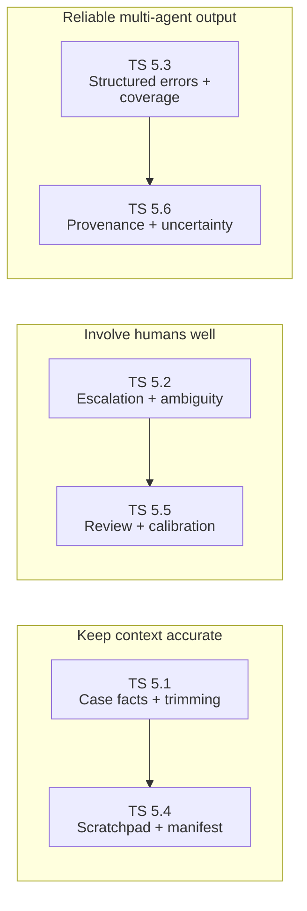
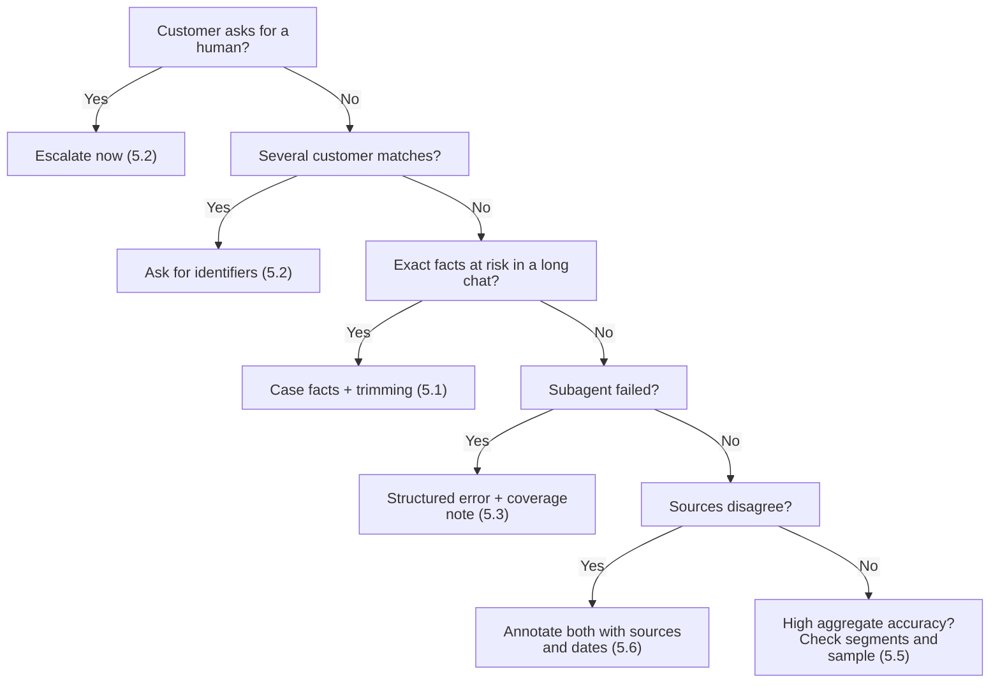

# Domain 5: Context Management and Reliability (15% of the Exam)

Domain 5 is **15%** of the **Claude Certified Architect - Foundations (CCAR-F)** exam. Weights: D1 27%, D2 18%, D3 20%, D4 20%, **D5 15%**. It tests how to keep context accurate in long work, hand off to humans well, survive failures in multi-agent systems, and keep sources traceable.

> Deep dive: [KEY_CONCEPTS.md](KEY_CONCEPTS.md) (diagrams, traps, 7 long scenario questions).
>
> Quick revision: [CHEATSHEET.md](CHEATSHEET.md) (question wording to answer, look-alike pairs, exact values, elimination filters).

---

## Study Order and Folder-to-Task-Statement Map

Some folder names mix topics. **Folder names stay unchanged** (tests import them). Each guide follows the **official task statement**.

| Study order | Official task statement | Folder (unchanged) | Note |
|:---:|---|---|---|
| 1 | **TS 5.1** Manage conversation context across long interactions | [ts_5_1_context_preservation](ts_5_1_context_preservation/README.md) | Matches |
| 2 | **TS 5.2** Escalation and ambiguity resolution | [ts_5_2_escalation_and_provenance](ts_5_2_escalation_and_provenance/README.md) | Provenance content moved to 5.6 |
| 3 | **TS 5.3** Error propagation across multi-agent systems | [ts_5_3_error_propagation_coverage](ts_5_3_error_propagation_coverage/README.md) | Matches |
| 4 | **TS 5.4** Large-codebase context management | [ts_5_4_scratchpads_and_human_review](ts_5_4_scratchpads_and_human_review/README.md) | Human review belongs to 5.5 |
| 5 | **TS 5.5** Human review and confidence calibration | [ts_5_5_human_review_calibration](ts_5_5_human_review_calibration/README.md) | Matches |
| 6 | **TS 5.6** Provenance and uncertainty in synthesis | [ts_5_6_provenance_and_uncertainty](ts_5_6_provenance_and_uncertainty/README.md) | Matches |

**Suggested path:** 5.1 -> 5.4 (context) -> 5.2 -> 5.5 (human involvement) -> 5.3 -> 5.6 (multi-agent reliability and sources).

## One Line Per Task Statement

| TS | What it tests | Key trap | Scenarios |
|---|---|---|---|
| **5.1** | Keep exact facts in long chats: case facts, trim tool output, key findings first | Trusting summaries to keep numbers | 1, 3 |
| **5.2** | Escalate on human request, policy gap, no progress; ask when many matches | Sentiment or confidence-score escalation | 1 |
| **5.3** | Structured error context; failure vs valid empty; coverage notes | Empty-as-success or aborting everything | 3 |
| **5.4** | Scratchpad, subagents, phase summaries, manifest recovery, `/compact` | "Remind the model" instead of external memory | 4 |
| **5.5** | Per-segment accuracy, stratified sampling, calibrated field confidence | Approving automation on 97% aggregate accuracy | 6, 1 |
| **5.6** | Claim-source mappings, conflict annotation, dates, content-type rendering | Averaging conflicting numbers | 3 |

## Map of Ideas



## Task Statement Summaries

### [TS 5.1: Manage Conversation Context Across Long Interactions](ts_5_1_context_preservation/README.md)
- Progressive summarisation loses numbers, dates and customer expectations.
- Keep a **case facts** block outside summarised history. Pass the complete history.
- Trim tool results (40+ fields to the 5 that matter) before they enter context.
- Counter "lost in the middle": key findings at the start, section headers.
- Subagents return structured data (facts, citations, relevance scores, dates), not reasoning.

### [TS 5.2: Escalation and Ambiguity Resolution](ts_5_2_escalation_and_provenance/README.md)
- Escalate immediately on an explicit human request; also on policy gaps and when stuck.
- Frustration alone: acknowledge and offer a fix when within capability.
- Multiple matches: ask for more identifiers; never guess.
- Sentiment and self-reported confidence are unreliable. Use explicit criteria with few-shot examples.

### [TS 5.3: Error Propagation Across Multi-Agent Systems](ts_5_3_error_propagation_coverage/README.md)
- Return structured error context: failure type, attempted query, partial results, alternatives.
- Access failure is not a valid empty result.
- Subagents recover transient errors locally and propagate only unresolved ones.
- Synthesis carries **coverage annotations**.

### [TS 5.4: Large-Codebase Context Management](ts_5_4_scratchpads_and_human_review/README.md)
- Context degradation gives "typical patterns" instead of specific classes.
- Use **scratchpad** files, subagents for verbose exploration, phase summaries.
- Crash recovery: per-agent state exports plus a coordinator **manifest** loaded on resume.
- `/compact` in Claude Code.

### [TS 5.5: Human Review and Confidence Calibration](ts_5_5_human_review_calibration/README.md)
- Aggregate accuracy (e.g. 97%) hides weak segments.
- Stratified random sampling of high-confidence outputs, by document type and field.
- Field-level confidence calibrated on labelled validation sets.
- Validate each segment before reducing human review. Route low-confidence, ambiguous or contradictory items to humans.

### [TS 5.6: Provenance and Uncertainty](ts_5_6_provenance_and_uncertainty/README.md)
- **Claim-source mappings** survive summarisation and synthesis.
- Annotate conflicting statistics with sources. Do not average or silently choose.
- Include publication or collection dates to avoid false "contradictions".
- Separate well-established from contested findings. Render by content type: tables, prose, lists.

---

## Rapid Decision Matrix



## Anti-Patterns to Reject

| Anti-pattern | Why it fails | Correct pattern | TS |
|---|---|---|---|
| Rely on progressive summaries | Numbers and dates drift | Case facts block | 5.1 |
| Append raw 40+ field tool results | Bloat, weaker attention | Trim before context | 5.1 |
| Probe a customer who asked for a human | Ignores explicit request | Escalate now | 5.2 |
| Sentiment or confidence-score escalation | Poor proxies | Explicit criteria + few-shot examples | 5.2 |
| Pick a customer heuristically | Wrong account, privacy risk | Ask for identifiers | 5.2 |
| Return empty as success on failure | Hides a gap | Structured error context | 5.3 |
| Abort the whole workflow on one failure | Loses good work | Continue + coverage annotation | 5.3 |
| "Remind the model" in long sessions | Does not restore details | Scratchpad | 5.4 |
| Re-run everything after a crash | Wasted work | Manifest + state exports | 5.4 |
| Trust 97% aggregate accuracy | Hides weak segments | Per-segment accuracy + stratified sampling | 5.5 |
| Average conflicting statistics | Invents a number | Annotate both with sources | 5.6 |

## Claude 4.5 Notes (applies to all six guides)

- `claude-sonnet-4-5` for reasoning and coordination; `claude-haiku-4-5` for workers.
- With extended thinking on: omit `temperature`; leave `top_k` and `top_p` unset; `tool_choice` may only be `auto` or `none`; `budget_tokens` at least 1024 and below `max_tokens`.
- Echo assistant `thinking` blocks (with signatures) back unchanged in tool-use turns.

## Hands-on

Every folder has a `README.md`, an offline `main.py` and a notebook. Nothing here calls the Claude API.

```powershell
wsl -d Ubuntu-26.04 bash -c "cd /mnt/c/Repos/Claude_cert && ~/.local/bin/uv run pytest tests/test_domain5_enhancements.py -q"
```
