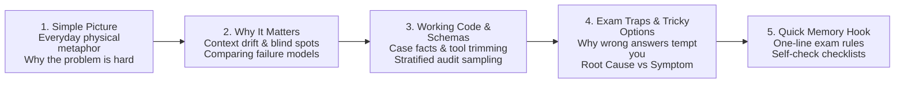
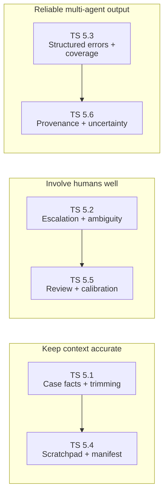
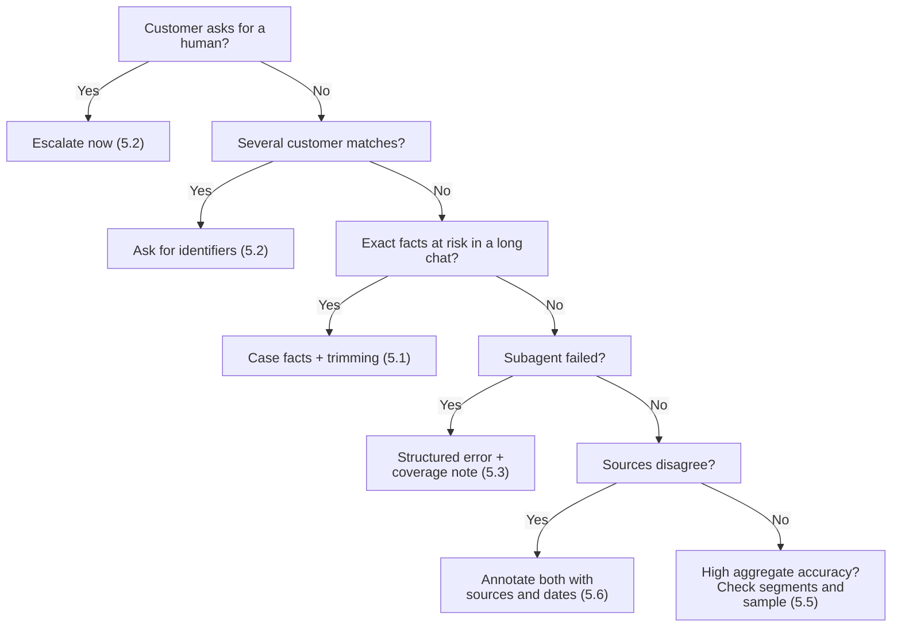

# Domain 5: Context Management and Reliability (15% of the Exam)

Domain 5 represents **15%** of the **Claude Certified Architect – Foundations (CCAR-F)** exam (D1 27%, D2 18%, D3 20%, D4 20%, **D5 15%**). It focuses on keeping context accurate across long multi-turn sessions, handling graceful escalations and ambiguity, surviving errors across multi-agent workflows, managing large-codebase exploration, calibrating confidence for human review, and preserving provenance and uncertainty in synthesis.

> 📖 **Deep Dive Master Guide**: For exhaustive technical explanations, architecture diagrams, sequence flows, gotchas, to-remember points, and practical scenario questions & answers, see [KEY_CONCEPTS.md](KEY_CONCEPTS.md).
>
> ⚡ **Quick revision**: [CHEATSHEET.md](CHEATSHEET.md) (question wording to answer, look-alike pairs, exact values, elimination filters).

---

## 🧠 How to Master Domain 5 (5 Clear Steps)

$$\text{1. Simple Picture} \longrightarrow \text{2. Why It Matters (The Architecture)} \longrightarrow \text{3. Working Code / Schema} \longrightarrow \text{4. Exam Traps \& Wrong Answers} \longrightarrow \text{5. Memory Hook}$$



---

## 🏛️ Everyday Metaphors: Foundational Mental Models

| Task Statement | Topic | Everyday Physical Metaphor | Why Naive Approaches Fail | Correct Architectural Pattern |
| :--- | :--- | :--- | :--- | :--- |
| **TS 5.1** | **Context Preservation** | **Executive Briefing Folder** | As a meeting goes on, oral summaries turn "\$142.50 on March 12" into "a recent charge"; details vanish. | **Case Facts Block Outside Summary**: Store transactional IDs, amounts, and dates in a dedicated top-level block passed alongside history ([TS 5.1](ts_5_1_context_preservation/README.md)). |
| **TS 5.2** | **Escalation & Ambiguity** | **Floor Manager Escalation** | Guessing customer intent from vague sentiment leads to arguing or acting on the wrong customer account. | **Rule-Based Triggers & Disambiguation**: Hand off immediately on explicit human request; ask for more IDs on multi-match ([TS 5.2](ts_5_2_escalation_and_provenance/README.md)). |
| **TS 5.3** | **Multi-Agent Errors** | **Weather Station Telemetry** | Reporting "0 mm rainfall" when the sensor was unplugged misleads forecasters into thinking it was sunny. | **Failure vs Valid Empty + Coverage Notes**: Return structured error type and query; annotate coverage gaps in synthesis ([TS 5.3](ts_5_3_error_propagation_coverage/README.md)). |
| **TS 5.4** | **Large Codebases** | **Detective's Caseboard** | Relying on mental memory during a 20-file investigation leads to confabulation and lost filenames. | **Scratchpad Files & `/compact`**: Write intermediate discoveries to disk; use subagents for deep dives and manifests for recovery ([TS 5.4](ts_5_4_scratchpads_and_human_review/README.md)). |
| **TS 5.5** | **Confidence & Review** | **Factory Quality Spot-Check** | Celebrating 97% factory yield hides the fact that 30% of rare specialized parts were cracked. | **Stratified Random Sampling**: Audit 5–10% across every subgroup and calibrate confidence on labelled sets before gating ([TS 5.5](ts_5_5_human_review_calibration/README.md)). |
| **TS 5.6** | **Provenance & Synthesis** | **Historical Ledger with Citations** | Averaging two conflicting dates or numbers invents a third fake number that neither historical record supports. | **Claim-to-Source Mapping & Side-by-Side Attribution**: Preserve source and timestamp; present conflicting data side-by-side ([TS 5.6](ts_5_6_provenance_and_uncertainty/README.md)). |

---

## Study Order and Folder-to-Task-Statement Map

Some folder names mix topics. **Folder names stay unchanged** (tests import them). Each guide follows the **official task statement**.

| Study order | Official task statement | Folder (unchanged) | Note |
|:---:|---|---|---|
| 1 | **TS 5.1** Manage conversation context across long interactions | [ts_5_1_context_preservation](ts_5_1_context_preservation/README.md) | Matches |
| 2 | **TS 5.2** Escalation and ambiguity resolution | [ts_5_2_escalation_and_provenance](ts_5_2_escalation_and_provenance/README.md) | Provenance content moved to 5.6 |
| 3 | **TS 5.3** Error propagation across multi-agent systems | [ts_5_3_error_propagation_coverage](ts_5_3_error_propagation_coverage/README.md) | Matches |
| 4 | **TS 5.4** Large-codebase context management | [ts_5_4_scratchpads_and_human_review](ts_5_4_scratchpads_and_human_review/README.md) | Human review belongs to 5.5 |
| 5 | **TS 5.5** Human review and confidence calibration | [ts_5_5_human_review_calibration](ts_5_5_human_review_calibration/README.md) | Matches |
| 6 | **TS 5.6** Provenance and uncertainty in synthesis | [ts_5_6_provenance_and_uncertainty](ts_5_6_provenance_and_uncertainty/README.md) | Matches |

**Suggested path:** 5.1 -> 5.4 (context) -> 5.2 -> 5.5 (human involvement) -> 5.3 -> 5.6 (multi-agent reliability and sources).

## One Line Per Task Statement

| TS | What it tests | Key trap | Scenarios |
|---|---|---|---|
| **5.1** | Keep exact facts in long chats: case facts, trim tool output, key findings first | Trusting summaries to keep numbers | 1, 3 |
| **5.2** | Escalate on human request, policy gap, no progress; ask when many matches | Sentiment or confidence-score escalation | 1 |
| **5.3** | Structured error context; failure vs valid empty; coverage notes | Empty-as-success or aborting everything | 3 |
| **5.4** | Scratchpad, subagents, phase summaries, manifest recovery, `/compact` | "Remind the model" instead of external memory | 4 |
| **5.5** | Per-segment accuracy, stratified sampling, calibrated field confidence | Approving automation on 97% aggregate accuracy | 6, 1 |
| **5.6** | Claim-source mappings, conflict annotation, dates, content-type rendering | Averaging conflicting numbers | 3 |

## Map of Ideas



## Task Statement Summaries

### [TS 5.1: Manage Conversation Context Across Long Interactions](ts_5_1_context_preservation/README.md)
- Progressive summarisation loses numbers, dates and customer expectations.
- Keep a **case facts** block outside summarised history. Pass the complete history.
- Trim tool results (40+ fields to the 5 that matter) before they enter context.
- Counter "lost in the middle": key findings at the start, section headers.
- Subagents return structured data (facts, citations, relevance scores, dates), not reasoning.

### [TS 5.2: Escalation and Ambiguity Resolution](ts_5_2_escalation_and_provenance/README.md)
- Escalate immediately on an explicit human request; also on policy gaps and when stuck.
- Frustration alone: acknowledge and offer a fix when within capability.
- Multiple matches: ask for more identifiers; never guess.
- Sentiment and self-reported confidence are unreliable. Use explicit criteria with few-shot examples.

### [TS 5.3: Error Propagation Across Multi-Agent Systems](ts_5_3_error_propagation_coverage/README.md)
- Return structured error context: failure type, attempted query, partial results, alternatives.
- Access failure is not a valid empty result.
- Subagents recover transient errors locally and propagate only unresolved ones.
- Synthesis carries **coverage annotations**.

### [TS 5.4: Large-Codebase Context Management](ts_5_4_scratchpads_and_human_review/README.md)
- Context degradation gives "typical patterns" instead of specific classes.
- Use **scratchpad** files, subagents for verbose exploration, phase summaries.
- Crash recovery: per-agent state exports plus a coordinator **manifest** loaded on resume.
- `/compact` in Claude Code.

### [TS 5.5: Human Review and Confidence Calibration](ts_5_5_human_review_calibration/README.md)
- Aggregate accuracy (e.g. 97%) hides weak segments.
- Stratified random sampling of high-confidence outputs, by document type and field.
- Field-level confidence calibrated on labelled validation sets.
- Validate each segment before reducing human review. Route low-confidence, ambiguous or contradictory items to humans.

### [TS 5.6: Provenance and Uncertainty](ts_5_6_provenance_and_uncertainty/README.md)
- **Claim-source mappings** survive summarisation and synthesis.
- Annotate conflicting statistics with sources. Do not average or silently choose.
- Include publication or collection dates to avoid false "contradictions".
- Separate well-established from contested findings. Render by content type: tables, prose, lists.

---

## Rapid Decision Matrix



## Domain 5 Golden Rules

1. **Exact facts live outside the summary (TS 5.1)**:  
   Progressive summarisation turns "\$142.50 on 12 March" into "a recent charge". Keep a persistent **case facts** block (ids, amounts, dates, stated expectations) in every prompt, outside summarised history. Pass the complete history rather than a lossy recap.
2. **Trim before it enters context (TS 5.1)**:  
   Reduce a 40+ field tool result to the few fields needed (a `PostToolUse` step). Put key findings first and use section headers to counter "lost in the middle". Subagents return structured data (facts, citations, dates), not reasoning chains.
3. **Escalate on explicit criteria, not proxies (TS 5.2)**:  
   Escalate at once when the customer asks for a human, on a policy gap, or when no progress is possible. Frustration alone means acknowledge and offer a fix if within capability. Sentiment and self-reported confidence are poorly calibrated, so write explicit criteria with few-shot examples.
4. **Ambiguity means ask, never guess (TS 5.2)**:  
   If a lookup returns several matches, ask for another identifier (email, order number). Picking by heuristic risks acting on the wrong account.
5. **Failure is not an empty result (TS 5.3)**:  
   Return the failure type, the attempted query, partial results and alternatives. A timeout reported as "no results" hides a coverage gap. Recover transient errors locally and propagate only what is unresolved.
6. **Degrade gracefully and say so (TS 5.3)**:  
   One failed source must not abort the workflow. Continue with what succeeded and attach **coverage annotations** (which areas are well supported, which are missing and why) to the final output.
7. **Use external memory for long work (TS 5.4)**:  
   Reminding the model does not restore lost detail. Write findings to **scratchpad** files, push verbose exploration into subagents, summarise per phase, and use `/compact` when needed. For crash recovery, export per-agent state and load a coordinator **manifest** on resume instead of rerunning everything.
8. **Aggregate accuracy hides weak segments (TS 5.5)**:  
   97% overall can mean 70% on one document type or field. Measure per segment, sample high-confidence outputs with stratified random sampling, and calibrate field-level confidence on labelled validation sets before reducing human review. Route low-confidence, ambiguous or contradictory items to people.
9. **Provenance survives synthesis (TS 5.6)**:  
   Keep claim-to-source mappings (source, location, date) through every summarisation step. When two sources disagree, show both with attribution. Never average or silently pick one. Dates explain many apparent contradictions.
10. **Separate certainty levels and render by content type (TS 5.6)**:  
    Mark well-established findings apart from contested ones. Present financial data as tables, narrative as prose, and enumerations as lists, instead of one uniform format.

## Anti-Patterns to Reject

| Anti-pattern | Why it fails | Correct pattern | TS |
|---|---|---|---|
| Rely on progressive summaries | Numbers and dates drift | Case facts block | 5.1 |
| Append raw 40+ field tool results | Bloat, weaker attention | Trim before context | 5.1 |
| Probe a customer who asked for a human | Ignores explicit request | Escalate now | 5.2 |
| Sentiment or confidence-score escalation | Poor proxies | Explicit criteria + few-shot examples | 5.2 |
| Pick a customer heuristically | Wrong account, privacy risk | Ask for identifiers | 5.2 |
| Return empty as success on failure | Hides a gap | Structured error context | 5.3 |
| Abort the whole workflow on one failure | Loses good work | Continue + coverage annotation | 5.3 |
| "Remind the model" in long sessions | Does not restore details | Scratchpad | 5.4 |
| Re-run everything after a crash | Wasted work | Manifest + state exports | 5.4 |
| Trust 97% aggregate accuracy | Hides weak segments | Per-segment accuracy + stratified sampling | 5.5 |
| Average conflicting statistics | Invents a number | Annotate both with sources | 5.6 |

## Claude 4.5 Notes (applies to all six guides)

- `claude-sonnet-4-5` for reasoning and coordination; `claude-haiku-4-5` for workers.
- With extended thinking on: omit `temperature`; leave `top_k` and `top_p` unset; `tool_choice` may only be `auto` or `none`; `budget_tokens` at least 1024 and below `max_tokens`.
- Echo assistant `thinking` blocks (with signatures) back unchanged in tool-use turns.

## Hands-on

Every folder has a `README.md`, an offline `main.py` and a notebook. Nothing here calls the Claude API.

```powershell
wsl -d Ubuntu-26.04 bash -c "cd /mnt/c/Repos/Claude_cert && ~/.local/bin/uv run pytest tests/test_domain5_enhancements.py -q"
```

---

## 🧭 Navigation & Study Links
- ⬅️ **Previous Domain**: [Domain 4: Prompt Engineering & Model Guidance](../domain4/README.md)
- 📋 **Exam Blueprint**: [5-Domain Blueprint Matrix](../EXAM_BLUEPRINT.md)
- ⚡ **Exam Refresher**: [Core Architectural Rules & Cheatsheet](../EXAM_REFRESHER.md)
- ➡️ **Next Topic**: [Master Scenario Practice](../scenarios/MASTER_SCENARIO_PRACTICE.md)
- 🎯 **Scenario Practice**: [Master Scenario Practice](../scenarios/MASTER_SCENARIO_PRACTICE.md)
