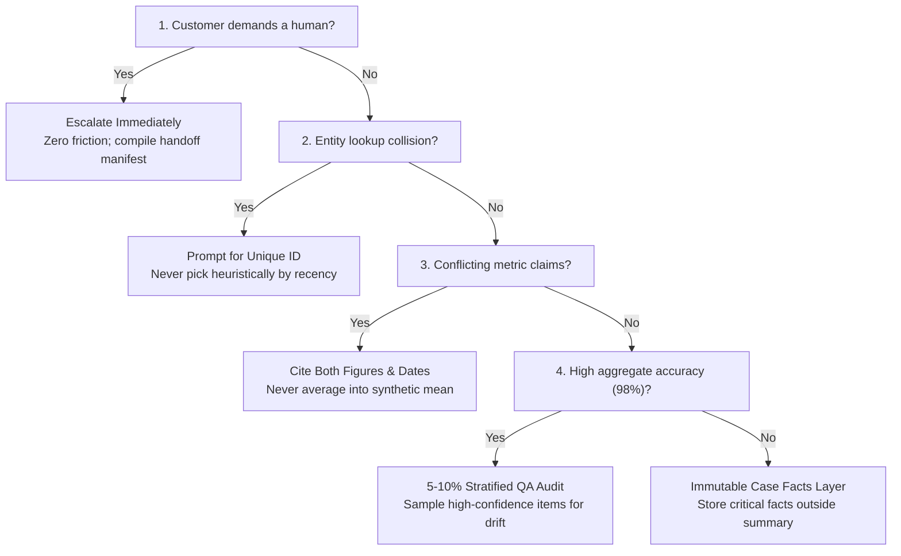

# Domain 5: Context Management & Reliability (15% of Exam)

Domain 5 accounts for 15% of the **Claude Certified Architect – Foundations (CCAR-F)** exam. It covers managing conversation context windows, mitigating attention degradation, implementing human escalation and ambiguity resolution patterns, error propagation in multi-agent workflows, stratified confidence calibration, and preserving information provenance.

> 📖 **Deep Dive Master Guide**: For exhaustive technical explanations, architecture diagrams, sequence flows, gotchas, to-remember points, and practical scenario questions & answers, see [KEY_CONCEPTS.md](KEY_CONCEPTS.md).

---

## 📋 Task Statements & Core Architectural Principles

### [TS 5.1: Manage Conversation Context to Preserve Critical Information Across Long Interactions](ts_5_1_context_preservation/main.py)
- **Risks of Progressive Summarization**: Condensing conversations washes away exact numbers, dates, order IDs, and customer constraints into vague prose.
- **The "Case Facts" Architecture**: Extract critical transactional facts into an immutable, persistent structured state block outside the summarized conversation history and prepend to prompts.
- **Tool Payload Trimming**: Strip bloated backend payloads (40+ raw fields) down to the 4 essential fields before appending to context.
- **"Lost in the Middle" Mitigation**: Place critical instructions and case facts at the beginning (system prompt) or end (immediate prompt turn), avoiding the middle of long transcripts.
- **Reference Exercise**: [ts_5_1_context_preservation/](ts_5_1_context_preservation/)

### [TS 5.2: Design Effective Escalation and Ambiguity Resolution Patterns](ts_5_2_escalation_and_provenance/main.py)
- **Immediate Escalation on Customer Demand**: When a customer explicitly demands a human representative, escalate immediately without asking diagnostic questions.
- **Policy Gaps**: When corporate policy is silent on a customer request (e.g. competitor price match), escalate to a human supervisor; never hallucinate policy.
- **Unreliability of Sentiment & Confidence**: Sentiment scores and self-reported model confidence are poor proxies for task complexity; trigger escalations via deterministic rules.
- **Ambiguity Resolution Protocol**: When an entity query returns multiple candidate matches, prompt the user for a unique disambiguating identifier (account ID, zip code) instead of guessing heuristically.
- **Reference Exercise**: [ts_5_2_escalation_and_provenance/](ts_5_2_escalation_and_provenance/)

### [TS 5.3: Implement Error Propagation Strategies Across Multi-Agent Systems](ts_5_3_error_propagation_coverage/main.py)
- **Structured Error Payloads**: Subagents must return structured error context (failure type, attempted query, partial findings, alternatives) to the coordinator.
- **Access Failure vs Valid Empty Result**: Distinguish between network/auth failures (retryable) and 0 matching records found (ground-truth fact).
- **Coverage Annotations**: Annotate multi-source reports with explicit coverage boundaries when specific sources are unavailable.
- **Reference Exercise**: [ts_5_3_error_propagation_coverage/](ts_5_3_error_propagation_coverage/)

### [TS 5.4: Manage Context Effectively in Large Codebase Exploration](ts_5_4_scratchpads_and_human_review/main.py)
- **Context Drift**: In long exploration sessions, models drift into hallucinating generic framework patterns instead of actual discovered classes.
- **Mitigation Architecture**: Maintain persistent `scratchpad.md` files, delegate verbose file exploration to read-only Explore subagents, and use `/compact` in Claude Code.
- **Reference Exercise**: [ts_5_4_scratchpads_and_human_review/](ts_5_4_scratchpads_and_human_review/)

### [TS 5.5: Design Human Review Workflows and Confidence Calibration](ts_5_5_human_review_calibration/main.py)
- **The Flaw of Aggregate Accuracy**: 98% overall accuracy can conceal a 45% failure rate on rare document formats or specific fields.
- **Segmented Accuracy Auditing**: Measure accuracy across specific document types, vendors, and complexity tiers.
- **Stratified Random Sampling**: Continuously audit a 5%–10% random sample of high-confidence extractions to detect silent hallucinations and distribution drift.
- **Calibrated Routing**: Route high-impact transactions (> $1,000) or low-confidence extractions to human review.
- **Reference Exercise**: [ts_5_5_human_review_calibration/](ts_5_5_human_review_calibration/)

### [TS 5.6: Preserve Information Provenance and Handle Uncertainty in Multi-Source Synthesis](ts_5_6_provenance_and_uncertainty/main.py)
- **Claim-Source Mappings**: Every finding must include claim, verbatim supporting excerpt, document ID / source URL, and collection date.
- **Preserving Conflicting Information**: Never average numbers or pick one arbitrarily; report both conflicting statistics with explicit attribution, collection dates, and methodology notes.
- **Temporal Context**: Check publication dates to distinguish actual factual contradictions from chronological evolution.
- **Reference Exercise**: [ts_5_6_provenance_and_uncertainty/](ts_5_6_provenance_and_uncertainty/)

---

## 🛠️ Hands-on Exercises in this Domain
- `ts_5_1_context_preservation/`: Case Facts persistence, tool trimming, and context preservation.
- `ts_5_2_escalation_and_provenance/`: Immediate escalation gates and multi-record collision disambiguation.
- `ts_5_3_error_propagation_coverage/`: Structured multi-agent error propagation and synthesis coverage gaps.
- `ts_5_4_scratchpads_and_human_review/`: Persistent scratchpads and Explore subagent summaries.
- `ts_5_5_human_review_calibration/`: Stratified random sampling and calibrated human review routing.
- `ts_5_6_provenance_and_uncertainty/`: Provenance tracking and conflicting statistics preservation.

---

## ⚡ Domain 5 Exam Rules, Golden Architectural Rules & Anti-Patterns Reference

### 📋 CCAR-F Exam Rules & Scope Boundaries for Domain 5

| Aspect | In-Scope Exam Focus (Official Syllabus) | Out-of-Scope Distractor (Do Not Choose on Exam) |
|---|---|---|
| **Context Window Preservation** | Immutable "Case Facts" block outside summarized history; aggressive tool payload trimming (40+ down to 4-5 fields). | Unconstrained history accumulation; asking Claude to "remember everything" in prompts. |
| **Position Effects ("Lost in Middle")**| Placing key finding summaries at the beginning of aggregated inputs; using explicit section headers. | Burying critical operational constraints in the middle of long multi-thousand-token transcripts. |
| **Upstream Payload Budgets** | Modifying upstream agents to return structured data (facts, citations, scores) rather than verbose reasoning chains. | Ingesting complete chain-of-thought traces from 5 subagents into downstream synthesis agents. |
| **Customer Escalation: Explicit Demand**| Immediate zero-friction escalation upon explicit customer request for a human; no diagnostic questions. | Attempting issue resolution or asking "why do you want a supervisor?" after customer demands a human. |
| **Customer Escalation: Frustration**| Acknowledging frustration while offering resolution when within capability, escalating only if customer reiterates human preference. | Escalating immediately on emotional language alone (ruins FCR); ignoring frustration entirely. |
| **Policy Exception Escalation** | Deterministically escalating when company policy is silent or ambiguous (e.g. competitor price match). | Permitting the agent to guess unwritten policy or invent store compensation. |
| **Ambiguity Resolution** | Prompting user for unique disambiguating identifier (phone, zip, ID) on multiple candidate hits. | Selecting the first record or guessing heuristically based on recency or location. |
| **Multi-Agent Error Flow** | Returning structured error context (`failure_type`, `attempted_query`, `partial_results`, `alternatives`). | Returning generic strings ("service unavailable"), suppressing errors, or terminating entire pipeline. |
| **Large Codebase Exploration** | Persistent `scratchpad.md`, read-only Explore subagent isolation, `/compact` memory reduction. | Expanding context limits via imaginary environment variables; manual shell grep audits. |
| **Crash Recovery Manifests** | Each agent exports state to known locations; coordinator loads manifest on resume and injects into prompts. | Re-running complete multi-hour exploration from scratch after mid-process coordinator interruption. |
| **Human Review Calibration** | Segmented accuracy by document type; stratified random sampling (5–10%) of high-confidence results. | Relying on aggregate 98% accuracy; eliminating human review entirely for high confidence. |
| **Provenance & Uncertainty** | Claim-source-date mappings; explicitly reporting conflicting figures with source attribution; temporal dating. | Averaging conflicting statistics into a single number; picking one number arbitrarily. |
| **Synthesis Content Rendering** | Rendering different data types appropriately (tables for financials, prose for news, structured lists for technical findings). | Forcing all diverse research findings into a single uniform bulleted list or flat narrative. |

---

### 🏆 The 8 Golden Architectural Rules of Domain 5

1. **The Immutable Case Facts Architecture (`TS 5.1`)**:  
   Progressive summarization washes away critical transactional specifics (dates, order IDs, tracking numbers, dollar balances). Always extract these entities into a structured, immutable "Case Facts" block maintained outside summarized conversational history and injected into every prompt.
2. **Aggressive Tool Payload Trimming (`TS 5.1`)**:  
   Backend databases and APIs return bloated JSON payloads (40–80 raw fields). Strip payloads down to the 4–5 attributes strictly required for the customer interaction before adding to context, mitigating "lost-in-the-middle" attention decay.
3. **Zero-Friction Immediate Escalation on Customer Demand (`TS 5.2`)**:  
   When a customer explicitly demands a human representative, supervisor, or manager, **escalate immediately without friction**. Never attempt to resolve the issue, ask diagnostic questions, or propose troubleshooting steps once human escalation is demanded.
4. **Frustration Empathy vs Explicit Escalation (`TS 5.2`)**:  
   When a customer merely expresses frustration without demanding a human, **acknowledge and empathize with their emotion while offering autonomous resolution**. Escalate only if the customer subsequently reiterates a preference for a human agent.
5. **Escalate Unhandled Policy Gaps Deterministically (`TS 5.2`)**:  
   When company policy is silent or ambiguous on a specific customer request (e.g. competitor price matching when policy only mentions internal adjustments), escalate the ticket to a human supervisor. Never allow the agent to invent policy.
6. **Prompt for Disambiguation on Multiple Matches (`TS 5.2`)**:  
   When an entity search returns multiple matching customer records, **prompt the user for a unique disambiguating identifier** (e.g., account number, billing zip code, phone number). Never select an account heuristically or guess based on recency.
7. **Structured Multi-Agent Error Propagation (`TS 5.3`)**:  
   Subagents encountering failures must return structured error objects detailing `failure_type`, `attempted_query`, `partial_results`, and `recommended_alternative`. The coordinator uses this metadata to adjust queries or annotate synthesis reports with coverage gap notices.
8. **Preserve Conflicting Statistics Without Averaging (`TS 5.6`)**:  
   When two credible sources report contradictory statistical metrics, **NEVER average the numbers or choose one arbitrarily**. Report both values with explicit source attribution, publication dates, and methodology notes.

---

### 🚫 Architectural Anti-Patterns to Reject in Domain 5 (Exam Distractor Teardown)

| Anti-Pattern | The Exam Distractor Trap (Why Candidates Pick It) | Fatal Production Consequence | Correct Architectural Solution |
|---|---|---|---|
| **Relying Solely on Progressive Summaries** | Summarization keeps conversations within token limits. | As turns accumulate, summarization degrades exact order IDs, numbers, and dates into vague narrative text. | Maintain a persistent, structured "Case Facts" block outside summarized history. |
| **Appending Bloated 60-Field Tool Payloads** | Developers assume having full database records in context gives Claude maximum intelligence. | Ingests thousands of irrelevant tokens per turn, drives up latency, and triggers "lost-in-the-middle" attention loss. | Filter raw backend payloads down to 4–5 essential fields before appending to context. |
| **Probing Customers Demanding a Human** | Asking *"I can help with that, could you tell me why you want a human?"* to attempt deflection. | Infuriates frustrated customers, damages brand trust, and directly violates enterprise customer service SLAs. | Escalate immediately with zero friction; compile a structured Case Facts handoff manifest. |
| **Sentiment / Confidence Based Escalation** | Using sentiment analysis or model confidence (1–10) to trigger human handoffs. | Sentiment does not correlate with task complexity, and LLMs are notoriously overconfident on complex edge cases. | Drive escalations via explicit deterministic rules (customer demand, policy gaps, repeated failures). |
| **Heuristic Collision Selection** | Picking the most recent order or first customer record when a name search returns 3 matches. | Discloses private order data to the wrong user, causing severe security, privacy, and regulatory breaches. | Pause and ask the customer for a unique disambiguating identifier (account ID, phone, zip). |
| **Silently Suppressing Tool Errors** | Returning an empty result set marked as success when a backend database times out. | Coordinator concludes that no data exists in ground truth, producing incomplete or factually incorrect reports. | Distinguish access failures from valid empty results; propagate structured error context. |
| **Averaging Conflicting Financial Metrics** | When source A says revenue was $4.2B and source B says $4.8B, calculating the mean ($4.5B). | Generates fabricated synthetic data that neither source reported, destroying auditability and integrity. | Annotate both figures with citations, publication dates, and accounting methodology differences. |
| **Assuming 98% Aggregate Accuracy is Sufficient** | Trusting overall accuracy metrics without breaking down performance by category. | Rare but critical document formats (e.g. handwritten claims) fail at 50%, slipping past unmonitored. | Segment accuracy auditing by document subtype and maintain 5–10% stratified random sampling. |

---

### 🧠 Domain 5 Rapid Decision Matrix for Scenario Questions

| Question Trigger / Condition | Decision Branch | Architectural Action & Distractor Rule |
| :--- | :---: | :--- |
| **Customer explicitly demands a human agent?** | **YES** | Escalate immediately with zero friction *(NEVER probe or ask diagnostic questions)*. |
| **Ambiguous entity lookup (e.g. 3 matching accounts)?** | **YES** | Prompt customer for unique disambiguating identifier *(NEVER guess heuristically)*. |
| **Two credible sources report conflicting statistics?** | **YES** | Report both figures with citations, dates, and attribution *(NEVER average into synthetic mean)*. |
| **98% aggregate accuracy in extraction pipeline?** | **YES** | Maintain **5–10% stratified random sampling** of high-confidence predictions. |
| **Prevent loss of critical numbers across 30+ turns?** | **YES** | Maintain a persistent **Case Facts** block outside summarized history. |

