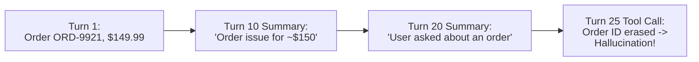
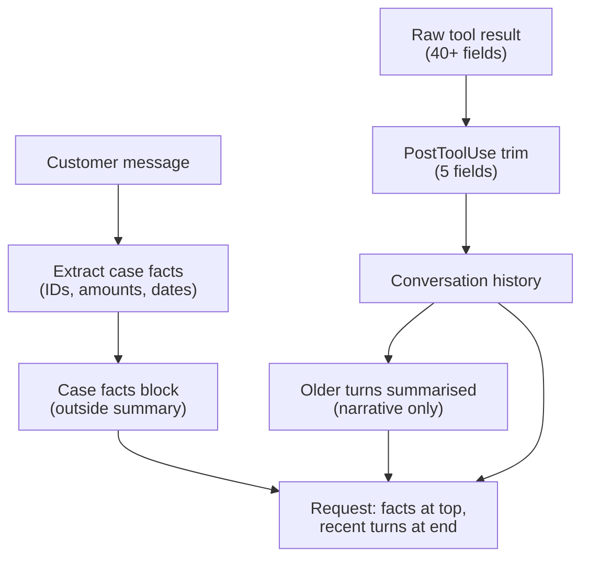

# Task Statement 5.1: Manage Conversation Context Across Long Interactions

> **Domain 5 (15% of exam)** | Scenario focus: **1 - Customer Support Resolution Agent** | Folder: `ts_5_1_context_preservation` | Next: [TS 5.2](../ts_5_2_escalation_and_provenance/README.md)

## In One Minute

- **What:** Long chats lose exact facts (order IDs, amounts, dates) when old turns are summarised.
- **Why it matters:** One wrong number means a wrong refund. Trust and money are lost.
- **Fix 1:** Keep a **case facts** block outside the summarised history and send it on every turn.
- **Fix 2:** Trim big tool results (40+ fields) to the 5 that matter *before* they enter context.
- **Fix 3:** Put key facts at the start and end of the input. Models under-use the middle.
- **Exam answer in one line:** *Structured case facts + trimmed tool output + key findings first.*

---

## 🧒 Explain Like I'm 13

**The picture:** A telephone game. If each person re-tells the story in their own words, "\$47.83" slowly becomes "about fifty". Keep a **facts card** on the desk that is never retold, and let only the rest of the chat be summarised. Also, do not copy a 47-field form into your notes when you only need 4 boxes.

**In plain steps:**
1. Put IDs, amounts and dates in a facts block and send it with every request.
2. Trim tool results to needed fields **before** they enter the history.
3. Key points first, headers on sections, question at the end.
4. Always send the full (managed) history. The API remembers nothing.

**Tiny example:** After 30 turns, "refund about \$50" in a summary versus `item_price: 47.83` on the facts card.

---

## 📖 Concepts Explained

### 1. The Degradation Dynamics of Progressive Summarization
In long-running conversational systems, context budgets eventually fill up. The most common naive mitigation is **progressive summarization**: periodically taking turns 1 through N and prompting the model to write a summary paragraph.

While progressive summarization preserves broad conversational themes, it catastrophically degrades **transactional precision**:
- **Why Naive Summarization Destroys State**: When an LLM summarizes, it naturally turns hard, exact facts into casual **natural language prose** (conversational sentences like *"the user asked about an order they bought last week for about \$150"*).
- Exact numeric quantities (\$149.99) are rounded or converted into vague approximations ("about \$150").
- Precise timestamps, tracking numbers, and database keys (`ORD-2026-9921`, `1Z999`) evaporate.
- Critical constraints verified by backend logic (e.g. `is_2fa_verified = True`) are forgotten.
- Within 20 turns, the agent cannot execute tool calls like `process_refund(order_id=...)` because the ground truth was erased. When forced to provide required tool parameters, Claude might hallucinate a fake ID (`"ORD-12345"`), causing database corruption!



### 2. The Dedicated "Case Facts" Architectural Layer
To prevent transactional amnesia, enterprise architectures decouple **session history** from **authoritative entities** by maintaining a dedicated, immutable **Case Facts Layer**:
- When transactional entities (customer IDs, order numbers, dollar amounts, tracking numbers, customer constraints) are first mentioned or returned by backend tools, the application runtime extracts them into an isolated structured data store (JSON / dictionary).
- On every subsequent turn, the application runtime renders this Case Facts block at the very top of the system prompt, completely outside the reach of conversational summarization.
- Even if turns 1 through 30 are compressed into a 3-sentence narrative summary, the Case Facts block guarantees that Claude always sees 100% exact, uncorrupted identifiers.

### 3. Early Tool Trimming via `PostToolUse` Hooks
Enterprise backend tools (like SAP, Salesforce, or order management databases) frequently return massive database dumps containing 40+ attributes per entity—internal shard IDs, database revision timestamps, employee shift logs, and raw network routing metadata.
- If raw tool outputs are appended directly to conversation context, a single order lookup can consume 2,000+ tokens. Over a 10-turn interaction, the context window fills with irrelevant noise.
- **The Architectural Fix**: Implement a `PostToolUse` normalization hook that intercepts raw tool outputs *before* they are committed to conversation history, trimming 40+ raw fields down to the 4–5 attributes strictly relevant to the agent's decision logic.

### 4. Mitigating the "Lost in the Middle" Transformer Effect
Extensive research on transformer attention architectures reveals the **U-shaped recall curve** ("lost in the middle"): models retrieve information positioned at the very beginning and very end of long input prompts with near 100% accuracy, but retrieval fidelity dips significantly for information buried in the middle 60% of context.
- **Positioning Strategies**:
  1. Position the immutable **Case Facts block at the absolute top** of the prompt context.
  2. Place aggregated executive summaries and high-priority findings at the beginning of multi-source payloads.
  3. Organize detailed supporting documentation with explicit markdown section headers to guide attention.
  4. Ensure the most recent turns and user messages reside at the end of the context window.

### 5. Multi-Agent Context Budgets: Structured Data Over Reasoning Chains
When specialized subagents (e.g. Web Search or Document Analysis subagents) complete their tasks, they must not return verbose 2,000-word reasoning chains or raw conversational transcripts to the coordinator.
- Downstream synthesis agents have limited context budgets. Upstream agents must return **structured payloads**: extracted factual claims, source citations, publication dates, and relevance scores.
- This allows the coordinator to synthesize findings efficiently without exceeding context limits or triggering attention dilution.

---

## 🧪 Worked Example

### ❌ Invalid Example (Anti-Pattern / What Breaks)
*(Anti-Pattern: Progressive Summarization Washing Away Numbers)*
```text
# BROKEN: Repeatedly summarizing older turns directly into conversational memory
Turn 1: "Customer ID CUST-9921, Order ORD-2026-9921, Amount $149.99 paid on 2026-09-28 via FedEx 1Z999."
Turn 6 Summary:  "Customer asked for a refund on a recent charge."
Turn 12 Summary: "User requested assistance with an order."

What happens in production:
1. Exact transactional identifiers (order ID, dollar amount, date) vanish into casual natural language prose, destroying the structured state required by backend APIs.
2. At Turn 14, when Claude calls `process_refund(order_id=...)`, the ground truth is gone, causing Claude to fail or hallucinate a fake order ID!
3. Tool payloads (47 raw CRM fields, 1,800 tokens each turn) flood context and trigger attention dilution.
```

### ✅ Valid Example (Production Pattern)
*(Production Pattern: Immutable Case Facts Layer & PostToolUse Trimming)*
```python
# CORRECT: Extract immutable facts into a pinned layer outside the summarized narrative

# 1. Dedicated Case Facts layer pinned in system prompt prefix:
case_facts = {
    "customer_id": "CUST-9921",
    "order_id": "ORD-2026-9921",
    "amount": 149.99,
    "transaction_date": "2026-09-28",
    "tracking_number": "1Z999"
}

# 2. PostToolUse hook trims 47 raw CRM fields down to 4 decision fields:
def trim_crm_payload(raw_crm: dict) -> dict:
    return {
        "order_id": raw_crm["order_id"],
        "status": raw_crm["status"],
        "total": raw_crm["total"],
        "delivery_date": raw_crm["delivery_date"]
    }

# 3. Prompt Assembly:
# - Case Facts block pinned at the very top (immune to summarization drift)
# - Narrative summaries for turns 1-10
# - Verbatim recent turns (11-14) at the end
# Result: Claude issues the exact refund for $149.99 without hallucinating!
```

**Walkthrough:**
Customer writes on turn 1: *"Refund ORD-2026-9921. I paid \$149.99 on 2026-09-28."*

| Step | What happens | Result |
|---|---|---|
| Turn 1 | Code extracts case facts with regexes. | `order=ORD-2026-9921`, `amount=$149.99`, `date=2026-09-28` |
| Turn 6 | A summary replaces turns 1-5: *"Customer asked about an order refund."* | Numbers are gone from narrative, but preserved in Case Facts block! |
| Turn 7 | `lookup_order` returns 47 fields (1,800 tokens). Hook keeps 4 fields. | Far fewer tokens enter context. |
| Turn 8 | Prompt = case facts (top) + narrative summary + recent turns. | Agent refunds exactly `$149.99`. |

Run `main.py` to see this offline: `lossy_summary()` shows the drift, `facts_survive()` proves the facts block protects the numbers.

---

## 🔑 Key Terms

- **Case Facts layer**: A dedicated, immutable structured block of transactional entities (order IDs, dollar amounts, timestamps, tracking numbers) maintained outside summarized conversation history and prepended to every turn.
- **Progressive summarization**: The technique of iteratively compressing older conversational turns into running narrative prose, which inevitably rounds exact numbers and erodes critical transactional details over long sessions.
- **`PostToolUse` context trimming**: An architectural normalization hook that filters voluminous raw database payloads down to the essential fields before appending them to the persistent message history.
- **Lost in the middle phenomenon**: An inherent characteristic of transformer attention mechanisms where models recall information at the start and end of large prompts significantly better than tokens in the middle 60%.
- **Structured subagent contracts**: The practice of requiring upstream specialist agents to return concise, structured facts (claims, dates, sources) rather than multi-thousand-token raw thinking chains to the coordinator.

---

## 🏗️ Architecture



---

## ⚠️ Exam Traps and Correct Patterns

### Trap 1: Summarising harder to keep exact values

**Exam scenario**: After 30 turns, the support agent says the refund is "about \$50" and the order was "last week". Turn 3 had `$47.83` and order `ORD-2026-9912` placed `2026-10-14`.

Progressive summarisation rewrites facts in prose each time, and exact numbers erode. Asking the summary to "keep numbers" helps a little and still fails over many rounds.

```text
PATTERN: Case facts block, outside the summarised history, re-sent every turn
  <case_facts>
    customer_id: CUST-88319
    order_id: ORD-2026-9912   placed: 2026-10-14
    item_price: 47.83 USD     refund_status: pending
  </case_facts>
  <summary>Customer reports a damaged item; photos received...</summary>
  <recent_turns>...</recent_turns>
```

Transactional values live in structured data that is never paraphrased.

### Trap 2: Trimming after the raw output is already in context

```python
# ANTI-PATTERN: raw 47-field order record appended, "trim later"
messages.append(tool_result(raw_record))   # 2,000 tokens, now in every future request

# PATTERN: allow-list in a PostToolUse step BEFORE it enters context
KEEP = ("order_id", "status", "total", "delivered_at")
messages.append(tool_result({k: raw_record[k] for k in KEEP}))
```

Once raw output is in the history, you pay for it on every later turn.

### Trap 3: Key finding buried in the middle

In long inputs, content in the middle gets less attention than the start and end. Put the key findings first, label sections with headers, and place the question or most recent turns at the end.

### Trap 4: Dropping history

The API is stateless. Sending only the last user message loses all prior turns. Send the complete (or properly managed) history with each request. Prompt caching lowers cost, it does not restore dropped facts.

### Trap 5: Subagents that return full reasoning

If each of five research subagents returns 4,000 tokens of reasoning, the coordinator receives 20,000 tokens. Change the subagent output contract to structured facts: claim, source, date, score.

---

## 📝 Exam-Style Practice Questions

**Q1 (Scenario 1).** A support agent runs 35 turns. The platform summarises every 8 turns. At turn 30 it refunds `$480` instead of `$487.50` for the wrong order. What is the best fix?

- A. Summarise every 4 turns so less is lost.
- B. Keep a structured case facts block outside the summarised history and include it every turn.
- C. Tell the summariser "never round numbers".
- D. Delete history after each refund request.

**Q2 (Scenario 1).** `lookup_order` returns 46 fields. Only status, eligibility, amount, date and ID are used. Context is filling fast. Best approach?

- A. Keep all fields so Claude can choose what matters.
- B. Trim the result to the needed fields before it is added to the conversation.
- C. Trim it on the next turn, after Claude has read it once.
- D. Ask Claude to repeat the relevant fields in every reply.

**Q3 (Scenario 3).** A coordinator merges findings from 5 research subagents into one long input. The most important finding is often missed in the final report. What helps most?

- A. Put key findings at the start of the aggregated input and use section headers for details.
- B. Place the key finding in the middle so it is "surrounded by context".
- C. Remove all dates and source names to shorten the input.
- D. Ask subagents to return longer reasoning so nothing is lost.

### Answers

- **Q1: B.** A fails: more summaries cause more loss. C fails: instructions cannot stop summarisation drift. D fails: deleting history destroys the case.
- **Q2: B.** A fails: bloats context and attention. C fails: the raw record already sits in history. D fails: repeating fields adds tokens and still keeps the raw record.
- **Q3: A.** B fails: the middle is the weakest position. C fails: it removes the provenance needed later. D fails: verbose reasoning adds noise; ask for structured facts instead.

---

## ✅ Self-Check Checklist

- [ ] I can explain why summaries lose numbers, dates and expectations.
- [ ] I can list what goes in a case facts block and where it is placed.
- [ ] I know trimming must happen **before** results enter context.
- [ ] I can explain "lost in the middle" and the fix (key findings first, headers).
- [ ] I know subagents should return structured data, not reasoning.

**Memory hook:** *"Facts in a box, trim before the stack, key points at the top."*

---

## 🛠️ Hands-on Workbook Guide

Notebook: [`ts_5_1_context_preservation.ipynb`](ts_5_1_context_preservation.ipynb). Code: [`main.py`](main.py). Both run offline.

1. **Case facts:** `CaseFacts`, `extract_case_facts()`.
2. **Drift demo:** `lossy_summary()` and `facts_survive()`.
3. **Trimming:** `trim_order_output()` cuts 47 fields to 5; `approx_tokens()` compares size.
4. **Layout:** `assemble_context()` and `render_aggregated_findings()`.
5. **Verify:** `uv run pytest tests/test_domain5_enhancements.py -q` in WSL.

**Related:** [TS 5.4](../ts_5_4_scratchpads_and_human_review/README.md) (the same ideas at codebase scale) | [TS 5.6](../ts_5_6_provenance_and_uncertainty/README.md) (keep claim-source links through summaries).

---

## 🧭 Navigation & Study Links
- ⬅️ **Previous Topic**: [TS 4.6: Multi-Pass Code Review & Consensus](../../domain4/ts_4_6_multi_pass_review/README.md)
- 📋 **Domain Overview**: [Domain 5: Operational Excellence, Monitoring & Production Readiness](../README.md)
- ➡️ **Next Topic**: [TS 5.2: Escalation Protocols & Deterministic Provenance](../ts_5_2_escalation_and_provenance/README.md)
- 🎯 **Scenario Practice**: [Master Scenario Practice](../../scenarios/MASTER_SCENARIO_PRACTICE.md)
