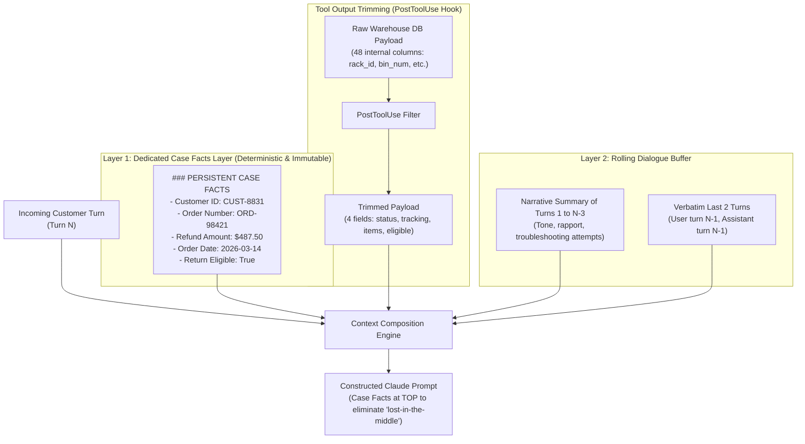

# Task Statement 5.1: Manage Conversation Context to Preserve Critical Information

## 📌 Executive Overview: Goal, Scope & Exam Importance

### Domain & Exam Weight
- **Domain**: Domain 5 — Context Management & Reliability (18% of exam weighting)
- **Scenario Alignment**: Scenario 1 (Customer Support Resolution Agent with Strict SLAs)
- **Core Goal**: Architect resilient context preservation strategies for long multi-turn interactions, avoiding the loss of transactional numbers and identifiers caused by progressive summarization, trimming verbose tool outputs, and mitigating the "lost-in-the-middle" attention degradation.

### Why This Matters in Production
In real-world enterprise customer support, long-running agent loops (15–30 turns) encounter severe context window pressure. Two naive solutions often cause catastrophic production failures:
1. **Unbounded History Accumulation**: Appending every raw user message and 50-field database response exhausts token budgets, skyrockets API costs, and causes latency timeouts.
2. **Naive Progressive Summarization**: Periodically condensing chat history using an LLM ("Summarize the conversation so far") creates **information entropy**. LLMs reliably drop, distort, or hallucinate precise numbers, customer IDs, tracking numbers, and refund amounts over successive summary passes.

To achieve production reliability and 100% transactional accuracy, production architectures implement a **Dual-Layer Context Architecture**:
- **Layer 1: Immutable Case Facts**: Transactional entities (Order ID, Customer ID, refund amounts, eligibility flags) are extracted deterministically and preserved in an isolated structured data block outside the conversational summary.
- **Layer 2: Rolling Dialogue Buffer**: A rolling window of the last 2–3 turns in verbatim detail, accompanied by a narrative summary of earlier pleasantries and troubleshooting attempts.
- **Tool Payload Normalization**: Trimming 50-field enterprise JSON payloads down to only the 3–4 fields relevant to the current decision before storing them in conversation context.
- **Attention Positioning**: Mitigating the "lost-in-the-middle" effect by pinning Case Facts and critical system instructions to the absolute top of the prompt.

---

## 📖 Deep Narrative: Why We Do What We Do

### The Naive Production Failure: The Summarization Drift Trap
Consider an enterprise customer support agent handling a return for order `ORD-98421` with a refund amount of `$487.50` on March 14, 2026.
In Turn 1, the user states:
> *"Hi, I need a refund for order ORD-98421. I was charged $487.50 for the titanium cookware set delivered on March 14."*

In Turn 4, after extensive troubleshooting about return shipping labels, the system runs a naive summarization step:
```python
# NAIVE ANTI-PATTERN: Recursive LLM Summarization
summary_prompt = f"Summarize this conversation so far: {full_history}"
new_history = [{"role": "user", "content": f"Previous conversation summary: {call_claude(summary_prompt)}"}]
```
The summarizer produces:
> *"Customer discussed issues with titanium cookware set and requested a refund for roughly $480. Agent provided troubleshooting for return labels."*

Notice what happened:
- `ORD-98421` was omitted completely.
- `$487.50` was rounded to *"roughly $480"*.
- `March 14, 2026` was dropped.

In Turn 12, when the customer provides their tracking number and the agent calls `issue_refund(order_id, amount)`, the agent hallucinates an order ID or issues an incorrect refund of `$480.00`. The company incurs financial discrepancy audits, and the customer is shortchanged.

### The Architectural Solution: Dual-Layer Context with Case Facts & Tool Trimming
To solve this, we separate **transactional facts** from **conversational narrative**:



1. **Deterministic Case Facts Extraction**: As soon as order IDs, dollar amounts, or verification tokens appear in tool responses or validated user inputs, they are written to a structured `CaseFacts` object in application state.
2. **Context Assembly Order**:
   - **Top of Context (Highest Attention)**: `CaseFacts` block rendered as clean markdown.
   - **Middle of Context**: Compressed narrative summary of prior troubleshooting.
   - **Bottom of Context (Highest Recency Attention)**: The last 2 turns in full verbatim text, followed by the current user prompt.
3. **Tool Output Normalization**: When a tool queries an enterprise ERP/CRM system returning 48 columns (such as internal warehouse bin IDs, supplier codes, employee shift IDs), a `PostToolUse` trimming function strips out everything except the 4 fields required by the LLM (`status`, `tracking_number`, `item_list`, `is_returnable`). This saves up to 85% of token usage per tool call.

---

## 🔑 Key Technical Terminology Explained

- **Case Facts Layer**: A dedicated, structured context section outside summarized dialogue containing immutable transactional ground truths (order IDs, customer identifiers, exact monetary amounts, policy entitlements).
- **Progressive Summarization**: The process of periodically condensing previous conversation turns into an ongoing summary. Effective for narrative flow, but hazardous for exact numerical or string entities.
- **Information Entropy / Number Drift**: The progressive degradation and distortion of exact figures (amounts, dates, serial numbers) as they undergo successive LLM summarization cycles.
- **Lost-in-the-Middle Effect**: The empirical phenomenon where large language models exhibit high retrieval and instruction adherence at the beginning and end of long contexts, with a noticeable dip in attention in the middle 60% of the window.
- **Tool Output Trimming**: Normalizing and filtering verbose third-party or database JSON responses down to essential semantic fields before appending them to the message history.
- **Rolling Dialogue Buffer**: Preserving the most recent $K$ turns (typically 2 to 3) in verbatim detail so the model retains natural conversational continuity.

---

## ⚠️ Critical Exam Distinctions & Distractor Teardown

| Context Management Technique | Correct Implementation (Exam Standard) | Exam Trap / Distractor to Reject |
|---|---|---|
| **Preserving Transactional Facts** | **Case Facts Pattern**: Maintain a persistent state object with order numbers, customer IDs, and exact amounts. Inject it at the top of every turn. | **TRAP: Pure LLM Summarization**: Relying on Claude to summarize the entire chat history including order IDs and dollar values. (Numbers will be rounded or lost). |
| **Handling Verbose Tool Payloads** | **Post-Tool Trimming**: Filter JSON responses to only the fields needed for the prompt before appending to the context. | **TRAP: Raw Payload Ingestion**: Appending the complete 50-field database row to message history, bloating the context window with warehouse noise. |
| **Mitigating 'Lost-in-the-Middle'** | Place critical system instructions, policy constraints, and Case Facts at the **top** or **bottom** of the context. | **TRAP: Mid-Context Ingestion**: Appending critical policy instructions or case state in the middle of a 100,000-token conversation history. |
| **Conversation Memory Strategy** | Hybrid Architecture: Case Facts (Immutable) + Verbatim Recent Turns (Recency) + Compressed Narrative (History). | **TRAP: All-or-Nothing Memory**: Either keeping 100% of raw conversation history until context overflow, or throwing away everything except a 1-sentence summary. |

---

## 💡 Architectural Decision Matrix: Rules of Thumb

| Scenario / Conversation Length | Context Strategy | Token Cost | Fact Preservation Guarantee |
|---|---|---|---|
| **Short Task (1–3 turns)** | Full Raw Context Buffer | Low | 100% (within immediate attention) |
| **Multi-Turn Service (5–20 turns)** | **Case Facts + Rolling 2-Turn Window + Narrative Summary** | Predictable & Bound | **100% Deterministic for Facts** |
| **Extremely Long Audit (> 50 turns)** | Case Facts + Vector Search / Subagent Exploration Scratchpad | Fixed baseline | High (Facts isolated, details fetched on-demand) |
| **High-Volume DB Tool Responses** | PostToolUse Whitelist Trimming (4–5 fields max) | 80% reduction | Eliminates token waste and schema confusion |

---

## 🧠 Claude 4.5 Extended Thinking & Parameter Standards

When managing context in Claude 4.5:
- **Model Standard**: Use `claude-sonnet-4-5` for complex customer resolution reasoning; use `claude-haiku-4-5` for fast, lightweight narrative summarization.
- **Thinking Configuration**: Enable Extended Thinking with a budget of 2,048 to 4,096 tokens when resolving complex return/refund policies:
  ```python
  thinking = {"type": "enabled", "budget_tokens": 2048}
  ```
- **Temperature Omission**: **Do NOT specify `temperature`**, `top_p`, or `top_k`. Claude 4.5 enforces default sampling parameters when thinking is active; supplying custom values results in an HTTP `400 Bad Request`.
- **Thinking Continuity**: When replaying multi-turn conversation histories, any previous assistant turns containing `thinking` blocks must be preserved intact with their cryptographic signatures. Never strip thinking blocks from history.

---

## 🛠️ Hands-on Workbook Guide: Following the Code Step-by-Step

In the accompanying notebook [`ts_5_1_context_preservation.ipynb`](ts_5_1_context_preservation.ipynb), you will execute the full offline-executable context management architecture:

- **Step 1: Case Facts Class & State Initialization**: Instantiate the structured `CaseFacts` container for holding immutable transactional records.
- **Step 2: Simulating Summarization Drift**: Observe how naive progressive summarization corrupts order IDs and rounds floating-point dollar amounts.
- **Step 3: Tool Payload Trimming**: Implement a `PostToolUse` filter that strips a 45-field enterprise database response down to 4 critical attributes.
- **Step 4: Dual-Layer Context Engine**: Assemble the final prompt combining Case Facts at the top, a rolling dialogue buffer, and trimmed tool responses.
- **Step 5: Offline Execution & Verification**: Validate that the agent executes refund and return operations with 100% numerical and identifier accuracy.

Verify your implementation anytime with offline unit tests in WSL Ubuntu-26.04:
```powershell
wsl -d Ubuntu-26.04 bash -c "~/.local/bin/uv run pytest tests/test_domain5_full.py"
```
