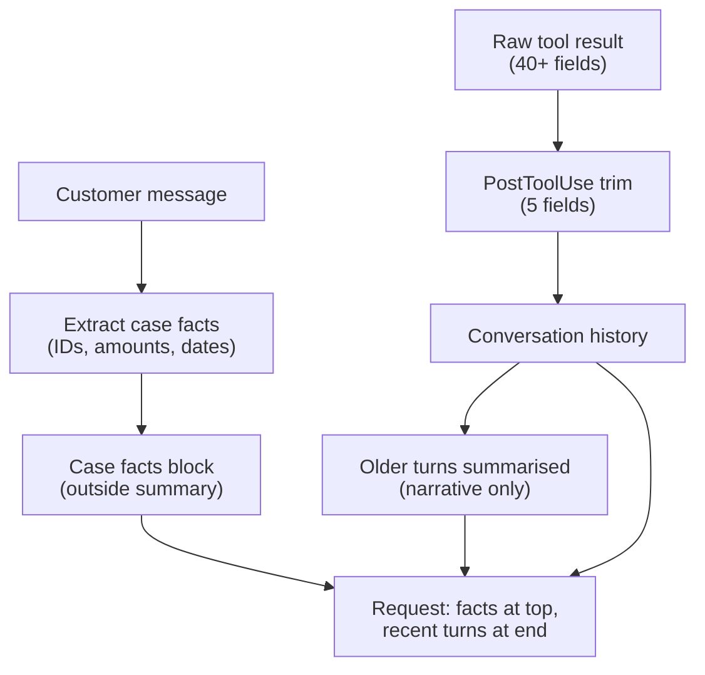

# Task Statement 5.1: Manage Conversation Context Across Long Interactions

> **Domain 5 (15% of exam)** | Scenario focus: **1 - Customer Support Resolution Agent** | Folder: `ts_5_1_context_preservation` | Next: [TS 5.2](../ts_5_2_escalation_and_provenance/README.md)

## In One Minute

- **What:** Long chats lose exact facts (order IDs, amounts, dates) when old turns are summarised.
- **Why it matters:** One wrong number means a wrong refund. Trust and money are lost.
- **Fix 1:** Keep a **case facts** block outside the summarised history and send it on every turn.
- **Fix 2:** Trim big tool results (40+ fields) to the 5 that matter *before* they enter context.
- **Fix 3:** Put key facts at the start and end of the input. Models under-use the middle.
- **Exam answer in one line:** *Structured case facts + trimmed tool output + key findings first.*

---

## Explain Like I'm 13

**The picture:** A telephone game. If each person re-tells the story in their own words, "$47.83" slowly becomes "about fifty". Keep a **facts card** on the desk that is never retold, and let only the rest of the chat be summarised. Also, do not copy a 47-field form into your notes when you only need 4 boxes.

**In plain steps:**
1. Put IDs, amounts and dates in a facts block and send it with every request.
2. Trim tool results to needed fields **before** they enter the history.
3. Key points first, headers on sections, question at the end.
4. Always send the full (managed) history. The API remembers nothing.

**Tiny example:** After 30 turns, "refund about $50" in a summary versus `item_price: 47.83` on the facts card.

---

## Concepts Explained

### 1. Progressive summarisation loses detail
Each summary pass keeps the topic and drops the specifics. Numbers get rounded, dates vanish, and **customer expectations** ("I need it by Friday") disappear.

### 2. Case facts block
Pull transactional facts into a small structured block (customer ID, order ID, amount, date, status, stated expectation). It lives **outside** the summarised history. You inject it into every request.

### 3. Trim tool results early
A tool can return 40+ fields when only 5 matter. Every raw result stays in the history for the rest of the session. Trim it **before it enters context**, for example in a `PostToolUse` hook.

### 4. "Lost in the middle"
Models use the start and end of a long input best. Details in the middle are easier to miss.
- Put **key findings at the start** of aggregated input.
- Use **clear section headers** for the detail below.
- Keep case facts at the top; keep the newest turns at the end.

### 5. Pass the complete history
Each API request must include the full conversation history (or its safe, trimmed form). Case facts add to the history. They do not replace it.

### 6. Subagents return structured data
Upstream agents should return **key facts, citations, relevance scores and dates**, not long reasoning. This keeps the downstream context small and checkable.

---

## Worked Example

**Scenario:** A customer writes on turn 1: *"Refund ORD-2026-9921. I paid $149.99 on 2026-09-28."*

| Step | What happens | Result |
|---|---|---|
| Turn 1 | Code extracts case facts with regexes. | `order=ORD-2026-9921`, `amount=$149.99`, `date=2026-09-28` |
| Turn 6 | A summary replaces turns 1-5: *"Customer asked about an order refund."* | Numbers are gone from the summary. |
| Turn 7 | `lookup_order` returns 47 fields (illustratively, about 1,800 tokens). Hook keeps 5 fields. | Far fewer tokens stay in history. |
| Turn 8 | Prompt = case facts (top) + summary + last turns + new message. | Agent refunds exactly `$149.99`. |

Run `main.py` to see this offline: `lossy_summary()` shows the drift, `facts_survive()` proves the facts block protects the numbers.

---

## Key Terms

- **Case facts:** Structured, persistent block of exact transactional facts kept outside summarised history.
- **Progressive summarisation:** Repeatedly condensing old turns. Fine for tone, risky for exact values.
- **Trimming (PostToolUse):** Keeping only needed fields from a tool result before it joins the history.
- **Lost in the middle:** Weaker use of information placed in the middle of a long input.
- **Structured subagent output:** Facts + citations + relevance + dates instead of verbose reasoning.

---

## Architecture



---

## Exam Traps and Correct Patterns

### Trap 1: Summarising harder to keep exact values

**Exam scenario**: After 30 turns, the support agent says the refund is "about $50" and the order was "last week". Turn 3 had `$47.83` and order `ORD-2026-9912` placed `2026-10-14`.

Progressive summarisation rewrites facts in prose each time, and exact numbers erode. Asking the summary to "keep numbers" helps a little and still fails over many rounds.

```text
PATTERN: Case facts block, outside the summarised history, re-sent every turn
  <case_facts>
    customer_id: CUST-88319
    order_id: ORD-2026-9912   placed: 2026-10-14
    item_price: 47.83 USD     refund_status: pending
  </case_facts>
  <summary>Customer reports a damaged item; photos received...</summary>
  <recent_turns>...</recent_turns>
```

Transactional values live in structured data that is never paraphrased.

### Trap 2: Trimming after the raw output is already in context

```python
# ANTI-PATTERN: raw 47-field order record appended, "trim later"
messages.append(tool_result(raw_record))   # 2,000 tokens, now in every future request

# PATTERN: allow-list in a PostToolUse step BEFORE it enters context
KEEP = ("order_id", "status", "total", "delivered_at")
messages.append(tool_result({k: raw_record[k] for k in KEEP}))
```

Once raw output is in the history, you pay for it on every later turn.

### Trap 3: Key finding buried in the middle

In long inputs, content in the middle gets less attention than the start and end. Put the key findings first, label sections with headers, and place the question or most recent turns at the end.

### Trap 4: Dropping history

The API is stateless. Sending only the last user message loses all prior turns. Send the complete (or properly managed) history with each request. Prompt caching lowers cost, it does not restore dropped facts.

### Trap 5: Subagents that return full reasoning

If each of five research subagents returns 4,000 tokens of reasoning, the coordinator receives 20,000 tokens. Change the subagent output contract to structured facts: claim, source, date, score.

---

## Exam-Style Practice Questions

**Q1 (Scenario 1).** A support agent runs 35 turns. The platform summarises every 8 turns. At turn 30 it refunds `$480` instead of `$487.50` for the wrong order. What is the best fix?

- A. Summarise every 4 turns so less is lost.
- B. Keep a structured case facts block outside the summarised history and include it every turn.
- C. Tell the summariser "never round numbers".
- D. Delete history after each refund request.

**Q2 (Scenario 1).** `lookup_order` returns 46 fields. Only status, eligibility, amount, date and ID are used. Context is filling fast. Best approach?

- A. Keep all fields so Claude can choose what matters.
- B. Trim the result to the needed fields before it is added to the conversation.
- C. Trim it on the next turn, after Claude has read it once.
- D. Ask Claude to repeat the relevant fields in every reply.

**Q3 (Scenario 3).** A coordinator merges findings from 5 research subagents into one long input. The most important finding is often missed in the final report. What helps most?

- A. Put key findings at the start of the aggregated input and use section headers for details.
- B. Place the key finding in the middle so it is "surrounded by context".
- C. Remove all dates and source names to shorten the input.
- D. Ask subagents to return longer reasoning so nothing is lost.

### Answers

- **Q1: B.** A fails: more summaries cause more loss. C fails: instructions cannot stop summarisation drift. D fails: deleting history destroys the case.
- **Q2: B.** A fails: bloats context and attention. C fails: the raw record already sits in history. D fails: repeating fields adds tokens and still keeps the raw record.
- **Q3: A.** B fails: the middle is the weakest position. C fails: it removes the provenance needed later. D fails: verbose reasoning adds noise; ask for structured facts instead.

---

## Self-Check Checklist

- [ ] I can explain why summaries lose numbers, dates and expectations.
- [ ] I can list what goes in a case facts block and where it is placed.
- [ ] I know trimming must happen **before** results enter context.
- [ ] I can explain "lost in the middle" and the fix (key findings first, headers).
- [ ] I know subagents should return structured data, not reasoning.

**Memory hook:** *"Facts in a box, trim before the stack, key points at the top."*

---

## Hands-on Workbook Guide

Notebook: [`ts_5_1_context_preservation.ipynb`](ts_5_1_context_preservation.ipynb). Code: [`main.py`](main.py). Both run offline.

1. **Case facts:** `CaseFacts`, `extract_case_facts()`.
2. **Drift demo:** `lossy_summary()` and `facts_survive()`.
3. **Trimming:** `trim_order_output()` cuts 47 fields to 5; `approx_tokens()` compares size.
4. **Layout:** `assemble_context()` and `render_aggregated_findings()`.
5. **Verify:** `uv run pytest tests/test_domain5_enhancements.py -q` in WSL.

**Related:** [TS 5.4](../ts_5_4_scratchpads_and_human_review/README.md) (the same ideas at codebase scale) | [TS 5.6](../ts_5_6_provenance_and_uncertainty/README.md) (keep claim-source links through summaries).
