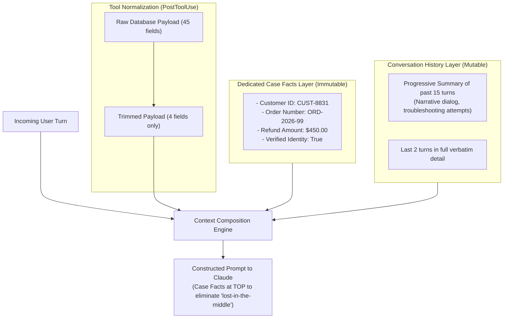

# Task Statement 5.1: Manage Conversation Context to Preserve Critical Information

## 🎯 Exam Objective
Understand how to preserve transactional integrity across long multi-turn interactions using the **Case Facts** layer, avoid the catastrophic loss of numerical facts from **progressive summarization**, trim tool outputs, and combat the **lost-in-the-middle** effect.

---

## 🏗️ Architecture: Dual-Layer Context Preservation

---

## ⚠️ Critical Exam Distinctions & Anti-Patterns

| Context Management Technique | Correct Implementation | Exam Trap to Reject |
|---|---|---|
| **Transactional State Storage** | **Case Facts Pattern**: Store order IDs, refund dollar amounts, and customer IDs in an immutable structured block outside conversation summaries. | **TRAP**: Relying solely on recursive LLM summarization. LLM summarizers reliably drop or distort exact numbers, timestamps, and order strings over long threads. |
| **Tool Payload Optimization** | **Trim Tool Outputs**: Strip unneeded internal metadata fields before saving tool results into conversation history. | **TRAP**: Dumping raw 50-field enterprise database rows into history, filling the context window with useless noise. |
| **Combating 'Lost-in-the-Middle'** | Place critical system instructions, schemas, and Case Facts at the **top** or **bottom** of the context. | **TRAP**: Burying critical policy rules in the middle of a 150,000-token conversation history. |

---

## 💡 Architectural Decision Matrix

| Strategy | Token Efficiency | Fact Retention Fidelity | Best Used For |
|---|---|---|---|
| **Raw Conversation History** | Low (rapidly exhausts context) | 100% (until overflow) | Short, 2–3 turn quick workflows. |
| **Naive Progressive Summarization** | High | Low (hallucinates/drops numbers) | Casual conversational bots (NOT financial/billing). |
| **Case Facts + Rolling Summary** | High | **100% Deterministic** | Enterprise billing, customer support, legal workflows. |

---

## 🛠️ Production Code Reference
- Interactive Workbook: [`ts_5_1_context_preservation.ipynb`](ts_5_1_context_preservation.ipynb)
- Runnable Script: [`main.py`](main.py)
- Offline Verification: Run via `uv run pytest tests/test_domain5_full.py` in WSL.
