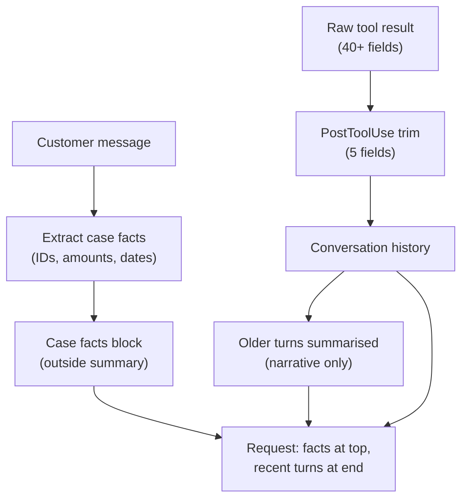

# Task Statement 5.1: Manage Conversation Context Across Long Interactions

> **Domain 5 (15% of exam)** | Scenario focus: **1 - Customer Support Resolution Agent** | Folder: `ts_5_1_context_preservation` | Next: [TS 5.2](../ts_5_2_escalation_and_provenance/README.md)

## In One Minute

- **What:** Long chats lose exact facts (order IDs, amounts, dates) when old turns are summarised.
- **Why it matters:** One wrong number means a wrong refund. Trust and money are lost.
- **Fix 1:** Keep a **case facts** block outside the summarised history and send it on every turn.
- **Fix 2:** Trim big tool results (40+ fields) to the 5 that matter *before* they enter context.
- **Fix 3:** Put key facts at the start and end of the input. Models under-use the middle.
- **Exam answer in one line:** *Structured case facts + trimmed tool output + key findings first.*

---

## Overview

- **Domain:** 5 - Context Management and Reliability (15% of the exam; D1 27%, D2 18%, D3 20%, D4 20%).
- **Task statement:** 5.1 - manage conversation context to preserve critical information across long interactions.
- **Scenario fit:** Scenario 1 (support agent with SLAs). Also seen in Scenario 3 (research subagents).
- **Folder note:** The folder name says "context preservation". It matches official TS 5.1 exactly.

## Concepts Explained

### 1. Progressive summarisation loses detail
Each summary pass keeps the topic and drops the specifics. Numbers get rounded, dates vanish, and **customer expectations** ("I need it by Friday") disappear.

### 2. Case facts block
Pull transactional facts into a small structured block (customer ID, order ID, amount, date, status, stated expectation). It lives **outside** the summarised history. You inject it into every request.

### 3. Trim tool results early
A tool can return 40+ fields when only 5 matter. Every raw result stays in the history for the rest of the session. Trim it **before it enters context**, for example in a `PostToolUse` hook.

### 4. "Lost in the middle"
Models use the start and end of a long input best. Details in the middle are easier to miss.
- Put **key findings at the start** of aggregated input.
- Use **clear section headers** for the detail below.
- Keep case facts at the top; keep the newest turns at the end.

### 5. Pass the complete history
Each API request must include the full conversation history (or its safe, trimmed form). Case facts add to the history. They do not replace it.

### 6. Subagents return structured data
Upstream agents should return **key facts, citations, relevance scores and dates**, not long reasoning. This keeps the downstream context small and checkable.

## Worked Example

**Scenario:** A customer writes on turn 1: *"Refund ORD-2026-9921. I paid $149.99 on 2026-09-28."*

| Step | What happens | Result |
|---|---|---|
| Turn 1 | Code extracts case facts with regexes. | `order=ORD-2026-9921`, `amount=$149.99`, `date=2026-09-28` |
| Turn 6 | A summary replaces turns 1-5: *"Customer asked about an order refund."* | Numbers are gone from the summary. |
| Turn 7 | `lookup_order` returns 47 fields (illustratively, about 1,800 tokens). Hook keeps 5 fields. | Far fewer tokens stay in history. |
| Turn 8 | Prompt = case facts (top) + summary + last turns + new message. | Agent refunds exactly `$149.99`. |

Run `main.py` to see this offline: `lossy_summary()` shows the drift, `facts_survive()` proves the facts block protects the numbers.

## Key Terms

- **Case facts:** Structured, persistent block of exact transactional facts kept outside summarised history.
- **Progressive summarisation:** Repeatedly condensing old turns. Fine for tone, risky for exact values.
- **Trimming (PostToolUse):** Keeping only needed fields from a tool result before it joins the history.
- **Lost in the middle:** Weaker use of information placed in the middle of a long input.
- **Structured subagent output:** Facts + citations + relevance + dates instead of verbose reasoning.

## Architecture

## Exam Traps and Correct Patterns

| Topic | Correct pattern | Trap to reject |
|---|---|---|
| Keeping exact values | Case facts block re-sent every turn | "Summarise harder" or "ask the summary to keep numbers" |
| Bloated tool output | Trim to needed fields before it enters context | Append the whole 47-field record "just in case" |
| Long aggregated input | Key findings first, section headers | Bury the key result in the middle |
| History | Send complete history each request | Send only the last user message |
| Subagent output | Structured facts, citations, scores, dates | Pass full reasoning chains downstream |

## Common Mistakes

- Trusting an LLM summary to keep numbers exact.
- Trimming **after** the raw result is already in history (too late).
- Putting policy and facts in the middle of a long transcript.
- Dropping the history and keeping only a summary of it.
- Asking subagents for "full detail" and then flooding the coordinator.

## Quick Decision Rules

| Situation | Do this |
|---|---|
| Exact IDs, amounts or dates matter across many turns | Case facts block |
| Tool returns many unused fields | Allow-list trim before context |
| Many sources feed one summary | Key findings first + headers per source |
| Subagent output is long | Change the subagent to return structured data |
| Need cheaper repeated prompts | Prompt caching is a cost tool; it does not fix lost facts |

## Claude 4.5 Notes

- `claude-sonnet-4-5` for reasoning and coordination; `claude-haiku-4-5` for workers and summaries.
- With extended thinking on: omit `temperature`; leave `top_k` and `top_p` unset; `tool_choice` may only be `auto` or `none`; `budget_tokens` must be at least 1024 and below `max_tokens`.
- Echo assistant `thinking` blocks (with signatures) back unchanged in tool-use turns.

## Exam-Style Practice Questions

**Q1 (Scenario 1).** A support agent runs 35 turns. The platform summarises every 8 turns. At turn 30 it refunds `$480` instead of `$487.50` for the wrong order. What is the best fix?

- A. Summarise every 4 turns so less is lost.
- B. Keep a structured case facts block outside the summarised history and include it every turn.
- C. Tell the summariser "never round numbers".
- D. Delete history after each refund request.

**Q2 (Scenario 1).** `lookup_order` returns 46 fields. Only status, eligibility, amount, date and ID are used. Context is filling fast. Best approach?

- A. Keep all fields so Claude can choose what matters.
- B. Trim the result to the needed fields before it is added to the conversation.
- C. Trim it on the next turn, after Claude has read it once.
- D. Ask Claude to repeat the relevant fields in every reply.

**Q3 (Scenario 3).** A coordinator merges findings from 5 research subagents into one long input. The most important finding is often missed in the final report. What helps most?

- A. Put key findings at the start of the aggregated input and use section headers for details.
- B. Place the key finding in the middle so it is "surrounded by context".
- C. Remove all dates and source names to shorten the input.
- D. Ask subagents to return longer reasoning so nothing is lost.

### Answers

- **Q1: B.** A fails: more summaries cause more loss. C fails: instructions cannot stop summarisation drift. D fails: deleting history destroys the case.
- **Q2: B.** A fails: bloats context and attention. C fails: the raw record already sits in history. D fails: repeating fields adds tokens and still keeps the raw record.
- **Q3: A.** B fails: the middle is the weakest position. C fails: it removes the provenance needed later. D fails: verbose reasoning adds noise; ask for structured facts instead.

## Self-Check Checklist

- [ ] I can explain why summaries lose numbers, dates and expectations.
- [ ] I can list what goes in a case facts block and where it is placed.
- [ ] I know trimming must happen **before** results enter context.
- [ ] I can explain "lost in the middle" and the fix (key findings first, headers).
- [ ] I know subagents should return structured data, not reasoning.

**Memory hook:** *"Facts in a box, trim before the stack, key points at the top."*

## Hands-on Workbook Guide

Notebook: [`ts_5_1_context_preservation.ipynb`](ts_5_1_context_preservation.ipynb). Code: [`main.py`](main.py). Both run offline.

1. **Case facts:** `CaseFacts`, `extract_case_facts()`.
2. **Drift demo:** `lossy_summary()` and `facts_survive()`.
3. **Trimming:** `trim_order_output()` cuts 47 fields to 5; `approx_tokens()` compares size.
4. **Layout:** `assemble_context()` and `render_aggregated_findings()`.
5. **Verify:** `uv run pytest tests/test_domain5_enhancements.py -q` in WSL.

**Related:** [TS 5.4](../ts_5_4_scratchpads_and_human_review/README.md) (the same ideas at codebase scale) | [TS 5.6](../ts_5_6_provenance_and_uncertainty/README.md) (keep claim-source links through summaries).
