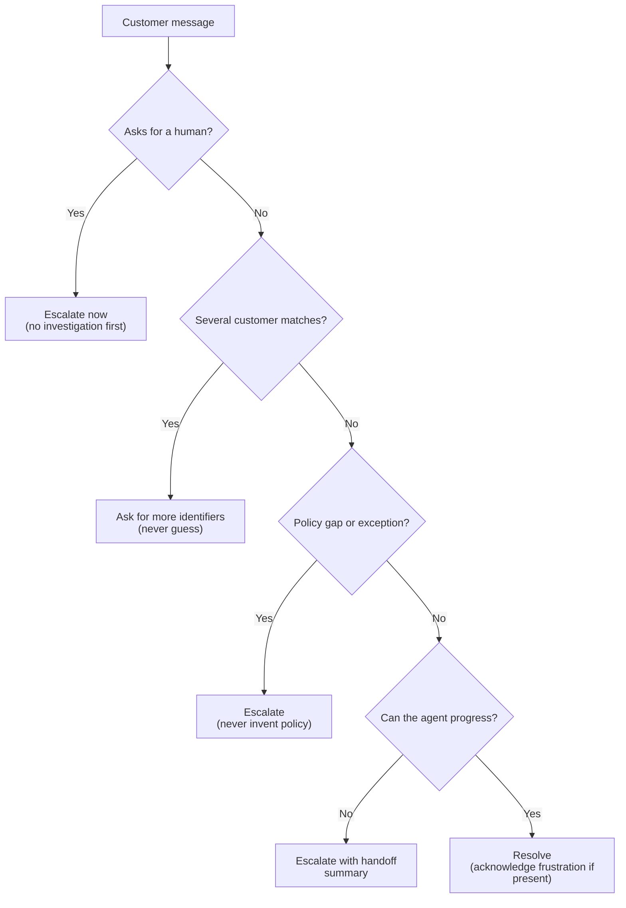

# Task Statement 5.2: Escalation and Ambiguity Resolution

> **Domain 5 (15% of exam)** | Scenario focus: **1 - Customer Support Resolution Agent** | Folder: `ts_5_2_escalation_and_provenance` | Previous: [TS 5.1](../ts_5_1_context_preservation/README.md) | Next: [TS 5.3](../ts_5_3_error_propagation_coverage/README.md)

> **Folder name note:** The folder name mentions "provenance", but this guide is **official TS 5.2 (escalation and ambiguity)**. Provenance belongs to [TS 5.6](../ts_5_6_provenance_and_uncertainty/README.md). `main.py` keeps a small provenance helper only for old imports.

## In One Minute

- **What:** Decide when the agent should hand over to a human and when it should ask, not guess.
- **Why it matters:** Wrong escalation hurts both ways: too much escalation wastes people, too little traps customers.
- **Escalate when:** the customer asks for a human, policy has a gap or exception, or the agent cannot progress.
- **Do not escalate on:** frustration alone, or an easy standard case.
- **Exam answer in one line:** *Explicit escalation criteria with few-shot examples. Not sentiment, not confidence scores.*

---

## 🧒 Explain Like I'm 13

**The picture:** A help desk. Someone says "I want the manager": you get the manager, you do not quiz them. Two customers named Jordan Lee: you ask for an ID, you do not pick one. The rule book says nothing about price matching: you ask the manager, you do not invent a rule.

**In plain steps:**
1. Asked for a human? Escalate now, with a short summary.
2. Angry but easy to fix? Acknowledge, fix, escalate only if they repeat the request.
3. Several matches? Ask for another identifier.
4. Policy silent? Escalate as a gap.
5. Too many wrong escalations? Write clear criteria with examples.

**Tiny example:** Mood is not difficulty. A calm customer asking for something outside policy needs a person. An angry one with a late parcel may not.

---

## Concepts Explained

### 1. Three Legitimate Triggers for Human Escalation
In autonomous customer operations, an agent should escalate to a human representative under exactly three deterministic conditions:
1. **Explicit Customer Demand**: The user explicitly requests a human agent or supervisor (e.g., *"Transfer me to a person"*).
2. **Policy Gaps & Uncovered Exceptions**: The customer's request is not addressed by existing corporate policy, or requires a discretionary exception (e.g., a customer asks to price-match an unlisted foreign competitor when the corporate manual only covers domestic brick-and-mortar stores). Autonomous agents must **never fabricate corporate policy**.
3. **Inability to Make Meaningful Progress**: The agent has attempted two consecutive tool lookups or troubleshooting steps without converging on a resolution.

### 2. Explicit Human Demands vs Customer Frustration
A core distinction frequently tested on the CCAR-F certification exam:
- **Explicit Demand for a Human**: When a user states *"I want to speak with a human right now"*, the agent must **escalate immediately without friction**. Forcing the customer to answer further diagnostic questions or attempting to persuade them to stay with the bot directly escalates customer anger and destroys satisfaction scores.
- **Customer Frustration Alone**: When a user expresses strong negative emotion (e.g. *"This shipping delay is completely ridiculous and unacceptable!"*) but does *not* demand a human, the agent should **acknowledge the frustration with empathy and offer an autonomous resolution** if the task is within its capabilities (e.g. checking tracking status or issuing a late-delivery credit). If the user subsequently reiterates their preference for a person, escalate immediately.

### 3. Resolving Ambiguous Identity Matches
When `get_customer` or `lookup_order` returns multiple candidate records (e.g. searching for `"John Smith"` yields four accounts with active subscriptions):
- **The Anti-Pattern**: Selecting the "most recent" account, the highest-tier customer, or the first record in the database list based on heuristics. This frequently compromises user privacy and applies changes to the wrong customer.
- **The Architectural Standard**: The agent must pause and **ask the customer for additional clarifying identifiers** (e.g., *"We found multiple accounts under that name. Could you please provide your account number, billing postal code, or registered email address?"*).

### 4. Why Sentiment and Self-Reported Confidence Fail as Escalation Proxies
Engineering teams frequently attempt to solve escalation calibration by adding infrastructure:
- **Sentiment Analysis Classifiers**: Sentiment measures emotion, not problem complexity. A perfectly calm, polite customer may present an intricate, unprecedented enterprise contract dispute requiring human legal review; an enraged customer may simply need a replacement tracking link that the agent can deliver in 2 seconds.
- **LLM Self-Reported Confidence**: Asking an autoregressive model to score its own confidence (1–10) before answering is notoriously uncalibrated. Models are frequently hyper-confident on subtle edge cases where they hallucinate.
- **The Solution**: Add explicit categorical escalation criteria directly to the system prompt, supported by 4–5 targeted few-shot examples demonstrating exact decision boundaries.

---

## 🧪 Worked Example

### ❌ Invalid Example (Anti-Pattern: Interrogating Customers & Guessing on Ambiguity)
```text
# BROKEN 1: Probing and interrogating when a customer demands a supervisor
Customer: "Your bot failed twice. Transfer me to a human supervisor right now!"
Agent Response: "I understand your frustration. Before I transfer you, can you answer 3 diagnostic questions about your issue?"
Why it fails: The customer explicitly requested a human. Delaying transfer with interrogation causes angry churn!

# BROKEN 2: Guessing customer account on multiple matches
Agent searches CRM for "David Miller" -> returns 3 accounts (TX, NY, CA).
Agent Action: Arbitrarily selects David Miller in TX because they had the most recent order.
Why it fails: Severe privacy violation! The agent updates the wrong customer's address and exposes personal data!
```

### ✅ Valid Example (Production Pattern: Immediate Hand-off & Disambiguation Request)
```python
# CORRECT 1: Immediate Hand-off on Explicit Request
def handle_customer_message(user_input: str, state: ConversationState):
    if state.explicit_human_requested(user_input):
        # Escalate immediately without diagnostic interrogation!
        return escalate_to_human(
            reason="explicit_customer_demand",
            handoff_payload={
                "customer_id": state.customer_id,
                "order_id": state.order_id,
                "summary": state.summary,
                "attempted_tools": state.tool_history
            }
        )

# CORRECT 2: Disambiguation on Ties (Never guess!)
def resolve_customer(matches: list[CustomerRecord]):
    if len(matches) > 1:
        # Prompt for unique disambiguating identifier without leaking other accounts:
        return "I found multiple accounts with that name. Please provide your order number or registered email address."
```

**Situation (sample-question style):** First-contact resolution is **55%**. The agent escalates easy damaged-item replacements but tries policy exceptions on its own.

| Step | Finding | Action |
|---|---|---|
| Diagnose | Wrong cases are escalated; wrong cases are attempted. | The agent has no clear boundary. |
| Reject | Confidence scores, a sentiment classifier. | Both are unreliable proxies. |
| Fix | Add criteria to prompt: resolve standard damage & replacement; escalate exceptions & policy gaps. | Add 4-5 few-shot examples (see `ESCALATION_FEW_SHOT_EXAMPLES`). |
| Result | Easy cases resolve autonomously, edge cases reach humans. | FCR rate rises without extra infrastructure. |

---

## 🔑 Key Terms

- **Explicit escalation criteria**: Precise prompt boundaries and few-shot examples defining the exact conditions under which an agent must surrender execution to a human specialist.
- **Policy gap**: A novel customer request or business scenario that is completely unmentioned by existing operating procedures (distinct from an explicit policy denial), requiring human judgment rather than agent invention.
- **Entity disambiguation**: The mandatory protocol of requesting secondary identifiers (such as email, account ID, or order number) when a database lookup returns multiple candidate records.
- **First-Contact Resolution (FCR)**: An operational service metric tracking the percentage of incoming customer tickets resolved successfully in a single interaction without human handoff or subsequent re-opens.
- **Structured handoff summary**: A concise briefing document (specifying customer identity, verified facts, attempted actions, and escalation rationale) passed to a human representative to prevent customer repetition.

---

## 🏗️ Architecture



---

## ⚠️ Exam Traps and Correct Patterns

### Trap 1: Investigating when the customer asks for a human

**Exam scenario**: Customer: "Stop. I want to talk to a human."

```text
ANTI-PATTERN reply: "Let me just check your order status first."
  -> The customer asked once and was ignored. This is how conversations get worse.

PATTERN reply: "Of course. I'm connecting you with a person now. I'm passing along your
  case so you don't have to repeat it."  + structured handoff (customer, order, issue, attempts)
```

Explicit request for a human means escalate immediately.

### Trap 2: Escalating on emotion alone

| Message | Right action |
|---|---|
| "This is ridiculous! My order is late again!" and the order is trackable | Acknowledge the frustration, give the status, offer a fix. Escalate if they repeat the request for a human |
| "This is ridiculous, I want a manager" | Escalate |

Sentiment is not difficulty. An angry customer with a solvable problem should be solved. A calm customer asking for something outside policy needs escalation.

### Trap 3: Guessing among multiple matches

```text
lookup_customer("Jordan Lee") -> 3 matches
ANTI-PATTERN: pick the most recent "to save time" -> refund goes to the wrong person.
PATTERN: ask for another identifier: email, phone, or order number.
```

### Trap 4: Policy silence is not "no" and not "yes"

Customer asks for price matching against a competitor. The policy covers only the company's own price drops. The agent must not invent a rule either way. This is a policy gap, so escalate.

### Trap 5: Fixing poor first-contact resolution with scores

**Exam scenario**: Resolution is low. The agent escalates simple cases and handles complex ones.

| Option | Verdict |
|---|---|
| Self-reported confidence threshold | Confidence is poorly calibrated, so it sorts cases badly |
| Sentiment model | Measures mood, not complexity |
| Separate classifier | Heavy. Still needs the criteria it lacks |
| **Explicit escalation criteria with few-shot examples** | Gives the agent the missing boundary. Correct |

---

## 📝 Exam-Style Practice Questions

**Q1 (Scenario 1).** A customer writes: *"Stop. I want to talk to a human."* The agent has `lookup_order` and `process_refund`. What should it do?

- A. Look up the order first so the human has context.
- B. Escalate immediately with a short handoff summary.
- C. Ask what is wrong, then decide whether to escalate.
- D. Offer a discount to keep the customer in chat.

**Q2 (Scenario 1).** FCR is 55%. Logs show the agent escalates simple damaged-item replacements but tries to approve competitor price matches (policy covers our own site only). What is the best change?

- A. Ask the model for a 1-10 confidence score and escalate below 7.
- B. Add a sentiment classifier and escalate on negative tone.
- C. Add explicit escalation criteria to the prompt with few-shot examples of each case.
- D. Route every ticket to a human first.

**Q3 (Scenario 1).** `get_customer("Maria Santos")` returns three customers. What should the agent do?

- A. Use the account with the most recent order.
- B. Use the first result.
- C. Ask the customer for an email, order ID or account number.
- D. Read out all three accounts' details and let the customer pick.

### Answers

- **Q1: B.** A fails: investigating first delays an explicit request. C fails: it questions the request. D fails: it ignores the request.
- **Q2: C.** A fails: self-reported confidence is unreliable. B fails: sentiment does not track complexity. D fails: it discards the cases the agent resolves well.
- **Q3: C.** A fails: recency is a guess. B fails: arbitrary choice risks the wrong account. D fails: it exposes other customers' data.

---

## ✅ Self-Check Checklist

- [ ] I can name the three escalation triggers.
- [ ] I know why frustration alone does not escalate.
- [ ] I can explain why sentiment and confidence scores are poor proxies.
- [ ] I know how to handle multiple customer matches.
- [ ] I can describe how criteria plus few-shot examples fix a low FCR.

**Memory hook:** *"Ask for human? Go. Policy gap? Go. Many matches? Ask. Angry but solvable? Fix."*

---

## 🛠️ Hands-on Workbook Guide

Notebook: [`ts_5_2_escalation_and_provenance.ipynb`](ts_5_2_escalation_and_provenance.ipynb). Code: [`main.py`](main.py). Both run offline.

1. **Rules:** `evaluate_escalation_rules()` applies the triggers in priority order.
2. **Disambiguation:** `resolve_customer()` never guesses.
3. **Prompt:** `build_escalation_prompt()` renders criteria plus few-shot examples.
4. **Verify:** `uv run pytest tests/test_domain5_enhancements.py -q` in WSL.

**Related:** [TS 5.5](../ts_5_5_human_review_calibration/README.md) (human review of extraction) | [TS 5.6](../ts_5_6_provenance_and_uncertainty/README.md) (provenance).

---

## 🧭 Navigation & Study Links
- ⬅️ **Previous Topic**: [TS 5.1: Context Preservation Across Long Sessions](../ts_5_1_context_preservation/README.md)
- 📋 **Domain Overview**: [Domain 5: Operational Excellence, Monitoring & Production Readiness](../README.md)
- ➡️ **Next Topic**: [TS 5.3: Error Propagation & Resilience in Multi-Agent Topologies](../ts_5_3_error_propagation_coverage/README.md)
- 🎯 **Scenario Practice**: [Master Scenario Practice](../../scenarios/MASTER_SCENARIO_PRACTICE.md)
