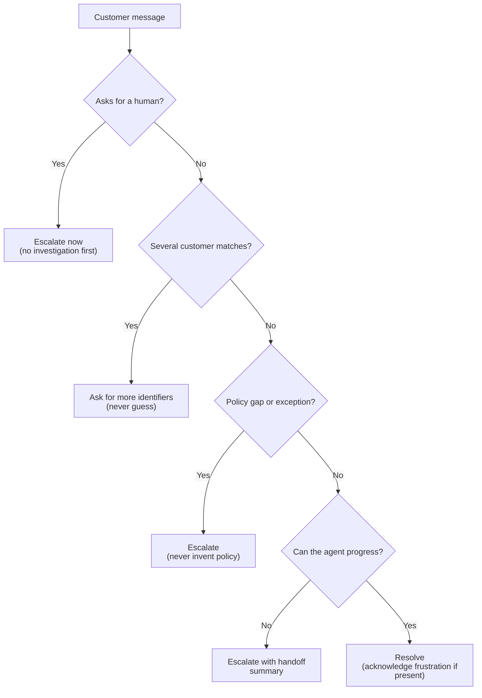

# Task Statement 5.2: Escalation and Ambiguity Resolution

> **Domain 5 (15% of exam)** | Scenario focus: **1 - Customer Support Resolution Agent** | Folder: `ts_5_2_escalation_and_provenance` | Previous: [TS 5.1](../ts_5_1_context_preservation/README.md) | Next: [TS 5.3](../ts_5_3_error_propagation_coverage/README.md)

> **Folder name note:** The folder name mentions "provenance", but this guide is **official TS 5.2 (escalation and ambiguity)**. Provenance belongs to [TS 5.6](../ts_5_6_provenance_and_uncertainty/README.md). `main.py` keeps a small provenance helper only for old imports.

## In One Minute

- **What:** Decide when the agent should hand over to a human and when it should ask, not guess.
- **Why it matters:** Wrong escalation hurts both ways: too much escalation wastes people, too little traps customers.
- **Escalate when:** the customer asks for a human, policy has a gap or exception, or the agent cannot progress.
- **Do not escalate on:** frustration alone, or an easy standard case.
- **Exam answer in one line:** *Explicit escalation criteria with few-shot examples. Not sentiment, not confidence scores.*

---

## Explain Like I'm 13

**The picture:** A help desk. Someone says "I want the manager": you get the manager, you do not quiz them. Two customers named Jordan Lee: you ask for an ID, you do not pick one. The rule book says nothing about price matching: you ask the manager, you do not invent a rule.

**In plain steps:**
1. Asked for a human? Escalate now, with a short summary.
2. Angry but easy to fix? Acknowledge, fix, escalate only if they repeat the request.
3. Several matches? Ask for another identifier.
4. Policy silent? Escalate as a gap.
5. Too many wrong escalations? Write clear criteria with examples.

**Tiny example:** Mood is not difficulty. A calm customer asking for something outside policy needs a person. An angry one with a late parcel may not.

---

## Concepts Explained

### 1. Escalation triggers
| Trigger | What the agent does |
|---|---|
| Customer explicitly asks for a human | Escalate **immediately**. No investigation first. |
| Policy gap or exception (e.g. competitor price match when policy covers our own site only) | Escalate. Never invent policy. |
| Agent cannot make progress | Escalate with a clear handoff summary. |

### 2. Frustration is not a trigger
If the issue is within the agent's capability, **acknowledge the frustration and offer a resolution**. If the customer then repeats that they want a human, escalate.

### 3. Ambiguous customer matches
A lookup returns several customers. Ask for **more identifiers** (email, order ID, account number). Never choose by recency, location or "first result".

### 4. Unreliable proxies
- **Sentiment** does not match complexity. A calm customer can have a serious problem.
- **Self-reported confidence** is often high when the model is wrong.
- Neither is a good escalation rule.

### 5. Fix with explicit criteria and few-shot examples
Write the criteria in the prompt. Add examples that show the boundary, such as "standard damage replacement: resolve" and "competitor price match: escalate".

---

## Worked Example

**Situation (sample-question style):** First-contact resolution is **55%**. The agent escalates easy damaged-item replacements but tries policy exceptions on its own.

| Step | Finding | Action |
|---|---|---|
| Diagnose | Wrong cases are escalated; wrong cases are attempted. | The agent has no clear boundary. |
| Reject | Confidence scores, a sentiment classifier. | Both are unreliable proxies. |
| Fix | Add criteria to the prompt: resolve standard damage and replacement; escalate exceptions and policy gaps. | Add 4-5 few-shot examples (see `ESCALATION_FEW_SHOT_EXAMPLES`). |
| Result | Easy cases resolve, edge cases reach humans. | Rate rises without extra infrastructure. |

---

## Key Terms

- **Explicit escalation criteria:** Written rules, in the prompt, for when to hand off.
- **Policy gap:** The request is not covered by policy (not the same as "policy says no").
- **Disambiguation:** Asking for identifiers to select one record.
- **First-contact resolution (FCR):** Share of issues solved without a handoff or follow-up.
- **Handoff summary:** Short structured note (customer, issue, steps taken) for the human.

---

## Architecture



---

## Exam Traps and Correct Patterns

### Trap 1: Investigating when the customer asks for a human

**Exam scenario**: Customer: "Stop. I want to talk to a human."

```text
ANTI-PATTERN reply: "Let me just check your order status first."
  -> The customer asked once and was ignored. This is how conversations get worse.

PATTERN reply: "Of course. I'm connecting you with a person now. I'm passing along your
  case so you don't have to repeat it."  + structured handoff (customer, order, issue, attempts)
```

Explicit request for a human means escalate immediately.

### Trap 2: Escalating on emotion alone

| Message | Right action |
|---|---|
| "This is ridiculous! My order is late again!" and the order is trackable | Acknowledge the frustration, give the status, offer a fix. Escalate if they repeat the request for a human |
| "This is ridiculous, I want a manager" | Escalate |

Sentiment is not difficulty. An angry customer with a solvable problem should be solved. A calm customer asking for something outside policy needs escalation.

### Trap 3: Guessing among multiple matches

```text
lookup_customer("Jordan Lee") -> 3 matches
ANTI-PATTERN: pick the most recent "to save time" -> refund goes to the wrong person.
PATTERN: ask for another identifier: email, phone, or order number.
```

### Trap 4: Policy silence is not "no" and not "yes"

Customer asks for price matching against a competitor. The policy covers only the company's own price drops. The agent must not invent a rule either way. This is a policy gap, so escalate.

### Trap 5: Fixing poor first-contact resolution with scores

**Exam scenario**: Resolution is low. The agent escalates simple cases and handles complex ones.

| Option | Verdict |
|---|---|
| Self-reported confidence threshold | Confidence is poorly calibrated, so it sorts cases badly |
| Sentiment model | Measures mood, not complexity |
| Separate classifier | Heavy. Still needs the criteria it lacks |
| **Explicit escalation criteria with few-shot examples** | Gives the agent the missing boundary. Correct |

---

## Exam-Style Practice Questions

**Q1 (Scenario 1).** A customer writes: *"Stop. I want to talk to a human."* The agent has `lookup_order` and `process_refund`. What should it do?

- A. Look up the order first so the human has context.
- B. Escalate immediately with a short handoff summary.
- C. Ask what is wrong, then decide whether to escalate.
- D. Offer a discount to keep the customer in chat.

**Q2 (Scenario 1).** FCR is 55%. Logs show the agent escalates simple damaged-item replacements but tries to approve competitor price matches (policy covers our own site only). What is the best change?

- A. Ask the model for a 1-10 confidence score and escalate below 7.
- B. Add a sentiment classifier and escalate on negative tone.
- C. Add explicit escalation criteria to the prompt with few-shot examples of each case.
- D. Route every ticket to a human first.

**Q3 (Scenario 1).** `get_customer("Maria Santos")` returns three customers. What should the agent do?

- A. Use the account with the most recent order.
- B. Use the first result.
- C. Ask the customer for an email, order ID or account number.
- D. Read out all three accounts' details and let the customer pick.

### Answers

- **Q1: B.** A fails: investigating first delays an explicit request. C fails: it questions the request. D fails: it ignores the request.
- **Q2: C.** A fails: self-reported confidence is unreliable. B fails: sentiment does not track complexity. D fails: it discards the cases the agent resolves well.
- **Q3: C.** A fails: recency is a guess. B fails: arbitrary choice risks the wrong account. D fails: it exposes other customers' data.

---

## Self-Check Checklist

- [ ] I can name the three escalation triggers.
- [ ] I know why frustration alone does not escalate.
- [ ] I can explain why sentiment and confidence scores are poor proxies.
- [ ] I know how to handle multiple customer matches.
- [ ] I can describe how criteria plus few-shot examples fix a low FCR.

**Memory hook:** *"Ask for human? Go. Policy gap? Go. Many matches? Ask. Angry but solvable? Fix."*

---

## Hands-on Workbook Guide

Notebook: [`ts_5_2_escalation_and_provenance.ipynb`](ts_5_2_escalation_and_provenance.ipynb). Code: [`main.py`](main.py). Both run offline.

1. **Rules:** `evaluate_escalation_rules()` applies the triggers in priority order.
2. **Disambiguation:** `resolve_customer()` never guesses.
3. **Prompt:** `build_escalation_prompt()` renders criteria plus few-shot examples.
4. **Verify:** `uv run pytest tests/test_domain5_enhancements.py -q` in WSL.

**Related:** [TS 5.5](../ts_5_5_human_review_calibration/README.md) (human review of extraction) | [TS 5.6](../ts_5_6_provenance_and_uncertainty/README.md) (provenance).
