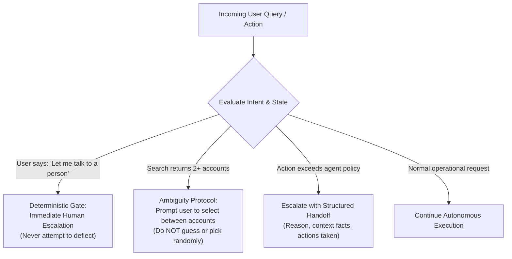

# Task Statement 5.2: Design Effective Escalation and Ambiguity Resolution Patterns

## 🎯 Exam Objective
Understand how to implement deterministic escalation routing for **explicit human requests**, resolve **multi-match query ambiguities** without guessing, and preserve conflicting statistics with source provenance.

---

## 🏗️ Architecture: Escalation and Ambiguity Router

---

## ⚠️ Critical Exam Distinctions & Anti-Patterns

| Situation | Correct Agent Behavior | Exam Trap to Reject |
|---|---|---|
| **Explicit Human Request** | **Escalate immediately**: Respect user demand without further deflection, sales pitches, or repeated queries. | **TRAP**: Trying to convince the user to keep talking to the AI or attempting 2 more times to resolve it autonomously. |
| **Multiple Database Matches** | **Disambiguation prompt**: Present the conflicting records to the user and request specific clarifying criteria. | **TRAP**: Arbitrarily picking the first record or guessing which account belongs to the user. |
| **Conflicting Source Data** | **Preserve both perspectives**: Quote each conflicting source with timestamp and methodology in the synthesis. | **TRAP**: Averaging numbers together or silently picking one source without telling the user about the conflict. |

---

## 💡 Architectural Decision Matrix

| Trigger Event | Routing Destination | Payload Structure |
|---|---|---|
| **"Human Agent Please"** | Tier 2 Human Support | Full Case Facts + Escalation Reason |
| **Policy Limit Exceeded ($500+)** | Supervisor Approval Queue | Structured Handoff Bundle |
| **Multiple Search Results Found** | Interactive User Disambiguation | Multiple-choice options |
| **Standard Supported Task** | Autonomous Agent Loop | Tool Execution Results |

---

## 🛠️ Production Code Reference
- Interactive Workbook: [`ts_5_2_escalation_and_provenance.ipynb`](ts_5_2_escalation_and_provenance.ipynb)
- Runnable Script: [`main.py`](main.py)
- Offline Verification: Run via `uv run pytest tests/test_domain5_full.py` in WSL.
