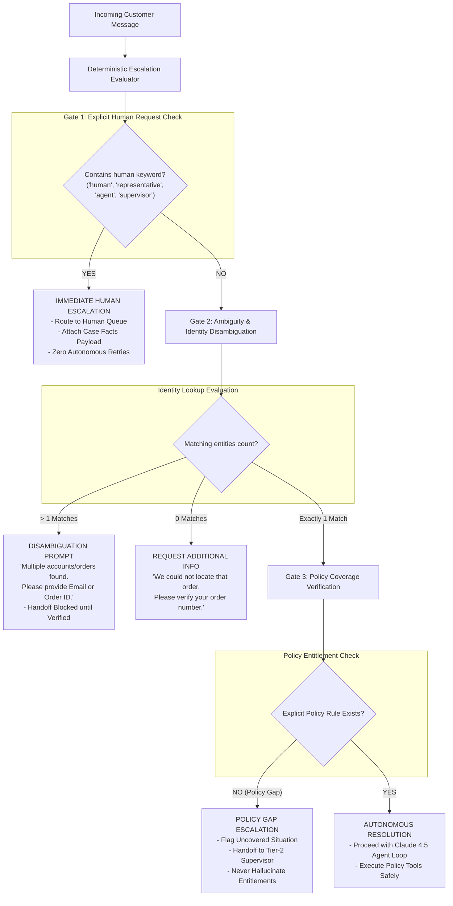

# Task Statement 5.2: Escalation Protocols & Ambiguity Resolution Patterns

## 📌 Executive Overview: Goal, Scope & Exam Importance

### Domain & Exam Weight
- **Domain**: Domain 5 — Context Management & Reliability (15% of exam weighting)
- **Scenario Alignment**: Scenario 1 (Customer Support Resolution Agent with Strict SLAs)
- **Core Goal**: Architect deterministic escalation logic and disambiguation protocols that protect customers and enterprise operations: immediately honoring explicit human agent requests, handling multi-match ambiguity without guessing, and escalating on policy gaps rather than hallucinating entitlements.

### Why This Matters in Production
In customer support and financial operations, autonomous agents face critical failure modes when dealing with ambiguous or edge-case interactions:
1. **Trapping Users in Infinite Loops**: When a frustrated customer says *"Let me speak to a human"*, a naive agent repeatedly replies *"I can help you with that! Please describe your issue again."* This infuriates users, destroys CSAT ratings, and violates consumer protection standards.
2. **Arbitrary Disambiguation Guessing**: When a customer says *"Check my order"* and a database query returns three active orders, a naive agent randomly picks the first order or guesses based on date. In production, this leaks another user's PII or cancels the wrong shipment.
3. **Hallucinating Policy Answers on Uncovered Scenarios**: When company policy is silent on an edge case (e.g., custom return policies during natural disasters), a naive agent invents a generous refund policy.

To prevent these failures, production architectures enforce **deterministic programmatic gates**:
- **Immediate Human Escalation**: Hardcoded regex/intent triggers that instantly route to a human supervisor upon explicit keywords (`representative`, `human agent`, `supervisor`).
- **Multi-Match Disambiguation**: When an identity or entity search yields $>1$ result, the agent is programmatically blocked from acting and must present a structured clarification prompt asking for a unique key.
- **Policy Gap Escalation**: When explicit policy rules do not cover the customer's condition, the agent halts autonomous actions and generates a structured handoff ticket for human review.

---

## 📖 Deep Narrative: Why We Do What We Do

### The Naive Production Failure: The "Helpful" Over-Reach Anti-Pattern
Consider an e-commerce support agent handling customer inquiries.
- A user named *"Alex Smith"* messages: *"Cancel my order right now."*
- The database lookup `find_orders(name="Alex Smith")` returns three orders: `ORD-101` ($25.00), `ORD-102` ($1,400.00), and `ORD-103` ($65.00).
- The customer also adds: *"And let me talk to a real person, this is ridiculous."*

If the engineering team relies on prompt-based instructions without programmatic escalation gates:
```python
# NAIVE ANTI-PATTERN: Relying on Prompt Instructions for Escalation
system_prompt = """
You are a helpful customer support agent. Always try your best to satisfy the customer.
If the customer asks for a human, try to resolve their issue first.
If there are multiple orders, pick the most recent one.
"""
```
The model will:
1. Ignore the demand for a human supervisor, attempting to be "helpful".
2. Pick `ORD-102` ($1,400.00 custom order) because it was placed today.
3. Call `cancel_order(order_id="ORD-102")` without verifying the customer's email or identity.
4. Reply: *"I have cancelled your $1,400 order for you! Is there anything else I can help you with today?"*

The customer actually wanted to cancel `ORD-103` ($65.00 phone case), and `ORD-102` was a non-refundable custom build belonging to a different Alex Smith in another state. The company now suffers a financial dispute, inventory loss, and severe privacy violations.

### The Architectural Solution: Programmatic Escalation & Disambiguation Router
Production architectures place a deterministic Python evaluation layer around the model:



1. **Gate 1: Hard Explicit Human Escalation**: If the message matches explicit escalation keywords, the workflow halts immediately. No further autonomous reasoning is permitted. A structured handoff ticket is created with full `CaseFacts` and chat trail.
2. **Gate 2: Multi-Match Disambiguation**: If an entity lookup returns more than one record, the agent is strictly prohibited from guessing. It generates a targeted clarification question prompting the user for unique identifiers (order ID, billing ZIP code, email).
3. **Gate 3: Policy Gap Escalation**: If the customer's request falls outside codified policy rules (e.g., requesting a refund after 90 days due to emergency hospitalization), the agent does not invent exceptions; it escalates to a human manager with explicit rationale.

---

## 🔑 Key Technical Terminology Explained

- **Programmatic Escalation Gate**: Code-level conditional logic that bypasses LLM decision-making and forces routing to a human queue or clarification prompt based on deterministic criteria.
- **Explicit Escalation**: User-initiated demand to speak with a human representative, which must be honored immediately without automated deflection or friction.
- **Implicit Escalation**: System-detected conditions requiring human intervention, such as repeated tool failures, high-risk financial values, or negative sentiment escalation.
- **Multi-Match Ambiguity**: A condition where a query resolves to multiple candidate database entities, requiring targeted user clarification rather than probabilistic guessing.
- **Policy Gap**: An operational scenario where codified organizational rules are silent or ambiguous; requires escalation to human leadership rather than autonomous generation of new rules.
- **Structured Handoff Manifest**: A complete JSON payload containing `CaseFacts`, conversation summaries, attempted actions, and escalation reasons passed to a human representative's CRM interface.

---

## ⚠️ Critical Exam Distinctions & Distractor Teardown

| Escalation / Ambiguity Pattern | Correct Implementation (Exam Standard) | Exam Trap / Distractor to Reject |
|---|---|---|
| **Explicit Human Request** | **Immediate Escalation**: Transfer immediately to human supervisor with context payload upon first request. | **TRAP: Deflection / Persuasion**: Prompting Claude to say: *"I understand your frustration, but I can resolve this faster. Please give me one more chance."* |
| **Ambiguous Entity Lookup** | **Mandatory Clarification**: Ask the user for unique identifying information (order ID, email, account number). | **TRAP: Heuristic Guessing**: Automatically selecting the most recent order, highest-value order, or the first record in the database array. |
| **Policy Coverage Gaps** | **Escalate to Tier-2 Support**: Inform customer that the scenario requires supervisor review and create an escalation ticket. | **TRAP: Autonomous Leniency**: Letting Claude hallucinate custom exceptions or approve refunds outside policy to maintain high sentiment scores. |
| **Escalation Implementation** | **Programmatic Code Gates**: Implement checks in Python / SDK hooks before and after tool calls. | **TRAP: Prompt-Only Guidelines**: Putting escalation rules solely in system prompt text, leaving them vulnerable to prompt drift and jailbreaks. |

---

## 💡 Architectural Decision Matrix: Rules of Thumb

| Condition Detected | Action Required | Autonomous Action Permitted? | Destination Queue |
|---|---|---|---|
| **User says "agent" / "human"** | Immediate Escalation | **NO** | Tier-1 Live Support Queue |
| **Lookup returns 2+ records** | Ask Clarification Prompt | **NO** (Ask user for unique ID) | Active Chat Session (Pending User Input) |
| **Lookup returns 0 records** | Request Identifier Re-entry | **NO** (Search again with new data) | Active Chat Session (Pending User Input) |
| **Refund value > \$500.00** | High-Value Approval Gate | **NO** (Generate pending ticket) | Tier-2 Financial Operations Manager |
| **Policy is silent on scenario** | Policy Gap Escalation | **NO** (Never invent policy) | Policy / Exception Review Queue |
| **1 exact match within policy** | Autonomous Execution | **YES** (Execute tool & confirm) | Autonomous Resolution Trail |

---

## 🧠 Claude 4.5 Extended Thinking & Parameter Standards

When designing escalation agents with Claude 4.5:
- **Model Standard**: Use `claude-sonnet-4-5` for high-accuracy policy evaluation and edge-case classification.
- **Thinking Configuration**: Enable Extended Thinking with a budget of 2,048 tokens for checking complex policy boundaries:
  ```python
  thinking = {"type": "enabled", "budget_tokens": 2048}
  ```
- **Temperature Omission**: **Do NOT supply `temperature`**, `top_p`, or `top_k` when thinking is enabled. Anthropic returns an HTTP `400 Bad Request` if custom temperature values are passed.
- **Tool Schema for Handoff**: Provide a dedicated tool `route_to_human_supervisor` with required arguments `case_facts`, `escalation_reason`, `priority` (`URGENT`, `STANDARD`), and `unresolved_questions`.

---

## 🛠️ Hands-on Workbook Guide: Following the Code Step-by-Step

In the accompanying notebook [`ts_5_2_escalation_and_provenance.ipynb`](ts_5_2_escalation_and_provenance.ipynb), you will follow the step-by-step implementation:

- **Step 1: Escalation Router Definition**: Implement the deterministic `evaluate_escalation_rules` logic in Python.
- **Step 2: Explicit Human Request Evaluation**: Test keyword matching to verify zero-delay escalation routing.
- **Step 3: Multi-Match Ambiguity Disambiguation**: Simulate multi-account collisions and generate structured clarification prompts.
- **Step 4: Policy Gap Handling**: Trigger policy gap detection when customer scenarios fall outside codified rules.
- **Step 5: Structured Handoff Manifest Creation**: Build the complete, auditable context packet for human agents.

Verify your implementation anytime with offline unit tests in WSL Ubuntu-26.04:
```powershell
wsl -d Ubuntu-26.04 bash -c "~/.local/bin/uv run pytest tests/test_domain5_full.py"
```
