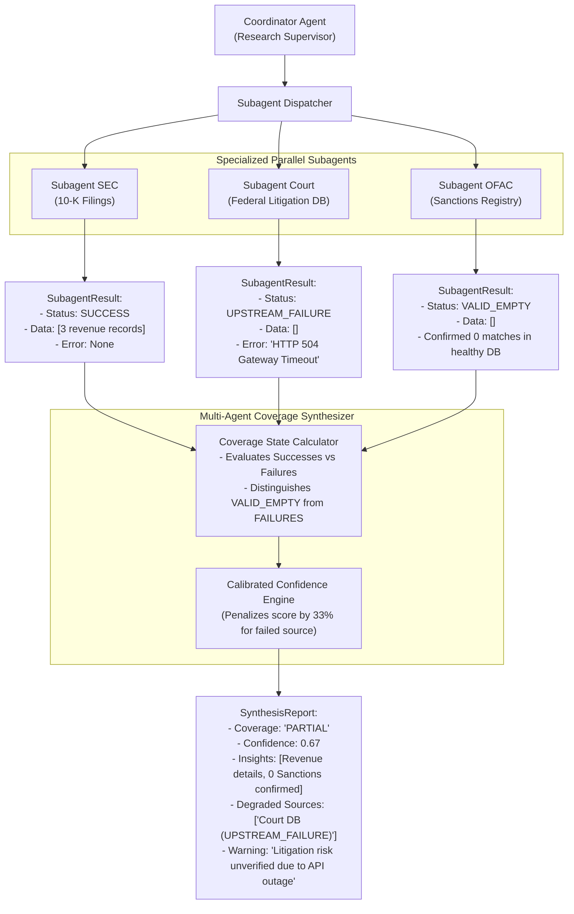

# Task Statement 5.3: Error Propagation & Coverage Tracking Across Multi-Agent Systems

## 📌 Executive Overview: Goal, Scope & Exam Importance

### Domain & Exam Weight
- **Domain**: Domain 5 — Context Management & Reliability (15% of exam weighting)
- **Scenario Alignment**: Scenario 3 (Multi-Agent Research & Competitive Synthesis)
- **Core Goal**: Architect resilient error propagation and synthesis protocols across subagent hierarchies: strictly distinguishing between semantic zero results (`VALID_EMPTY`) and infrastructure outages (`UPSTREAM_FAILURE`), tracking partial system coverage, and transparently annotating degraded findings in executive reports.

### Why This Matters in Production
In distributed multi-agent systems, a coordinator dispatches research or data-gathering tasks to 3–5 specialized subagents (e.g., SEC EDGAR filings, Market Analyst, Social Sentiment, Regulatory DB).
Two critical failure modes plague naive architectures:
1. **Silent Error Masking (The "Zero Results" Lie)**: When a subagent encounters a 503 HTTP timeout querying a financial database, a naive error handler catches the exception and returns an empty list `[]`. The coordinator interprets `[]` as *"No regulatory violations exist for this company"*—transforming an infrastructure outage into a dangerously false affirmative business finding.
2. **Brittle Cascading Failures**: When one subagent fails out of five, a naive system raises an unhandled exception that aborts the entire multi-agent job, discarding 80% of successfully gathered research.

Production multi-agent systems solve this through **Structured Status Propagation & Coverage Accounting**:
- **Semantic Zero (`VALID_EMPTY`) vs System Outage (`UPSTREAM_FAILURE`)**: Distinguishing when a healthy database found zero items vs when a service failed to respond.
- **Partial Coverage Accounting**: The synthesizer labels reports as `COMPLETE` or `PARTIAL`, explicitly naming omitted sources and calculating a calibrated confidence penalty.
- **Graceful Degradation**: Producing high-value partial reports while flagging data gaps for targeted follow-up.

---

## 📖 Deep Narrative: Why We Do What We Do

### The Naive Production Failure: Conflating Downtime with Clean Audits
Consider a corporate due diligence agent analyzing a target acquisition candidate (*"Acme Logistics"*).
The coordinator spawns three subagents:
- `Subagent 1 (Financials)`: Queries 10-K filings.
- `Subagent 2 (Litigation)`: Queries federal court records.
- `Subagent 3 (Sanctions)`: Queries OFAC and global sanctions lists.

During the run, the federal court database experiences a gateway timeout (`HTTP 504 Gateway Timeout`).
In a naive implementation:
```python
# NAIVE ANTI-PATTERN: Swallowing Errors into Empty Lists
def query_litigation_database(company_name: str) -> List[Dict[str, Any]]:
    try:
        response = court_api.search(company_name, timeout=5)
        return response.json()["records"]
    except Exception as e:
        # Catastrophic: treating an infrastructure failure as "no records found"
        logger.warning(f"Error querying court API: {e}")
        return []
```
The coordinator collects:
- Financials: 3 records found.
- Litigation: `[]` (Empty list).
- Sanctions: `[]` (Empty list).

The coordinator passes these results to Claude:
> *"Synthesize the findings. If no records are found in litigation or sanctions, confirm that the company is legally clean."*

Claude reports:
> *"Executive Summary: Acme Logistics has healthy cash flow and zero active litigation or legal sanctions. The target is cleared for acquisition."*

Two weeks later, the company acquires Acme Logistics, only to discover a pending $50M class-action lawsuit. The due diligence system didn't verify clean litigation; it simply reported an internal server timeout as clean evidence!

### The Architectural Solution: Structured Subagent Status & Coverage Synthesis
Production multi-agent pipelines demand an explicit status enum and coverage contract:



1. **Subagent Status Enum**: Every subagent emits an explicit status:
   - `SUCCESS`: Successfully executed and returned $\ge 1$ records.
   - `VALID_EMPTY`: Service is healthy and confirmed zero records match the query.
   - `UPSTREAM_FAILURE`: Network timeout, 500 error, or connection reset.
   - `RATE_LIMITED`: API quota exceeded; eligible for exponential backoff.
2. **Synthesizer Coverage Tracking**: The synthesis engine computes the ratio of healthy vs degraded sources. If any source experiences `UPSTREAM_FAILURE`, the report state is downgraded to `PARTIAL`.
3. **Transparent Uncertainty Reporting**: The final executive output does not pretend everything is complete. It highlights validated insights from healthy sources while explicitly naming degraded sources and warning decision-makers about missing coverage.

---

## 🔑 Key Technical Terminology Explained

- **Semantic Zero (`VALID_EMPTY`)**: The affirmative finding that a healthy, accessible data source contains zero matching records for a query.
- **System Failure (`UPSTREAM_FAILURE`)**: An infrastructure or network error (timeout, HTTP 500, DNS failure) preventing data retrieval; must never be conflated with zero results.
- **Silent Error Swallowing**: The anti-pattern of catching exceptions in data-fetching tools and returning `[]` or `None`, which falsely implies non-existence of records to downstream LLMs.
- **Coverage State**: Metadata indicating whether all intended data sources contributed to a synthesized output (`COMPLETE` vs `PARTIAL`).
- **Confidence Calibration Penalty**: A mathematical discount applied to the overall assessment score reflecting missing information from degraded sources.
- **Degraded Source Disclosure**: Clear callout in the executive summary informing human reviewers which specific APIs failed and need manual verification.

---

## ⚠️ Critical Exam Distinctions & Distractor Teardown

| Error Propagation Technique | Correct Implementation (Exam Standard) | Exam Trap / Distractor to Reject |
|---|---|---|
| **Empty Search vs Outage** | **Typed Status Return**: Return `VALID_EMPTY` for 0 results on healthy APIs; return `UPSTREAM_FAILURE` on timeouts or errors. | **TRAP: Empty List Coercion**: Converting exceptions to `return []` so the coordinator can process everything uniformly. (Creates false clean bills of health). |
| **Handling Subagent Outages** | **Partial Coverage Degradation**: Synthesize available results, mark coverage as `PARTIAL`, and clearly cite degraded sources. | **TRAP: All-or-Nothing Hard Crash**: Raising an exception in the coordinator that crashes the entire run when 1 of 5 sources times out. |
| **Synthesizer Transparency** | Explicitly state data gaps: *"Court DB was unreachable; litigation risk could not be verified."* | **TRAP: Silent Synthesis**: Hiding the outage from the user and reporting only the successful results as if they represent the whole picture. |
| **Retry Strategy on Errors** | Retry only transient errors (`503`, `429`, timeout) with exponential backoff; never retry permanent errors (`401`, `404`). | **TRAP: Infinite Retry Loop**: Retrying every error up to 10 times, exhausting latency budgets and compounding upstream outages. |

---

## 💡 Architectural Decision Matrix: Rules of Thumb

| Subagent Response | Coordinator Handling | Coverage Impact | Final Report Action |
|---|---|---|---|
| **`SUCCESS` ($\ge 1$ items)** | Ingest items into synthesis pool | Full coverage maintained | Include findings with source attribution |
| **`VALID_EMPTY` (0 items)** | Ingest "0 records found" confirmation | Full coverage maintained | State affirmative negative: *"Confirmed zero sanctions"* |
| **`UPSTREAM_FAILURE` (Timeout)** | Log error, omit from synthesis | Degrades to `PARTIAL` | Add prominent disclaimer: *"Source unreachable"* |
| **`RATE_LIMITED` (HTTP 429)** | Execute backoff or fallback cache | Degrades if cache misses | Note data freshness: *"Using cached data from 24h ago"* |
| **All Sources Fail** | Circuit breaker trigger | `ZERO_COVERAGE` | Abort synthesis; escalate infrastructure alert |

---

## 🧠 Claude 4.5 Extended Thinking & Parameter Standards

When synthesizing multi-agent findings with Claude 4.5:
- **Model Standard**: Use `claude-sonnet-4-5` for nuanced multi-source synthesis, conflict resolution, and gap analysis.
- **Thinking Configuration**: Enable Extended Thinking with a budget of 4,000 tokens to reason through source reliability and partial coverage impacts:
  ```python
  thinking = {"type": "enabled", "budget_tokens": 4000}
  ```
- **Temperature Omission**: **Do NOT provide `temperature`**, `top_p`, or `top_k`. Anthropic's Claude 4.5 API rejects custom sampling parameters when `thinking` is active.
- **Explicit Coverage Prompting**: Instruct Claude: *"If any source has status UPSTREAM_FAILURE, you must state in your executive summary that conclusions are tentative due to incomplete coverage."*

---

## 🛠️ Hands-on Workbook Guide: Following the Code Step-by-Step

In the accompanying notebook [`ts_5_3_error_propagation_coverage.ipynb`](ts_5_3_error_propagation_coverage.ipynb), you will explore the full offline-executable error propagation system:

- **Step 1: Subagent Status Enums & Data Classes**: Define `SubagentStatus`, `SubagentResult`, and `SynthesisReport`.
- **Step 2: Simulating Subagent Execution**: Dispatch mock subagents returning a mix of `SUCCESS`, `VALID_EMPTY`, and `UPSTREAM_FAILURE`.
- **Step 3: Multi-Agent Coverage Synthesizer**: Execute the synthesis engine to calculate coverage percentages and confidence penalties.
- **Step 4: Silent Error Anti-Pattern Comparison**: Compare the honest partial coverage report against a naive model that swallowed errors.
- **Step 5: Automated Verification**: Run assertions ensuring that failed sources are never reported as "zero records".

Verify your implementation anytime with offline unit tests in WSL Ubuntu-26.04:
```powershell
wsl -d Ubuntu-26.04 bash -c "~/.local/bin/uv run pytest tests/test_domain5_full.py"
```
