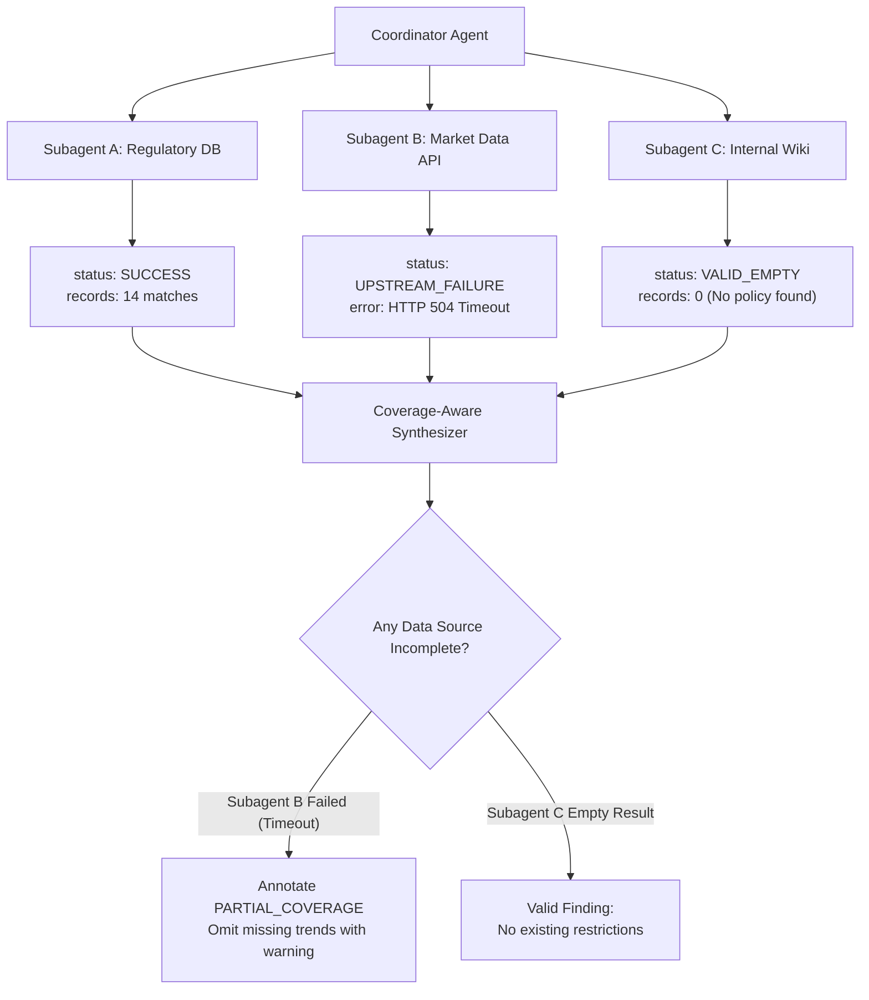

# Task Statement 5.3: Multi-Agent Error Propagation & Coverage Tracking

## 🎯 Exam Objective
Understand how to propagate structured errors across multi-agent hierarchies, distinguish valid empty results from upstream system failures, and annotate partial synthesis coverage.

---

## 🏗️ Architecture: Coverage & Error Disambiguation

---

## ⚠️ Critical Exam Distinction

| Event | Status Code | Synthesizer Action |
|---|---|---|
| Search query returns 0 documents in healthy database | `VALID_EMPTY` | Report finding: "No applicable policies exist." |
| Upstream database times out / network socket closes | `UPSTREAM_FAILURE` | **DO NOT report "No records exist"**! Must flag `PARTIAL_COVERAGE` with degraded confidence warning. |
| Malformed query / bad parameter | `VALIDATION_ERROR` | Retry or fail fast with parameter correction. |
