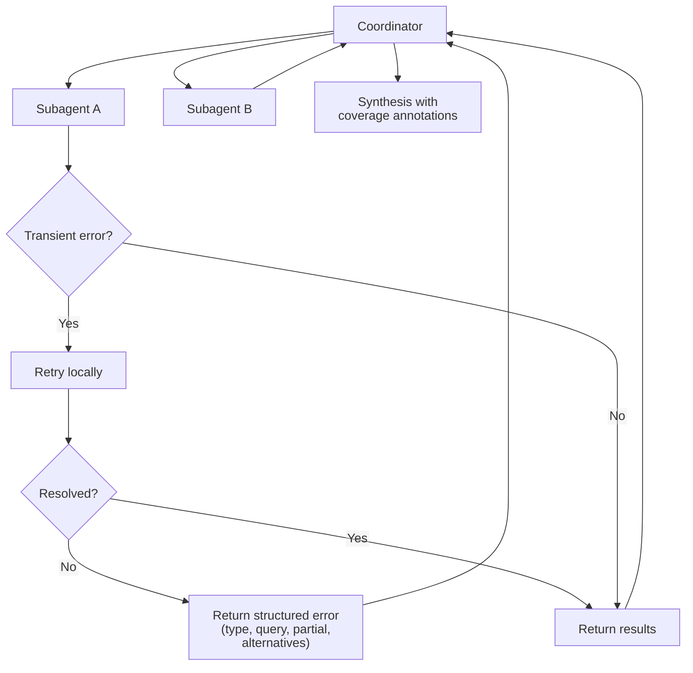

# Task Statement 5.3: Error Propagation Across Multi-Agent Systems

> **Domain 5 (15% of exam)** | Scenario focus: **3 - Multi-Agent Research System** | Folder: `ts_5_3_error_propagation_coverage` | Previous: [TS 5.2](../ts_5_2_escalation_and_provenance/README.md) | Next: [TS 5.4](../ts_5_4_scratchpads_and_human_review/README.md)

## In One Minute

- **What:** When a subagent fails, the coordinator needs *useful* error context, not a vague message.
- **Why it matters:** The coordinator can only retry, reroute or warn if it knows what went wrong.
- **Key split:** An **access failure** (timeout, 503) is not the same as a **valid empty result** (searched fine, found nothing).
- **Two anti-patterns:** hiding errors as "empty success", and killing the whole workflow on one failure.
- **Exam answer in one line:** *Return structured error context to the coordinator; recover transient errors locally; annotate coverage in the final report.*

---

## Explain Like I'm 13

**The picture:** Delivery notes. "Failed" is useless. "Door locked, tried twice, left a slip, can retry after 5pm" lets the next person decide. And "I checked the shelf and it was empty" is very different from "I never opened the shop".

**In plain steps:**
1. A subagent retries transient errors itself.
2. If it still fails, it reports: failure type, what it tried, partial results, alternatives.
3. Empty and checked is `VALID_EMPTY`. Could not check is `UPSTREAM_FAILURE`.
4. The coordinator keeps going and writes which sources were and were not checked.

**Tiny example:** "No patents found" is wrong if the patent database timed out. The report should say "Patent database: NOT CHECKED".

---

## Concepts Explained

### 1. Structured error context
A failure should carry four things:
- **Failure type** (transient, permanent, timeout, access denied).
- **Attempted query** (what was being searched).
- **Partial results** (anything gathered before failing).
- **Alternatives** (what the coordinator could try next).

### 2. Access failure vs valid empty result
| Result | Meaning | Coordinator action |
|---|---|---|
| `UPSTREAM_FAILURE` | The source could not be checked. | Retry, reroute, or note the gap. |
| `VALID_EMPTY` | The source was checked. Nothing matched. | Treat as real evidence ("none found"). |

### 3. Two anti-patterns
- **Generic status** ("search unavailable"): the coordinator cannot decide what to do.
- **Empty-as-success:** hides the failure, so the report claims "nothing found" when nothing was checked.
- **Killing the workflow:** one failed source aborts everything and discards good results.

### 4. Recover locally, propagate the rest
A subagent should retry **transient** errors itself (for example a timeout). It reports upward only the errors it **could not resolve**, with context and any partial results.

### 5. Coverage annotations in synthesis
The final report says which sources answered and which did not. Readers can then see what is well supported and what is a gap.

---

## Worked Example

**Scenario (sample-question style):** A web search subagent **times out** while the document analysis subagent succeeds.

| Step | What happens |
|---|---|
| 1 | Subagent retries the search twice (transient error handling). Still fails. |
| 2 | It returns: `failure_type=TRANSIENT`, `attempted_query="solid-state battery patents"`, `partial_results=[1 cached item]`, `alternatives=["retry later", "use cached index"]`. |
| 3 | Coordinator keeps the document results and decides to retry once, then proceed. |
| 4 | Final report states: *"Coverage: 2 of 3 sources answered. NOT CHECKED: web search (TRANSIENT)."* |

`run_subagent_query()` and `render_report()` in `main.py` implement exactly this.

---

## Key Terms

- **Structured error context:** failure type, attempted query, partial results, alternatives.
- **Valid empty result:** a successful query that matched nothing.
- **Local recovery:** a subagent handling a transient error without involving the coordinator.
- **Coverage annotation:** report text stating which sources were or were not checked.

---

## Architecture



---

## Exam Traps and Correct Patterns

### Trap 1: The generic status

**Exam scenario**: The search subagent times out and returns `"search unavailable"`.

The coordinator cannot tell: is it transient (retry)? Which query failed? Is there partial data? Any alternative? With a generic string it can only give up or guess.

```json
{
  "status": "failed", "failure_type": "TRANSIENT",
  "attempted_query": "solid-state battery patents 2025",
  "partial_results": [{"title": "Cached: SolidPower patent summary", "source": "cache"}],
  "alternatives": ["retry in 60s", "query the cached patent index"]
}
```

### Trap 2: Empty result as success, or as failure

| What happened | Correct return | Coordinator reading |
|---|---|---|
| Source searched, zero matches | `VALID_EMPTY` | Evidence: "checked, none found" |
| Source could not be searched | `UPSTREAM_FAILURE` | Gap: "not checked" |

```text
ANTI-PATTERN: except Exception: return []
  -> report says "no patents found" when the patent database was never queried.
```

The opposite mistake is raising an error for a valid zero. That triggers retries and false alarms.

### Trap 3: One failure kills the whole run

Of five sources, one times out. Aborting discards four good results. Continue, and annotate the report:

```text
Coverage: 4 of 5 sources answered.
NOT CHECKED: Patent database (TRANSIENT timeout). Findings on patents are incomplete.
```

### Trap 4: Where to recover

| Error | Subagent does | Propagates? |
|---|---|---|
| Timeout, 503 | Retry locally 2 times | Only if still failing, with context |
| Access denied (permanent) | Does not retry | Yes, with alternatives |

Escalating every blip floods the coordinator. Retrying a permanent error wastes turns.

---

## Exam-Style Practice Questions

**Q1 (Scenario 3).** A search subagent times out. The coordinator receives `"Error: search unavailable"`. What is the best improvement?

- A. Return the error with failure type, attempted query, partial results and alternatives.
- B. Return an empty result so the pipeline continues.
- C. Raise an exception that stops the whole research run.
- D. Retry forever in the coordinator.

**Q2 (Scenario 3).** A patents search runs successfully and finds no matching patents. How should the subagent report it?

- A. As an upstream failure, so the coordinator retries.
- B. As a valid empty result, stating what was searched.
- C. As a transient error with alternatives.
- D. Omit it from the output.

**Q3 (Scenario 6).** An extraction pipeline fetches data from 4 sources. Source 3 is down after local retries. What should the final report do?

- A. Drop source 3 silently; the other three are enough.
- B. Fail the whole job and return nothing.
- C. Fill source 3's section with likely values from similar companies.
- D. Include the results from the three sources and add a coverage annotation naming source 3 and the failure.

### Answers

- **Q1: A.** B fails: it turns a failure into false "nothing found". C fails: one failure should not discard good work. D fails: infinite retries ignore permanent failures and block progress.
- **Q2: B.** A fails: a successful search is not a failure. C fails: nothing went wrong. D fails: "none found" is useful evidence.
- **Q3: D.** A fails: the gap becomes invisible. B fails: it discards good partial work. C fails: it invents data.

---

## Self-Check Checklist

- [ ] I can list the four parts of structured error context.
- [ ] I can tell an access failure from a valid empty result.
- [ ] I can name the two anti-patterns (empty-as-success, killing the workflow).
- [ ] I know subagents retry transient errors and propagate only unresolved ones.
- [ ] I know what a coverage annotation says.

**Memory hook:** *"Fail with facts; empty is an answer; report what you missed."*

---

## Hands-on Workbook Guide

Notebook: [`ts_5_3_error_propagation_coverage.ipynb`](ts_5_3_error_propagation_coverage.ipynb). Code: [`main.py`](main.py). Both run offline.

1. **Local recovery:** `run_subagent_query()` retries `TransientSourceError`, stops on `PermanentSourceError`.
2. **Statuses:** `SUCCESS`, `VALID_EMPTY`, `UPSTREAM_FAILURE`, `RATE_LIMITED`.
3. **Synthesis:** `MultiAgentSynthesizer.synthesize()` builds coverage annotations.
4. **Report:** `render_report()` prints findings plus a coverage section.
5. **Verify:** `uv run pytest tests/test_domain5_enhancements.py -q` in WSL.

**Related:** [TS 5.6](../ts_5_6_provenance_and_uncertainty/README.md) (what to attach to each claim in the synthesis).
