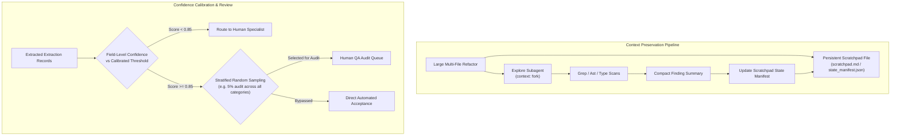

# Task Statement 5.4: Manage Context in Codebase Exploration & Calibrate Human Review

## 🎯 Exam Objective
Understand how to maintain state across context limits using **persistent scratchpads** and **crash recovery manifests**, isolate verbose codebase scans, and design **calibrated human review** with **stratified sampling**.

---

## 🏗️ Architecture: Persistent Scratchpad & Stratified Review Pipeline

---

## ⚠️ Critical Exam Distinctions & Anti-Patterns

| Exploration / Calibration Concept | Correct Implementation | Exam Trap to Reject |
|---|---|---|
| **State Manifests Across Restarts** | Save active task progress, completed milestones, and pending work to a **persistent disk file** (`manifest.json` / `scratchpad.md`). | **TRAP**: Relying entirely on in-memory variables or conversational history that vanish on session timeout or crash. |
| **Exploration Isolation** | Delegate wide codebase file searches to an **Explore subagent** with `context: fork`. | **TRAP**: Ingesting entire 50-file directory trees into the main conversation prompt. |
| **Aggregate Accuracy Pitfall** | **Calibrate by document segment/type**: A system with 98% overall accuracy may have a 60% error rate on rare edge-case forms (e.g. handwritten customs forms). | **TRAP**: Relying solely on overall aggregate accuracy metrics to justify skipping human review on high-risk document classes. |
| **Ongoing Quality Auditing** | **Stratified Random Sampling**: Sample a guaranteed percentage of high-confidence documents from *every* category to detect silent data drift. | **TRAP**: Auditing only low-confidence documents, leaving model blind spots and silent hallucinated false positives undetected. |

---

## 💡 Architectural Decision Matrix

| Mechanism | Purpose | Failure Mode Prevented |
|---|---|---|
| **`scratchpad.md`** | Preserves hypotheses, notes, and task progress | Context compaction and catastrophic forgetting |
| **Explore Subagent (`context: fork`)** | Gathers search results and provides synthesis | Main context pollution from massive grep outputs |
| **Stratified Sampling** | Ongoing human evaluation across categories | Undetected accuracy drops in rare document classes |

---

## 🛠️ Production Code Reference
- Interactive Workbook: [`ts_5_4_scratchpads_and_human_review.ipynb`](ts_5_4_scratchpads_and_human_review.ipynb)
- Runnable Script: [`main.py`](main.py)
- Offline Verification: Run via `uv run pytest tests/test_domain5_full.py` in WSL.
