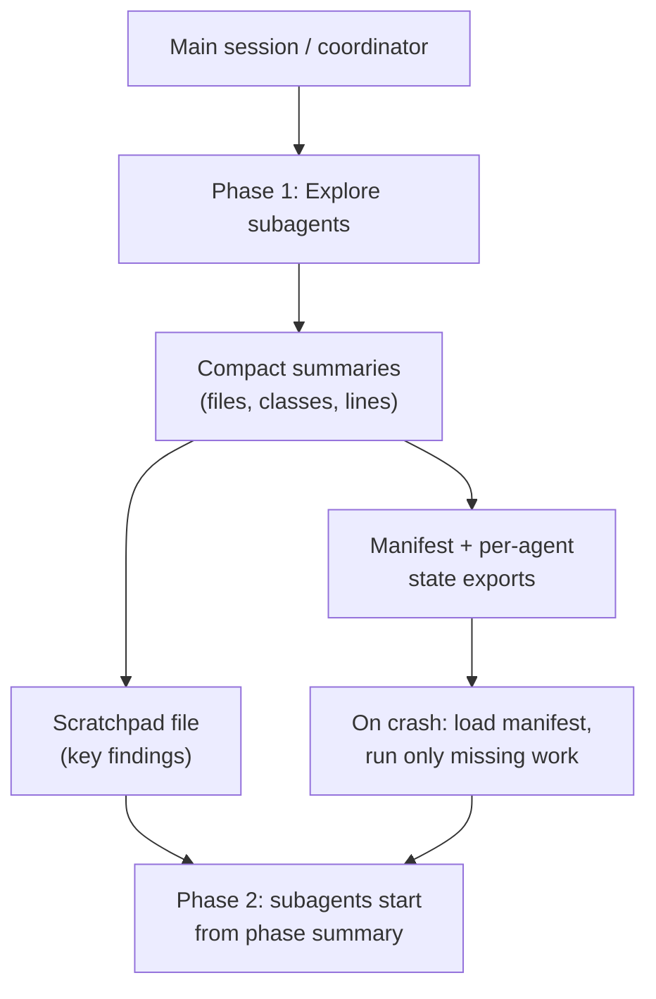

# Task Statement 5.4: Context Management in Large Codebase Exploration

> **Domain 5 (15% of exam)** | Scenario focus: **4 - Developer Productivity** (also Scenario 2 code generation) | Folder: `ts_5_4_scratchpads_and_human_review` | Previous: [TS 5.3](../ts_5_3_error_propagation_coverage/README.md) | Next: [TS 5.5](../ts_5_5_human_review_calibration/README.md)

> **Folder name note:** The folder name mentions "human review", but this guide is **official TS 5.4 (large-codebase context)**. Human review belongs to [TS 5.5](../ts_5_5_human_review_calibration/README.md). `main.py` keeps a small review helper only for old imports.

## In One Minute

- **What:** In long code exploration, the context fills with file contents and grep output.
- **Symptom:** The model starts giving "typical patterns" instead of the **specific classes** it found earlier.
- **Fix:** Write key findings to a **scratchpad file**, use **subagents** for noisy exploration, **summarise a phase** before the next, and save **state for crash recovery**.
- **Claude Code tool:** `/compact` reduces context usage in a long session.
- **Exam answer in one line:** *Scratchpad for findings, subagents for exploration, manifest for recovery.*

---

## Explain Like I'm 13

**The picture:** A detective's case notebook. After many days the detective forgets details unless they are written down. So: write specifics in the notebook (`scratchpad.md`), send a scout (Explore subagent) to read piles of files and bring back a summary, and save a checkpoint so a crash does not mean starting again.

**In plain steps:**
1. Write exact findings to a scratchpad as you go.
2. Delegate heavy reading to a subagent.
3. After each phase, summarise it and start the next phase from that summary.
4. Keep a manifest of what is done so a resume runs only what is left.

**Tiny example:** At turn 40 Claude talks about "typical patterns" and forgets `LedgerService`. A line in the scratchpad would have kept it.

---

## Concepts Explained

### 1. The Context Degradation Phenomenon in Large Codebase Exploration
When an autonomous agent explores a large enterprise codebase over an extended session (e.g. 40+ turns of reading files, grepping symbols, and inspecting logs), the model's effective attention degrades:
- The context window becomes saturated with thousands of lines of intermediate file dumps, compiler warnings, and abandoned search trails.
- As context fills, **context degradation** occurs: Claude stops referencing the specific, concrete class names and interfaces discovered on turn 5 (e.g. `LegacyOrderManager` in `billing/legacy/order.py`) and begins hallucinating generic textbook boilerplate ("typical enterprise architectures use a repository pattern...").
- Inconsistent and contradictory recommendations emerge because the model's attention cannot isolate verified ground truth from discarded exploratory noise.

### 2. The Persistent Scratchpad Pattern
To counteract context degradation, the agent must maintain a dedicated on-disk **Scratchpad File** (`SCRATCHPAD.md`):
- As the agent discovers concrete architectural facts (active database engines, auth middleware locations, public API schemas, core classes), it immediately writes these verified findings to the scratchpad.
- Because the scratchpad lives on disk outside conversation memory, it remains immune to token limits and context degradation.
- When beginning a new analytical subtask or answering follow-up questions, the agent re-reads the scratchpad, anchoring its reasoning in verified ground truth rather than fuzzy memory.

### 3. Subagent Delegation for Isolating Exploration Noise
When investigating a broad, open-ended question across an unfamiliar monorepo (e.g. *"Trace every dependency and caller of `TokenVerifier` across all 50 microservices"*):
- If the primary coordinator reads all 50 files directly, its context window is instantly destroyed by raw code tokens.
- **The Architectural Standard**: The coordinator delegates the exploration to an isolated **Explore subagent**. The subagent reads files, runs regex queries, and navigates imports in its own private context buffer.
- Upon completion, the subagent returns a concise, structured 10-line executive summary (matching file paths, exported symbol names, and call contracts) to the coordinator. The coordinator retains a clean, uncluttered context for high-level decision-making.

### 4. Phase-Gated Summarization Before Subagent Hand-Off
In multi-phase projects (e.g. Phase 1: Codebase Discovery $\to$ Phase 2: Refactoring Implementation):
- Never pass Phase 1's raw conversational history into Phase 2 subagents.
- The coordinator summarizes Phase 1's key findings into a structured architectural baseline, injecting only this verified summary into the initial prompts of Phase 2 subagents.

### 5. Crash Recovery Manifests for Stateful Systems
In long-running autonomous workflows that run for hours across distributed systems, network drops, machine reboots, and rate-limit timeouts will inevitably occur:
- If state is held purely in RAM, a crash forces the system to restart from scratch, re-spending hundreds of dollars in API tokens.
- **The Architectural Standard**: Every agent exports its execution state and findings to a known disk location upon completing each subtask.
- The coordinator maintains an authoritative **State Manifest** (`manifest.json`) recording which subtasks are completed, in progress, or pending. Upon restart, the coordinator loads the manifest, injects completed state into context, and resumes execution strictly on pending work.

### 6. Session Compaction (`/compact`)
Inside Claude Code, developers running long interactive exploration sessions can invoke `/compact` to semantically compress conversation history into a structured summary while preserving active tool pointers. For maximum reliability, use `/compact` in tandem with persistent scratchpad files.

---

## Worked Example

**Scenario:** Mapping an old monolith. By turn 40 Claude suggests a PostgreSQL syntax. The team found MySQL on turn 6.

| Step | Action |
|---|---|
| Turn 6 | Finding written to `scratchpad.md`: "DB layer is MySQL (`db/conn.py`)". |
| Turns 7-20 | An Explore subagent scans 200 files for `TokenVerifier`. Returns 3 findings with file and line. |
| End of phase 1 | Coordinator writes a phase summary; phase 2 subagents start from it. |
| Crash at turn 30 | On restart, the manifest lists `auth-explorer` (done) and `billing-explorer` (pending). Only billing runs again. |
| Turn 41 | Claude reads the scratchpad and uses MySQL syntax. |

`explore_subagent()`, `CodebaseScratchpadManager`, and `CrashRecoveryManifest` in `main.py` do this offline.

---

## Key Terms

- **Context degradation:** Specific details fade and generic patterns replace them in long sessions.
- **Scratchpad:** A file of key findings that persists beyond the context window.
- **Explore subagent:** A subagent that reads a lot and returns a compact summary.
- **Manifest:** A coordinator file that records each agent's phase and state file for resume.
- **`/compact`:** Claude Code command that condenses the conversation.

---

## Architecture



---

## Exam Traps and Correct Patterns

### Trap 1: Telling the model to "remember"

**Exam scenario**: 40 turns into mapping a legacy codebase, Claude talks about "typical repository patterns" and misses the `LedgerService` class it found at turn 6.

Context degrades over long sessions: early specifics fade into generalities. A reminder does not bring back detail that is no longer well attended to.

```markdown
# scratchpad.md  (Claude writes this as it goes, re-reads it periodically)
- LedgerService (src/ledger/service.py): all balance writes go through apply_entry()
- Retry logic lives in src/common/retry.py, used by 3 callers
- Open question: who calls reconcile()? (not found yet)
```

Exact findings in a file survive any context compaction.

### Trap 2: Reading 40 files in the main session

Send a verbose question such as "which modules touch payments?" to an **Explore subagent**. It reads in its own context and returns a short answer. The main session keeps its room.

### Trap 3: Passing raw phase output to the next phase

```text
ANTI-PATTERN: phase 1 produced 60k tokens of notes -> pasted into phase 2's subagents.
PATTERN: summarise phase 1 into key findings (a page), spawn phase 2 from that summary.
```

### Trap 4: Restarting from scratch after a crash

Write per-agent state as it works and a manifest of what is done:

```json
{"completed": ["auth", "billing"], "pending": ["reports"], "state_files": {"auth": "state/auth.json"}}
```

On resume, load the manifest into the coordinator's prompt and run only the pending work.

### Trap 5: `/compact` alone for exact facts

`/compact` summarises history. Summaries paraphrase. Keep identifiers, signatures, and decisions in the scratchpad so exact values survive compaction.

---

## Exam-Style Practice Questions

**Q1 (Scenario 4).** Forty turns into mapping a legacy codebase, Claude describes "typical repository patterns" and misses the real `LedgerService` class it found earlier. What is the best fix?

- A. Maintain a scratchpad file of key findings and have the agent refer to it.
- B. Tell Claude to "pay more attention".
- C. Reload every file again in the main session.
- D. Switch to a smaller model.

**Q2 (Scenario 4).** A developer needs every caller of `TokenVerifier` across about 300 files. The main session must stay focused on the design. What should they do?

- A. Read each file in the main session.
- B. Spawn a subagent to search and return a short list of callers with file and line.
- C. Paste the whole repository into the prompt.
- D. Ask Claude to guess from naming conventions.

**Q3 (Scenario 3/4).** A multi-agent exploration crashes after 3 of 5 agents finish. What lets the run resume efficiently?

- A. Re-run all five agents from scratch.
- B. Rely on the conversation history alone.
- C. Each agent exports state to a known file; the coordinator loads a manifest on resume and runs only missing agents.
- D. Increase the context window and retry.

### Answers

- **Q1: A.** B fails: a plea does not restore dropped details. C fails: it refills the context with the same noise. D fails: model size does not fix context buildup.
- **Q2: B.** A fails: it floods the main context. C fails: it cannot fit and dilutes attention. D fails: guessing invents callers.
- **Q3: C.** A fails: it wastes completed work. B fails: history may be lost or too large. D fails: a larger window does not recover lost state.

---

## Self-Check Checklist

- [ ] I can describe context degradation in a long exploration.
- [ ] I know what goes in a scratchpad.
- [ ] I can explain how subagents isolate verbose output.
- [ ] I can describe the manifest-based resume flow.
- [ ] I know what `/compact` does and its limit.

**Memory hook:** *"Write it down, delegate the noise, save your place."*

---

## Hands-on Workbook Guide

Notebook: [`ts_5_4_scratchpads_and_human_review.ipynb`](ts_5_4_scratchpads_and_human_review.ipynb). Code: [`main.py`](main.py). Both run offline.

1. **Scratchpad:** `CodebaseScratchpadManager.save()` and `.load()`.
2. **Subagent:** `explore_subagent()` returns an `ExploreSummary`.
3. **Phase summary:** `summarise_phase()`.
4. **Recovery:** `CrashRecoveryManifest.export_agent_state()`, `.load_manifest()`, `.resume_prompt()`.
5. **Verify:** `uv run pytest tests/test_domain5_enhancements.py -q` in WSL.

**Related:** [TS 5.1](../ts_5_1_context_preservation/README.md) (the same ideas for chat) | [TS 5.5](../ts_5_5_human_review_calibration/README.md) (human review, which was mixed into this folder).
