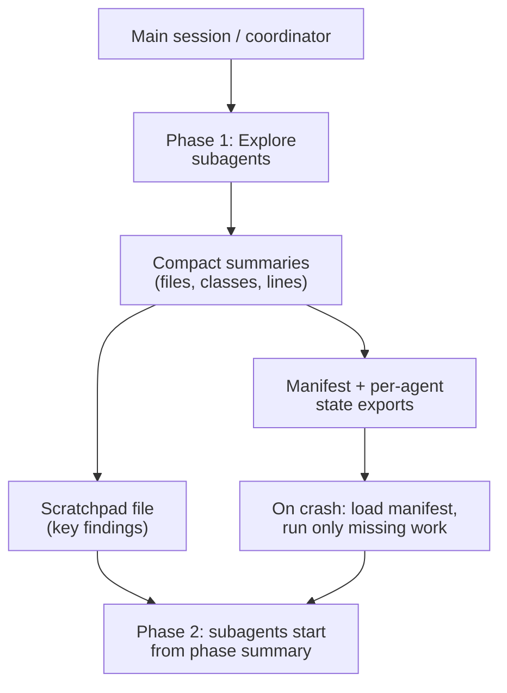

# Task Statement 5.4: Context Management in Large Codebase Exploration

> **Domain 5 (15% of exam)** | Scenario focus: **4 - Developer Productivity** (also Scenario 2 code generation) | Folder: `ts_5_4_scratchpads_and_human_review` | Previous: [TS 5.3](../ts_5_3_error_propagation_coverage/README.md) | Next: [TS 5.5](../ts_5_5_human_review_calibration/README.md)

> **Folder name note:** The folder name mentions "human review", but this guide is **official TS 5.4 (large-codebase context)**. Human review belongs to [TS 5.5](../ts_5_5_human_review_calibration/README.md). `main.py` keeps a small review helper only for old imports.

## In One Minute

- **What:** In long code exploration, the context fills with file contents and grep output.
- **Symptom:** The model starts giving "typical patterns" instead of the **specific classes** it found earlier.
- **Fix:** Write key findings to a **scratchpad file**, use **subagents** for noisy exploration, **summarise a phase** before the next, and save **state for crash recovery**.
- **Claude Code tool:** `/compact` reduces context usage in a long session.
- **Exam answer in one line:** *Scratchpad for findings, subagents for exploration, manifest for recovery.*

---

## Overview

- **Domain:** 5 (15% of the exam).
- **Task statement:** 5.4 - manage context effectively in large codebase exploration.
- **Scenario fit:** Scenario 4 (exploring and mapping a large codebase).

## Concepts Explained

### 1. Context degradation
In a long session the model reasons from a context full of old output. Early specifics fade. Answers become generic ("services usually have a repository layer") instead of exact ("`OrderService` in `billing/api.py`").

### 2. Scratchpad files
The agent writes **key findings** to a file as it goes: class names, file paths, contracts, open questions. Later phases (or a fresh context) read the file back. The scratchpad lives on disk, so context limits do not erase it.

### 3. Subagents isolate verbose exploration
Delegate a question such as "find all callers of `TokenVerifier`" to a subagent. It reads many files. It returns a **short summary** to the main session. The raw output never enters the main context.

### 4. Summarise a phase, then spawn the next
Finish phase 1 (discovery). Write a short summary of its findings. Give that summary to the phase 2 subagents. They do not need phase 1's raw output.

### 5. Crash recovery with a manifest
Each agent **exports its state** to a known file. A coordinator keeps a **manifest** listing agents, phases and state files. On resume, the coordinator loads the manifest and injects it into the prompt, then runs only the work still missing.

### 6. `/compact`
In Claude Code, `/compact` condenses the conversation to free context during a long session. Use it with a scratchpad, not instead of one.

## Worked Example

**Scenario:** Mapping an old monolith. By turn 40 Claude suggests a PostgreSQL syntax. The team found MySQL on turn 6.

| Step | Action |
|---|---|
| Turn 6 | Finding written to `scratchpad.md`: "DB layer is MySQL (`db/conn.py`)". |
| Turns 7-20 | An Explore subagent scans 200 files for `TokenVerifier`. Returns 3 findings with file and line. |
| End of phase 1 | Coordinator writes a phase summary; phase 2 subagents start from it. |
| Crash at turn 30 | On restart, the manifest lists `auth-explorer` (done) and `billing-explorer` (pending). Only billing runs again. |
| Turn 41 | Claude reads the scratchpad and uses MySQL syntax. |

`explore_subagent()`, `CodebaseScratchpadManager`, and `CrashRecoveryManifest` in `main.py` do this offline.

## Key Terms

- **Context degradation:** Specific details fade and generic patterns replace them in long sessions.
- **Scratchpad:** A file of key findings that persists beyond the context window.
- **Explore subagent:** A subagent that reads a lot and returns a compact summary.
- **Manifest:** A coordinator file that records each agent's phase and state file for resume.
- **`/compact`:** Claude Code command that condenses the conversation.

## Architecture

## Exam Traps and Correct Patterns

| Topic | Correct pattern | Trap to reject |
|---|---|---|
| Model gives generic patterns | Scratchpad of specific findings | "Remind the model to remember" |
| Verbose file reading | Subagent returns a summary | Read all 40 files in the main session |
| Multi-phase work | Summarise phase, then spawn next | Pass all raw output forward |
| Interrupted run | Manifest + state exports, load on resume | Restart the whole exploration |
| Context getting full | `/compact` plus scratchpad | Rely on `/compact` alone for exact facts |

## Common Mistakes

- Keeping findings only in the conversation.
- Letting subagents return full file contents.
- Writing no state until the end, so a crash loses everything.
- Forgetting to load the manifest into the coordinator's prompt on resume.
- Treating `/compact` as a guarantee that exact details survive.

## Quick Decision Rules

| Situation | Do this |
|---|---|
| Specific names fade in long session | Scratchpad |
| One question needs many files | Explore subagent |
| Moving to next phase | Summarise, then spawn |
| Run may be interrupted | Per-agent state + manifest |
| Context nearly full in Claude Code | `/compact` |

## Claude 4.5 Notes

- `claude-sonnet-4-5` for the coordinator; `claude-haiku-4-5` for fast Explore-style workers.
- With extended thinking on: omit `temperature`; leave `top_k` and `top_p` unset; `tool_choice` may only be `auto` or `none`; `budget_tokens` at least 1024 and below `max_tokens`.
- Echo assistant `thinking` blocks (with signatures) back unchanged in tool-use turns.

## Exam-Style Practice Questions

**Q1 (Scenario 4).** Forty turns into mapping a legacy codebase, Claude describes "typical repository patterns" and misses the real `LedgerService` class it found earlier. What is the best fix?

- A. Maintain a scratchpad file of key findings and have the agent refer to it.
- B. Tell Claude to "pay more attention".
- C. Reload every file again in the main session.
- D. Switch to a smaller model.

**Q2 (Scenario 4).** A developer needs every caller of `TokenVerifier` across about 300 files. The main session must stay focused on the design. What should they do?

- A. Read each file in the main session.
- B. Spawn a subagent to search and return a short list of callers with file and line.
- C. Paste the whole repository into the prompt.
- D. Ask Claude to guess from naming conventions.

**Q3 (Scenario 3/4).** A multi-agent exploration crashes after 3 of 5 agents finish. What lets the run resume efficiently?

- A. Re-run all five agents from scratch.
- B. Rely on the conversation history alone.
- C. Each agent exports state to a known file; the coordinator loads a manifest on resume and runs only missing agents.
- D. Increase the context window and retry.

### Answers

- **Q1: A.** B fails: a plea does not restore dropped details. C fails: it refills the context with the same noise. D fails: model size does not fix context buildup.
- **Q2: B.** A fails: it floods the main context. C fails: it cannot fit and dilutes attention. D fails: guessing invents callers.
- **Q3: C.** A fails: it wastes completed work. B fails: history may be lost or too large. D fails: a larger window does not recover lost state.

## Self-Check Checklist

- [ ] I can describe context degradation in a long exploration.
- [ ] I know what goes in a scratchpad.
- [ ] I can explain how subagents isolate verbose output.
- [ ] I can describe the manifest-based resume flow.
- [ ] I know what `/compact` does and its limit.

**Memory hook:** *"Write it down, delegate the noise, save your place."*

## Hands-on Workbook Guide

Notebook: [`ts_5_4_scratchpads_and_human_review.ipynb`](ts_5_4_scratchpads_and_human_review.ipynb). Code: [`main.py`](main.py). Both run offline.

1. **Scratchpad:** `CodebaseScratchpadManager.save()` and `.load()`.
2. **Subagent:** `explore_subagent()` returns an `ExploreSummary`.
3. **Phase summary:** `summarise_phase()`.
4. **Recovery:** `CrashRecoveryManifest.export_agent_state()`, `.load_manifest()`, `.resume_prompt()`.
5. **Verify:** `uv run pytest tests/test_domain5_enhancements.py -q` in WSL.

**Related:** [TS 5.1](../ts_5_1_context_preservation/README.md) (the same ideas for chat) | [TS 5.5](../ts_5_5_human_review_calibration/README.md) (human review, which was mixed into this folder).
