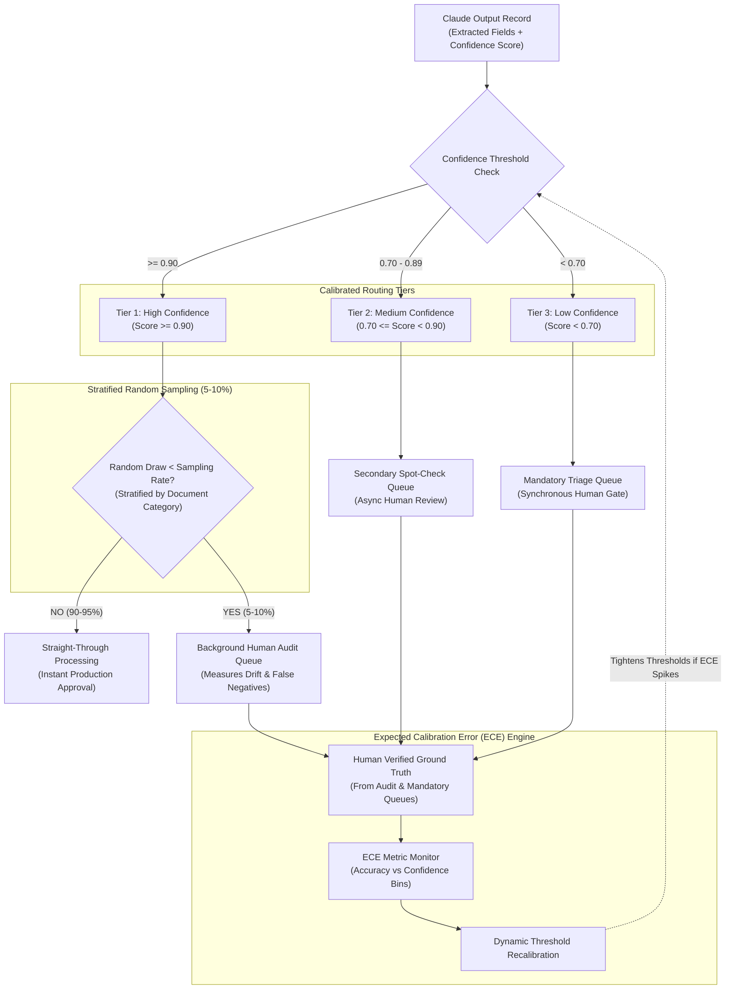

# Task Statement 5.5: Human Review Workflows & Confidence Calibration

## 📌 Executive Overview: Goal, Scope & Exam Importance

### Domain & Exam Weight
- **Domain**: Domain 5 — Context Management & Reliability (18% of exam weighting)
- **Scenario Alignment**: Scenario 1 (Customer Support Resolution Agent) & Scenario 6 (Structured Data Extraction)
- **Core Goal**: Design production-grade Human-in-the-Loop (HITL) routing architectures that combine tiered confidence thresholds with stratified random sampling, avoiding the catastrophic "selective review trap" and continuously monitoring Expected Calibration Error (ECE) to detect model drift and overconfident hallucinations.

### Why This Matters in Production
In enterprise AI deployments (e.g., automated document extraction, claims processing, customer refunds), organizations routinely automate decisions using confidence thresholds:
- The naive architecture sets a hard rule: *"If Claude's confidence is $\ge 0.85$, auto-approve directly (Straight-Through Processing); if confidence $< 0.85$, route to a human reviewer."*

While intuitive, this setup creates the **Selective Review Trap**:
1. **The Overconfidence Blindspot**: Large language models can be confidently wrong. When a vendor subtly shifts an invoice layout or introduces a novel tariff code, Claude may extract an incorrect figure while reporting a confidence of $0.98$.
2. **False Negative Slippage**: Because high-confidence outputs are never reviewed, errors in the $\ge 0.85$ bucket bypass human oversight entirely. Over months, systematic compliance violations and revenue leakage compound silently.
3. **Invisible Model Drift**: Prompt adjustments or upstream API model updates can alter confidence distributions without engineering teams realizing that accuracy has degraded.

To achieve production reliability, enterprise architectures implement **Calibrated Tiered Routing with Stratified Audit Sampling**:
- **Tier 1 (High Confidence $\ge 0.90$)**: Straight-Through Processing (STP) for operational speed, but with a mandatory **5–10% stratified random audit stream** routed to human reviewers.
- **Tier 2 (Medium Confidence $0.70\text{--}0.89$)**: Asynchronous spot-check queue with expedited human verification.
- **Tier 3 (Low Confidence $< 0.70$)**: Synchronous mandatory human escalation.
- **ECE Feedback Loop**: Measuring actual empirical accuracy against reported confidence bins to dynamically recalibrate routing thresholds.

---

## 📖 Deep Narrative: Why We Do What We Do

### The Naive Production Failure: The Selective Review Trap
Consider an enterprise financial logistics platform processing 25,000 customs declarations daily.
The team configures an extraction pipeline:
```python
# NAIVE ANTI-PATTERN: Auto-Approving 100% of High-Confidence Predictions
if extraction.confidence >= 0.85:
    database.approve_customs_declaration(extraction.data)  # Zero human eyes!
else:
    human_queue.route_for_manual_review(extraction.data)
```
During the first quarter, human reviewers audit 3,000 low-confidence documents and correct minor optical character recognition (OCR) glitches. The dashboard proudly displays: *"98.5% of human-reviewed cases successfully resolved; 88% Straight-Through Processing rate."*

However, in month four, a major international supplier updated their declaration layout, placing import duty fees in an annex rather than the main table. Claude confidently extracted the duty fee as `$0.00` with a confidence score of `0.96` because it cleanly parsed an empty table row.
Because confidence was `0.96`, **zero** of these declarations were routed to human reviewers. Over 12 weeks, 14,000 declarations cleared customs with underreported duties, resulting in federal impoundment of shipments, a $3.2M penalty, and a formal compliance audit.

### The Architectural Solution: Tiered Routing with Stratified Audit Sampling
To catch overconfident hallucinations before they cause enterprise damage, production systems place an active audit layer over high-confidence flows:



1. **Stratified Sampling Across Segments**: Sampling is not uniform across all traffic. It is stratified across document types, suppliers, and customer tiers. This ensures that rare document types (e.g., hand-written customs declarations representing only 2% of volume) are adequately audited rather than being drowned out by standard digital invoices.
2. **Detection of False Negatives**: When human auditors inspect the 5–10% audit sample, any error discovered in a $\ge 0.90$ document is immediately flagged as a high-severity incident (Overconfidence Failure).
3. **Expected Calibration Error (ECE)**: The system groups predictions into confidence bins ($[0.70, 0.80), [0.80, 0.90), [0.90, 1.00]$) and measures empirical accuracy within each bin. If items in the $0.90\text{--}1.00$ bin only achieve $81\%$ real-world accuracy, the system triggers an automated alert and dynamically raises the STP threshold from $0.90$ to $0.95$.

---

## 🔑 Key Technical Terminology Explained

- **Straight-Through Processing (STP)**: Fully automated execution and approval of an agent's output without human intervention, reserved for high-confidence, low-risk operations.
- **The Selective Review Trap**: The false sense of security created by reviewing only low-confidence outputs, allowing overconfident model errors and systematic false negatives to pass into production undetected.
- **Stratified Random Sampling**: Sampling a fixed percentage (typically 5–10%) of high-confidence predictions proportionally across distinct customer segments, document types, or transaction classes to ensure rare edge cases are audited.
- **Expected Calibration Error (ECE)**: A statistical metric that quantifies the difference between predicted confidence probabilities and actual empirical accuracy across partitioned confidence bins.
- **Overconfidence Bias**: The tendency of language models to assign high probability scores ($\ge 0.95$) to outputs that contain factual errors or hallucinated fields.
- **Tiered Human-in-the-Loop Routing**: A multi-stage routing strategy that directs work to different human queues (instant triage, async spot-check, background audit) based on calibrated confidence and operational impact.

---

## ⚠️ Critical Exam Distinctions & Distractor Teardown

| Human Review / HITL Pattern | Correct Implementation (Exam Standard) | Exam Trap / Distractor to Reject |
|---|---|---|
| **High-Confidence Monitoring** | **Stratified Random Audit Stream**: Route a 5–10% sample of high-confidence items to human reviewers to detect drift and overconfident errors. | **TRAP: 100% Blind Auto-Approval**: Auto-approving all items with confidence $\ge 0.90$ without background sampling. (Allows drift and false negatives to compound). |
| **Audit Sampling Strategy** | **Stratified Sampling**: Sample across document formats, regions, and customer tiers to guarantee representation of rare edge cases. | **TRAP: Pure Random Sampling**: Taking a uniform random sample of all traffic, which over-indexes on dominant standard templates and misses rare formats. |
| **Confidence Metric Validation** | **Calibrate against Empirical Truth**: Continually compute ECE using human audit feedback to validate that a 90% confidence score delivers 90% accuracy. | **TRAP: Trusting Raw LLM Self-Assessment**: Treating Claude's verbalized confidence ("I am 99% sure") as unassailable mathematical probability without calibration. |
| **Handling Threshold Spikes** | Dynamically increase confidence thresholds or trigger alerts when ECE degrades beyond predefined tolerance. | **TRAP: Static Inflexible Rules**: Hardcoding fixed thresholds in configuration files that remain unchanged regardless of model version updates or drift. |

---

## 💡 Architectural Decision Matrix: Rules of Thumb

| Routing Tier | Confidence Score | Sampling / Routing Rule | Operational SLA |
|---|---|---|---|
| **Tier 1 (High Confidence)** | $\ge 0.90$ | Auto-approve 90–95%; route **5–10% stratified sample** to audit queue | Real-time / Instant |
| **Tier 2 (Medium Confidence)** | $0.70 \le \text{Score} < 0.90$ | Route 100% to Asynchronous Spot-Check Queue | Within 2 hours |
| **Tier 3 (Low Confidence)** | $< 0.70$ | Route 100% to Mandatory Synchronous Human Triage | Immediate blocking gate |
| **High-Financial Impact (>\$10,000)** | Any Score | Route 100% to Dual-Key Manager Approval regardless of score | Within 24 hours |

---

## 🧠 Claude 4.5 Extended Thinking & Parameter Standards

When calibrating confidence and extracting structured decisions with Claude 4.5:
- **Model Standard**: Use `claude-sonnet-4-5` for high-precision extraction and calibration analysis; use `claude-haiku-4-5` for high-volume secondary triage.
- **Thinking Configuration**: Enable Extended Thinking with a budget of 3,000 tokens when assessing ambiguity or extracting dense financial schedules:
  ```python
  thinking = {"type": "enabled", "budget_tokens": 3000}
  ```
- **Temperature Omission**: **Do NOT pass `temperature`**, `top_p`, or `top_k`. Anthropic returns an HTTP `400 Bad Request` if custom sampling parameters accompany `thinking`.
- **Structured Confidence Schema**: Mandate that the extraction tool includes field-level confidence ratings and rationales:
  ```json
  {
    "extracted_total": 487.50,
    "confidence_score": 0.94,
    "confidence_rationale": "Total explicitly matched line-item sum and subtotal invoice block."
  }
  ```

---

## 🛠️ Hands-on Workbook Guide: Following the Code Step-by-Step

In the accompanying notebook [`ts_5_5_human_review_calibration.ipynb`](ts_5_5_human_review_calibration.ipynb), you will follow the step-by-step implementation:

- **Step 1: Routing Tiers & Thresholds**: Configure the `ConfidenceRouter` class and define the tiered threshold boundaries.
- **Step 2: Simulating Extraction Traffic**: Generate a realistic synthetic dataset of extraction records with varying confidence levels and document categories.
- **Step 3: Stratified Sampling Implementation**: Execute stratified random sampling to select audit cases across dominant and rare document categories.
- **Step 4: Detecting the Selective Review Trap**: Compare the error catch rate between a naive pure-STP system and a calibrated audit system.
- **Step 5: Expected Calibration Error Calculation**: Compute ECE across confidence bins to demonstrate dynamic threshold adjustment.

Verify your implementation anytime with offline unit tests in WSL Ubuntu-26.04:
```powershell
wsl -d Ubuntu-26.04 bash -c "~/.local/bin/uv run pytest tests/test_domain5_full.py"
```
