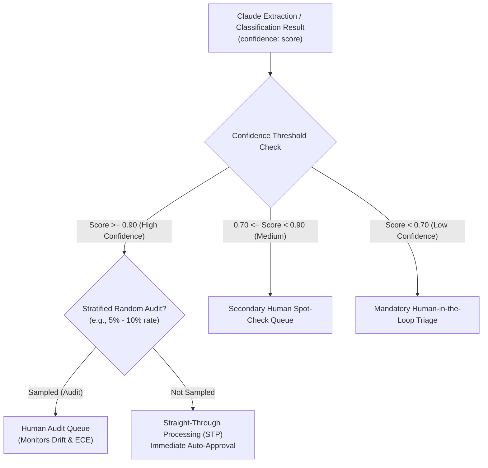

# Task Statement 5.5: Human Review & Confidence Calibration

## 🎯 Exam Objective
Understand how to design tiered routing based on calibrated confidence thresholds and enforce stratified audit sampling of high-confidence predictions to detect model drift.

---

## 🏗️ Architecture: Calibrated Tiered Routing Engine

---

## ⚠️ The "Zero Sampling of High Confidence" Exam Trap

### Trap:
A candidate assumes that if Claude's confidence is $\ge 0.95$, the system should process 100% automatically with zero human oversight.

### Exam Insight:
- Without **stratified random sampling** of high-confidence outputs:
  - Systematic hallucinations in niche categories go undetected for months.
  - Model drift (caused by API updates or shifting user data) is invisible until customers complain.
- **Architectural Requirement**:
  - Always maintain a **background audit stream (5–10% sampling)** of high-confidence outputs to continuously validate calibration against human ground truth.
