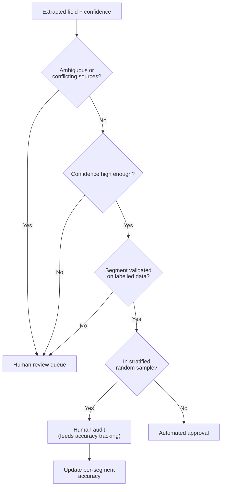

# Task Statement 5.5: Human Review Workflows and Confidence Calibration

> **Domain 5 (15% of exam)** | Scenario focus: **6 - Structured Data Extraction** (also Scenario 1) | Folder: `ts_5_5_human_review_calibration` | Previous: [TS 5.4](../ts_5_4_scratchpads_and_human_review/README.md) | Next: [TS 5.6](../ts_5_6_provenance_and_uncertainty/README.md)

## In One Minute

- **What:** Decide which extracted values need a human and prove that automation is safe.
- **Trap:** *97% overall accuracy* can hide a segment (a document type or field) that is far worse.
- **Check accuracy per segment** before you reduce human review for that segment.
- **Sample high-confidence outputs at random**, stratified by document type and field.
- **Calibrate field-level confidence** on a labelled validation set. Route low-confidence, ambiguous or contradictory items to people.
- **Exam answer in one line:** *Stratified sampling + segment accuracy + calibrated field confidence.*

---

## Explain Like I'm 13

**The picture:** A school with a 97% average. One subject could be failing badly while the big subjects are perfect. So look at **each subject**. And when spot-checking homework, check some of the answers the student felt **sure** about too, or you never find confident mistakes.

**In plain steps:**
1. Measure accuracy per document type and per field.
2. Sample for human review across those groups (stratified), including high-confidence items.
3. Check that "0.9 confident" really means about 90% correct.
4. Reduce review only for a segment with proven accuracy and enough examples.

**Tiny example:** 90% of volume at 99.5%, but handwritten receipts at 81%. The average hides the problem.

---

## Concepts Explained

### 1. Aggregate accuracy can mislead
If 90% of documents are easy and 10% are hard, a high overall number says little about the hard 10%.

### 2. Stratified random sampling
Sample **inside each stratum**: (document type, field). A flat 10% random sample may include no rare-segment items at all. Stratification guarantees coverage. Sample **high-confidence** outputs too. These are the ones automation would approve without a human seeing them.

### 3. Per-segment validation first
Before reducing review for a segment, measure its accuracy on labelled data. Require enough samples and a high enough accuracy for that segment.

### 4. Field-level confidence, calibrated
Ask the model for confidence **per field**. Then compare confidence against the truth on a **labelled validation set**. Calibrated means "items at 90% confidence are right about 90% of the time". Two simple checks:
- **Reliability bins:** group items by stated confidence and compare with real accuracy.
- **Expected calibration error (ECE):** size-weighted average gap between confidence and accuracy.

### 5. Route to humans on risk signals
Send items to a human when confidence is low, the source is **ambiguous**, or sources **contradict** each other.

---

## Worked Example

**Data:** 100 labelled fields. 90 are `standard_invoice/total` (all correct, confidence 0.97). 10 are `customs_form/hs_code` (7 correct, confidence 0.95).

| Check | Result | Meaning |
|---|---|---|
| Aggregate accuracy | **97%** | Looks ready for automation. |
| Per segment accuracy | invoice total **100%**; customs HS code **70%** | One weak segment is hidden. |
| Overall ECE | about 0.002 | Overall calibration looks fine. |
| ECE for customs HS code | about 0.25 | That segment is badly overconfident. |
| Stratified sample (10%, high confidence) | 9 invoice items + **1** customs item | The weak segment is guaranteed a review. |
| Decision | Keep human review for customs HS code; automate invoice totals. | Validated per segment. |

Run `main.py` to print these numbers. The tests check them.

---

## Key Terms

- **Stratum / segment:** A group such as (document type, field).
- **Stratified random sampling:** Random sampling within each stratum.
- **Calibration:** Stated confidence matches real accuracy.
- **ECE:** Expected calibration error, the weighted gap between confidence and accuracy.
- **Labelled validation set:** Data with known correct answers used to test accuracy and calibration.

---

## Architecture



---

## Exam Traps and Correct Patterns

### Trap 1: "97% accurate overall, so remove human review"

**Exam scenario**: The pipeline reports 97% accuracy across 10,000 documents.

| Document type | Share of volume | Accuracy |
|---|---|---|
| Clean typed invoices | 90% | 99.5% |
| Handwritten receipts | 6% | 81% |
| Foreign-language contracts | 4% | 78% |

Overall: 0.90*99.5 + 0.06*81 + 0.04*78 = about 97.6%. The average hides two segments where 1 in 5 documents is wrong. Measure accuracy **per document type and per field** before any decision about reducing review.

### Trap 2: Reviewing only the low-confidence items

```text
ANTI-PATTERN: humans see only items with confidence < 0.8.
  Confident but wrong outputs are never seen, so you cannot know how often that happens.
PATTERN: stratified random sample across (document type x field), INCLUDING high-confidence items.
  A flat random sample would hold almost no handwritten receipts (6% of volume).
```

### Trap 3: Trusting raw confidence

Check calibration on a labelled set: group predictions in bins (0.9 to 1.0, 0.8 to 0.9...) and compare each bin's claimed confidence to its actual accuracy. If the "0.9" bin is right only 70% of the time, the number cannot gate automation.

### Trap 4: Reducing review for a segment with too little evidence

"Handwritten receipts scored 100% on 6 labelled examples" is not proof. Check the segment's accuracy **and** its sample size before lowering review for it.

### Trap 5: Letting the model pick between contradictory sources

When two documents disagree on a value, route to a human. Choosing silently hides the conflict.

---

## Exam-Style Practice Questions

**Q1 (Scenario 6).** An extraction pipeline reports 97% overall accuracy. Leadership wants to remove human review. What should you do first?

- A. Approve; 97% is above most targets.
- B. Measure accuracy by document type and field to find weak segments.
- C. Raise the confidence threshold slightly.
- D. Ask Claude to rate its own accuracy.

**Q2 (Scenario 6).** The team already sends all low-confidence items to humans. How can they detect errors in items automation approves?

- A. They cannot; high-confidence items are always correct.
- B. Review a flat random 2% of everything.
- C. Draw a stratified random sample of high-confidence output by document type and field.
- D. Review only items users complained about.

**Q3 (Scenario 1).** Field confidence scores are available, but nobody knows if they are reliable. What makes them usable for routing?

- A. Calibrate them against a labelled validation set.
- B. Increase the number of digits reported.
- C. Average them across all fields.
- D. Use the highest score per document.

### Answers

- **Q1: B.** A fails: the aggregate can hide a weak segment. C fails: it does not show where errors are. D fails: self-assessment is not validation.
- **Q2: C.** A fails: confidence can be wrong. B fails: a flat sample can miss rare segments. D fails: complaints show only some errors, late.
- **Q3: A.** B fails: more digits do not add reliability. C fails: averaging hides weak fields. D fails: one high field says nothing about the others.

---

## Self-Check Checklist

- [ ] I can explain how 97% overall accuracy hides a weak segment.
- [ ] I can describe stratified sampling by (document type, field).
- [ ] I know why high-confidence items must also be sampled.
- [ ] I can explain calibration, reliability bins and ECE in plain words.
- [ ] I know to validate a segment before reducing review for it.

**Memory hook:** *"Slice it, sample it, calibrate it, then trust it."*

---

## Hands-on Workbook Guide

Notebook: [`ts_5_5_human_review_calibration.ipynb`](ts_5_5_human_review_calibration.ipynb). Code: [`main.py`](main.py). Both run offline.

1. **Data:** `demo_validation_set()` (100 labelled fields).
2. **Accuracy:** `aggregate_accuracy()`, `segment_accuracy()`, `weak_segments()`.
3. **Sampling:** `stratified_audit_sample()` (local `random.Random(seed)`; no global seed).
4. **Calibration:** `reliability_bins()`, `expected_calibration_error()`, `segment_calibration()`.
5. **Gate and routing:** `safe_to_reduce_review()`, `ConfidenceRouter`.
6. **Verify:** `uv run pytest tests/test_domain5_enhancements.py -q` in WSL.

**Related:** [TS 5.2](../ts_5_2_escalation_and_provenance/README.md) (escalation in chat) | [TS 5.6](../ts_5_6_provenance_and_uncertainty/README.md) (conflicting sources).
