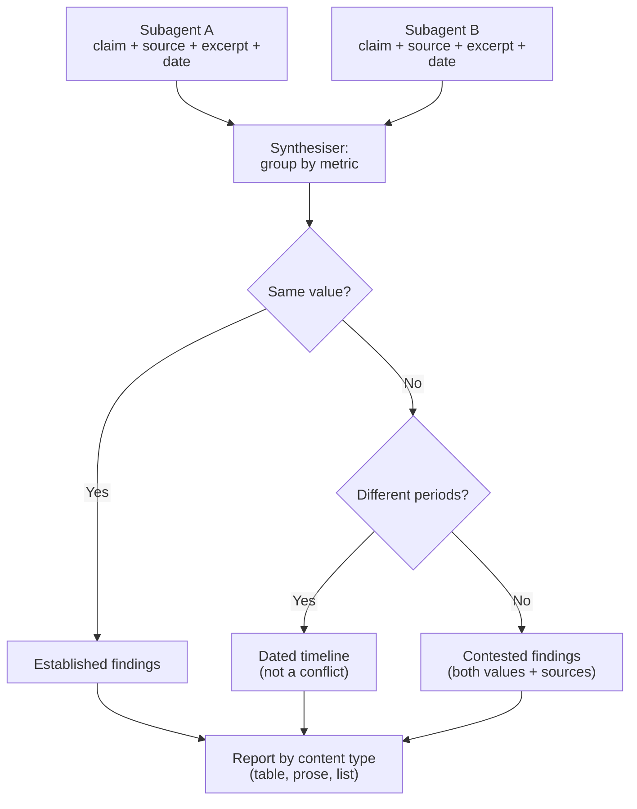

# Task Statement 5.6: Provenance and Uncertainty in Multi-Source Synthesis

> **Domain 5 (15% of exam)** | Scenario focus: **3 - Multi-Agent Research System** | Folder: `ts_5_6_provenance_and_uncertainty` | Previous: [TS 5.5](../ts_5_5_human_review_calibration/README.md) | Back to: [Domain 5 overview](../README.md)

> **Folder note:** Provenance helpers also appear in the [TS 5.2](../ts_5_2_escalation_and_provenance/README.md) folder for old imports. The canonical guide and code are here.

## In One Minute

- **What:** Every claim in a synthesised report must point back to its source.
- **Why it matters:** Summaries often drop the link between a claim and its evidence. Readers then cannot check it.
- **When sources disagree:** annotate both values with sources. Never average, never pick one silently.
- **Dates matter:** different dates (or periods) can explain a "contradiction".
- **Exam answer in one line:** *Keep claim-source mappings, annotate conflicts, include dates, separate established from contested.*

---

## Explain Like I'm 13

**The picture:** Two news sources give different numbers. A good reporter shows **both**, with the name and date of each, and explains why they might differ. They do not average the numbers (nobody published that), and they do not quietly pick one.

**In plain steps:**
1. Keep each claim attached to its source and date through every summary.
2. Same metric, same period, different values: show both as contested.
3. Different years: show a timeline, it is not a conflict.
4. Split the report into established and contested.
5. Tables for finance, prose for news, lists for technical findings.

**Tiny example:** 1,200 employees in 2023 and 1,850 in 2025 is growth, not a contradiction.

---

## Concepts Explained

### 1. Claim-source mappings
Each claim is stored with: **source**, **verbatim excerpt**, **publication or collection date**, and **methodology** when known. Subagents return these. The synthesiser must **carry them through** to the final report. Summarising must not cut the link.

### 2. Conflicting statistics
Two credible sources give different numbers. Do not average them. Do not choose one without saying so. **Show both, each with its source**, and explain any known difference (method, definition).

### 3. Dates prevent false conflicts
A number from 2025 and a number from 2026 may both be right. Include the **publication or collection date** (and the period the number describes). Then the report shows a change over time, not a contradiction.

### 4. Separate established from contested
Structure the report with a section for **well-established findings** (sources agree) and one for **contested findings** (sources disagree). Readers see the confidence level at a glance.

### 5. Render each content type appropriately
| Content | Best format |
|---|---|
| Financial data | Table |
| News and events | Prose |
| Technical findings | List |

Do not squash everything into one uniform format.

---

## Worked Example

**Subagents report:**

| Metric | Value | Source | Pub. date | Period | Method |
|---|---|---|---|---|---|
| Q3 revenue | $1.2B | Press wire | 2024-10-01 | 2024-Q3 | Preliminary |
| Q3 revenue | $1.4B | 10-Q filing | 2024-10-15 | 2024-Q3 | Audited |
| Inventory | 50,000 units | Report A | 2025-06-30 | 2025-06 | Warehouse count |
| Inventory | 12,000 units | Report B | 2026-09-30 | 2026-09 | Warehouse count |
| Headcount | 12,500 | 10-Q filing | 2024-10-15 | n/a | Payroll |

**Synthesis result:**
- **Q3 revenue:** same period, different values -> **contested**. Show both, with source and method. No average.
- **Inventory:** different periods -> **temporal difference**, not a conflict. Present as a dated timeline.
- **Headcount:** one source -> **established**.

`ProvenanceSynthesizer` and `render_report()` in `main.py` produce exactly this.

---

## Key Terms

- **Claim-source mapping:** Link between a claim and its source, excerpt and date.
- **Contested finding:** Credible sources disagree for the same period.
- **Temporal difference:** Values differ because they describe different times.
- **Methodology note:** Short text on how a number was produced (e.g. audited vs preliminary).

---

## Architecture



---

## Exam Traps and Correct Patterns

### Trap 1: Averaging or silently choosing between two sources

**Exam scenario**: Source A (Gartner) says the 2025 market is $12.1B. Source B (IDC) says $9.8B.

```text
ANTI-PATTERN: "The market is about $11B."   (a number neither source reported)
ANTI-PATTERN: "The market is $12.1B."       (picked the bigger publisher, hid the disagreement)

PATTERN:
  CONTESTED: 2025 market size
    - $12.1B (Gartner, report dated 2025-06, includes services)
    - $9.8B  (IDC, report dated 2025-09, hardware only)
  Note: definitions differ, so the numbers may not be comparable.
```

Show both values with their sources, and annotate the likely reason.

### Trap 2: Treating a date difference as a contradiction

```text
Source 1 (2023): "Company has 1,200 employees."
Source 2 (2025): "Company has 1,850 employees."
NOT a conflict. It is change over time. Report with dates:  2023: 1,200 -> 2025: 1,850.
```

Rule: same metric and same period with different values is contested. Different periods is a timeline.

### Trap 3: Summaries that lose claim-source links

A subagent returns `{claim, source, date}`. Synthesis that rewrites them into prose without sources leaves unattributed facts that nobody can verify. Keep the mapping through the summary, and name source and date next to each claim.

### Trap 4: Everything at the same certainty

| Section | Content |
|---|---|
| Established | Claims with agreement or a single reliable cited source |
| Contested | Claims where sources disagree, shown side by side |
| Not found | Areas checked with no evidence |

A flat list makes a disputed number look as solid as a confirmed one.

### Trap 5: One format for all content

Financial figures go in a table, news in prose, technical findings in a list. Forcing everything into bullets loses structure and comparisons.

---

## Exam-Style Practice Questions

**Q1 (Scenario 3).** Two subagents report different market-size statistics for the same year, from two credible sources. What should the synthesis agent do?

- A. Report the average.
- B. Keep the number from the larger publisher.
- C. Report both values, each attributed to its source, and note any known method difference.
- D. Omit the metric.

**Q2 (Scenario 3).** A report says revenue was $800M (published 2024) and $950M (published 2026). The synthesiser flags a "conflict". What was missed?

- A. Nothing; this is a real contradiction.
- B. The dates and periods; the values may describe different years.
- C. The need to average them.
- D. The need for a longer summary.

**Q3 (Scenario 3).** The final report mixes quarterly financials, news events and technical findings in one bullet list, and many claims lack sources. What two improvements fit best?

- A. Shorten everything into one paragraph and remove the sources.
- B. Keep claim-source mappings and render each content type suitably (table, prose, list).
- C. Merge all claims into one confidence score.
- D. Sort alphabetically.

### Answers

- **Q1: C.** A fails: it invents a number. B fails: it hides a credible source. D fails: it throws away evidence.
- **Q2: B.** A fails: it ignores that values describe different times. C fails: averaging is never right. D fails: length does not help.
- **Q3: B.** A fails: it removes traceability. C fails: a single score hides what is contested. D fails: order does not fix traceability or format.

---

## Self-Check Checklist

- [ ] I can list what a claim-source mapping contains.
- [ ] I know why conflicting values are annotated, not averaged.
- [ ] I can explain how dates turn a "conflict" into a timeline.
- [ ] I can describe a report that separates established from contested findings.
- [ ] I know the right format for financial, news and technical content.

**Memory hook:** *"Every claim carries its receipt."*

---

## Hands-on Workbook Guide

Notebook: [`ts_5_6_provenance_and_uncertainty.ipynb`](ts_5_6_provenance_and_uncertainty.ipynb). Code: [`main.py`](main.py). Both run offline.

1. **Record claims:** `ProvenanceSynthesizer.add_claim()` with excerpt, date, methodology, period.
2. **Classify:** `synthesize_metrics()` returns `CONSENSUS`, `PRESERVED_CONFLICT` or `TEMPORAL_DIFFERENCE`.
3. **Render:** `render_claims()` per content type; `render_report()` for the two-section layout.
4. **Verify:** `uv run pytest tests/test_domain5_enhancements.py -q` in WSL.

**Related:** [TS 5.1](../ts_5_1_context_preservation/README.md) (structured subagent output) | [TS 5.3](../ts_5_3_error_propagation_coverage/README.md) (coverage annotations).
