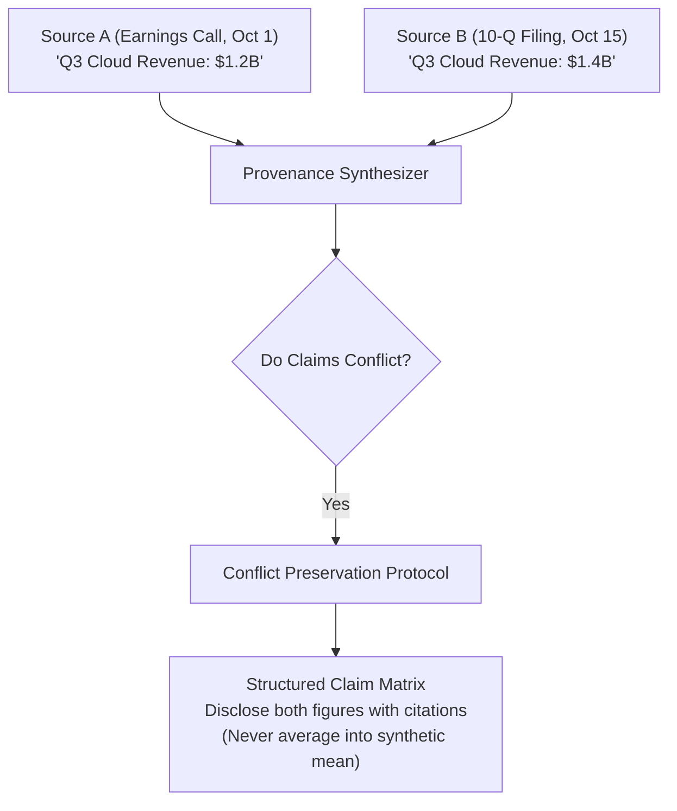

# Task Statement 5.6: Information Provenance & Uncertainty Synthesis

## 🎯 Exam Objective
Understand how to construct structured claim-source mappings, maintain provenance timestamps, and synthesize conflicting statistics without hallucinated consensus.

---

## 🏗️ Architecture: Conflict Preservation & Provenance Graph

---

## ⚠️ The "Artificial Reconciliation" Exam Trap

### Trap:
When presented with conflicting numbers from two external reports:
- **Trap Option A**: Claude calculates the arithmetic mean (`$1.3B`) and presents it as the single true number.
- **Trap Option B**: Claude silently chooses the later date without mentioning the earlier discrepancy.

### Exam Insight:
- Both Trap Options are **incorrect** because they destroy provenance and mislead executive decision-makers.
- **The Correct Architecture**:
  - Always **preserve both data points**, attach explicit citation metadata (author, date, methodology), and explain the variance (e.g. preliminary vs audited).
