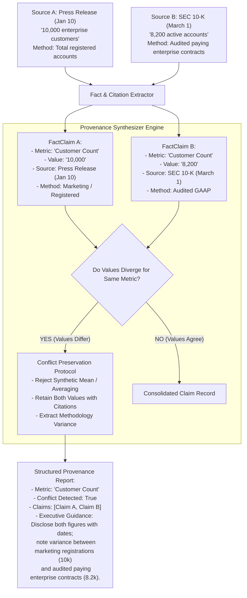

# Task Statement 5.6: Information Provenance & Uncertainty Synthesis

## 📌 Executive Overview: Goal, Scope & Exam Importance

### Domain & Exam Weight
- **Domain**: Domain 5 — Context Management & Reliability (18% of exam weighting)
- **Scenario Alignment**: Scenario 3 (Multi-Agent Research & Competitive Synthesis)
- **Core Goal**: Architect verifiable research and data synthesis pipelines that preserve claim-to-source provenance, maintain exact publication dates and extraction methodologies, and transparently synthesize conflicting statistics without generating hallucinated averages or artificial consensus.

### Why This Matters in Production
In enterprise research, legal intelligence, and financial analysis, models frequently ingest information from multiple authoritative sources that report conflicting data:
- Source A (Earnings Call, Oct 1) reports: *"Q3 Cloud Revenue was $1.2B."*
- Source B (SEC 10-Q Filing, Oct 15) reports: *"Q3 Cloud Revenue was $1.4B."*

Naive LLM implementations suffer from the **Reconciliation Fallacy**:
1. **The Hallucinated Average**: The model computes an arithmetic mean: *"Q3 Cloud Revenue was approximately $1.3B."* Neither source ever reported $1.3B; the model has generated a completely fictitious number that exists in zero source documents.
2. **Silent Heuristic Discard**: The model arbitrarily picks one number (e.g., the later date or larger figure) and discards the other without disclosing the contradiction to the user.

In regulated industries (compliance, finance, healthcare), the existence of a discrepancy is itself the primary intelligence insight. Production architectures enforce **Strict Provenance & Conflict Preservation**:
- Every factual metric is bound to a structured `SourceCitation` (source ID, timestamp, methodology, document version).
- Conflicting metrics are preserved in a structured dual-citation matrix, disclosing both values and explaining the methodology variance (e.g., preliminary non-GAAP guidance vs audited GAAP filing).
- Final executive summaries convey explicit **epistemic uncertainty**, empowering human leaders to make informed decisions.

---

## 📖 Deep Narrative: Why We Do What We Do

### The Naive Production Failure: The Reconciliation Fallacy
Consider a market research system evaluating cloud computing competitors.
The agent ingests:
- **Press Release (Jan 10)**: *"Acme Cloud reached 10,000 enterprise customers."*
- **Annual SEC 10-K Report (March 1)**: *"Acme Cloud has 8,200 active enterprise subscription accounts."*

If the engineering team provides a naive summarization prompt:
```python
# NAIVE ANTI-PATTERN: Forcing Synthetic Consensus
prompt = f"""
Synthesize these two documents into a single conclusive paragraph:
Document 1: {press_release}
Document 2: {sec_filing}
Reconcile any differences so the report is clear and definitive for the CEO.
"""
```
The model will respond:
> *"Acme Cloud has approximately 9,100 enterprise customers across its platform."*

Notice the critical failures:
1. **Fabricated Ground Truth**: 9,100 is an artificial hallucination. Neither marketing nor the audited SEC filing claimed 9,100.
2. **Methodology Erasure**: The model erased the crucial business context: marketing counted total registered customer trials, while the audited SEC filing counted paying enterprise subscriptions ($> \$100\text{k}$ ARR).
3. **Legal Risk**: Presenting a synthetic number in an investment memo or regulatory filing creates severe legal and compliance exposure.

### The Architectural Solution: Claim-Source Mapping & Conflict-Preserving Synthesizer
Production architectures treat conflicting information as a first-class data structure rather than an error to smooth over:



1. **Structured Citation Model**: Every claim ingested into the reasoning pipeline carries explicit metadata:
   - `source_id`: URI, file path, or regulatory accession number.
   - `publication_date`: ISO timestamp of source release.
   - `methodology`: Accounting standard, survey methodology, or observation technique.
2. **Deterministic Conflict Detection**: When multiple claims reference the same underlying metric (e.g., `Customer Count`, `Revenue`, `Churn Rate`), a deterministic Python check detects value divergence.
3. **Preservation Over Averaging**: If divergence is found, the system forbids the LLM from producing a blended number. The output schema requires a structured list of claims with citations and an explanation of the divergence.
4. **Epistemic Uncertainty Representation**: The report explicitly states that the ground truth depends on definition and accounting methodology, preserving high decision-making fidelity.

---

## 🔑 Key Technical Terminology Explained

- **Data Provenance / Lineage**: The complete, traceable history of a data point from its original primary source document through extraction, transformation, and final synthesis.
- **Claim-to-Source Mapping**: A formal data association binding every factual assertion in an LLM output to a specific source document, version, and locator.
- **The Reconciliation Fallacy**: The erroneous practice of forcing an LLM to reconcile contradictory data points by inventing an artificial consensus or calculating a synthetic arithmetic mean.
- **Epistemic Uncertainty**: Uncertainty arising from incomplete knowledge or conflicting external evidence (e.g., two reports disagreeing), which must be disclosed rather than hidden.
- **Non-Consensus Reporting**: An architectural standard requiring an agent to present conflicting perspectives or measurements side-by-side with source attribution.
- **Citation Anchor**: A machine-readable tag (e.g., `[Source: SEC-10K-2025, Line 142]`) appended to claims to ensure 100% auditability.

---

## ⚠️ Critical Exam Distinctions & Distractor Teardown

| Provenance / Uncertainty Pattern | Correct Implementation (Exam Standard) | Exam Trap / Distractor to Reject |
|---|---|---|
| **Synthesizing Conflicting Data** | **Preserve and Disclose Both**: Report both values side-by-side with full source citations, dates, and methodologies. | **TRAP: Calculating the Mean**: Averaging conflicting figures (e.g., \$1.2B and \$1.4B into \$1.3B) to provide a single tidy answer. |
| **Resolving Source Disagreements** | Explain the methodology variance (e.g., preliminary call vs audited filing) and highlight epistemic uncertainty. | **TRAP: Heuristic Dropping**: Silently picking the latest source and discarding the earlier source without mentioning the discrepancy. |
| **Claim Citation Architecture** | **Fine-Grained Claim Mapping**: Bind each individual metric to a specific source record with timestamp and locator. | **TRAP: Document-Level Dumping**: Putting a single general bibliography at the end of the report without inline claim-to-source bindings. |
| **Handling Data Gaps** | Explicitly state which metrics are unknown or unverified due to missing source coverage. | **TRAP: Speculative Interpolation**: Instructing Claude to extrapolate or estimate missing metrics based on historical trends without labeling them as estimates. |

---

## 💡 Architectural Decision Matrix: Rules of Thumb

| Scenario Encountered | Architectural Action | Schema Requirement | Final Report Representation |
|---|---|---|---|
| **Sources Agree on Metric** | Merge into single confirmed fact | Single claim with multi-source citation list | High-confidence assertion |
| **Sources Disagree on Metric** | **Trigger Conflict Preservation** | Structured array of diverging claims with dates | **Side-by-side matrix with methodology explanation** |
| **Source Date Variance (Old vs New)** | Disclose both dates; note trend or update | Chronological claim trail | Note progression: *"Updated from X in Jan to Y in Mar"* |
| **Methodology Discrepancy (GAAP vs Non-GAAP)** | Highlight definition mismatch | Methodology attribute populated | Explain scope difference clearly |
| **Missing Metric Across All Sources** | Disclose data omission | Metric flagged as `UNVERIFIED` | Clear disclaimer: *"Metric not disclosed by sources"* |

---

## 🧠 Claude 4.5 Extended Thinking & Parameter Standards

When configuring Claude 4.5 for provenance extraction and research synthesis:
- **Model Standard**: Use `claude-sonnet-4-5` for rigorous multi-source cross-referencing and contradiction analysis.
- **Thinking Configuration**: Allocate a thinking budget of 4,000 to 6,000 tokens for identifying nuanced discrepancies across source texts:
  ```python
  thinking = {"type": "enabled", "budget_tokens": 5000}
  ```
- **Temperature Omission**: **Do NOT provide `temperature`**, `top_p`, or `top_k`. Anthropic's Claude 4.5 API rejects custom sampling parameters when `thinking` is active.
- **Structured Citation Output Schema**: Force structured outputs via tool calling with an explicit schema requiring `metric_name`, `has_conflict`, `claims` (with `source_id`, `date`, `methodology`), and `synthesis_notes`.

---

## 🛠️ Hands-on Workbook Guide: Following the Code Step-by-Step

In the accompanying notebook [`ts_5_6_provenance_and_uncertainty.ipynb`](ts_5_6_provenance_and_uncertainty.ipynb), you will follow the step-by-step implementation:

- **Step 1: SourceCitation & FactClaim Data Structures**: Implement structured provenance containers in Python.
- **Step 2: Simulating Ingestion of Conflicting Datasets**: Ingest real-world examples of earnings transcripts vs audited SEC filings.
- **Step 3: ProvenanceSynthesizer & Conflict Detection**: Execute the synthesis engine to automatically flag metric discrepancies.
- **Step 4: Synthetic Reconciliation Anti-Pattern Comparison**: Compare the honest provenance-preserving output against the dangerous "reconciliation fallacy" mean.
- **Step 5: Verifiable Report Generation**: Generate the final executive report with inline citation anchors and uncertainty callouts.

Verify your implementation anytime with offline unit tests in WSL Ubuntu-26.04:
```powershell
wsl -d Ubuntu-26.04 bash -c "~/.local/bin/uv run pytest tests/test_domain5_full.py"
```
