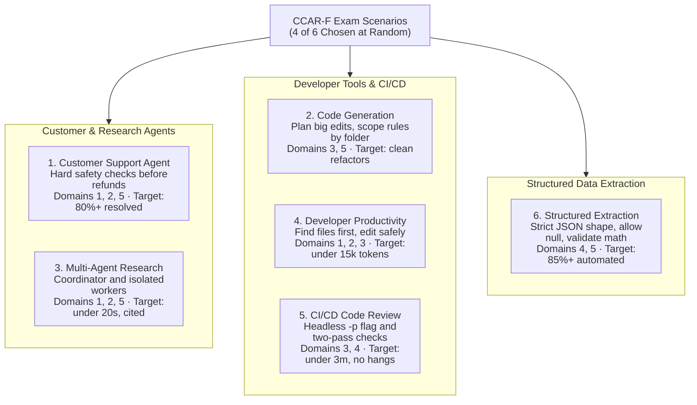

# Production Scenarios Master Guide

The **Claude Certified Architect – Foundations (CCAR-F)** exam includes **60 multiple-choice questions in 120 minutes** (about 2 minutes per question). Passing requires a scaled score of **720 out of 1000**.

Instead of testing abstract trivia, almost every question is grounded in realistic engineering situations. On each exam, **four of the six production scenarios below are chosen at random**, and the questions ask you to diagnose what broke, pick the cleanest fix, and avoid common traps.

This folder gives you a complete learning and practice path for all six scenarios—written in plain language first, backed by working offline simulations and practice quizzes.

---

## How to Study Each Scenario (Step by Step)

To get the most out of these materials without memorizing buzzwords, follow this sequence for each scenario:

1. **Read `SCENARIO_GUIDE.md`** — Start with the plain-English overview and analogy, trace the architecture diagram, and read the core design rules so you understand *why* naive fixes fail.
2. **Test Yourself Before Peeking** — Answer the 6 scenario questions in Section 6 on your own first, then expand each answer block to check your reasoning against the wrong options.
3. **Run `scenario_workbench.ipynb` & Inspect `simulation.py`** — See the exact rules enforced in clean Python code and run the offline notebook cells to observe how the system behaves on happy paths and edge cases.
4. **Take the Timed 60-Question Mock Exam** — Once you finish all six scenarios, work through [MASTER_SCENARIO_PRACTICE.md](MASTER_SCENARIO_PRACTICE.md) in two 60-minute halves and score yourself by domain.

### What Every Scenario Guide Contains

All six `SCENARIO_GUIDE.md` files follow the same 7-part structure (aligned with the repository's 5-step learning method: *Simple Picture → Why It Matters → Working Pattern → Exam Traps → Memory Hook*):

1. **The Big Picture (In Plain English)** — What the system does, an everyday analogy, exam domains covered, and the top 3 mistakes to avoid.
2. **How the System Works** — An architecture diagram and a plain-English walkthrough from input to output.
3. **Core Design Rules** — The engineering rules behind the scenario, why shortcuts break, and a quick symptom-to-fix decision chart.
4. **What the Exam Tests (Task Statement Map)** — How the official syllabus items appear in this scenario.
5. **Realistic Walkthrough** — A full end-to-end example showing inputs, tool calls, decisions, and outputs.
6. **Practice Questions (With Hidden Answers)** — 6 exam-style questions with collapsible answer explanations so you can practice active recall.
7. **Hands-On Lab, Self-Check & Memory Hook** — Offline lab commands, a self-check list, and a one-line reminder for exam day.



---

## The 6 Scenarios at a Glance

| # | Scenario | Everyday Analogy | What Usually Goes Wrong | The Reliable Engineering Fix | Tempting Wrong Answer |
|:---:|---|---|---|---|---|
| **1** | **[Customer Support](scenario_1_customer_support/SCENARIO_GUIDE.md)** | **A bank vault turnstile:** A polite sign does not stop someone; a locked gate that checks your badge does. | An urgent customer tricks the model into issuing a refund without verifying identity or over the dollar limit. | Enforce identity and refund limits in Python code before the payment tool can run; escalate on request. | Adding stronger wording to the system prompt (e.g., `"NEVER refund without ID"`). |
| **2** | **[Code Generation](scenario_2_code_generation/SCENARIO_GUIDE.md)** | **Drawing blueprints before renovating:** You plan load-bearing changes before swinging a hammer. | Asking Claude to jump straight into editing 15 files causes broken imports, circular bugs, and forgotten rules. | Use Plan Mode for large changes, clarify ambiguities first, and keep rules in folder-scoped files. | Stuffing the entire team handbook into one giant `CLAUDE.md` file. |
| **3** | **[Multi-Agent Research](scenario_3_multi_agent_research/SCENARIO_GUIDE.md)** | **An air traffic control tower:** The tower coordinates each plane separately; pilots do not chatter across channels. | Running subagents one after another makes the job time out, or subagents miss facts because they lack context. | Have the coordinator launch independent subagents in one turn, pass needed context in each prompt, and keep conflicting stats with citations. | Letting subagents message each other freely, or averaging conflicting numbers together. |
| **4** | **[Developer Productivity](scenario_4_developer_productivity/SCENARIO_GUIDE.md)** | **Map, magnifying glass, and scalpel:** Find the right folder, locate the exact function, then make a clean edit. | Reading hundreds of files wastes the context window, and editing a common line like `return False` fails on duplicate matches. | Search in order (`Glob` → `Grep` → small `Read`); if `Edit` matches multiple lines, add surrounding lines or fall back to `Read` + `Write`. | Retrying the exact same failing `Edit` call or dumping whole directories into chat. |
| **5** | **[CI/CD Code Review](scenario_5_continuous_integration/SCENARIO_GUIDE.md)** | **A factory quality-control robot:** It runs on its own and must never freeze waiting for a human to type "Y". | Running `claude` without `-p` hangs the CI runner forever, or a single pass over a huge PR misses cross-file bugs. | Run `claude -p` with JSON schema output, review in two passes (per-file, then cross-file), and exit non-zero on critical flaws. | Using the 24-hour Message Batches API for a blocking pre-merge check. |
| **6** | **[Structured Extraction](scenario_6_structured_data_extraction/SCENARIO_GUIDE.md)** | **A customs form with an "N/A" box:** If a form forces an answer for an item you do not have, people guess. | Requiring a string for fields missing from an invoice (like a PO number) forces Claude to invent fake numbers. | Enforce JSON shape via `tool_use`, mark optional fields as nullable (`["string", "null"]`), verify math in code, and audit a 5–10% stratified sample. | Asking for markdown JSON in the prompt, or retrying when a fact is not in the document. |

---

## Scenario Summaries

### [Scenario 1: Customer Support Resolution Agent](scenario_1_customer_support/SCENARIO_GUIDE.md)
- **Domains:** Domain 1 (27%), Domain 2 (18%), Domain 5 (15%)
- **The Challenge:** Customers want fast help with orders and refunds, while the company must block unauthorized access and refunds above policy limits. Under pressure or clever wording, prompt rules alone eventually slip.
- **What Good Looks Like:**
  1. Check identity and refund limits (`$500` cap, `30-day` window) in deterministic code before `process_refund` can execute.
  2. Hand off to a human immediately when the customer explicitly asks for one—without asking extra diagnostic questions first.
  3. Keep key entities (customer ID, order ID, auth status) in a pinned **Case Facts** block outside summarized chat history.
  4. Trim bloated CRM payloads (around 40 internal fields down to the 5 needed for the decision) in a `PostToolUse` hook.

### [Scenario 2: Code Generation with Claude Code](scenario_2_code_generation/SCENARIO_GUIDE.md)
- **Domains:** Domain 3 (20%), Domain 5 (15%)
- **The Challenge:** Direct edits work well for a small, clear fix, but jumping straight into code on a 15-file refactor or an underspecified feature creates rework and wasted tokens.
- **What Good Looks Like:**
  1. Use **Plan Mode** to map dependencies and draft a step-by-step plan before touching files on multi-file changes.
  2. Use the **Interview Pattern** to ask 2–3 targeted design questions when requirements are vague.
  3. Keep root `CLAUDE.md` under 200 lines; place folder-specific conventions in `.claude/rules/*.md` with `paths:` filters.
  4. Run noisy, multi-file discovery skills with `context: fork` so raw logs do not clutter your main session.

### [Scenario 3: Multi-Agent Research System](scenario_3_multi_agent_research/SCENARIO_GUIDE.md)
- **Domains:** Domain 1 (27%), Domain 2 (18%), Domain 5 (15%)
- **The Challenge:** Researching a broad topic across filings, patents, and news takes too long if done one agent at a time, and subagents lose critical instructions if you assume they can read the coordinator's chat history.
- **What Good Looks Like:**
  1. Use a **Hub-and-Spoke** design where a central coordinator spawns independent subagents in parallel during a single turn.
  2. Pass all needed entities, dates, and constraints explicitly in each subagent's prompt, because subagents start with a fresh, empty context.
  3. Separate a valid empty search (`VALID_EMPTY`, zero hits found) from an outage (`UPSTREAM_FAILURE`, timeout or 503), and disclose partial coverage honestly.
  4. Report conflicting numbers side by side with dates and sources—never average them into a synthetic middle number.

### [Scenario 4: Developer Productivity with Claude](scenario_4_developer_productivity/SCENARIO_GUIDE.md)
- **Domains:** Domain 1 (27%), Domain 2 (18%), Domain 3 (20%)
- **The Challenge:** Large legacy codebases quickly overflow the context window if the agent reads whole directories, and surgical edits fail when short target snippets appear multiple times in a file.
- **What Good Looks Like:**
  1. Follow **Progressive Discovery**: `Glob` to find file paths → `Grep` to locate symbols → chunked `Read` (`offset` and `limit`) around matching lines.
  2. Follow the **Edit Fallback Ladder**: if `Edit` fails on duplicate matches, expand the target text to include unique surrounding lines; if it still fails, `Read` the whole file and `Write` the clean replacement.
  3. Put shared team MCP settings in `.mcp.json` using `${ENV_VAR}` placeholders (never raw secrets), and expose static docs/specs as **MCP Resources** rather than executable tools.

### [Scenario 5: Claude Code for Continuous Integration](scenario_5_continuous_integration/SCENARIO_GUIDE.md)
- **Domains:** Domain 3 (20%), Domain 4 (20%)
- **The Challenge:** Automated PR pipelines stall if Claude waits for terminal input, miss cross-file bugs if a huge PR is checked in one pass, or flood PRs with nitpicks when instructions are vague.
- **What Good Looks Like:**
  1. Always run `claude -p "<prompt>" --output-format json --json-schema '<inline JSON>'` in CI so it finishes cleanly without waiting for keyboard input.
  2. Run a **Two-Pass Review** (Pass 1 checks each file for local bugs; Pass 2 checks how changed files interact) in an independent session, never the session that wrote the code.
  3. Use the **Real-Time API** for blocking pre-merge PR checks, and save the **Message Batches API** (50% cheaper, up to 24-hour turnaround) for overnight or weekly audits.
  4. Write explicit **Report** and **Skip** rules (for example, ignoring mock keys in `tests/`) instead of vague advice like *"be conservative"*.

### [Scenario 6: Structured Data Extraction](scenario_6_structured_data_extraction/SCENARIO_GUIDE.md)
- **Domains:** Domain 4 (20%), Domain 5 (15%)
- **The Challenge:** Pulling fields out of messy invoices, forms, and contracts leads to broken JSON if you rely on prompt instructions, and leads to made-up data if your schema marks optional fields as required.
- **What Good Looks Like:**
  1. Enforce JSON structure using `tool_use` (or native JSON schema constrained decoding), never regex parsing over markdown text.
  2. Mark fields that may be missing from a document as **nullable** (`["string", "null"]`), and include `"other"` / `"unclear"` escape hatches in enums.
  3. Run deterministic math and logic checks after extraction: retry up to 2–3 times with exact error feedback for fixable math errors, but **stop immediately** if the fact is missing from the source document.
  4. Route low-confidence items to humans, and keep auditing a **5–10% stratified random sample** across document types and vendors even when overall accuracy looks high.

---

## Offline Practice Labs & Verification

Every scenario folder contains four files so you can read, experiment, and verify everything offline at zero API cost:

- `SCENARIO_GUIDE.md`: Complete study guide, architecture diagram, worked example, and 6 practice questions.
- `simulation.py`: Deterministic Python implementation of the scenario's rules, gates, and edge cases.
- `scenario_workbench.ipynb`: Interactive Jupyter notebook that walks through the simulation step by step.
- `test_scenario_N_simulation.py`: Offline `pytest` unit tests checking every rule.

```bash
# Run all scenario simulation tests offline in WSL Ubuntu-26.04 (zero API cost):
uv run pytest scenarios/ -q

# Run a single scenario's test suite:
uv run pytest scenarios/scenario_1_customer_support/test_scenario_1_simulation.py
uv run pytest scenarios/scenario_3_multi_agent_research/test_scenario_3_simulation.py
```

---

## Related Study Hub

- [Exam Refresher Cheat Sheet (`EXAM_REFRESHER.md`)](../EXAM_REFRESHER.md) — The 15 golden rules and quick decision tables.
- [Exam Blueprint (`EXAM_BLUEPRINT.md`)](../EXAM_BLUEPRINT.md) — Full 5-domain syllabus and 27 task statements.
- [Master Scenario Practice (`MASTER_SCENARIO_PRACTICE.md`)](MASTER_SCENARIO_PRACTICE.md) — Complete 60-question timed practice exam with decision trees and scorecard.
- [Progress Tracker (`PROGRESS.md`)](../PROGRESS.md) — Track your readiness across all 27 task statements and 6 scenarios.
- [Root README (`README.md`)](../README.md) — Repository overview and offline test commands.
- [Execution Policy (`EXECUTION_POLICY.md`)](../EXECUTION_POLICY.md) — Offline testing and live execution rules.
