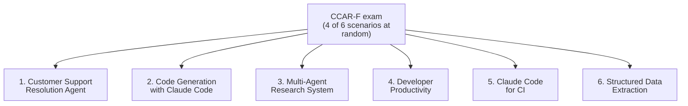

# Official Exam Scenarios Master Guide

The **Claude Certified Architect - Foundations (CCAR-F)** exam has 60 multiple-choice questions in 120 minutes. Four of the six scenarios below are picked at random, and questions are framed in them. Passing is 720 out of 1000 (scaled).

Each scenario folder has:
1. `SCENARIO_GUIDE.md`: In One Minute, diagram, how a good answer thinks, task statement map, worked example, 6 practice questions with answers, self-check.
2. `simulation.py`: offline Python model of the key rules. No API calls.
3. `test_scenario_N_simulation.py`: offline tests.
4. `scenario_workbench.ipynb`: offline notebook that mirrors the guide and runs the simulation.

For the study plan, exam-day tips, decision trees, and a 60-question bank, see [MASTER_SCENARIO_PRACTICE.md](MASTER_SCENARIO_PRACTICE.md).

---

## The Six Scenarios



| # | Scenario | Official description | Domains |
|:---:|---|---|---|
| 1 | [Customer Support Resolution Agent](scenario_1_customer_support/SCENARIO_GUIDE.md) | Agent SDK agent for returns, billing disputes, account issues. MCP tools `get_customer`, `lookup_order`, `process_refund`, `escalate_to_human`. Target 80%+ first-contact resolution with correct escalation. | D1, D2, D5 |
| 2 | [Code Generation with Claude Code](scenario_2_code_generation/SCENARIO_GUIDE.md) | Custom slash commands, `CLAUDE.md`, plan mode vs direct execution. | D3, D5 |
| 3 | [Multi-Agent Research System](scenario_3_multi_agent_research/SCENARIO_GUIDE.md) | Coordinator and subagents (web search, document analysis, synthesis, report generation) producing cited reports. | D1, D2, D5 |
| 4 | [Developer Productivity with Claude](scenario_4_developer_productivity/SCENARIO_GUIDE.md) | Agent explores unfamiliar code, legacy systems, boilerplate, using built-in tools and MCP servers. | D2, D3, D1 |
| 5 | [Claude Code for CI](scenario_5_continuous_integration/SCENARIO_GUIDE.md) | Automated reviews, test generation, PR feedback, with few false positives. | D3, D4 |
| 6 | [Structured Data Extraction](scenario_6_structured_data_extraction/SCENARIO_GUIDE.md) | Extract from unstructured documents, validate with JSON schemas, handle edge cases, feed downstream systems. | D4, D5 |

## Study Plan

1. Read the domain `KEY_CONCEPTS.md` files, starting with D1 (27%).
2. Per scenario: guide sections 1 to 5, then the 6 questions, then the Answers.
3. Run the workbench notebook offline and read `simulation.py`.
4. Do the 60-question bank in two timed halves.
5. Tally by domain; revisit the weakest domain.

## Scenario to Domain to Traps to Folders

| Scenario | Domains | Top traps | Related folders |
|---|---|---|---|
| 1 Support | D1, D2, D5 | Prompt for a must-hold rule; sentiment escalation; classifier before better descriptions | `domain1/ts_1_4_*`, `domain2/ts_2_1_*`, `domain5/ts_5_2_*` |
| 2 Code Gen | D3, D5 | User-level config for team needs; wrong mode; giant `CLAUDE.md` | `domain3/ts_3_1_*` to `ts_3_5_*` |
| 3 Research | D1, D2, D5 | Narrow decomposition; assumed shared context; averaged conflicts | `domain1/ts_1_2_*`, `ts_1_3_*`, `domain5/ts_5_3_*` |
| 4 Productivity | D2, D3, D1 | Reading everything; secrets in `.mcp.json`; noisy main session | `domain2/ts_2_3_*` to `ts_2_5_*` |
| 5 CI | D3, D4 | Missing `-p`; Batches for blocking check; single-pass big PR | `domain3/ts_3_6_*`, `domain4/ts_4_5_*`, `ts_4_6_*` |
| 6 Extraction | D4, D5 | Schema equals truth; retry on absent data; no stratified review | `domain4/ts_4_3_*`, `ts_4_4_*`, `domain5/ts_5_5_*` |

## Exam-Day Tips

- Pace about 2 minutes per question; flag and return.
- Find the root cause before choosing a fix.
- Reject options that depend on probabilistic compliance for must-hold rules, over-engineer, or treat symptoms.
- Prefer code gates, explicit criteria, least privilege, structured errors, and preserved provenance.

## Offline Test Commands

```bash
wsl -d Ubuntu-26.04 bash -c "cd /mnt/c/Repos/Claude_cert && ~/.local/bin/uv run pytest tests scenarios -q"
```

Nothing in this folder calls the Claude API.
