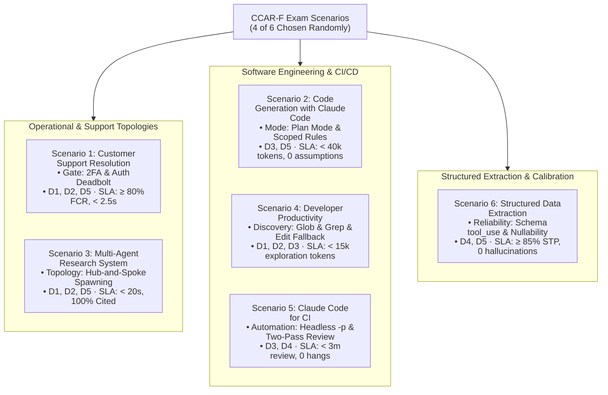

# Official Exam Scenarios Master Guide

The **Claude Certified Architect – Foundations (CCAR-F)** exam consists of **60 multiple-choice questions in 120 minutes** (pacing benchmark: 2.0 minutes per question). On every exam form, **four of the six production scenarios below are chosen at random**, anchoring the majority of scenario-based questions. Passing score is **720 out of 1000** (scaled score).

This master guide covers all six production scenarios, giving you the practical intuition needed to quickly spot root causes and eliminate tricky wrong answers during the exam.

---

## 🧠 How to Solve Scenario Questions (5 Clear Steps)

Every scenario on the exam tests whether you can spot the root cause of a failure instead of applying cosmetic prompt patches. Each scenario guide uses 5 clear steps:

> **1. Simple Picture (Mental Model)** → **2. Architectural Why** → **3. Working Code / Schema** → **4. Exam Traps & Wrong Answers** → **5. Memory Hook**



---

## 📊 The 6 Production Scenarios Comparative Matrix

| # | Scenario | Core Problem & Everyday Metaphor | Target Production SLA | Dominant Failure Mode | Deterministic CCAR-F Remedy | Top Distractor to Reject |
|:---:|---|---|---|---|---|---|
| **1** | **[Customer Support Agent](scenario_1_customer_support/SCENARIO_GUIDE.md)** | **Bank Vault Turnstile**: Guarding customer accounts and refunds with hard gates. | ≥ 80% FCR<br>< 2.5s turn latency | Prompt-only compliance allows unauthorized refunds when user presses urgently. | Programmatic prerequisite gate blocking `process_refund` until 2FA verified. | Adding emphatic warning prompts ("NEVER refund without verifying ID"). |
| **2** | **[Code Generation](scenario_2_code_generation/SCENARIO_GUIDE.md)** | **Architect's Blueprint**: Blueprints before demolition; spackling drywall directly. | < 40k context tokens<br>0 rework iterations | Direct execution on 15-file refactor produces circular edits and breaking changes. | Plan Mode for architecture exploration; Interview Pattern for ambiguities. | Starting direct execution immediately; stuffing entire codebase in `CLAUDE.md`. |
| **3** | **[Multi-Agent Research](scenario_3_multi_agent_research/SCENARIO_GUIDE.md)** | **Air Traffic Controller**: Tower coordinates isolated aircraft without pilot cross-talk. | < 20s turn latency<br>100% cited sources | Sequential turn-by-turn subagent spawning causes timeouts (> 80s). | Single-turn concurrent `Task` spawning; 100% subagent context isolation. | Allowing peer-to-peer subagent communication; averaging conflicting statistics. |
| **4** | **[Developer Productivity](scenario_4_developer_productivity/SCENARIO_GUIDE.md)** | **Map, Magnifying Glass, Scalpel**: Find path, locate symbol, surgical edit. | < 15k exploration tokens<br>0 broken edits | Bulk-reading 300 files on turn 1 saturates context; non-unique edit collides. | Progressive discovery (`Glob` → `Grep` → `Read`); 3-stage `Edit` Fallback Protocol. | Repeatedly retrying failed `Edit` calls without expanding anchor text or falling back. |
| **5** | **[Continuous Integration](scenario_5_continuous_integration/SCENARIO_GUIDE.md)** | **Automated Factory Robot**: Robot must never freeze waiting for human keyboard input. | < 3m PR review latency<br>0 runner hangs | Running `claude` without `-p` hangs CI runner indefinitely waiting for stdin. | Non-interactive `-p` flag; Two-Pass Review (Pass 1 per-file, Pass 2 integration). | Using Message Batches API for blocking PR review (24h turnaround window). |
| **6** | **[Structured Extraction](scenario_6_structured_data_extraction/SCENARIO_GUIDE.md)** | **Strict Customs Declaration**: Checkboxes must allow "N/A" so travelers don't invent facts. | ≥ 85% Straight-Through Processing (STP)<br>0 fabricated facts | Required schema fields force Claude to hallucinate missing phone numbers or tax IDs. | Schema enforcement via `tool_use`; nullable fields (`["string", "null"]`); 10% stratified audit. | Asking model for markdown JSON; retrying extraction when fact is absent from document. |

---

## 🏛️ Scenario Architectural Profiles

### [Scenario 1: Customer Support Resolution Agent](scenario_1_customer_support/)
- **Primary Domains**: Domain 1 (27%), Domain 2 (18%), Domain 5 (15%)
- **The Physical Metaphor**: The **Bank Vault Turnstile**. Warning signs fail; only an electronic turnstile blocks access until the badge scans green.
- **System Dynamics & Failure Modes**: E-commerce customers demand fast resolutions, but agents must never breach security. When angry customers bypass verification by impersonating executives, probabilistic system prompts degrade.
- **Architectural Solution**:
  1. Programmatic prerequisite gate in Python blocking `process_refund` until `get_customer` successfully authenticates.
  2. Immediate escalation to human agents on explicit customer demand ("transfer me to a supervisor") without asking further diagnostic questions.
  3. Immutable Case Facts layer keeping customer ID, order number, and refund amounts outside compacted history.
  4. Trimming 55 raw CRM fields down to 4 essentials in a `PostToolUse` normalization hook.

### [Scenario 2: Code Generation with Claude Code](scenario_2_code_generation/)
- **Primary Domains**: Domain 3 (20%), Domain 5 (15%)
- **The Physical Metaphor**: The **Architectural Blueprint**. When moving load-bearing walls across multiple floors, you draft blueprints before swinging a sledgehammer.
- **System Dynamics & Failure Modes**: On small scripts, direct code editing is fast. On multi-service refactors touching 15+ files, direct edits cause circular regressions, broken imports, and context exhaustion.
- **Architectural Solution**:
  1. Enter **Plan Mode** to explore dependencies, trace call trees, and propose a file-by-file refactoring manifest.
  2. Implement the **Interview Pattern**: ask targeted clarifying questions with concrete selectable options before writing code.
  3. Scope conventions using `.claude/rules/*.md` with YAML `paths: ["**/*.test.tsx"]` rather than bloating root `CLAUDE.md`.
  4. Execute discovery commands using custom skills configured with `context: fork` to protect main context.

### [Scenario 3: Multi-Agent Research System](scenario_3_multi_agent_research/)
- **Primary Domains**: Domain 1 (27%), Domain 2 (18%), Domain 5 (15%)
- **The Physical Metaphor**: The **Air Traffic Control Tower**. The central tower coordinates takeoffs and landings; individual flights operate in strict isolation without open-channel chatter.
- **System Dynamics & Failure Modes**: Researching market trends requires aggregating 10-K filings, earnings transcripts, and news sentiment. Sequential execution causes 90-second latencies; shared context causes cross-topic hallucination.
- **Architectural Solution**:
  1. Central Coordinator emits multiple `Task` calls in a **single turn**, triggering concurrent subagent runs.
  2. Subagents execute with **100% context isolation**; parent context is explicitly injected into subagent prompts.
  3. Differentiate between `VALID_EMPTY` (0 records found, no error) and `UPSTREAM_FAILURE` (API timeout, structured error).
  4. Preserve conflicting metrics (\$1.2B vs \$1.5B) side-by-side with source citations and collection timestamps; never average conflicting statistics.

### [Scenario 4: Developer Productivity with Claude](scenario_4_developer_productivity/)
- **Primary Domains**: Domain 1 (27%), Domain 2 (18%), Domain 3 (20%)
- **The Physical Metaphor**: The **Map, Magnifying Glass, and Scalpel**. The map (`Glob`) finds files; the magnifying glass (`Grep`) locates code symbols; the scalpel (`Edit`) alters lines surgically.
- **System Dynamics & Failure Modes**: Developers exploring large repos waste 50k tokens reading full directories. When making surgical edits, duplicate code blocks cause `Edit` collisions.
- **Architectural Solution**:
  1. Progressive Discovery: run `Glob` to narrow paths → run `Grep` to locate function signatures → chunked `Read` around targets.
  2. 3-Stage `Edit` Fallback Protocol: If surgical `Edit` fails due to non-unique anchor text, expand anchor context; if it fails again, fallback to `Read` + `Write` of the complete file.
  3. Expose API catalogs and database schemas as read-only **MCP Resources** (`catalog://orders/schema`) to eliminate exploratory tool loops.

### [Scenario 5: Claude Code for Continuous Integration](scenario_5_continuous_integration/)
- **Primary Domains**: Domain 3 (20%), Domain 4 (20%)
- **The Physical Metaphor**: The **Silent Factory Robot**. A quality-control robot on a manufacturing line must never stop and beep waiting for an operator to type "Y" on a keyboard.
- **System Dynamics & Failure Modes**: Running Claude Code in GitHub Actions or GitLab CI often fails because the runner hangs indefinitely on interactive prompts. In single-pass reviews of large PRs, attention dilution causes missed bugs.
- **Architectural Solution**:
  1. Automated CI commands must pass `claude -p "..." --output-format json` to run non-interactively.
  2. Implement **Two-Pass Review**: Pass 1 evaluates individual files in isolated subagents; Pass 2 audits cross-file interface contracts.
  3. Prohibit the Message Batches API for blocking pre-merge PR gates (Batch API has a 24-hour window without latency SLAs).
  4. Write concrete categorical rubrics with explicit **negative boundaries** to eliminate test false alarms.

### [Scenario 6: Structured Data Extraction](scenario_6_structured_data_extraction/)
- **Primary Domains**: Domain 4 (20%), Domain 5 (15%)
- **The Physical Metaphor**: The **Strict Customs Declaration Form**. The traveler must be allowed to check "None" or "N/A" for secondary items; otherwise, they fabricate answers.
- **System Dynamics & Failure Modes**: Document extraction pipelines parsing invoices and insurance claims hallucinate values when required schema properties are absent from source PDFs.
- **Architectural Solution**:
  1. Enforce schema compliance using `tool_use` (never parse raw markdown with regex).
  2. Declare non-guaranteed attributes as **nullable** (`type: ["string", "null"]`) so Claude returns `null` instead of guessing.
  3. Closed-Loop Validation: retry up to 2 times on arithmetic or formatting errors; **fast-fail immediately** when source facts are absent.
  4. Calibrated Human Routing: automate high-confidence extractions, but audit **5–10% stratified random samples** across all document types to detect distribution drift.

---

## 🛠️ Offline Verification & Practice Labs

Every scenario directory provides an isolated, zero-token test suite and executable simulation:

```bash
# Run all scenario simulations offline (zero API cost):
uv run pytest scenarios/ -q

# Run specific scenario tests:
uv run pytest scenarios/scenario_1_customer_support/test_scenario_1_simulation.py
uv run pytest scenarios/scenario_3_multi_agent_research/test_scenario_3_simulation.py
```

### Lab Artifacts per Scenario
- `SCENARIO_GUIDE.md`: Executive summary, visual architecture, thinking protocol, worked examples, 6 exam-style questions, and self-check.
- `simulation.py`: Deterministic Python simulation of the scenario's state machines and failure handling.
- `scenario_workbench.ipynb`: Interactive Jupyter notebook mirroring the simulation offline.
- `test_scenario_N_simulation.py`: Unit tests validating offline safety and contract invariants.

---

## 🔗 Master Navigation Hub

- ⚡ [**Exam Refresher Cheat Sheet (`EXAM_REFRESHER.md`)**](../EXAM_REFRESHER.md): The 15 Golden Rules, rapid decision matrix, and distractor traps.
- 📋 [**Exam Blueprint (`EXAM_BLUEPRINT.md`)**](../EXAM_BLUEPRINT.md): 5-domain syllabus, exam weighting, and 27 task statements matrix.
- 🎯 [**Master Scenario Practice (`scenarios/MASTER_SCENARIO_PRACTICE.md`)**](MASTER_SCENARIO_PRACTICE.md): Complete 60-question authentic diagnostic practice exam.
- ✅ [**Progress Tracker (`PROGRESS.md`)**](../PROGRESS.md): 27 task statements and 6 scenario checklist.
- 🏠 [**Root README (`README.md`)**](../README.md): Main repository hub and zero-token offline test suite.
- 🛡️ [**Execution Policy (`EXECUTION_POLICY.md`)**](../EXECUTION_POLICY.md): Zero-token testing and live execution standards.
