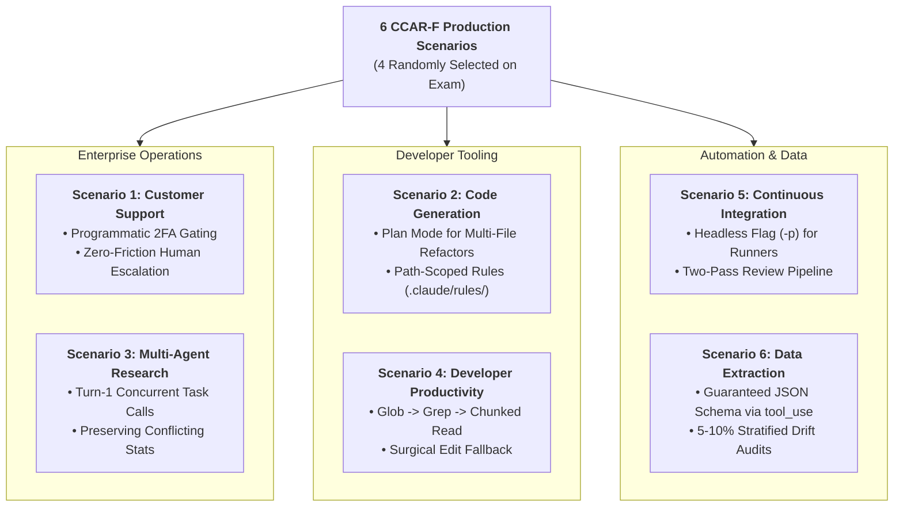

# Official Exam Scenarios Master Guide

The **Claude Certified Architect – Foundations (CCAR-F)** exam evaluates architectural decision-making through realistic production deployments. On the real 60-question exam, **4 out of these 6 scenarios are chosen at random**, and nearly all questions are anchored to them.

Each scenario directory below is an end-to-end learning lab containing:
1. **`SCENARIO_GUIDE.md`**: Executive SLAs, exact Anthropic API/MCP structures, production engineering state machines, threat modeling, token budgeting, 10 high-yield scenario-based exam questions with deep rationales and distractor teardowns, a hands-on practical coding mini-lab with complete walkthrough, and Socratic senior architect interview defenses.
2. **`simulation.py`**: Fully runnable end-to-end Python pipeline weaving multiple Task Statements into a cohesive architecture.
3. **`test_scenario_{N}_simulation.py`**: Zero-token offline unit tests verifying pipeline behavior across edge cases.

👉 **Master Study Engine**: See [**`MASTER_SCENARIO_PRACTICE.md`**](MASTER_SCENARIO_PRACTICE.md) for the consolidated 6-scenario comparative matrix, decision trees, complete 60-question authentic diagnostic practice exam, and domain readiness scorecard.

---

## 🧭 The 6 Production Scenarios Directory




### [🎧 Scenario 1: Customer Support Resolution Agent](scenario_1_customer_support/)
- **Core SLA**: $\ge 80\%$ First-Contact Resolution (FCR) rate; $<2.5\text{s}$ turn latency; $0 unverified refunds.
- **Task Statements Weaved**: **TS 1.4** (Gates), **TS 2.1** (Tool Interfaces), **TS 2.2** (MCP Structured Errors), **TS 5.1** (Case Facts & Context Trimming), **TS 5.2** (Immediate Escalation).
- **Key Architectures**:
  - Programmatic prerequisite gate blocking refunds until identity verification.
  - Immediate human escalation without friction when customer demands a manager.
  - Context trimming of 55 raw CRM database fields down to 4 customer-facing attributes.
  - Immutable Case Facts preserved across context compaction turns.
- **Lab Files**: [`SCENARIO_GUIDE.md`](scenario_1_customer_support/SCENARIO_GUIDE.md) | [`simulation.py`](scenario_1_customer_support/simulation.py) | [`test_scenario_1_simulation.py`](scenario_1_customer_support/test_scenario_1_simulation.py)

---

### [💻 Scenario 2: Code Generation with Claude Code](scenario_2_code_generation/)
- **Core SLA**: Zero-assumption engineering acceleration across multi-tier repositories; $<40\text{k}$ context tokens.
- **Task Statements Weaved**: **TS 3.1** (CLAUDE.md Hierarchy), **TS 3.2** (Slash Commands & Skills), **TS 3.3** (Path-Scoped Rules), **TS 3.4** (Plan Mode vs Direct), **TS 3.5** (Interview Pattern).
- **Key Architectures**:
  - Path-scoped rules in `.claude/rules/*.md` matching `backend/**` to eliminate context bloat.
  - Plan Mode for multi-file architectural refactors; Direct Execution for localized one-line fixes.
  - The Interview Pattern: Proactively querying the user with concrete options when ambiguity is detected.
  - Custom skills configured with `context: fork` to isolate exploration tokens.
- **Lab Files**: [`SCENARIO_GUIDE.md`](scenario_2_code_generation/SCENARIO_GUIDE.md) | [`simulation.py`](scenario_2_code_generation/simulation.py) | [`test_scenario_2_simulation.py`](scenario_2_code_generation/test_scenario_2_simulation.py)

---

### [🔬 Scenario 3: Multi-Agent Research System](scenario_3_multi_agent_research/)
- **Core SLA**: Autonomous, cited market reports with verifiable source provenance; $<20\text{s}$ turnaround.
- **Task Statements Weaved**: **TS 1.2** (Hub-and-Spoke Coordinator), **TS 1.3** (Parallel Subagent Spawning), **TS 2.4** (MCP Server Integration), **TS 5.3** (Coverage Tracking), **TS 5.6** (Preserving Conflicting Claims).
- **Key Architectures**:
  - Emitting multiple `Task` calls in Turn 1 for concurrent subagent execution.
  - Distinguishing `VALID_EMPTY` (legitimate 0 records) from `UPSTREAM_FAILURE` (504 timeout).
  - Preserving conflicting financial metrics with timestamps and source attribution (never averaging).
  - Strict context isolation preventing parent history leakage to subagents.
- **Lab Files**: [`SCENARIO_GUIDE.md`](scenario_3_multi_agent_research/SCENARIO_GUIDE.md) | [`simulation.py`](scenario_3_multi_agent_research/simulation.py) | [`test_scenario_3_simulation.py`](scenario_3_multi_agent_research/test_scenario_3_simulation.py)

---

### [🛠️ Scenario 4: Developer Productivity with Claude](scenario_4_developer_productivity/)
- **Core SLA**: Friction-free onboarding to large unfamiliar legacy codebases; $<15\text{k}$ exploration tokens.
- **Task Statements Weaved**: **TS 1.7** (Session State & Forking), **TS 2.3** (Tool Distribution & Least Privilege), **TS 2.4** (MCP Resources), **TS 2.5** (Built-in Tools: Grep, Glob, Read, Edit Fallback).
- **Key Architectures**:
  - Incremental discovery: `Glob` $\rightarrow$ `Grep` $\rightarrow$ chunked `Read` (never bulk reading all files).
  - The Edit Fallback Protocol: Expanding anchor lines or falling back to `Read + Write` when surgical `Edit` encounters collision.
  - Exposing company API specs as read-only **MCP Resources** instead of active tool calls.
- **Lab Files**: [`SCENARIO_GUIDE.md`](scenario_4_developer_productivity/SCENARIO_GUIDE.md) | [`simulation.py`](scenario_4_developer_productivity/simulation.py) | [`test_scenario_4_simulation.py`](scenario_4_developer_productivity/test_scenario_4_simulation.py)

---

### [🚀 Scenario 5: Claude Code for Continuous Integration (CI/CD)](scenario_5_continuous_integration/)
- **Core SLA**: Non-blocking pull request gatekeeper and automated code review bot; $<3\text{m}$ review latency.
- **Task Statements Weaved**: **TS 3.6** (Headless Execution & JSON Schemas), **TS 4.1** (Explicit Rubrics & Negative Boundaries), **TS 4.5** (Batch API Trap), **TS 4.6** (Two-Pass Review).
- **Key Architectures**:
  - Non-interactive execution requiring `-p` / `--print` and `--output-format json` to eliminate runner hangs.
  - Two-Pass Review: Pass 1 file-level local correctness; Pass 2 cross-file integration & contracts.
  - The Message Batches API Trap: Never use Batch API for blocking PR checks (24h turnaround); use Batches only for overnight audits.
  - Negative boundaries in rubrics exempting test mocks from secret leakage alerts.
- **Lab Files**: [`SCENARIO_GUIDE.md`](scenario_5_continuous_integration/SCENARIO_GUIDE.md) | [`simulation.py`](scenario_5_continuous_integration/simulation.py) | [`test_scenario_5_simulation.py`](scenario_5_continuous_integration/test_scenario_5_simulation.py)

---

### [📄 Scenario 6: Structured Data Extraction](scenario_6_structured_data_extraction/)
- **Core SLA**: Production-grade entity extraction with zero fabricated data; $\ge 85\%$ Straight-Through Processing.
- **Task Statements Weaved**: **TS 4.3** (Structured Output via Tool Use), **TS 4.4** (Validation & Bounded Retries), **TS 4.5** (Message Batches API), **TS 5.5** (Confidence Calibration & Stratified Audits).
- **Key Architectures**:
  - Enforcing valid JSON schemas using Tool Use (`tool_choice: "any"` or named tool).
  - The Nullable Schema Rule: Marking non-guaranteed attributes as nullable to eliminate hallucinations.
  - Closed-loop retry with targeted math feedback; fast-failing on unrecoverable missing source facts.
  - Calibrated routing with **10% stratified random sampling** of high-confidence predictions to monitor model drift.
- **Lab Files**: [`SCENARIO_GUIDE.md`](scenario_6_structured_data_extraction/SCENARIO_GUIDE.md) | [`simulation.py`](scenario_6_structured_data_extraction/simulation.py) | [`test_scenario_6_simulation.py`](scenario_6_structured_data_extraction/test_scenario_6_simulation.py)

---

## ⚡ 6 Production Scenarios Golden Rules & Anti-Pattern Exam Matrix

| # | Production Scenario | Primary Domains | Golden Architectural Rule | Top Exam Distractor to Reject | Rapid Decision Trigger |
|:---:|---|:---:|---|---|---|
| **1** | **Customer Support Resolution Agent** | **D1 (27%), D2 (18%), D5 (15%)** | Programmatic prerequisite gates block mutative tools until verified; zero-friction human escalation on explicit customer demand. | Adding prompt instructions ("never issue refunds without verification"); probing users who demand a human. | If customer demands human $\rightarrow$ Escalate immediately with Case Facts manifest. If mutative tool $\rightarrow$ Programmatic auth gate. |
| **2** | **Code Generation with Claude Code** | **D3 (20%), D5 (15%)** | Plan Mode (`/plan`) with Explore subagent for multi-file (5+) refactors; Interview Pattern with concrete options on ambiguity; path-scoped rules in `.claude/rules/`. | Using Direct Execution for monolith restructuring; assuming technology choices (e.g. Redis vs Memcached) without asking. | If task touches 5+ files/architectural shift $\rightarrow$ Plan Mode. If requirements underspecified $\rightarrow$ Interview Pattern. |
| **3** | **Multi-Agent Research System** | **D1 (27%), D2 (18%), D5 (15%)** | Central coordinator spawns parallel subagents via multiple `Task` calls in Turn 1; preserve conflicting stats with source citations; distinguish `VALID_EMPTY` from failures. | Allowing subagents to communicate peer-to-peer; averaging conflicting statistics into an artificial mean. | If spawning independent subagents $\rightarrow$ Multiple `Task` calls in single turn. If conflicting numbers $\rightarrow$ Cite both with dates. |
| **4** | **Developer Productivity with Claude** | **D2 (18%), D3 (20%), D1 (27%)** | Incremental discovery (`Glob` $\rightarrow$ `Grep` $\rightarrow$ chunked `Read`); least privilege (4–5 tools); expose passive catalogs as MCP Resources; `Edit` fallback to `Read + Write`. | Bulk reading all files into context upfront; retrying failing `Edit` calls blindly without inspecting line offsets via `Read`. | If locating code in large codebase $\rightarrow$ Glob $\rightarrow$ Grep $\rightarrow$ Read. If Edit text collision $\rightarrow$ Read + Write fallback. |
| **5** | **Continuous Integration (CI/CD)** | **D3 (20%), D4 (20%)** | Mandatory `-p` (or `--print`) flag for non-interactive execution; Two-Pass Review (Pass 1 local, Pass 2 integration); reserve Batch API for overnight jobs only. | Running Claude without `-p` (hangs waiting for stdin); using Message Batches API for blocking pre-merge PR checks. | If running in CI pipeline runner $\rightarrow$ Pass `-p` and `--output-format json`. If reviewing multi-file PR $\rightarrow$ Two-Pass Review. |
| **6** | **Structured Data Extraction** | **D4 (20%), D5 (15%)** | Enforce schemas via `tool_use` with forced `tool_choice`; mark non-guaranteed fields nullable; fast-fail retries on absent source data; 5–10% stratified random audits. | Asking Claude to output markdown JSON blocks; marking all fields required (causes hallucinations); looping retries on absent data. | If extracting structured JSON $\rightarrow$ Define tool schema + forced `tool_choice`. If field absent $\rightarrow$ Return null. |

---

## 🧪 Automated Offline Verification & Test Suite

All 6 scenarios are paired with comprehensive zero-token offline unit tests that execute within WSL Ubuntu in compliance with the repository's safety policy (`no_claude_api_execution.md`):

```bash
# Run the complete repository test suite (115 passing tests):
wsl -d Ubuntu-26.04 bash -c "~/.local/bin/uv run pytest"

# Run all 43 scenario-specific simulation unit tests:
wsl -d Ubuntu-26.04 bash -c "~/.local/bin/uv run pytest scenarios/"

# Run an individual scenario simulation standalone:
wsl -d Ubuntu-26.04 bash -c "~/.local/bin/uv run python scenarios/scenario_1_customer_support/simulation.py"
```

| Scenario Lab | Test File | Test Count | Key Invariants Verified |
|---|---|:---:|---|
| **Scenario 1** | `test_scenario_1_simulation.py` | 7 | Auth gating, context trimming, immediate escalation, policy windows, multi-order pivoting |
| **Scenario 2** | `test_scenario_2_simulation.py` | 7 | Plan mode routing, interview pattern ambiguity detection, stack rule isolation, blueprint approval |
| **Scenario 3** | `test_scenario_3_simulation.py` | 6 | Concurrent subagent fan-out, VALID_EMPTY vs UPSTREAM_FAILURE, conflicting claims preservation |
| **Scenario 4** | `test_scenario_4_simulation.py` | 7 | MCP resource reads, Glob/Grep discovery, anchor collision recovery, targeted occurrence replacement |
| **Scenario 5** | `test_scenario_5_simulation.py` | 9 | Headless flag enforcement, Real-Time vs Batch API, cross-file contract breaks, secret detection |
| **Scenario 6** | `test_scenario_6_simulation.py` | 7 | Math retry recovery, fast-fail on absent facts, confidence tier routing, 10% stratified drift audit |
| **Total Scenario Tests** | | **43** | **100% Offline, Zero Token Costs** |

