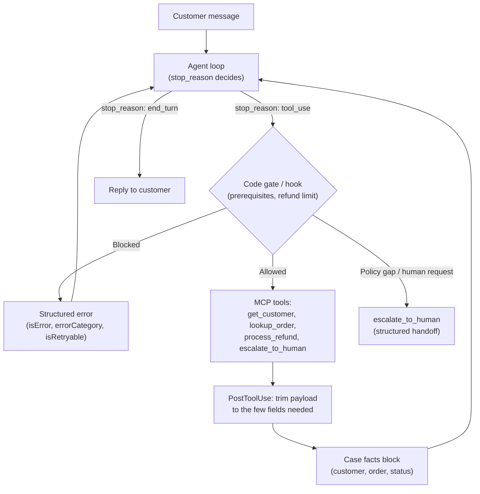
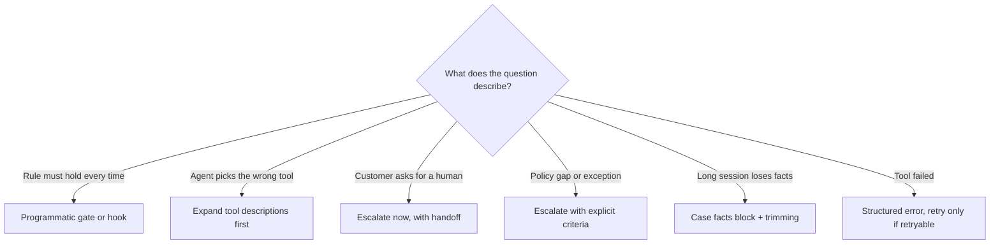

# Scenario 1: Customer Support Resolution Agent

## 1. In One Minute

**What it is.** An Agent SDK agent that handles returns, billing disputes, and account issues. It uses four custom MCP tools: `get_customer`, `lookup_order`, `process_refund`, `escalate_to_human`. The target is 80%+ first-contact resolution, while still knowing when to hand off to a human.

**Domains hit:** D1 Agentic Architecture, D2 Tool Design and MCP, D5 Context Management and Reliability.

**Task statements:** TS 1.1 (agent loop), 1.4 (prerequisite gates), 1.5 (hooks), 2.1 (tool descriptions), 2.2 (MCP errors), 2.3 (tool distribution), 5.1 (context and case facts), 5.2 (escalation).

**Top 3 traps**
1. Using a prompt or few-shot examples to enforce a rule that must hold 100% of the time (identity check before a refund).
2. Using self-reported confidence, sentiment, or a separate classifier to decide when to escalate.
3. Building a routing classifier or merging tools before fixing weak tool descriptions.

## 2. Architecture Diagram

## 3. How a Good Answer Thinks

Ask these in order.

1. **What is the root cause?** Do not treat the symptom. Wrong tool picked? Look at tool descriptions first.
2. **Must it hold every time?** Money, identity, and permissions need code (gate or hook). Prompts and few-shot examples are probabilistic.
3. **Is the first step proportionate?** Cheapest fix that attacks the cause: better descriptions before classifiers, explicit criteria before extra models.
4. **Least privilege.** Give the agent only the 4-5 tools it needs.
5. **Escalation uses explicit criteria**: customer asks for a human, policy gap or exception, no progress. Never sentiment or self-reported confidence.
6. **Escalate right away** on an explicit human request. Do not probe or retry first.
7. **Several matches?** Ask for another identifier. Never guess by recency.

### Model and Sampling Notes
- Use `claude-sonnet-4-5` for coordinators and reasoning, `claude-haiku-4-5` for workers and extraction.
- With extended thinking on: omit `temperature`, leave `top_k` and `top_p` unset, and use only `tool_choice` `auto` or `none` (forced or `any` returns HTTP 400). Forced-tool extraction calls must not use thinking.
- In tool loops, return thinking blocks with their signature unchanged.
- Loops end on `stop_reason` only (`end_turn`, `tool_use`, `max_tokens`, `stop_sequence`, `pause_turn`, `refusal`). A max-iterations counter is a safety cap, not the stop rule.

## 4. Task Statement Map

| Task statement | How it shows up here | Trap |
|---|---|---|
| TS 1.1 Agent loop | Loop continues on `tool_use`, stops on `end_turn` | Parsing reply text to decide when to stop |
| TS 1.4 Prerequisite gates | `get_customer` must succeed before `lookup_order` or `process_refund` | Prompt rule or few-shot for a 100% rule |
| TS 1.5 Hooks | Block `process_refund` above `$500` in code; trim results in `PostToolUse` | Asking the model to remember the limit |
| TS 2.1 Tool design | `get_customer` (who) vs `lookup_order` (what) need clear boundaries | Adding a routing classifier before fixing descriptions |
| TS 2.2 MCP errors | Return `isError`, `errorCategory`, `isRetryable` | Generic "operation failed" or empty success |
| TS 2.3 Distribution | Support agent gets only its 4 tools | Giving all company tools "just in case" |
| TS 5.1 Context | Case facts block + trimmed tool output | Relying on summaries for IDs and amounts |
| TS 5.2 Escalation | Explicit criteria + few-shot for borderline cases | Sentiment score or self-reported confidence |

## 5. Worked Example

**Customer:** "My name is Alex Kim. Refund my desk order."

1. Name search finds **two** Alex Kims. The agent asks for the phone number or email. It does not pick one.
2. Customer gives `alex1@example.com`. `get_customer` succeeds, so case facts now hold `customer_id` and `is_authenticated`.
3. `lookup_order` returns 40 fields. `PostToolUse` keeps `order_id`, `status`, `total`, `items`, `days_since_delivery`.
4. Customer wants a refund of `$750`. The refund hook sees the amount is over `$500`, blocks the tool, and returns a structured error.
5. The agent calls `escalate_to_human` with case facts, actions taken, and the reason. A human finishes the case.

Why this is right: identity and limit are enforced by code, context stays small, and the escalation reason is explicit.

Try it offline: `scenarios/scenario_1_customer_support/simulation.py` (`execute_tool`, `resolve_customer_by_name`, `REFUND_APPROVAL_LIMIT_USD`).

## 6. Exam-Style Practice Questions

**Q1.** Occasionally the agent calls `process_refund` for amounts above the policy limit. Which change gives the strongest guarantee?
- A) Add the limit to the system prompt in bold.
- B) Add five few-shot examples of refusing large refunds.
- C) Add a hook that checks the amount before the tool runs and redirects to `escalate_to_human`.
- D) Ask the agent to state its confidence before each refund.

**Q2.** `lookup_order` returns about 40 fields. After 15 turns the agent mixes up order status. What is the best fix?
- A) Switch to a larger model.
- B) Trim the tool result to the needed fields in a `PostToolUse` hook.
- C) Summarize the whole conversation every turn.
- D) Remove `lookup_order` and let the agent ask the customer.

**Q3.** `lookup_order` times out. Which response should the MCP tool return?
- A) `isError: true`, `errorCategory: "transient"`, `isRetryable: true`, and a clear message.
- B) The text "Operation failed".
- C) An empty result marked as success.
- D) An error that ends the session.

**Q4.** A customer writes: "Stop. Get me a manager." The agent could solve the issue. What should happen?
- A) Try to solve it first, then offer a human.
- B) Ask why they want a manager.
- C) Run a sentiment check to confirm they are upset.
- D) Escalate immediately with a structured handoff.

**Q5.** In long sessions the agent forgets the order ID after earlier turns are summarized. What fixes this?
- A) Summarize more aggressively.
- B) Increase `max_tokens`.
- C) Keep a persistent case facts block outside the summarized history.
- D) Repeat the whole transcript in the system prompt.

**Q6.** The support agent has 18 tools, including HR and finance tools, and sometimes picks an unrelated one. What is the best first step?
- A) Add a rule in the prompt saying which tools to avoid.
- B) Give the agent only its 4-5 relevant tools.
- C) Add a classifier to pre-select tools.
- D) Lower the temperature.

### Answers

**Q1: C.** A fails: prompts are probabilistic. B fails: few-shot is probabilistic too. D fails: self-reported confidence is not a guarantee.

**Q2: B.** A fails: model size does not remove noisy fields. C fails: summaries lose exact values. D fails: it removes capability and hurts resolution.

**Q3: A.** B fails: no category or retry signal. C fails: hides the failure and looks like "no order". D fails: a transient timeout should not end the session.

**Q4: D.** A fails: ignores an explicit request. B fails: probing adds friction. C fails: sentiment is not the trigger; the explicit request is.

**Q5: C.** A fails: more compression loses more facts. B fails: output length is unrelated. D fails: wastes context and is not structured.

**Q6: B.** A fails: prompt rules are probabilistic and tools still appear. C fails: over-engineered; reduce the tool set first. D fails: temperature does not fix tool choice.

## 7. Self-Check Checklist

- [ ] I can say why code beats prompts for identity and money.
- [ ] I know the four tools and what each one is for.
- [ ] I can list three valid escalation triggers and two invalid ones.
- [ ] I know what to keep in the case facts block and what to trim.
- [ ] I fix tool descriptions before adding classifiers.

**Memory hook:** "Money in code, humans on request, facts in a block."
