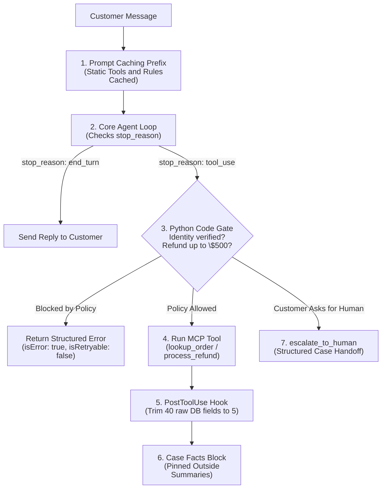
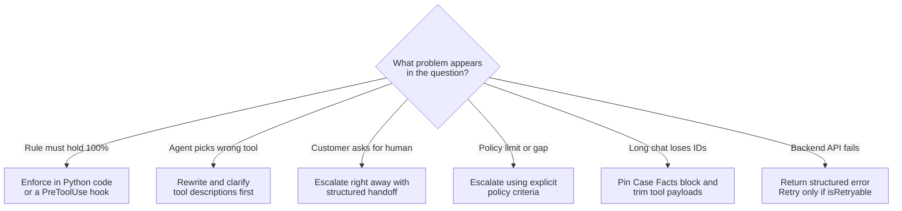

# Scenario 1: Customer Support Resolution Agent

## 1. The Big Picture (In Plain English)

Imagine an e-commerce support bot built with the Claude Agent SDK. Its job is to help customers check orders, process simple returns, and hand off tricky cases to human agents. It has four focused tools: `get_customer`, `lookup_order`, `process_refund`, and `escalate_to_human`. The business goal is to resolve **80% or more** of support requests on the first contact without ever issuing an unauthorized refund.

**Everyday Analogy — The Bank Vault Turnstile:**
Putting a sign on a bank vault that says *"Authorized Staff Only"* will not stop someone who pushes past it. An electronic turnstile that physically stays locked until your badge scans green will. In an AI agent, prompt instructions are polite signs; Python code checks (called **programmatic gates** or **hooks**) are the locked turnstile.

- **Domains Tested:** Domain 1 (Agentic Architecture, 27%), Domain 2 (Tool Design & MCP, 18%), Domain 5 (Context Management & Reliability, 15%).
- **Task Statements:** TS 1.1 (Agent loop), TS 1.4 (Prerequisite gates), TS 1.5 (Hooks), TS 2.1 (Tool descriptions), TS 2.2 (Structured tool errors), TS 2.3 (Tool scoping), TS 5.1 (Context & Case Facts), TS 5.2 (Escalation triggers).

### Top 3 Mistakes to Watch Out For
1. **Using a prompt for a rule that must never break:** Telling Claude *"NEVER refund before checking ID"* works most of the time, until an angry customer or prompt injection talks the model into skipping the check. Money and identity rules belong in code.
2. **Escalating based on mood or confidence:** Sending a customer to a human just because they sound frustrated—or because the model guesses a low confidence score—wastes human agent time. Escalate only when the customer asks for a person, policy forbids an action, or tools keep failing.
3. **Adding a classifier before fixing unclear tool descriptions:** If Claude keeps calling `lookup_order` when it should call `get_customer`, do not build an extra ML router right away. First rewrite the tool descriptions with clear boundaries and examples.

---

## 2. How the System Works



### Walkthrough of the Flow
1. **Static instructions stay cached at the top:** Tool definitions and policy rules sit in the cached prefix so the system does not pay full price to re-read them on every turn.
2. **The loop follows `stop_reason`:** Your application code keeps running tools whenever Claude returns `stop_reason == "tool_use"` and stops to reply only when `stop_reason == "end_turn"`.
3. **Code checks run before any sensitive tool:** Before `lookup_order` or `process_refund` touches the backend, a Python check verifies that `get_customer` already authenticated the customer and that the refund is within the `$500` and `30-day` limits.
4. **Raw database responses are trimmed:** A `PostToolUse` hook strips out ~35 internal database fields (warehouse IDs, partition keys, staff IDs) and keeps only the 5 fields the agent actually needs.
5. **Key facts stay pinned:** Verified details (`customer_id`, `is_authenticated`, `active_order_id`) live in a small **Case Facts** block outside summarized chat history so they never get lost in long conversations.

---

## 3. Core Design Rules (Why Naive Fixes Fail)

1. **Enforce 100% rules in code, not prompts:**
   Identity checks, ownership checks (making sure Bob cannot inspect Alice's order), and the `$500` refund cap must live in deterministic host code or a `PreToolUse` hook. Prompts are probabilistic and will eventually fail under urgent phrasing or adversarial inputs.
2. **Fix tool descriptions before adding extra models:**
   When Claude picks the wrong tool, the cheapest and cleanest root fix is improving the tool description: explain *when* to use it, *what format* it expects, and *when NOT to use it*.
3. **Use explicit escalation triggers:**
   - Customer asks for a human or manager → Escalate **right away** with a structured summary. Do not ask extra diagnostic questions first.
   - Request falls outside written policy (e.g., refund over `$500`, delivered over `30 days` ago, or price matching) → Escalate with a clear reason.
   - Tool fails repeatedly and is not retryable → Escalate cleanly instead of looping forever.
   - *Never* escalate based on sentiment scores or self-reported confidence.
4. **Follow Least Privilege:**
   Give the support agent only its 4 domain tools (`get_customer`, `lookup_order`, `process_refund`, `escalate_to_human`). Do not attach finance, HR, or shell tools "just in case."
5. **Clarify duplicate matches—never guess:**
   If looking up `"Alex Kim"` returns two customers, ask for a phone number or email. Never guess the most recent account, and never reveal other customers' addresses.
6. **Return structured tool errors:**
   When a backend service times out, return `isError: true` with a category (`"transient"`), a human-readable message, and `isRetryable: true`. Never return an empty list `{}` with `isError: false`, or Claude will assume the customer has no orders.



### Model & API Rules for This Scenario
- **Model choice:** Use `claude-sonnet-4-5` for the customer support agent (and coordinators), and `claude-haiku-4-5` for lightweight background classification or extraction tasks.
- **Extended Thinking rules:** If you turn on `thinking` (`budget_tokens`), **omit `temperature`**, `top_p`, and `top_k` (passing them causes an HTTP `400` error), and use only `tool_choice` `"auto"` or `"none"`.
- **Preserve thinking blocks:** In multi-turn tool loops, pass Claude's `thinking` blocks back unmodified with their cryptographic `signature`.
- **Prompt caching layout:** Put static tool schemas and rules first with `cache_control: {"type": "ephemeral"}`, and place dynamic customer messages and Case Facts below the breakpoint.

---

## 4. What the Exam Tests (Task Statement Map)

| Task Statement | How It Shows Up Here | Tempting Wrong Answer |
| :--- | :--- | :--- |
| **TS 1.1 Agent Loop** | Loop keeps running on `stop_reason: "tool_use"` and stops on `"end_turn"`. | Searching reply text with regex for phrases like `"All done"`. |
| **TS 1.4 Prerequisite Gates** | Code blocks `lookup_order` and `process_refund` until `get_customer` succeeds. | Writing `"NEVER refund before checking ID"` in bold in the system prompt. |
| **TS 1.5 Hooks** | Pre-tool check blocks refunds over `$500`; `PostToolUse` trims raw DB responses. | Asking Claude to remember the `$500` rule in its head. |
| **TS 2.1 Tool Descriptions** | Clear boundaries between `get_customer` (who) and `lookup_order` (what order). | Training an ML routing classifier before improving tool descriptions. |
| **TS 2.2 MCP Tool Errors** | Errors include `isError: true`, category, and `isRetryable` flag. | Returning `"Operation failed"` or returning `{}` as a fake success. |
| **TS 2.3 Tool Scoping** | Support agent receives only its 4 support tools. | Giving the agent all company tools "just in case." |
| **TS 5.1 Context & Case Facts** | Pinned Case Facts block outside summaries + trimmed tool payloads. | Expecting conversation summaries to preserve exact order IDs and amounts. |
| **TS 5.2 Escalation Triggers** | Explicit human demand or policy gap triggers a structured handoff right away. | Triggering escalation from anger sentiment or model confidence scores. |

---

## 5. Realistic Walkthrough (End-to-End Example)

**Customer Message:** *"My name is Alex Kim. Refund my desk order."*

1. **Avoid Guessing on Duplicate Names:**
   The agent searches `get_customer(name="Alex Kim")` and finds two customers with that name. Instead of picking one at random, it asks: *"I found two accounts under Alex Kim. Could you share the email address or phone number on your account?"*
2. **Verify Identity and Save Case Facts:**
   The customer replies with `alex1@example.com`. `get_customer` verifies the account and pins `customer_id: "cust_201"` and `is_authenticated: true` into the **Case Facts** block so it stays intact even if earlier chat messages are summarized later.
3. **Trim Bloated CRM Output:**
   The customer asks about their desk order (`ord_9903`, `$750.00`). Once verified, `lookup_order` returns 40 raw database fields. A `PostToolUse` hook trims the payload down to 5 clean fields: `order_id`, `status`, `total_usd`, `items`, and `days_since_delivery`.
4. **Enforce the Refund Limit in Code:**
   The agent tries to call `process_refund(order_id="ord_9903")`. Before the payment API runs, the Python gate sees `$750.00 > $500.00`, blocks the payout, and returns:
   `{"isError": true, "errorCategory": "business", "isRetryable": false, "message": "Refund $750.00 exceeds the $500 automated limit."}`
5. **Hand Off Cleanly to a Human:**
   Seeing a non-retryable policy limit, the agent calls `escalate_to_human` with the verified Case Facts, actions already taken, and the exact reason (*"Refund amount $750.00 exceeds $500 automated policy limit"*). A human specialist picks up the ticket with zero repeated questions.

---

## 6. Practice Questions (Try Before Peeking!)

Read each question carefully, pick your answer (A–D), and then open the hidden explanation to check your reasoning.

### Q1. Guaranteeing a Refund Limit
In testing, the support agent occasionally calls `process_refund` for amounts over the company's `$500` limit. Which change gives the strongest guarantee that refunds over `$500` are never issued automatically?

- **A)** Add the `$500` limit to the system prompt in bold uppercase letters.
- **B)** Add five few-shot examples showing the agent refusing refunds over `$500`.
- **C)** Add a programmatic pre-tool check in code that inspects the refund amount and routes anything over `$500` to `escalate_to_human`.
- **D)** Ask the agent to print a numerical confidence score before calling `process_refund`.

<details>
<summary>Show Answer & Explanation</summary>

**Correct Answer:** C

- **A is wrong:** System prompts are probabilistic. Under urgent or tricky user messages, the model can still ignore bold text.
- **B is wrong:** Few-shot examples improve behavior, but they still cannot give a 100% guarantee for financial rules.
- **C is right:** A deterministic check in host code runs before the payment API is ever called, making a violation impossible.
- **D is wrong:** Models' self-reported confidence scores are uncalibrated and do not enforce policy limits.

</details>

---

### Q2. Stopping Context Bloat from Database Payloads
The `lookup_order` tool returns around 40 raw database fields. After 15 turns, the agent starts mixing up old and new order statuses. What is the most effective fix?

- **A)** Switch to a larger model.
- **B)** Add a `PostToolUse` normalization hook that trims the tool result down to the 5 fields needed for support decisions before adding it to chat history.
- **C)** Re-summarize the entire chat history after every single turn.
- **D)** Remove `lookup_order` and ask customers to type their order details manually.

<details>
<summary>Show Answer & Explanation</summary>

**Correct Answer:** B

- **A is wrong:** Larger models still suffer attention loss when flooded with dozens of irrelevant database fields on every turn.
- **B is right:** Trimming payloads in `PostToolUse` removes internal noise (warehouse IDs, carrier logs, shard keys) before it bloats the context window.
- **C is wrong:** Summarizing every turn wastes compute and blurs exact numbers and IDs.
- **D is wrong:** Removing the tool hurts resolution rates and frustrates customers.

</details>

---

### Q3. Returning Clean Tool Timeouts
The `lookup_order` backend times out due to a brief network glitch. What should the MCP tool handler return to Claude?

- **A)** A structured error object: `{"isError": true, "errorCategory": "transient", "isRetryable": true, "message": "Order service timed out after 5000ms. Retry with backoff."}`.
- **B)** A plain string saying `"Operation failed"`.
- **C)** An empty dictionary `{}` with status `200 OK` (`isError: false`).
- **D)** Raise an unhandled exception that crashes the entire support session.

<details>
<summary>Show Answer & Explanation</summary>

**Correct Answer:** A

- **A is right:** Returning `isError: true` with a category and `isRetryable` flag tells Claude what broke and whether retrying makes sense.
- **B is wrong:** `"Operation failed"` gives Claude no clue whether to retry, ask the user, or escalate.
- **C is wrong:** Returning an empty success hides the outage and makes Claude tell the customer they have zero orders.
- **D is wrong:** Crashing the session over a temporary timeout ruins the user experience.

</details>

---

### Q4. Responding to an Explicit Human Request
A customer types: *"I have had enough. Stop talking and transfer me to a human manager immediately."* The agent actually has the tools to solve their problem. What should the agent do?

- **A)** Try to solve the issue first, and transfer only if that fails.
- **B)** Ask the customer two quick questions to understand why they want a manager.
- **C)** Run a sentiment classifier to check if the customer is truly angry.
- **D)** Escalate right away to a human supervisor with a structured handoff payload.

<details>
<summary>Show Answer & Explanation</summary>

**Correct Answer:** D

- **A is wrong:** Ignoring an explicit request for a human breaks escalation policy and angers the customer.
- **B is wrong:** Interrogating the customer after they already asked for a transfer adds unnecessary friction.
- **C is wrong:** Sentiment scores do not matter once the customer has explicitly asked for a human.
- **D is right:** Explicit human requests trigger an immediate handoff carrying the Case Facts and conversation summary.

</details>

---

### Q5. Keeping Order IDs Across Long Chats
In a 25-turn support conversation, older turns are summarized to save tokens. Right afterward, the agent asks the customer to repeat their order ID. What design prevents this?

- **A)** Increase the summarizer's max output tokens.
- **B)** Use a sliding window that keeps only the last 3 messages.
- **C)** Store verified entities (customer ID, order ID, auth status) in a pinned **Case Facts** block outside the summarized history.
- **D)** Paste the entire uncompressed transcript into the system prompt.

<details>
<summary>Show Answer & Explanation</summary>

**Correct Answer:** C

- **A is wrong:** Longer summaries still risk dropping exact alphanumeric IDs over time.
- **B is wrong:** Keeping only the last 3 turns guarantees early order IDs are thrown away.
- **C is right:** A pinned Case Facts block stays untouched outside chat compaction, so exact IDs and auth status never vanish.
- **D is wrong:** Re-sending the whole transcript breaks prompt caching and fills the context window.

</details>

---

### Q6. Fixing Wrong Tool Choices from Too Many Tools
A support agent is given 18 tools, including HR leave lookup, internal finance adjustments, and code repo search. It occasionally calls an internal finance tool when asked about an order. What should you do first?

- **A)** Add a prompt rule listing the 14 tools the agent must not call.
- **B)** Restrict the agent's tool list strictly to its 4 customer support tools.
- **C)** Train an upstream ML classifier to filter tools before each turn.
- **D)** Set model temperature to `0.0`.

<details>
<summary>Show Answer & Explanation</summary>

**Correct Answer:** B

- **A is wrong:** Telling the model to ignore 14 tools still leaves all 14 schemas cluttering its prompt.
- **B is right:** Under the Principle of Least Privilege, irrelevant tools should never be registered with the agent at all.
- **C is wrong:** Adding an ML router is over-engineering when the real fix is simply removing unrelated tools.
- **D is wrong:** Lowering temperature does not fix an overstuffed toolset.

</details>

---

## 7. Hands-On Lab, Self-Check & Memory Hook

- **Inspect the code:** Read [`simulation.py`](simulation.py) to see `GATED_TOOLS`, `REFUND_APPROVAL_LIMIT_USD`, `CaseFacts`, and `resolve_customer_by_name` in action.
- **Run the interactive lab:** Open [`scenario_workbench.ipynb`](scenario_workbench.ipynb) and execute all cells offline.
- **Run the unit tests (WSL Ubuntu-26.04):**
  ```bash
  uv run pytest scenarios/scenario_1_customer_support/test_scenario_1_simulation.py
  ```

### Self-Check Checklist
- [ ] I can explain why Python code gates beat prompts for identity checks and refund caps.
- [ ] I know what each of the 4 support tools does and how `PostToolUse` trims noisy payloads.
- [ ] I know the valid escalation triggers (explicit human request, policy gap, repeated failures) vs. invalid ones (mood/sentiment, model confidence).
- [ ] I can explain what the **Case Facts** block stores and why it stays outside chat summaries.
- [ ] I know to improve tool descriptions and remove extra tools before building a classifier.

**Exam-Day Memory Hook:** *"Money in code, humans on request, facts in a block."*

**Related Practice Bank Sets:**
- [Set 1 (Core Agentic Loop): Q1, Q9, Q10, Q20, Q22](../../practice_exam_bank_300/set_01_domain1_core_agentic_loop.md)
- [Set 8 (Tool Schemas & Errors): Q216, Q222, Q224, Q235, Q239](../../practice_exam_bank_300/set_08_domain4_tool_schemas_error_handling.md)
- [Set 10 (Governance & HITL): Q276, Q277, Q283, Q284](../../practice_exam_bank_300/set_10_domain5_governance_safety_risk.md)

---

[← Back to Scenarios Overview](../README.md) · [Next: Scenario 2 →](../scenario_2_code_generation/SCENARIO_GUIDE.md) · [60-Question Practice Exam](../MASTER_SCENARIO_PRACTICE.md)
