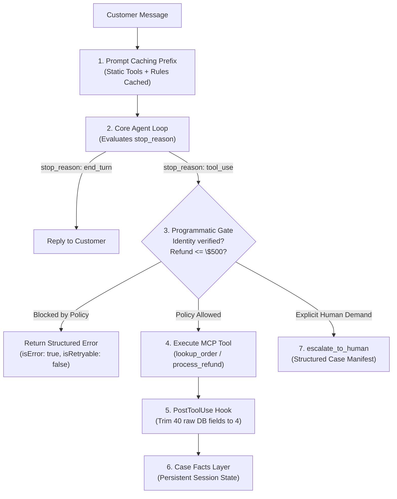
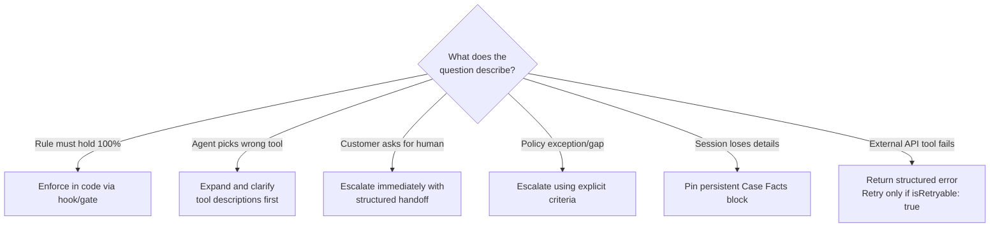

# Scenario 1: Customer Support Resolution Agent

## 1. In One Minute

**What it is.** An Agent SDK customer support agent that resolves returns, billing disputes, and order tracking. It relies on four focused MCP tools: `get_customer`, `lookup_order`, `process_refund`, and `escalate_to_human`. The target SLA is 80%+ First Contact Resolution (FCR) while cleanly escalating policy exceptions and human requests to human agents.

**Domains hit:** Domain 1 (Agentic Architecture), Domain 2 (Tool Design & MCP), Domain 5 (Context Management & Reliability).

**Key Task Statements:** TS 1.1 (Core loop), TS 1.4 (Prerequisite gates), TS 1.5 (Hooks), TS 2.1 (Tool descriptions), TS 2.2 (MCP structured errors), TS 2.3 (Tool distribution), TS 5.1 (Context & Case Facts), TS 5.2 (Escalation triggers).

**Top 3 Traps:**
1. **The Probabilistic Gate Trap**: Using a prompt instruction or few-shot examples to enforce a critical security or financial rule (e.g. verifying identity before processing a refund).
2. **The Sentiment Trap**: Using emotional sentiment scores or self-reported confidence to decide when to escalate, rather than explicit customer requests or policy gaps.
3. **The Classifier Band-Aid**: Adding a machine learning routing classifier or merging tools before fixing ambiguous, vague tool descriptions.

---

## 2. Architecture Diagram

---

## 3. How a Good Answer Thinks

When evaluating an exam question for Customer Support, follow this decision sequence:

1. **What is the root cause?** Never treat a symptom. If the agent invokes the wrong tool, inspect and expand tool descriptions first before adding complex classifiers.
2. **Must the rule hold 100% of the time?** Financial transactions, customer authentication, and refund caps must be enforced by deterministic code (a programmatic pre-tool hook or gateway). Prompts and few-shot examples are probabilistic.
3. **Escalation requires explicit triggers**:
   * Customer explicitly asks for a human or manager → Escalate immediately without interrogation.
   * Hard policy gap or edge case encountered → Escalate with a structured handoff payload.
   * Consecutive unrecoverable tool failures (retry limit breached) → Escalate.
   * *Never* escalate based on sentiment scores or self-reported model confidence.
4. **Least Privilege**: Equip the support agent strictly with its 4-5 domain tools. Never grant broad HR, financial ledger, or terminal tools.
5. **Multiple matches found?** If searching "Alex Kim" returns two records, prompt the customer for an unambiguous secondary identifier (phone or email). Never guess or default to the most recent record.

### Model & Sampling Invariants:
- **Model Choice**: Use `claude-sonnet-5-5` (or Sonnet 4.5) for the coordinator/support agent. Use `claude-haiku-4-5` for fast background classification or sub-tasks.
- **Extended Thinking Rules**: When `thinking` is enabled (`budget_tokens`), **omit `temperature`**, `top_p`, and `top_k`. Non-default sampling values return HTTP 400.
- **Thinking Continuity**: Assistant thinking blocks must be returned verbatim with their cryptographic signatures across multi-turn loops.
- **Prompt Caching Layout**: Place static tool definitions and system instructions at the top with `cache_control: {"type": "ephemeral"}` to receive 90% read discounts. Place dynamic customer dialogue and Case Facts downstream after the cache breakpoint.

---

## 4. Task Statement Map

| Task Statement | How It Manifests in Scenario 1 | Exam Trap |
| :--- | :--- | :--- |
| **TS 1.1 Agent Loop** | Loop continues on `stop_reason: "tool_use"`, stops on `"end_turn"`. | Parsing response text with regex instead of reading `stop_reason`. |
| **TS 1.4 Prerequisite Gates** | Customer identity must be authenticated before checking orders or issuing refunds. | Relying on system prompts or few-shot examples to block unauthenticated actions. |
| **TS 1.5 Hooks** | Programmatic pre-tool hook blocks refunds > \$500; `PostToolUse` trims database payloads. | Asking Claude to remember the \$500 limit in its head. |
| **TS 2.1 Tool Design** | Distinct descriptions for `get_customer` (identity) vs `lookup_order` (orders). | Adding a machine learning routing classifier before fixing weak descriptions. |
| **TS 2.2 MCP Errors** | Tools return `isError: true`, descriptive category, and `isRetryable` boolean flag. | Returning generic "Operation failed" strings or masking failures as empty results. |
| **TS 2.3 Tool Distribution** | Support agent receives strictly its 4 designated tools. | Granting broad enterprise tools "just in case" the agent needs them. |
| **TS 5.1 Context Window** | Immutable Case Facts block pinned outside summarized history; payload trimming. | Relying on conversational summaries to remember customer IDs and amounts. |
| **TS 5.2 Escalation** | Explicit customer demand or policy gap triggers immediate structured handoff. | Using emotional sentiment analysis or self-reported confidence scores. |

---

## 5. Step-by-Step Worked Example

**Customer Interaction**: "My name is Alex Kim. Refund my desk order."

1. **Disambiguation**: The agent queries `get_customer(name="Alex Kim")`. The database returns two matches. The agent halts and prompts: *"I found two accounts under Alex Kim. Could you please confirm your account email or phone number?"* (Does not guess).
2. **Authentication**: The customer provides `alex1@example.com`. `get_customer` executes successfully. The orchestrator updates the persistent **Case Facts block** with `customer_id: "cust_201"` and `is_authenticated: true`.
3. **Tool Ingestion & Trimming**: The agent calls `lookup_order(customer_id="cust_201")`. The raw database returns 40 fields (internal warehouse IDs, tracking timestamps, supplier codes). A `PostToolUse` hook strips the payload down to 5 critical fields: `order_id`, `status`, `total`, `items`, and `delivery_date`.
4. **Programmatic Gate Check**: The customer requests a full refund of \$750. The agent attempts to call `process_refund(order_id="ORD-99", amount=750)`. The pre-tool execution hook intercepts the call, detects that \$750 exceeds the hardcoded `REFUND_APPROVAL_LIMIT_USD = 500.0`, blocks execution, and returns a structured error: `{"isError": true, "code": "POLICY_LIMIT_EXCEEDED", "isRetryable": false}`.
5. **Human Escalation**: The agent recognizes the non-retryable policy limit and invokes `escalate_to_human`, passing the Case Facts, interaction summary, and the reason (*"Refund amount \$750 exceeds automated policy limit of \$500"*). A human Tier-2 representative takes over cleanly.

---

## 6. Exam-Style Practice Questions with Distractor Teardowns

### Q1. Policy Enforcement Guarantee
In testing, the support agent occasionally calls `process_refund` for amounts exceeding the company's \$500 limit. Which architectural change provides the strongest guarantee that refunds over \$500 are never processed autonomously?

- **A)** Add the \$500 limit to the system prompt in bold uppercase letters.
- **B)** Provide five few-shot examples demonstrating the agent refusing refunds over \$500.
- **C)** Implement a programmatic pre-tool hook in code that checks the refund amount and redirects to `escalate_to_human` if amount > \$500.
- **D)** Instruct the agent to state its numerical confidence score before each refund invocation.

**Correct Answer:** C

**Distractor Teardown:**
- **A is incorrect (The Probabilistic Gate Trap):** System prompts are probabilistic. Even with bold formatting, models under edge-case pressure can overlook prompt instructions.
- **B is incorrect:** Few-shot examples improve adherence but do not provide an immutable guarantee for financial compliance.
- **C is correct:** Programmatic gates execute in deterministic host code before the tool reaches the payment gateway, providing a 100% guarantee.
- **D is incorrect (The Self-Reported Confidence Trap):** Self-reported confidence scores from LLMs are uncalibrated and cannot prevent policy violations.

---

### Q2. Managing Context Saturation from Database Payloads
The `lookup_order` tool returns approximately 40 database fields. In conversations lasting 15 turns or more, the agent begins confusing past and current order statuses. What is the most effective architectural fix?

- **A)** Switch from Sonnet to a larger model.
- **B)** Implement a `PostToolUse` normalization hook that trims the tool result to only the 4-5 fields required for resolution before appending to conversation history.
- **C)** Re-summarize the entire conversation history on every single turn.
- **D)** Remove `lookup_order` from the toolset and require the customer to type their order details.

**Correct Answer:** B

**Distractor Teardown:**
- **A is incorrect:** Model size does not fix context bloat; larger models still suffer attention dilution when flooded with 40 irrelevant fields per turn.
- **B is correct:** `PostToolUse` normalization intercepts raw payloads and strips internal IDs, shipping carrier telemetry, and supplier keys, keeping the prompt lean.
- **C is incorrect:** Summarizing every turn is computationally expensive and causes loss of exact transactional figures.
- **D is incorrect:** Removing the tool degrades First Contact Resolution and creates extreme customer friction.

---

### Q3. Handling Tool Timeouts Cleanly
The `lookup_order` API service experiences a transient network timeout. Which response should the MCP tool handler return to Claude?

- **A)** A structured error block: `{"isError": true, "errorCategory": "transient", "isRetryable": true, "message": "Order service timeout after 5000ms. Retry with backoff."}`.
- **B)** A plain text message saying "Operation failed".
- **C)** An empty dictionary `{}` marked with status 200 OK.
- **D)** Raise an unhandled exception that terminates the agent session immediately.

**Correct Answer:** A

**Distractor Teardown:**
- **A is correct:** Returning `isError: true` with a clear retryable category and diagnostic message allows Claude's reasoning loop to attempt an informed retry or notify the user gracefully.
- **B is incorrect:** Opaque text provides zero diagnostic recovery information to the model.
- **C is incorrect (The Silent Fallback Trap):** Returning an empty success payload masks the failure; Claude will assume the customer has zero orders on file.
- **D is incorrect:** Crashing the session on a transient network glitch destroys customer experience.

---

### Q4. Immediate Human Escalation
A customer types: *"I have had enough. Stop talking and transfer me to a human manager immediately."* The agent has the tools and capability to resolve the customer's technical issue. What should the agent do?

- **A)** Attempt to resolve the issue first, and offer a human transfer only if the resolution attempt fails.
- **B)** Ask the customer why they want a manager and request more details.
- **C)** Run a sentiment analysis classifier to verify whether the customer is genuinely angry.
- **D)** Escalate immediately to a human supervisor with a structured handoff payload.

**Correct Answer:** D

**Distractor Teardown:**
- **A is incorrect:** Overriding an explicit customer request to speak with a human causes severe customer frustration and violates escalation policy.
- **B is incorrect:** Probing or interrogating the customer after an explicit transfer request creates unnecessary friction.
- **C is incorrect (The Sentiment Trap):** Sentiment is irrelevant when an explicit human request has already been issued.
- **D is correct:** Explicit human requests trigger immediate handoff with accumulated Case Facts and interaction history.

---

### Q5. Entity Retention Across Long Histories
In an extended 25-turn support session, earlier turns are summarized to conserve tokens. Shortly after, the agent asks the customer to restate their order ID. What architectural pattern resolves this amnesia?

- **A)** Increase the summarizer model's output token limit.
- **B)** Enforce a strict sliding window that keeps only the last 3 turns.
- **C)** Maintain a persistent Case Facts layer outside the summarized message array that is re-injected on every turn.
- **D)** Repeat the full uncompressed transcript inside the system prompt.

**Correct Answer:** C

**Distractor Teardown:**
- **A is incorrect:** Increasing summary output length does not guarantee retention of specific alphanumeric IDs.
- **B is incorrect:** Sliding windows discard early turns completely, guaranteeing loss of the order ID.
- **C is correct:** The Case Facts pattern pins verified transactional entities (IDs, verification status, amounts) in an invariant block outside summarized history.
- **D is incorrect:** Repeating the full transcript destroys prompt caching efficiency and exhausts the context window.

---

### Q6. Tool Scoping and Distribution
A support agent is provisioned with 18 tools, including HR leave lookup, internal finance billing adjustments, and code repository querying. The agent occasionally invokes an unrelated finance tool when asked about an order. What is the correct first step?

- **A)** Add a prompt instruction listing the 14 tools the agent is forbidden to use.
- **B)** Restrict the agent's tool allowlist strictly to its 4 relevant customer support tools.
- **C)** Build an upstream classifier model to pre-filter tools dynamically.
- **D)** Lower the model temperature to 0.0.

**Correct Answer:** B

**Distractor Teardown:**
- **A is incorrect:** Negative prompt constraints are probabilistic and do not remove tool schemas from the prompt prefix.
- **B is correct (Principle of Least Privilege):** Tools outside the support agent's scope should never be registered in its context window.
- **C is incorrect:** Adding a machine learning classifier is an over-engineered band-aid for an over-provisioned toolset.
- **D is incorrect:** Temperature does not resolve tool bloat or ambiguous schema selection.

---

## 7. Self-Check Checklist

- [ ] I can explain why programmatic code gates beat system prompts for financial limits and authentication.
- [ ] I can list the four core tools for customer support and explain each tool's boundary.
- [ ] I know the two valid escalation triggers (explicit human request, policy gap) and two invalid triggers (sentiment score, self-reported confidence).
- [ ] I understand how `PostToolUse` normalization protects the context window from raw database bloat.
- [ ] I know why tool descriptions must be improved before considering routing classifiers.

**Memory Hook:** *"Money in code, humans on request, facts in a block."*

**Related Practice Bank Questions:**
* [Set 1 (Core Agentic Loop): Q1, Q9, Q10, Q20, Q22](../../practice_exam_bank_300/set_01_domain1_core_agentic_loop.md)
* [Set 8 (Tool Schemas & Errors): Q216, Q222, Q224, Q235, Q239](../../practice_exam_bank_300/set_08_domain4_tool_schemas_error_handling.md)
* [Set 10 (Governance & HITL): Q276, Q277, Q283, Q284](../../practice_exam_bank_300/set_10_domain5_governance_safety_risk.md)
