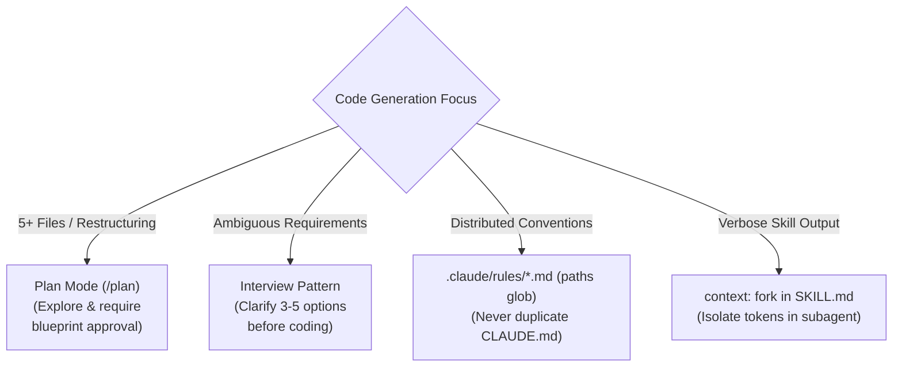
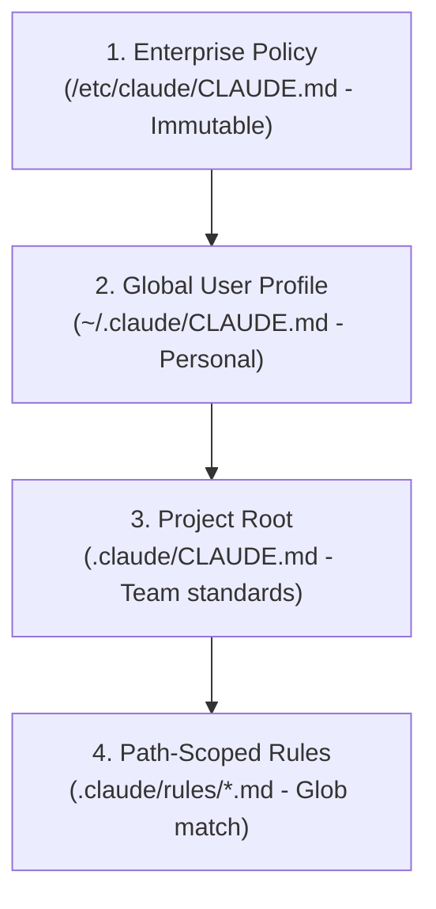
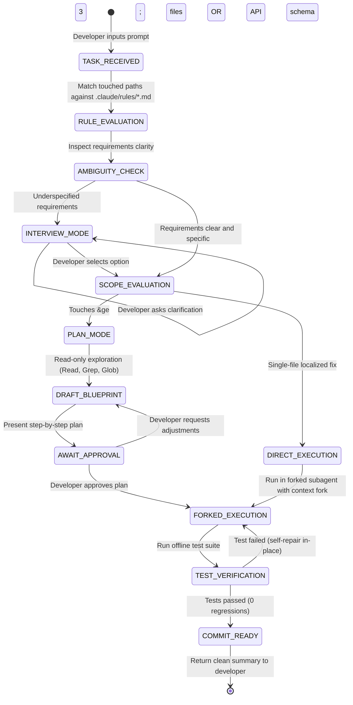

# Scenario 2: Code Generation with Claude Code

## 📌 Executive Architectural Specification & SLAs

We are architecting an enterprise developer productivity system using Claude Code across a large multi-tier monorepo (Go backend microservices, React/TypeScript frontends, and Terraform cloud infrastructure). The system accelerates feature development, automates bug fixing, and guides complex architectural refactors while enforcing strict enterprise standards.

### Quantitative Production SLAs & Non-Negotiables
- **Zero-Assumption Contract**: **0% unverified assumptions** on underspecified requirements. The agent must trigger the Interview Pattern rather than guessing technology choices or architectural boundaries.
- **Context Window Economy**: Active session context must remain $\le 40,000\text{ tokens}$ through path-scoped rule scoping and `context: fork` subagent execution.
- **Deterministic Precedence**: 100% enforcement of the 4-tier configuration hierarchy (Enterprise Policy $\gt$ User Settings $\gt$ Project Standards $\gt$ Path Rules).
- **Tool Execution Safety**: Zero destructive actions or multi-file migrations without explicit human blueprint approval via Plan Mode.

### Exam Domain Mapping Matrix
| Exam Domain | Weight | Mapped Task Statements | Architectural Implementation in Scenario 2 |
|---|:---:|---|---|
| **Domain 3: Claude Code Configuration & Workflows** | 20% | **TS 3.1** (CLAUDE.md Hierarchy), **TS 3.2** (Skills with `context: fork`), **TS 3.3** (Path-Scoped Rules), **TS 3.4** (Plan Mode vs Direct), **TS 3.5** (The Interview Pattern) | Monorepo rule scoping via `.claude/rules/*.md`; isolated subagents via `context: fork`; mode switching based on blast radius; proactive requirement clarification. |
| **Domain 1: Agentic Architecture & Orchestration** | 27% | **TS 1.7** (Session State & Speculative Forking) | Forking session context for exploratory refactoring to prevent polluting main dialogue. |
| **Domain 5: Context Management & Reliability** | 15% | **TS 5.1** (Context Economy) | Eliminating context bloat by loading rules only when touching matching paths. |

---

## ⚡ Scenario 2 Golden Rules & Anti-Patterns Reference

### 🏆 The 5 Golden Architectural Rules for Code Generation with Claude Code

1. **Hierarchical Configuration Precedence (`TS 3.1`)**:  
   Enterprise Managed Policies override User settings (`~/.claude/CLAUDE.md`), which in turn are overridden by Project repository standards (`.claude/CLAUDE.md` or root `CLAUDE.md`). All team build commands, formatting scripts, and review checklists must be committed to the repository so all engineers and CI runners share identical environments.
2. **Path-Scoped Monorepo Scoping (`TS 3.3`)**:  
   In multi-tier or monorepo environments (Go backend + React frontend + Terraform), use `.claude/rules/*.md` with YAML `paths: ["..."]` frontmatter. Rules must load conditionally only when matching files are accessed, preventing 30,000+ tokens of irrelevant language standards from polluting context.
3. **Blast-Radius Mode Gating: Plan Mode vs Direct Execution (`TS 3.4`)**:  
   Use **Plan Mode** (`Shift+Tab`, `/plan`) for multi-file refactoring (5+ files), microservice restructuring, and schema shifts. It engages the read-only Explore subagent to map dependencies safely before asking for human approval. Reserve **Direct Execution** strictly for localized, single-file bug fixes.
4. **The Interview Pattern for Ambiguity Resolution (`TS 3.5`)**:  
   When a developer prompt is underspecified (*"Add caching to order lookup"*, *"Refactor authentication"*), **trigger the Interview Pattern**: instruct Claude to ask 3–5 clarifying questions with concrete technology choices (e.g. Redis vs Memcached vs in-memory) *before* writing code. Never make silent architectural assumptions.
5. **Skill Context Isolation via `context: fork` (`TS 3.2`)**:  
   Custom developer skills that perform repository discovery or run test suites **must declare `context: fork`** in their frontmatter. This executes the skill inside an isolated ephemeral subagent, returning only a concise summary to the main conversation window.

---

### 🚫 Architectural Anti-Patterns to Reject in Scenario 2 (Exam Distractor Teardown)

| Anti-Pattern | The Exam Distractor Trap (Why Candidates Pick It) | Fatal Production Consequence | Correct Architectural Solution |
|---|---|---|---|
| **Monolithic Root CLAUDE.md in Monorepos** | Centralizing all Go, React, and Terraform rules in the root `CLAUDE.md` seems convenient. | Ingests thousands of irrelevant rules on every prompt, exhausting token limits and causing rule confusion. | Modularize into `.claude/rules/backend_go.md` and `frontend_react.md` with explicit path globs. |
| **Personal Config for Team Standards** | Defining team build commands in `~/.claude/CLAUDE.md` on one developer's machine. | New team members and CI runners lack the configuration, causing broken builds and inconsistent patches. | Commit shared build rules to `.claude/CLAUDE.md` or root `CLAUDE.md` in git repository. |
| **Direct Execution on Monolith Restructuring** | Starting coding immediately without a blueprint phase to demonstrate speed. | Claude generates conflicting patches across dozens of files, resulting in circular imports and costly rollbacks. | Enter Plan Mode (`/plan`), map dependencies safely, generate blueprint, and require human approval. |
| **Silent Technology Assumption** | When asked to add caching, Claude immediately generates code for Redis without asking. | Repository infrastructure might be AWS ElastiCache Memcached; code is useless and must be scrapped. | Trigger the Interview Pattern: ask clarifying questions with concrete options before coding. |
| **Running Discovery Skills in Main Session** | Omit `context: fork` from skill frontmatter so the skill runs directly in the active turn. | Floods context with 25,000+ tokens of raw AST dumps, grep logs, and compiler trails, degrading attention. | Add `context: fork` in `SKILL.md` frontmatter to isolate exploration tokens inside a subagent. |

---

### 🧠 Scenario 2 Rapid Exam Decision Tree



| Scenario Trigger / Condition | Decision Branch | Architectural Action & Distractor Rule |
| :--- | :---: | :--- |
| **5+ files modified / service restructuring / schema migration?** | **YES** | Enter **Plan Mode** (`/plan`) to explore dependencies and get blueprint approval *(NEVER Direct Execution)*. |
| **Request underspecified or architectural options ambiguous?** | **YES** | Trigger **Interview Pattern**: ask 3–5 clarifying questions with concrete selectable options *(NEVER guess)*. |
| **Conventions needed for scattered test files?** | **YES** | Create `.claude/rules/*.md` with YAML `paths: ["**/*.test.*"]` *(NEVER duplicate directory `CLAUDE.md`)*. |
| **Custom skill generates verbose logs / AST dumps?** | **YES** | Set `context: fork` in `SKILL.md` frontmatter to isolate tokens in a subagent. |


---

## 🔑 Deep Technical Concepts & Claude Code Architecture

### 1. The Configuration Precedence Hierarchy (TS 3.1)
Enterprise developers work under multiple layers of policy. When rules conflict, Claude Code enforces strict top-down precedence:



- **Conflict Resolution Rule**: Higher tiers always override lower tiers. An enterprise policy stating *"Never disable SSL certificate verification"* overrides a project-level `.claude/CLAUDE.md` rule attempting to bypass SSL for testing.

### 2. Path-Scoped Rules (`.claude/rules/*.md`) (TS 3.3)
In a monorepo containing Go, Python, and TypeScript, putting all language-specific conventions into a single root `CLAUDE.md` wastes tens of thousands of tokens per prompt. Path-scoped rules load dynamically *only* when the agent touches matching file paths.

#### File: `.claude/rules/backend_go.md`
```markdown
---
paths:
  - "services/backend/**/*.go"
  - "pkg/api/**/*.go"
---
# Go Backend Engineering Rules
- All errors must be wrapped with contextual stack info: `fmt.Errorf("reading order %s: %w", orderID, err)`.
- Handlers must never perform raw SQL concatenation; always use prepared statements via sqlx.
- Goroutines spawned in HTTP handlers must propagate `r.Context()`.
```

#### File: `.claude/rules/frontend_react.md`
```markdown
---
paths:
  - "apps/web/**/*.tsx"
  - "apps/web/**/*.ts"
---
# React Frontend Rules
- Strictly prohibit `any` types; all API responses must have Zod schema validation.
- All network fetches must use TanStack Query hooks; never call raw `fetch()` inside `useEffect`.
- Component state mutations must use immutable patterns.
```

### 3. Plan Mode vs. Direct Execution (TS 3.4)
Choosing between Plan Mode and Direct Execution is based on **blast radius**:

| Dimension | Plan Mode (Read-Only Blueprinting) | Direct Execution Mode (Immediate Action) |
|---|---|---|
| **When to Use** | Multi-file edits ($\ge 3$ files), schema changes, migrations, public API contract refactoring. | Single-file bug fixes, localized typo corrections, minor test assertions ($\le 2$ files). |
| **Tool Permissions** | Read-only discovery tools: `Read`, `Grep`, `Glob`. Write/Edit tools are blocked. | Full toolsuite: `Read`, `Edit`, `Write`, `Bash`. |
| **Human Gate** | Emits a structured step-by-step blueprint; blocks execution until the engineer approves. | Executes edits immediately and verifies with unit tests. |
| **Exam Trap** | Activating Plan Mode for a 1-line typo fix adds unnecessary human-in-the-loop latency. | Using Direct Execution for multi-file refactoring risks breaking cross-module contracts. |

### 4. The Interview Pattern for Underspecified Requirements (TS 3.5)
When a developer gives an ambiguous or incomplete prompt (e.g. *"Implement caching for our user service"*), the agent must **never guess** the backing store (Redis vs Memcached vs in-memory) or TTL policy.
- **Protocol**:
  1. Halt execution immediately.
  2. Present 2–3 concrete, well-articulated options with pros, cons, and performance trade-offs.
  3. Include sample schema or code snippets illustrating each option.
  4. Await explicit developer selection before generating code.

### 5. Custom Skills with `context: fork` (TS 3.2)
Skills allow teams to package reusable workflows. Setting `context: fork` executes the skill inside an isolated subagent session.

#### File: `.claude/skills/security-audit/SKILL.md`
```markdown
---
name: security-audit
description: Scans modified source files for OWASP Top 10 vulnerabilities and hardcoded secrets.
context: fork
allowed-tools:
  - Read
  - Grep
  - Glob
---
## Security Audit Execution Protocol
1. Use `Glob` and `Grep` to inspect modified code files for:
   - Unparameterized SQL or NoSQL queries
   - Hardcoded API tokens (e.g., matching `sk_live_[0-9a-zA-Z]{24}`)
   - Insecure deserialization patterns
2. Do NOT modify any files.
3. Return ONLY a markdown summary table of High and Critical findings with file paths and line numbers.
```

### 6. Exact Anthropic `/v1/messages` Payload for Claude Code
Claude Code translates developer prompts and repository context into structured `/v1/messages` requests:

```json
{
  "model": "claude-sonnet-4-5",
  "max_tokens": 4096,
  "system": [
    {
      "type": "text",
      "text": "Enterprise Policy: All HTTP egress must route through proxy.corp.internal:8080.\nActive Path Rules for services/backend/**/*.go:\n- Enforce async def handlers and validated Pydantic models.\n- Wrap all errors with fmt.Errorf.",
      "cache_control": {"type": "ephemeral"}
    }
  ],
  "tools": [
    {
      "name": "Read",
      "description": "Reads file contents with optional line offset and limit.",
      "input_schema": {
        "type": "object",
        "properties": {
          "path": {"type": "string"},
          "offset": {"type": "integer", "minimum": 1},
          "limit": {"type": "integer", "minimum": 1}
        },
        "required": ["path"]
      }
    },
    {
      "name": "Edit",
      "description": "Performs exact string replacement in a file. old_string must be unique.",
      "input_schema": {
        "type": "object",
        "properties": {
          "path": {"type": "string"},
          "old_string": {"type": "string"},
          "new_string": {"type": "string"}
        },
        "required": ["path", "old_string", "new_string"]
      }
    },
    {
      "name": "Write",
      "description": "Overwrites an entire file with new content.",
      "input_schema": {
        "type": "object",
        "properties": {
          "path": {"type": "string"},
          "content": {"type": "string"}
        },
        "required": ["path", "content"]
      }
    },
    {
      "name": "Bash",
      "description": "Executes shell commands in a sandboxed developer environment.",
      "input_schema": {
        "type": "object",
        "properties": {
          "command": {"type": "string"}
        },
        "required": ["command"]
      }
    }
  ],
  "tool_choice": {"type": "auto"},
  "messages": [
    {"role": "user", "content": "Refactor user authentication models across backend/models/user.py and backend/api/auth.py"}
  ]
}
```

### 7. Agent SDK Plan Mode PreToolUse Hook (TS 3.4)
When Claude Code enters Plan Mode, write operations (`Edit`, `Write`, `Bash`) are strictly intercepted:

```python
def plan_mode_pre_tool_use_hook(tool_name: str, tool_input: dict, session_state: dict) -> tuple[bool, Optional[dict]]:
    """Enforces read-only safety when in Plan Mode."""
    if session_state.get("mode") == "PLAN_MODE":
        if tool_name in ["Edit", "Write", "Bash"]:
            return False, {
                "isError": True,
                "errorType": "PLAN_MODE_WRITE_PROHIBITED",
                "message": f"Tool '{tool_name}' blocked: System is in Plan Mode (read-only). File modifications require developer plan approval."
            }
    return True, None
```

---

## 🏗️ Real-World Production Engineering Breakdown

### 1. Detailed System State Machine



### 2. Comprehensive Edge Cases & Boundary Handling

| Edge Case Scenario | Production Failure Mode (Anti-Pattern) | Robust Architectural Protocol |
|---|---|---|
| **Conflicting Monorepo Rules** (Root rule permits `var`; path rule bans `var`) | Agent uses `var` in backend Go code, failing CI build. | Precedence hierarchy: Path-scoped rules take precedence over general project rules for matching files. |
| **Plan Approval Rejection** (Developer rejects step 3 of a 5-step plan) | Agent proceeds with steps 1 and 2 anyway, leaving codebase in an inconsistent state. | Strict transactional plan gate: Zero file edits occur until the entire revised blueprint is approved. |
| **Runaway Subagent Tool Loop** (Subagent gets stuck grep-ing through vendor directories) | Context window saturates; API bill spikes; process hangs. | Enforce `max_iterations: 10` and directory exclusion glob (`!**/vendor/**`, `!**/node_modules/**`). |
| **Adversarial Repo Injection** (Untrusted public repo PR adds malicious `.claude/skills/deploy.md`) | Agent executes unauthorized bash script deploying compromised binaries. | Enterprise policy blocks untrusted custom skills from accessing `Bash` or network tools without explicit authorization. |

### 3. Token Budgeting & Memory Preservation Strategy
- **Path-Scoped Dynamic Loading**: In a 500,000 LOC repository with 40 distinct architectural rules across 12 services, storing all rules in root `CLAUDE.md` consumes ~22,000 tokens per turn. Path-scoped scoping reduces this to $\le 1,800\text{ tokens}$ loaded on demand ($92\%$ reduction).
- **Isolated Exploration via `context: fork`**: Security scanning or repo-wide dependency tracing reads dozens of files (accumulating 60,000+ tokens of raw file text). Running in a forked subagent keeps those 60,000 tokens out of the main session context. The parent session receives only a 400-token markdown findings table.

---

## 🛠️ Hands-On Practical Mini-Lab: Code Generation Router

### The Challenge
Implement an enterprise code generation workflow engine (`ClaudeCodeGenerationEngine`) that:
1. Dynamically resolves path-scoped rules (`backend_auth`, `frontend_react`) based on touched file paths.
2. Detects ambiguous requirements and triggers the Interview Pattern with concrete alternatives.
3. Automatically switches to Plan Mode for tasks touching $\ge 2$ files or architectural refactors, drafting a structured `PlanBlueprint`.
4. Enforces approval gating: no edits are applied until the developer explicitly approves the blueprint.
5. Upholds immutable Enterprise Managed Policy precedence.

### Running the Mini-Lab & Tests
```bash
# Run the interactive offline simulation
uv run python scenarios/scenario_2_code_generation/simulation.py

# Run the 7 unit tests verifying modes, interview pattern, rules, and blueprints
uv run pytest scenarios/scenario_2_code_generation/test_scenario_2_simulation.py
```

### Complete Solution Walkthrough

```python
"""
Scenario 2 Mini-Lab: Code Generation Workflow Engine
File: scenarios/scenario_2_code_generation/simulation.py
"""
import sys
from dataclasses import dataclass, field
from enum import Enum
from pathlib import Path
from typing import Any, Dict, List, Optional, Tuple


class ExecutionMode(str, Enum):
    PLAN_MODE = "PLAN_MODE"          # Architectural, multi-file, or ambiguous refactor
    DIRECT_EXECUTION = "DIRECT_EXEC"  # Single-file, localized, well-scoped bug fix


@dataclass
class CodeGenTask:
    task_id: str
    description: str
    target_files: List[str]
    is_architectural_shift: bool = False


@dataclass
class PlanBlueprint:
    task_id: str
    steps: List[str]
    affected_files: List[str]
    requires_approval: bool = True
    is_approved: bool = False


@dataclass
class CodeGenOutcome:
    mode_selected: ExecutionMode
    injected_path_rules: List[str]
    interview_required: bool
    clarification_options: List[str]
    forked_execution_used: bool
    summary: str
    blueprint: Optional[PlanBlueprint] = None


class ClaudeCodeGenerationEngine:
    """Simulates Claude Code's architectural workflow engine."""

    ENTERPRISE_POLICY = {
        "enforce_proxy": "All outbound requests must route through proxy.corp.internal:8080",
        "forbid_plaintext_secrets": "Strict prohibition of unencrypted keys in any configuration"
    }

    PATH_RULES = {
        "backend_auth": {
            "paths": ["backend/**", "api/**"],
            "instruction": "Enforce async def handlers and validated Pydantic models."
        },
        "frontend_react": {
            "paths": ["frontend/**", "ui/**"],
            "instruction": "Use TypeScript interfaces and React Server Components."
        }
    }

    def evaluate_task(self, task: CodeGenTask) -> CodeGenOutcome:
        # Step 1: Evaluate Path-Scoped Rules (TS 3.3)
        injected_rules = []
        for rule_id, rule_data in self.PATH_RULES.items():
            for touched in task.target_files:
                for pat in rule_data["paths"]:
                    prefix = pat.replace("/**", "")
                    if touched.startswith(prefix) or f"/{prefix}" in touched:
                        injected_rules.append(rule_id)
                        break

        # Step 2: Determine Execution Mode (Plan Mode vs Direct) (TS 3.4)
        is_multi_file = len(task.target_files) > 1
        if task.is_architectural_shift or is_multi_file:
            mode = ExecutionMode.PLAN_MODE
        else:
            mode = ExecutionMode.DIRECT_EXECUTION

        # Step 3: Evaluate Ambiguity & The Interview Pattern (TS 3.5)
        lower_desc = task.description.lower()
        interview_needed = False
        options = []

        if "auth" in lower_desc and not any(k in lower_desc for k in ["jwt", "session", "oauth"]):
            interview_needed = True
            options = ["Option A: JWT Bearer Tokens (Stateless)", "Option B: HttpOnly Session Cookies"]

        if "database" in lower_desc and not any(k in lower_desc for k in ["postgres", "sqlite", "redis"]):
            interview_needed = True
            options.append("Option C: PostgreSQL with SQLAlchemy")

        # Step 4: Forked Execution Simulation & Blueprint Generation (TS 3.2, TS 3.4)
        forked = mode == ExecutionMode.PLAN_MODE
        blueprint = self.draft_plan_blueprint(task) if mode == ExecutionMode.PLAN_MODE else None

        summary = (
            f"Activated {mode.value}. Injected rules: {list(set(injected_rules))}. "
            f"Interview required: {interview_needed}."
        )

        return CodeGenOutcome(
            mode_selected=mode,
            injected_path_rules=list(set(injected_rules)),
            interview_required=interview_needed,
            clarification_options=options,
            forked_execution_used=forked,
            summary=summary,
            blueprint=blueprint
        )

    def draft_plan_blueprint(self, task: CodeGenTask) -> PlanBlueprint:
        """Generates a structured, read-only plan blueprint in Plan Mode."""
        steps = [f"Phase {i+1}: Inspect and refactor {f}" for i, f in enumerate(task.target_files)]
        steps.append("Phase Final: Execute test verification suite")
        return PlanBlueprint(
            task_id=task.task_id,
            steps=steps,
            affected_files=task.target_files,
            requires_approval=True,
            is_approved=False
        )

    def approve_plan_blueprint(self, blueprint: PlanBlueprint) -> bool:
        """Gating mechanism: File modifications blocked until blueprint approval."""
        blueprint.is_approved = True
        return blueprint.is_approved
```

---

## ⚡ The 10-Second Exam Shortcut

| Exam Scenario Stem Clue | The Trap Option to Reject | The Instant Winning Choice | Core Justification |
|---|---|---|---|
| Refactoring a multi-module database layer across 6 files | Immediately apply file edits using `Edit` or `Write` | **Activate Plan Mode** to draft blueprint for human review | Multi-file edits have high blast radius; require explicit approval (**TS 3.4**). |
| Fixing a 1-character typo in `README.md` | Activate Plan Mode and draft step-by-step blueprint | **Direct Execution Mode** (make surgical edit immediately) | Plan Mode for 1-line edits introduces unnecessary human latency (**TS 3.4**). |
| User prompt: *"Add rate limiting to our microservice"* | Silently implement Redis token-bucket rate limiting | **The Interview Pattern**: Present 2–3 options with trade-offs | Underspecified prompts require developer choice; never guess (**TS 3.5**). |
| Monorepo has 200 coding standards across Go and React | Put all 200 rules into root `CLAUDE.md` | Create **Path-Scoped Rules** in `.claude/rules/*.md` | Root bloat wastes context; path rules load only on matching paths (**TS 3.3**). |
| Developer runs a 60-file security audit skill | Run skill inline in the main chat context | Configure skill with **`context: fork`** in frontmatter | Forked execution isolates discovery logs, protecting main context (**TS 3.2**). |
| Enterprise policy conflicts with project `CLAUDE.md` | Project `CLAUDE.md` overrides enterprise policy | **Enterprise Policy strictly wins** (cannot be overridden) | Security governance hierarchy enforces enterprise policy precedence (**TS 3.1**). |

---

## 🎯 Substantive Exam Practice: 10 Scenario Questions

### Question 2.1
**Scenario**: An engineer asks Claude Code: *"Migrate our authentication service from session cookies to JWT tokens, updating the database models, API middleware, and client headers."* The change touches 7 files across three services. How should Claude Code approach this task?

- **A)** Immediately invoke the `Edit` tool across all 7 files sequentially to complete the migration quickly.
- **B)** Switch to Plan Mode, use read-only discovery tools to analyze dependencies, draft a comprehensive step-by-step migration blueprint, and obtain developer approval before making any file modifications. *(Correct)*
- **C)** Delete the authentication directory and recreate it from scratch.
- **D)** Run a recursive `git reset --hard` before proceeding.

> **Deep Architectural Rationale**: Under **TS 3.4**, tasks involving $\ge 3$ files, cross-service dependencies, or core architectural migrations carry a high blast radius and must be routed through Plan Mode. Plan Mode enforces a read-only exploration phase where Claude drafts a plan for developer approval before any write operations occur.  
> **Exhaustive Distractor Teardown**:
> - *Option A is incorrect*: Performing immediate multi-file edits without planning risks partial failures, broken dependencies, and merge conflicts.
> - *Option C is incorrect*: Wholesale file deletion is reckless and destroys existing edge-case business logic.
> - *Option D is incorrect*: Running destructive git resets erases uncommitted developer work.

---

### Question 2.2
**Scenario**: A developer working in an enterprise monorepo opens Claude Code and types: *"Add distributed tracing to our order processing endpoints."* The prompt does not specify a tracing provider, sampling rate, or header format. What is the correct architectural behavior?

- **A)** Choose OpenTelemetry with Jaeger headers automatically, as it is the most popular open-source standard.
- **B)** Halt and apply the Interview Pattern: present 2–3 concrete implementation alternatives (e.g. OpenTelemetry vs AWS X-Ray vs Datadog) with their respective trade-offs and ask the developer to choose. *(Correct)*
- **C)** Refuse to perform the task and terminate the session.
- **D)** Implement custom logging using `println` statements instead of distributed tracing.

> **Deep Architectural Rationale**: Under **TS 3.5**, when requirements are underspecified or architectural choices exist, the agent must employ the Interview Pattern. Guessing an unverified implementation leads to wasted compute and rework when the guessed technology does not align with the team's stack.  
> **Exhaustive Distractor Teardown**:
> - *Option A is incorrect*: Silently guessing an architecture violates the zero-assumption principle.
> - *Option C is incorrect*: Outright refusing the task is unhelpful; the agent should guide the developer with clear options.
> - *Option D is incorrect*: Substituting simple print statements fails to fulfill the user's explicit request for distributed tracing.

---

### Question 2.3
**Scenario**: A monorepo contains a Go backend in `/services/api/` and a React web application in `/apps/web/`. The Go team requires strict error wrapping (`fmt.Errorf`), while the React team enforces strict TypeScript types without `any`. How should these rules be organized in Claude Code?

- **A)** Place all Go and React rules into a single 15,000-word root `CLAUDE.md` file.
- **B)** Define path-scoped rules in `.claude/rules/go_backend.md` with `paths: ["services/api/**/*.go"]` and `.claude/rules/react_web.md` with `paths: ["apps/web/**/*.{ts,tsx}"]`. *(Correct)*
- **C)** Instruct developers to manually copy-paste rules into their terminal prompt on every invocation.
- **D)** Create separate Git branches for each language and never merge them.

> **Deep Architectural Rationale**: Under **TS 3.3**, path-scoped rules dynamically load instructions into Claude's context window only when files matching the specified glob patterns are being accessed or modified. This prevents context bloat, saves thousands of tokens per turn, and eliminates rule cross-contamination.  
> **Exhaustive Distractor Teardown**:
> - *Option A is incorrect*: A monolithic `CLAUDE.md` wastes tokens on every turn and dilutes attention with irrelevant language conventions.
> - *Option C is incorrect*: Relying on manual prompt pasting is error-prone, friction-heavy, and unmaintainable.
> - *Option D is incorrect*: Splitting monorepo branches by language destroys monorepo code sharing and CI/CD pipelines.

---

### Question 2.4
**Scenario**: You are developing a custom Claude Code skill called `repo-security-scan` that searches 150 repository files for hardcoded credentials and returns a 5-line summary table. What configuration setting prevents the 150 file contents from bloating the developer's main conversational history?

- **A)** Set `context: fork` in the skill's YAML frontmatter in `SKILL.md`. *(Correct)*
- **B)** Run Claude Code at temperature 0.0.
- **C)** Delete the files after reading them.
- **D)** Run the skill inside a Docker container without network access.

> **Deep Architectural Rationale**: Under **TS 3.2**, specifying `context: fork` in a skill's frontmatter causes Claude Code to execute the skill within an isolated subagent context. The hundreds of file reads occur inside the subagent's temporary context window, and only the final concise output payload is returned to the parent conversation.  
> **Exhaustive Distractor Teardown**:
> - *Option B is incorrect*: Temperature controls token sampling randomness, not context window scoping.
> - *Option C is incorrect*: Deleting source files destroys repository code.
> - *Option D is incorrect*: Docker network isolation does not affect Claude Code's conversational context window token accumulation.

---

### Question 2.5
**Scenario**: An enterprise security policy file located at `/etc/claude/CLAUDE.md` contains the rule: *"All HTTP outbound requests must route through corporate proxy proxy.internal:8080"*. A developer creates a project-level `.claude/CLAUDE.md` containing: *"Direct internet access enabled; bypass all proxies"*. Which rule takes precedence when Claude Code executes?

- **A)** The project-level `.claude/CLAUDE.md` rule because it is closer to the source code.
- **B)** The enterprise managed policy at `/etc/claude/CLAUDE.md` because enterprise policies strictly override project and user configurations. *(Correct)*
- **C)** The two rules combine and cancel each other out, disabling networking entirely.
- **D)** The rule that was modified most recently according to file system timestamps.

> **Deep Architectural Rationale**: Under **TS 3.1**, Claude Code enforces a strict 4-tier configuration precedence: Enterprise Managed Policy $\gt$ Global User Profile $\gt$ Project Root $\gt$ Path-Scoped Rules. Enterprise security policies represent non-negotiable governance constraints and cannot be overridden by individual projects or developers.  
> **Exhaustive Distractor Teardown**:
> - *Option A is incorrect*: Local project settings cannot override enterprise governance policies.
> - *Option C is incorrect*: Configuration precedence resolves conflicts deterministically; rules do not cancel each other out.
> - *Option D is incorrect*: Precedence is based on architectural hierarchy, not file modification timestamps.

---

### Question 2.6
**Scenario**: A developer notices a spelling mistake in a single log message inside `logger.py`: `log.info("Processsing complete")`. They ask Claude Code: *"Fix the typo in logger.py"*. Which execution mode should Claude Code use?

- **A)** Plan Mode, drafting a formal 4-phase rollout plan with risk mitigation documentation.
- **B)** Direct Execution Mode, applying a surgical edit directly to `logger.py` and running the unit test. *(Correct)*
- **C)** Continuous Integration batch mode with a 24-hour turnaround window.
- **D)** Forked multi-agent coordinator mode with 3 peer agents.

> **Deep Architectural Rationale**: Under **TS 3.4**, localized single-file bug fixes or typo corrections have a negligible blast radius ($\le 1$ file). Forcing a developer through Plan Mode for a one-line typo introduces unnecessary friction and violates developer velocity goals. Direct Execution mode makes the change immediately.  
> **Exhaustive Distractor Teardown**:
> - *Option A is incorrect*: Using Plan Mode for a simple typo fix is an over-engineered anti-pattern that slows down developers.
> - *Option C is incorrect*: Batch API is asynchronous and inappropriate for interactive developer coding sessions.
> - *Option D is incorrect*: Multi-agent topologies are intended for large research or parallel synthesis tasks, not single-line edits.

---

### Question 2.7
**Scenario**: A developer asks Claude Code to implement a database schema update. Claude enters Plan Mode and presents a 4-step plan. The developer responds: *"I agree with steps 1, 2, and 4, but for step 3, use PostgreSQL UUIDv7 instead of BIGSERIAL."* What must Claude Code do next?

- **A)** Execute steps 1, 2, and 4 immediately, skipping step 3 entirely.
- **B)** Revise the blueprint to incorporate UUIDv7 for step 3, present the updated complete blueprint, and wait for developer approval before executing any file modifications. *(Correct)*
- **C)** Switch to Direct Execution mode and execute the original plan without modifications.
- **D)** Terminate the process and instruct the developer to write the SQL manually.

> **Deep Architectural Rationale**: Under **TS 3.4**, Plan Mode requires holistic developer consensus before execution. When a developer amends or critiques a proposed plan, the agent must update the blueprint and re-verify approval. Executing a partial or unapproved plan leaves production schemas corrupted or inconsistent.  
> **Exhaustive Distractor Teardown**:
> - *Option A is incorrect*: Executing partial steps without step 3 breaks foreign key relationships and schema consistency.
> - *Option C is incorrect*: Ignoring the developer's feedback and executing the original unapproved plan violates developer intent.
> - *Option D is incorrect*: Abandoning the task rather than incorporating feedback provides a poor developer experience.

---

### Question 2.8
**Scenario**: Why should software engineering teams avoid passing `--dangerously-skip-permissions` during standard interactive Claude Code sessions?

- **A)** It slows down inference by 50%.
- **B)** It bypasses human-in-the-loop confirmation gates for bash execution and file writes, allowing accidental destructive operations (e.g. `rm -rf`, dropping tables) to execute without confirmation. *(Correct)*
- **C)** It forces Claude Code to run on older legacy models.
- **D)** It disables prompt caching on Anthropic servers.

> **Deep Architectural Rationale**: The `--dangerously-skip-permissions` flag removes all interactive approval prompts for tool execution. While useful in isolated, sandboxed CI containers with disposable environments, using it on a developer's local machine allows runaway commands, catastrophic file deletions, or unintended git pushes to occur without human oversight.  
> **Exhaustive Distractor Teardown**:
> - *Option A is incorrect*: Skipping permissions actually speeds up execution by eliminating prompts, but at extreme security risk.
> - *Option C is incorrect*: The flag does not alter model selection.
> - *Option D is incorrect*: The flag does not impact Anthropic's prompt caching mechanics.

---

### Question 2.9
**Scenario**: In a path-scoped rule file `.claude/rules/data_access.md`, you want to enforce that all database models in any subfolder under `models/` follow camelCase naming conventions. Which YAML frontmatter configuration correctly targets these files?

- **A)**  
  ```yaml
  ---
  paths:
    - "**/models/**/*.py"
    - "**/models/**/*.go"
  ---
  ```
  *(Correct)*
- **B)**  
  ```yaml
  ---
  include_files: "models"
  ---
  ```
- **C)**  
  ```yaml
  ---
  regex: ".*models.*"
  ---
  ```
- **D)**  
  ```yaml
  ---
  apply_to_all_files: true
  ---
  ```

> **Deep Architectural Rationale**: Under **TS 3.3**, path-scoped rules in Claude Code use standard glob syntax under the `paths` key in YAML frontmatter. Double asterisks (`**`) match arbitrary directory depths, ensuring that all Python and Go files within any nested `models/` directory inherit the specified convention.  
> **Exhaustive Distractor Teardown**:
> - *Option B is incorrect*: Claude Code uses the `paths` YAML list property, not `include_files`.
> - *Option C is incorrect*: Path rules expect glob pattern lists, not raw regex strings under a `regex` key.
> - *Option D is incorrect*: Setting `apply_to_all_files: true` defeats the purpose of path scoping and bloats global context.

---

### Question 2.10
**Scenario**: When executing automated test-driven development (TDD) with Claude Code, a generated test fails with an assertion error. What is the expected autonomous remediation cycle?

- **A)** Immediately ask the developer to fix the test assertion manually.
- **B)** Analyze the failure output, inspect the implementation file, make a localized surgical correction, and re-run the test suite until all tests pass (or reach a bounded iteration limit). *(Correct)*
- **C)** Delete the failing test so that the test suite passes with 100% green status.
- **D)** Modify the test framework configuration to ignore assertion errors globally.

> **Deep Architectural Rationale**: Under **TS 3.4**, Claude Code's execution loop leverages execution feedback (compiler errors, stack traces, test assertions) to perform self-repair in place. Deleting tests or masking failures violates testing integrity; the agent must iterate on the implementation until assertions are satisfied.  
> **Exhaustive Distractor Teardown**:
> - *Option A is incorrect*: Claude Code is designed to autonomously iterate against test feedback without immediately stalling for human intervention.
> - *Option C is incorrect*: Deleting tests to achieve green status is a critical anti-pattern that hides functional regressions.
> - *Option D is incorrect*: Globally disabling assertions undermines the entire verification pipeline.

---

## 🎤 Senior Architect Interview Defense (Socratic Grilling)

### Defense 1: Plan Mode vs. Developer Velocity
**Interviewer**: *"Doesn't forcing Claude Code into Plan Mode for multi-file tasks slow down our senior developers who just want code written quickly?"*

**Architect Defense**:
> "Plan Mode actually protects net engineering velocity. When an agent performs direct, speculative modifications across 5 or 6 interdependent files without a verified dependency graph, the likelihood of a subtle interface mismatch or broken import is high. Reverting tangled git diffs and debugging partial refactors takes orders of magnitude longer than spending 15 seconds reviewing a structured blueprint. We gate only high blast-radius changes ($\ge 3$ files or core schemas) with Plan Mode, while keeping single-file surgical fixes in Direct Execution."

### Defense 2: Monolithic CLAUDE.md vs. Path-Scoped Rules
**Interviewer**: *"Why split our coding conventions into multiple `.claude/rules/*.md` files when a single unified `CLAUDE.md` in the root directory is much easier to manage?"*

**Architect Defense**:
> "A monolithic `CLAUDE.md` in an enterprise monorepo easily swells to 500+ lines covering Go, React, Python, and Terraform. Ingesting those 15,000 tokens on every single turn burns substantial token budget and degrades model attention via 'lost-in-the-middle'. Worse, contradictory conventions (e.g. Go's PascalCase exports vs Python's snake_case functions) confuse the model. Path-scoped rules load dynamically only when matching files are touched, keeping context under 40k tokens and maintaining razor-sharp architectural focus."
