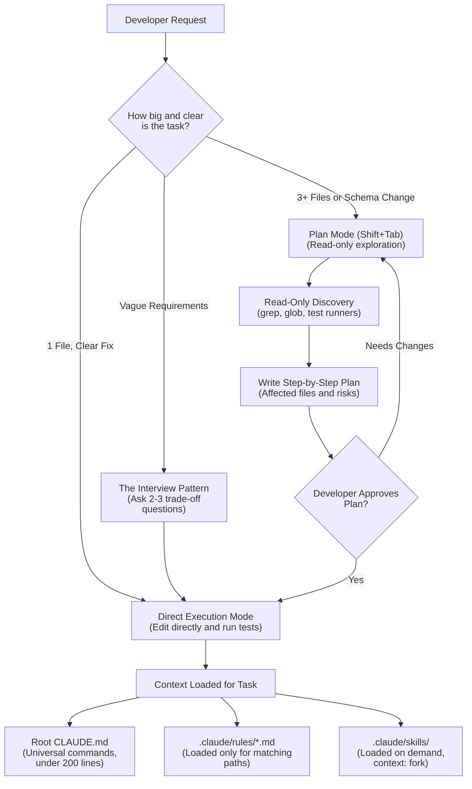
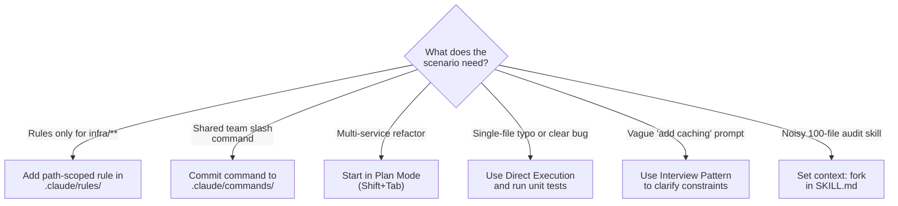

# Scenario 2: Code Generation with Claude Code

## 1. The Big Picture (In Plain English)

Engineering teams use **Claude Code** for everyday coding tasks—from fixing a quick typo to refactoring authentication across a dozen microservices. Getting reliable results depends on three choices: **where** you store instructions (`CLAUDE.md` vs. folder rules vs. skills), **when** you let Claude explore vs. edit (**Plan Mode** vs. **Direct Execution**), and **how** you clarify vague requests before writing code.

**Everyday Analogy — Blueprints Before Renovation:**
If a doorknob is loose, you grab a screwdriver and tighten it right away. If you are moving load-bearing walls across three floors of a house, you draw blueprints and get sign-off before swinging a hammer. **Direct Execution** is the screwdriver for small, clear fixes; **Plan Mode** is the blueprint for multi-file changes.

- **Domains Tested:** Domain 3 (Claude Code Configuration & Workflows, 20%), Domain 5 (Context Management & Reliability, 15%).
- **Task Statements:** TS 3.1 (`CLAUDE.md` hierarchy), TS 3.2 (Custom commands & Skills), TS 3.3 (Path-scoped rules), TS 3.4 (Plan Mode vs. Direct Execution), TS 3.5 (Iterative refinement & Interview pattern), TS 5.1 (Context window management).

### Top 3 Mistakes to Watch Out For
1. **Putting team rules in personal config:** Saving shared slash commands or coding standards in `~/.claude/` means your teammates never get them when they pull from Git. Shared rules belong in the repository's `.claude/` folder.
2. **Using the wrong execution mode:** Opening Plan Mode for a 1-line typo wastes time, while jumping straight into Direct Execution on a 15-file database migration leads to broken imports and circular edits.
3. **Turning root `CLAUDE.md` into a 2,000-line wiki:** Because `CLAUDE.md` loads on every turn, stuffing every language guide and runbook into it wastes tokens and causes Claude to overlook important rules.

---

## 2. How the System Works



### Walkthrough of the Flow
1. **Check scope and clarity first:** Before changing any file, decide whether the task is a small, clear fix (Direct Execution), a multi-file change (Plan Mode), or an underspecified request (ask clarifying questions first).
2. **Explore safely in Plan Mode:** In Plan Mode, Claude reads files and runs read-only checks to map out a file-by-file plan and waits for your approval before editing anything.
3. **Keep always-on instructions lean:** Root `CLAUDE.md` holds universal build, lint, and test commands (under ~200 lines).
4. **Load specialized rules only when needed:** Folder-specific rules (like React vs. Go conventions) sit in `.claude/rules/*.md` with `paths:` globs and load only when Claude touches matching files. Heavy one-off workflows live in skills with `context: fork`.

---

## 3. Core Design Rules (Why Naive Fixes Fail)

1. **Put config at the right scope:**
   - **Organization compliance rules** → Enterprise Managed config.
   - **Team coding rules & shared `/commands`** → Project scope (`.claude/` committed to Git).
   - **Personal preferences across projects** → User scope (`~/.claude/`, uncommitted).
   - Remember: `CLAUDE.md` files are concatenated rather than strictly overridden, and they are guidance, not security enforcement. Use a `PreToolUse` hook for rules that must never break (like blocking committed secrets).
2. **Keep root `CLAUDE.md` under 200 lines:**
   `CLAUDE.md` is loaded into every single conversation turn. When it grows to 700+ lines, useful rules get buried in noise (**attention dilution**). Move directory rules to `.claude/rules/` and multi-step procedures to `.claude/skills/`.
3. **Scope folder rules with `paths:` globs:**
   Use YAML frontmatter such as `paths: ["services/backend/**/*.go"]` inside `.claude/rules/backend_go.md`. That way backend rules do not clutter frontend sessions.
4. **Pick Plan Mode vs. Direct Execution purposefully:**
   - **Plan Mode (`Shift+Tab`):** Multi-file refactors, schema changes, or unfamiliar architecture. Enable `useAutoModeDuringPlan` so read-only discovery (`grep`, `glob`, type-checks) runs smoothly without nagging for permission on every read.
   - **Direct Execution:** Small, localized bug fixes backed by clear stack traces or unit tests.
5. **Ask before guessing (The Interview Pattern):**
   If a developer says *"Add caching"* or *"Add authentication"* without naming Redis vs. in-memory or JWT vs. sessions, ask 2–3 focused questions with trade-offs before writing code.
6. **Fork noisy workflows (`context: fork`):**
   If a skill scans 100 files and produces hundreds of lines of intermediate output, put `context: fork` in `SKILL.md` so the scan runs in a separate subagent buffer and returns only the clean summary table to your main chat.



### Model & API Rules for This Scenario
- **Model choice:** Use `claude-sonnet-4-5` for planning and complex multi-file coding; use `claude-haiku-4-5` for fast, narrow helper tasks.
- **Extended Thinking:** When `thinking` is enabled, omit `temperature`, `top_p`, and `top_k`, and echo assistant `thinking` blocks with their signatures intact across tool loops.
- **Safety flags:** Never pass `--dangerously-skip-permissions` during local interactive development—it removes confirmation prompts before destructive shell commands like `rm -rf`.

---

## 4. What the Exam Tests (Task Statement Map)

| Task Statement | How It Shows Up Here | Tempting Wrong Answer |
| :--- | :--- | :--- |
| **TS 3.1 `CLAUDE.md` Hierarchy** | Lean root file (<200 lines) for universal commands; `PreToolUse` hooks for hard security rules. | Dumping company wikis into root `CLAUDE.md`, or expecting `CLAUDE.md` to block secrets deterministically. |
| **TS 3.2 Commands & Skills** | Shared commands in `.claude/commands/`; noisy scans in skills with `context: fork`. | Saving shared commands in `~/.claude/commands/` where teammates cannot see them. |
| **TS 3.3 Path-Scoped Rules** | `.claude/rules/backend.md` with `paths: ["backend/**"]`. | Copying the same rule file into 10 subdirectories manually. |
| **TS 3.4 Plan Mode vs. Direct** | Plan Mode for cross-service refactors; Direct Execution for localized fixes. | Using Plan Mode for a 1-line typo, or editing 10 files blindly in Direct Mode. |
| **TS 3.5 Iterative Refinement** | Presenting 2–3 concrete options with trade-offs when requirements are ambiguous. | Silently guessing Redis or JWT without asking the developer. |
| **TS 5.1 Context Management** | Conditional rule loading and `context: fork` keep main chat clean. | Loading every repository doc into every single turn. |

---

## 5. Realistic Walkthrough (End-to-End Example)

**Developer Request:** *"Add authentication to the backend and update the API client."*

1. **Spot the Scope and Ambiguity:**
   This touches backend middleware, routes, and the frontend API client, and the developer did not specify how tokens should work.
2. **Run the Interview Pattern First:**
   Claude asks before editing: *"Should we use stateless JWT bearer tokens (RS256) or HttpOnly session cookies?"* The developer replies: *"Use RS256 JWTs in HttpOnly cookies."*
3. **Explore in Plan Mode:**
   Claude switches to Plan Mode (`Shift+Tab`). Using read-only tools, it inspects the existing routes and client without modifying any files, then proposes a 4-step blueprint (dependencies → auth middleware → login route → frontend `credentials` setting).
4. **Wait for Approval (and Revise if Needed):**
   If the developer asks to change Step 3, Claude updates the plan and confirms approval before touching code.
5. **Execute with Path-Scoped Rules:**
   Once approved, Claude enters execution. When editing `backend/middleware/auth.py`, `.claude/rules/backend.md` (`paths: ["backend/**"]`) loads automatically to enforce async handlers and Pydantic validation, while React rules stay unloaded.

---

## 6. Practice Questions (Try Before Peeking!)

### Q1. Scoping Infrastructure Rules
A team wants Terraform tagging rules to apply automatically whenever Claude edits files under `infra/**`. The root `CLAUDE.md` is already 180 lines long. What is the best setup?

- **A)** Append a 50-line Terraform section to the root `CLAUDE.md`.
- **B)** Add the Terraform rules to `~/.claude/CLAUDE.md`.
- **C)** Create a `/terraform` skill and ask engineers to remember to run it before editing.
- **D)** Create `.claude/rules/terraform.md` with YAML frontmatter `paths: ["infra/**"]`.

<details>
<summary>Show Answer & Explanation</summary>

**Correct Answer:** D

- **A is wrong:** Adding 50 lines pushes root `CLAUDE.md` past 200 lines and injects Terraform rules into unrelated frontend and backend work.
- **B is wrong:** `~/.claude/` is personal user config—teammates will never get those rules from Git.
- **C is wrong:** Relying on engineers to manually trigger a slash command means rules get skipped whenever someone forgets.
- **D is right:** Path-scoped rules in `.claude/rules/` are shared via Git and load automatically only when matching `infra/**` files are touched.

</details>

---

### Q2. Choosing the Right Mode
A stack trace points straight to an off-by-one bug inside a 15-line helper function `calculate_discount()` that already has unit tests. Which mode fits best?

- **A)** Plan Mode with a multi-page written proposal.
- **B)** Direct Execution.
- **C)** The Interview Pattern asking the developer about sorting algorithms.
- **D)** Launching a multi-agent team with `context: fork`.

<details>
<summary>Show Answer & Explanation</summary>

**Correct Answer:** B

- **A is wrong:** Plan Mode adds unnecessary overhead for a clear, single-function bug.
- **B is right:** When the scope is small, the cause is clear, and tests exist, Direct Execution fixes and verifies the bug immediately.
- **C is wrong:** Nothing in the request is ambiguous.
- **D is wrong:** Spawning multiple agents for a 1-line bug wastes time and tokens.

</details>

---

### Q3. Handling Vague Requests
A developer says: *"Add caching to the user profile service."* No caching layer (Redis, in-memory LRU, CDN) or expiration rules were specified. What should Claude do first?

- **A)** Ask targeted questions about cache invalidation, latency goals, and existing infrastructure.
- **B)** Install Redis and write connection code right away.
- **C)** Write three different caching implementations and ask the reviewer to pick one in the PR.
- **D)** Implement an in-memory cache and add a disclaimer at the end.

<details>
<summary>Show Answer & Explanation</summary>

**Correct Answer:** A

- **A is right:** Under the Interview Pattern, clarify key trade-offs and infrastructure constraints before writing code.
- **B is wrong:** Assuming Redis is available in production can break deployment if no Redis cluster exists.
- **C is wrong:** Building three versions wastes tokens and litters the PR with unused code.
- **D is wrong:** An in-memory cache silently fails to stay consistent if the service runs on multiple servers.

</details>

---

### Q4. Keeping Exploration Noise Out of Main Chat
A team builds an audit skill that scans 40 files and prints 800 lines of intermediate AST logs. Running it directly fills the chat window and slows down later prompts. What fixes this?

- **A)** Copy the audit script into `CLAUDE.md`.
- **B)** Ask the developer to write shorter prompts.
- **C)** Turn the skill into a shell alias.
- **D)** Add `context: fork` to the skill's `SKILL.md` frontmatter so it runs in an isolated subagent and returns only the final summary.

<details>
<summary>Show Answer & Explanation</summary>

**Correct Answer:** D

- **A is wrong:** Putting anything into `CLAUDE.md` loads it on every turn rather than isolating output.
- **B is wrong:** Shortening the user prompt does not stop the 800 lines of tool output.
- **C is wrong:** A shell alias still dumps its output into the active session.
- **D is right:** `context: fork` runs the noisy scan in a separate context and brings back only the concise summary.

</details>

---

### Q5. Guaranteeing a Review Skill Cannot Edit Files
A tech lead creates a code-review skill in `.claude/skills/review/SKILL.md` and wants to guarantee the skill can never modify any source file. How should this be enforced?

- **A)** Restrict the skill's allowed tools in frontmatter to read-only tools (such as `Read`, `Grep`, `Glob`), omitting `Edit`, `Write`, and `Bash`.
- **B)** Write *"Please do not edit any files during review"* in `SKILL.md`.
- **C)** Rely on Claude's default helpfulness not to edit files.
- **D)** Run `git status` after the review and warn the user if files changed.

<details>
<summary>Show Answer & Explanation</summary>

**Correct Answer:** A

- **A is right:** Removing write tools at the tool-permission layer makes file edits impossible.
- **B is wrong:** Prompt wording is only a soft instruction, not a hard boundary.
- **C is wrong:** Alignment is not an access control boundary.
- **D is wrong:** Checking after the fact only catches damage after files have already been altered.

</details>

---

### Q6. Cleaning Up a Bloated `CLAUDE.md`
A repository's root `CLAUDE.md` has grown to 700 lines, mixing build commands, Kubernetes deploy steps, Python lint rules, React guidelines, and database migrations. Claude keeps forgetting the React rules. What should the team do?

- **A)** Keep universal build/test commands in `CLAUDE.md` (under 200 lines), move directory rules to `.claude/rules/` with `paths:` globs, and move episodic runbooks (K8s deploy, DB migration) to `.claude/skills/`.
- **B)** Make all 700 lines bold and uppercase.
- **C)** Delete the React and Python rules completely.
- **D)** Split the file into 7 separate 100-line files that all load unconditionally at startup.

<details>
<summary>Show Answer & Explanation</summary>

**Correct Answer:** A

- **A is right:** Separating always-on commands, path-scoped rules, and on-demand skills keeps context lean and prevents attention dilution.
- **B is wrong:** Bold uppercase text does not fix a 700-line context overload.
- **C is wrong:** Deleting standards loses useful team conventions.
- **D is wrong:** Loading 7 files unconditionally still puts all 700 lines into every single turn.

</details>

---

## 7. Hands-On Lab, Self-Check & Memory Hook

- **Inspect the code:** Read [`simulation.py`](simulation.py) to see how `ClaudeCodeGenerationEngine` evaluates path rules, selects Plan Mode vs. Direct Execution, and triggers the Interview Pattern.
- **Run the interactive lab:** Open [`scenario_workbench.ipynb`](scenario_workbench.ipynb) and run all cells offline.
- **Run the unit tests (WSL Ubuntu-26.04):**
  ```bash
  uv run pytest scenarios/scenario_2_code_generation/test_scenario_2_simulation.py
  ```

### Self-Check Checklist
- [ ] I can tell when config belongs in `.claude/` (team/Git) vs. `~/.claude/` (personal).
- [ ] I know how to scope `.claude/rules/*.md` using `paths:` glob patterns.
- [ ] I can explain when to use Plan Mode, Direct Execution, and the Interview Pattern.
- [ ] I know what `context: fork` does in `SKILL.md` and why it protects main chat context.
- [ ] I understand why root `CLAUDE.md` stays under 200 lines (and why hard security rules still need hooks).

**Exam-Day Memory Hook:** *"Share in the repo, load by path, plan big, fork the noise."*

**Related Practice Bank Sets:**
- [Set 4 (Configuration Precedence & CLAUDE.md): Q96, Q98, Q99, Q100, Q101, Q103](../../practice_exam_bank_300/set_04_domain2_claude_code_config.md)
- [Set 5 (Skills, Subagents & Plan Mode): Q126, Q128, Q131, Q132, Q133, Q134](../../practice_exam_bank_300/set_05_domain2_skills_subagents_headless.md)

---

[← Scenario 1](../scenario_1_customer_support/SCENARIO_GUIDE.md) · [Scenarios Overview](../README.md) · [Next: Scenario 3 →](../scenario_3_multi_agent_research/SCENARIO_GUIDE.md)
