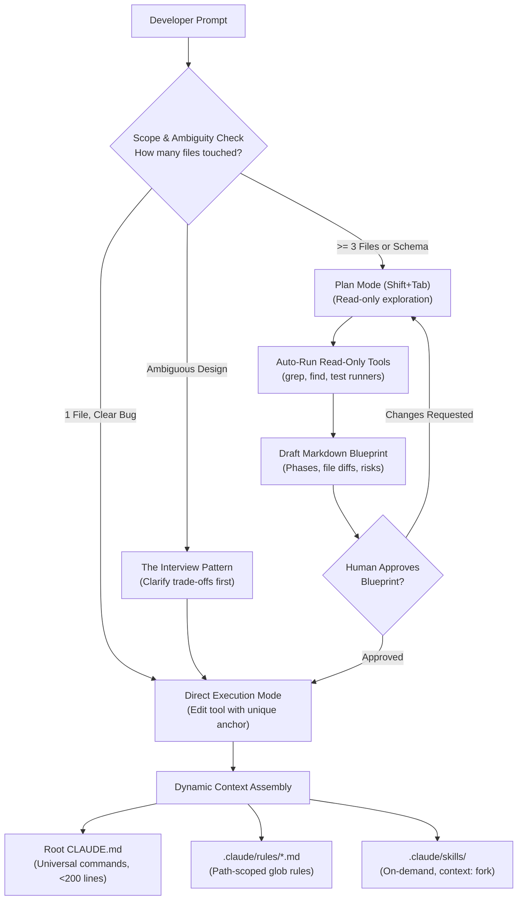
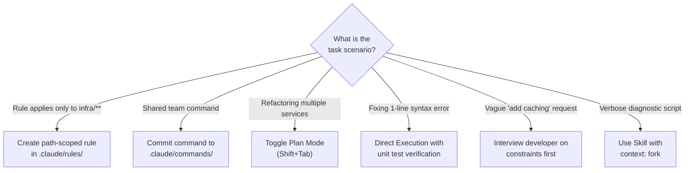

# Scenario 2: Code Generation with Claude Code

## 1. In One Minute

**What it is.** Engineering teams use Claude Code for local interactive development, multi-file refactoring, and automated codebase changes. Architectural mastery requires knowing how to partition instructions across the configuration hierarchy (`Managed` → `~/.claude/` → `.claude/` → `CLI flags`), when to use path-scoped rules vs on-demand skills, and how to choose between Plan Mode and Direct Execution.

**Domains hit:** Domain 3 (Claude Code Configuration & Workflows), Domain 5 (Context Management & Reliability).

**Key Task Statements:** TS 3.1 (`CLAUDE.md` hierarchy), TS 3.2 (Custom commands & Skills), TS 3.3 (Path-scoped rules), TS 3.4 (Plan Mode vs Direct Execution), TS 3.5 (Iterative refinement & Interview pattern), TS 5.1 (Context window preservation).

**Top 3 Traps:**
1. **The User-Scope Leak**: Putting team-wide shared commands or coding rules in user-level files (`~/.claude/`) that teammates never receive via Git.
2. **The Mode Mismatch Trap**: Using Plan Mode for a trivial 1-line typo fix, or rushing into Direct Execution for a cross-service refactor touching multiple databases.
3. **The Monolithic `CLAUDE.md` Trap**: Stuffing every deployment manual, coding standard, and historical bug list into one giant 2,000-line root file instead of using path-scoped rules and modular skills.

---

## 2. Architecture Diagram

---

## 3. How a Good Answer Thinks

Follow this decision sequence on the CCAR-F exam:

1. **Who needs the configuration?**
   * The whole team working in the repository → Project scope (`.claude/` committed to Git).
   * Just me on my local laptop across all projects → User scope (`~/.claude/` uncommitted).
   * Organization-wide compliance requirement → Enterprise Managed configuration.
2. **When should instructions load into memory?**
   * On every single interaction → Root `CLAUDE.md` (keep it lean: build, test, lint commands).
   * Only when editing specific directories (e.g. `frontend/**` vs `backend/**`) → Path-scoped rule (`.claude/rules/*.md`).
   * Only for specialized, episodic workflows (e.g. database migration or PR review) → Skill (`.claude/skills/*.md`).
3. **How big and clear is the change?**
   * Large, multi-file, or architectural design choices → Plan Mode first.
   * Small, well-isolated bug fix with existing tests → Direct Execution.
   * Vague or unconstrained requirements → The Interview Pattern (ask targeted questions before editing code).
4. **Does the task generate massive exploratory logs?**
   * Run the skill or subagent with `context: fork` so intermediate file dumps stay in an isolated context and return only an executive summary to the main thread.

### Model & Context Rules:
- **Keep `CLAUDE.md` Concise (<200 lines)**: `CLAUDE.md` is loaded into the prompt prefix on **every single turn**. A bloated file consumes baseline token budgets, increases latency, and causes *Attention Dilution*.
- **Use `useAutoModeDuringPlan`**: Allows Claude to run safe read-only discovery tools (`grep`, `glob`, `type-check`) autonomously during the planning phase without requiring human approval on every keystroke.
- **Path Matching Syntax**: Use standard glob patterns in YAML frontmatter (`paths: ["backend/**/*.py", "src/api/**"]`).

---

## 4. Task Statement Map

| Task Statement | How It Manifests in Scenario 2 | Exam Trap |
| :--- | :--- | :--- |
| **TS 3.1 `CLAUDE.md` Hierarchy** | Short root file with universal build/test commands; under 200 lines. | Storing company-wide wikis or API references in root `CLAUDE.md`. |
| **TS 3.2 Commands & Skills** | Shared `/review` in `.claude/commands/`; verbose workflows in skills with `context: fork`. | Putting shared team shortcuts in personal `~/.claude/commands/`. |
| **TS 3.3 Path-Scoped Rules** | `.claude/rules/backend.md` loading automatically via `paths: ["backend/**"]`. | Duplicating the same instructions across 10 subdirectories. |
| **TS 3.4 Plan Mode vs Direct** | Plan Mode for cross-service refactors; Direct Execution for localized bug fixes. | Defaulting to Plan Mode for simple typos, or skipping Plan Mode on core schema refactors. |
| **TS 3.5 Iterative Refinement** | Interviewing the developer when auth type or database driver is unspecified. | Silently picking a favorite database or guessing user intent without asking. |
| **TS 5.1 Context Management** | Conditionally loading rules by path and forking noisy exploratory tasks. | Ingesting all repository documentation into every session turn. |

---

## 5. Step-by-Step Worked Example

**Developer Request**: *"Add JWT authentication to the backend and update the frontend API client."*

1. **Scope Assessment**: The task touches backend handlers, database schemas, and frontend clients. This is a multi-file architectural change with ambiguity (token expiry, storage mechanism, library choices).
2. **The Interview Pattern**: Before modifying code, Claude prompts the developer:
   *"Should we use RS256 with public/private keys or symmetric HS256? Should tokens be stored in httpOnly cookies or Authorization headers?"* The developer responds: *"RS256 in httpOnly cookies."*
3. **Plan Mode Activation**: Claude toggles Plan Mode (`Shift+Tab`). It explores existing files using `useAutoModeDuringPlan` to check current session middleware without prompting for permission.
4. **Drafting the Blueprint**: Claude outputs a step-by-step markdown blueprint:
   * Phase 1: Add cryptography dependencies and generate keypair utilities.
   * Phase 2: Implement JWT authentication middleware in `backend/middleware/auth.py`.
   * Phase 3: Update login route to issue httpOnly cookies.
   * Phase 4: Update frontend client in `frontend/src/api.ts` to include credentials.
5. **Human Approval**: The developer reviews and approves the plan.
6. **Direct Execution with Path Rules**: Claude transitions to execution. When opening files in `backend/**`, `.claude/rules/backend.md` loads automatically (enforcing async handlers and Pydantic validation). Frontend rules remain unloaded, preserving context.

---

## 6. Exam-Style Practice Questions with Distractor Teardowns

### Q1. Scoping Infrastructure Guidelines
A team wants specific Terraform guidelines (e.g. mandatory resource tagging) to apply automatically whenever Claude edits infrastructure code in `infra/**`. The root `CLAUDE.md` is already 180 lines long. What is the best practice?

- **A)** Add a 50-line Terraform section to the bottom of the root `CLAUDE.md`.
- **B)** Add the Terraform rules to `~/.claude/CLAUDE.md`.
- **C)** Create a custom skill and require engineers to remember to type `/terraform` before making edits.
- **D)** Create a rule file in `.claude/rules/terraform.md` with YAML frontmatter specifying `paths: ["infra/**"]`.

**Correct Answer:** D

**Distractor Teardown:**
- **A is incorrect (The Monolithic `CLAUDE.md` Trap):** Adding 50 lines bloats the root file beyond 200 lines and injects Terraform rules into frontend and backend sessions where they are completely irrelevant.
- **B is incorrect (The User-Scope Leak):** Putting rules in `~/.claude/` keeps them on one developer's machine; teammates will not receive the rules.
- **C is incorrect:** Requiring manual invocation of a skill introduces human error; developers will inevitably forget to trigger it.
- **D is correct:** Path-scoped rules in `.claude/rules/` are committed to Git and automatically load only when matching files in `infra/**` are touched.

---

### Q2. Selecting the Operational Mode
A stack trace points directly to an off-by-one indexing error in a single utility function `calculate_discount()`. The function is 15 lines long, has unit tests, and the fix is unambiguous. Which mode should the developer use?

- **A)** Plan Mode with a multi-page written proposal.
- **B)** Direct Execution.
- **C)** The Interview Pattern asking the user to describe sorting algorithms.
- **D)** Launch a multi-agent research team with `context: fork`.

**Correct Answer:** B

**Distractor Teardown:**
- **A is incorrect:** Plan Mode introduces unnecessary cognitive and operational friction for an isolated, clear, single-file bug fix.
- **B is correct:** When the bug is localized, clear, and covered by unit tests, Direct Execution fixes the code and verifies with tests immediately.
- **C is incorrect:** The requirements are already unambiguous; asking unnecessary questions wastes developer time.
- **D is incorrect:** A multi-agent swarm for an off-by-one error is an absurd over-engineering anti-pattern.

---

### Q3. Handling Ambiguous Architecture Requests
A developer submits: *"Add caching to the user profile service."* There are multiple valid caching tiers (Redis, in-memory LRU, CDN edge cache) and no operational constraints were supplied. What should Claude do first?

- **A)** Ask targeted questions about cache invalidation requirements, latency goals, and existing infrastructure.
- **B)** Immediately install Redis and write connection code.
- **C)** Implement three alternative caching strategies simultaneously and ask the reviewer to pick one in the pull request.
- **D)** Implement an in-memory cache and append a disclaimer at the end of the response.

**Correct Answer:** A

**Distractor Teardown:**
- **A is correct (The Interview Pattern):** High-level, ambiguous architectural requests require clarifying constraints before committing to implementation.
- **B is incorrect (The Context Trap):** Guessing an external dependency (Redis) without knowing if Redis is deployed in production causes architectural mismatch.
- **C is incorrect:** Writing three parallel implementations burns token budget and litters the codebase with dead code.
- **D is incorrect:** Silently picking an in-memory cache may break if the service is deployed across multiple horizontal instances.

---

### Q4. Preventing Main Session Context Clutter
A developer builds a repository audit skill that inspects 40 files, generating 800 lines of intermediate AST logs. Running it directly in Claude Code fills the chat context, causing subsequent prompts to experience latency spikes. What configuration solves this?

- **A)** Copy the audit script text into `CLAUDE.md`.
- **B)** Truncate the developer's prompt.
- **C)** Convert the skill into a bash alias.
- **D)** Add `context: fork` to the skill's YAML frontmatter so it executes in an isolated subagent and returns only the final summary to the main session.

**Correct Answer:** D

**Distractor Teardown:**
- **A is incorrect:** Moving noisy scripts into `CLAUDE.md` guarantees the noise is re-injected on every single turn.
- **B is incorrect:** Shortening the user prompt does not reduce the 800 lines of tool output generated by the skill.
- **C is incorrect:** A bash alias still prints its full output directly into the active terminal session.
- **D is correct:** `context: fork` spins up an ephemeral, isolated subagent context for heavy exploration, returning only a clean summary to the main conversation.

---

### Q5. Enforcing Read-Only Safety on Review Skills
A technical lead creates a code review skill in `.claude/skills/review/SKILL.md`. The lead wants to guarantee that the skill can never modify source code under any circumstances. How should this be enforced?

- **A)** Configure the skill's frontmatter to explicitly restrict allowed tools to read-only operations: `tools: ["read_file", "list_directory", "git_diff"]`, omitting `write_file`, `edit_file`, and `bash`.
- **B)** Write in the skill prompt: *"Please do not edit any files during code review."*
- **C)** Instruct developers to trust the model's alignment.
- **D)** Configure a post-edit prompt asking the user if they noticed any file changes.

**Correct Answer:** A

**Distractor Teardown:**
- **A is correct (Least Privilege Tool Sandboxing):** Security and behavioral safety must be enforced structurally at the tool schema layer. Removing write tools makes file modification impossible.
- **B is incorrect (The Prompt-As-Permission Trap):** Prompt instructions are soft guidelines that can be bypassed by prompt injection or model hallucination.
- **C is incorrect:** Model alignment is not an access control boundary.
- **D is incorrect:** Post-edit warnings occur after the file has already been modified.

---

### Q6. Refactoring a Bloated Configuration
A repository's root `CLAUDE.md` has grown to 700 lines, mixing local build commands, Kubernetes deployment manifests, Python linting rules, React styling guides, and database migration steps. Claude frequently forgets the React rules and fails builds. What is the recommended restructuring?

- **A)** Keep universal build and test commands in `CLAUDE.md` (<200 lines); move directory-specific rules to `.claude/rules/` with path globs; move episodic procedures (K8s deploy, DB migration) to modular `.claude/skills/`.
- **B)** Make all 700 lines bold and uppercase to improve attention.
- **C)** Delete all React and Python styling rules completely.
- **D)** Split the file into 7 separate 100-line files that are all loaded unconditionally at startup.

**Correct Answer:** A

**Distractor Teardown:**
- **A is correct:** Partitioning configuration into a lean root file (<200 lines), conditional path-scoped rules, and on-demand skills preserves token budgets and eliminates attention dilution.
- **B is incorrect:** Bold text does not resolve context saturation.
- **C is incorrect:** Deleting conventions removes valuable team standards.
- **D is incorrect:** Unconditionally loading 7 files still injects 700 lines into every turn.

---

## 7. Self-Check Checklist

- [ ] I can distinguish between Project scope (`.claude/`) and User scope (`~/.claude/`).
- [ ] I can write the YAML frontmatter for a path-scoped rule with `paths: ["..."]`.
- [ ] I know the criteria for choosing Plan Mode vs Direct Execution.
- [ ] I know what `context: fork` does and when to use it to prevent context bloat.
- [ ] I understand why `CLAUDE.md` must stay under 200 lines.

**Memory Hook:** *"Share in the repo, load by path, plan big, fork the noise."*

**Related Practice Bank Questions:**
* [Set 4 (Configuration Precedence & CLAUDE.md): Q96, Q98, Q99, Q100, Q101, Q103](../../practice_exam_bank_300/set_04_domain2_claude_code_config.md)
* [Set 5 (Skills, Subagents & Plan Mode): Q126, Q128, Q131, Q132, Q133, Q134](../../practice_exam_bank_300/set_05_domain2_skills_subagents_headless.md)
