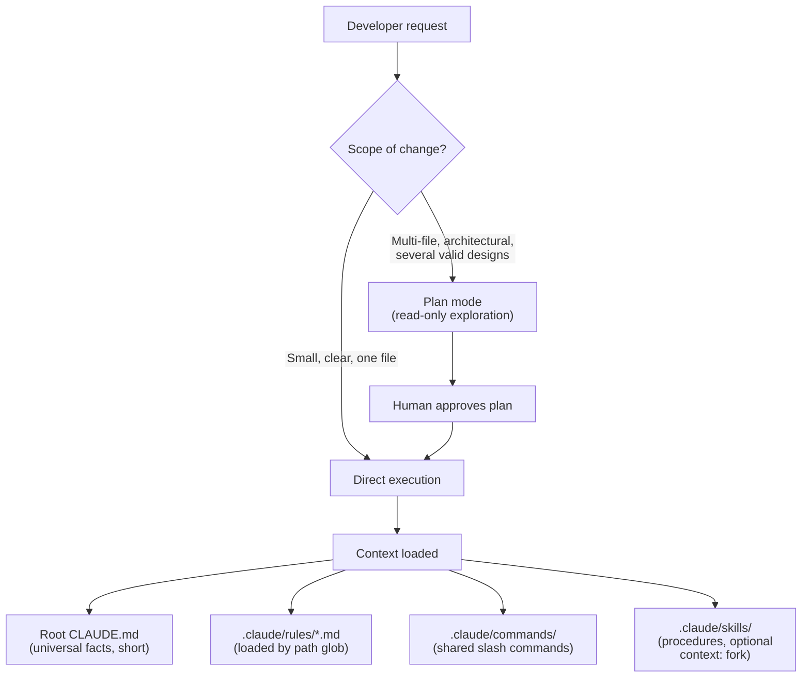

# Scenario 2: Code Generation with Claude Code

## 1. In One Minute

**What it is.** A team uses Claude Code to write and change code. It relies on custom slash commands, `CLAUDE.md` files, path-scoped rules, and a choice between plan mode and direct execution.

**Domains hit:** D3 Claude Code Configuration and Workflows, D5 Context Management.

**Task statements:** TS 3.1 (CLAUDE.md hierarchy), 3.2 (slash commands and skills), 3.3 (path-specific rules), 3.4 (plan mode vs direct), 3.5 (iterative refinement), 5.1 (context).

**Top 3 traps**
1. Putting shared team config in user-level files (`~/.claude/`) that teammates never receive.
2. Using plan mode for a tiny fix, or direct execution for a large architectural change.
3. Stuffing everything into one huge `CLAUDE.md` instead of using path rules and skills.

## 2. Architecture Diagram

## 3. How a Good Answer Thinks

1. **Who needs it?** Whole team in the repo means project scope (`.claude/`, committed). Just me means user scope (`~/.claude/`).
2. **When should it load?** Always: `CLAUDE.md`. Only for some files: `.claude/rules/` with a path glob. Only on demand: a skill or command.
3. **How big is the change?** Large, multi-file, or unclear design: plan mode first. Small and clear: direct.
4. **Is the request vague?** Ask questions (interview) before writing code. Do not guess a design.
5. **Does a task produce lots of noisy output?** Run it in a forked context (`context: fork`) so the main session stays clean.
6. **Root cause first.** If Claude ignores a convention, check where the convention lives and when it loads.

### Model and Sampling Notes
- Use `claude-sonnet-4-5` for coordinators and reasoning, `claude-haiku-4-5` for workers and extraction.
- With extended thinking on: omit `temperature`, leave `top_k` and `top_p` unset, and use only `tool_choice` `auto` or `none` (forced or `any` returns HTTP 400). Forced-tool extraction calls must not use thinking.
- In tool loops, return thinking blocks with their signature unchanged.
- Loops end on `stop_reason` only (`end_turn`, `tool_use`, `max_tokens`, `stop_sequence`, `pause_turn`, `refusal`). A max-iterations counter is a safety cap, not the stop rule.

## 4. Task Statement Map

| Task statement | How it shows up here | Trap |
|---|---|---|
| TS 3.1 CLAUDE.md | Short root file with universal facts; keep it under about 200 lines | One giant file with every procedure |
| TS 3.2 Commands and skills | `/review` in `.claude/commands/`; verbose workflows in skills with `context: fork` | Putting shared commands in `~/.claude/commands/` |
| TS 3.3 Path rules | `.claude/rules/*.md` with `paths:` globs such as `backend/**` | Repeating the same rule in many folder-level files |
| TS 3.4 Plan mode | Plan mode for a multi-service refactor; direct for a typo | Always plan, or never plan |
| TS 3.5 Iterative refinement | Interview first when auth or database choice is not stated | Picking a design silently |
| TS 5.1 Context | Load rules by path; fork noisy work | Loading everything into every session |

## 5. Worked Example

**Request:** "Add authentication to the backend and update the API clients."

1. Many files and no stated auth method, so this is plan mode plus an interview.
2. Claude asks: JWT bearer tokens or session cookies? It waits for the answer.
3. In plan mode it reads the code, lists affected files, and proposes phases. Nothing is edited yet.
4. The human approves the plan.
5. Direct execution starts. Editing `backend/**` loads the backend rule file (async handlers, validated models). Frontend rules stay unloaded.
6. A shared `/review` command from `.claude/commands/` is used before the PR.

Try it offline: `scenarios/scenario_2_code_generation/simulation.py` (`ClaudeCodeGenerationEngine.evaluate_task`).

## 6. Exam-Style Practice Questions

**Q1.** Terraform conventions should apply only when Claude edits `infra/**`. The root `CLAUDE.md` is already long. What is best?
- A) Add a "Terraform section" to the root `CLAUDE.md`.
- B) Add the rules to `~/.claude/CLAUDE.md`.
- C) Write a skill and ask engineers to invoke it each time.
- D) Create a rule file in `.claude/rules/` with a `paths:` glob for `infra/**`.

**Q2.** A stack trace points to an off-by-one error in one function. The fix is clear. What mode fits?
- A) Plan mode with a full written proposal.
- B) Direct execution.
- C) Interview the developer about design choices.
- D) Fork a separate research session first.

**Q3.** A developer says "add caching to the service." There are several valid designs and no constraints given. What should Claude do first?
- A) Ask targeted questions about constraints and design options.
- B) Choose Redis and implement it.
- C) Implement three variants and let the reviewer choose.
- D) Add a generic cache and ask later.

**Q4.** A repo-analysis skill prints thousands of lines of exploration and clutters the session. What helps most?
- A) Move its text into `CLAUDE.md`.
- B) Make the prompt shorter.
- C) Turn it into a slash command.
- D) Add `context: fork` in the skill so it runs in an isolated context and returns a summary.

**Q5.** A review skill must never modify files. How should this be enforced?
- A) Restrict the skill's allowed tools to read-only tools.
- B) Write "do not edit files" in the skill text.
- C) Trust the model to follow the instruction.
- D) Ask for confirmation after each edit.

**Q6.** The root `CLAUDE.md` has grown to 600 lines mixing facts, deployment procedures, and per-folder style notes. Claude follows it unevenly. What is the best restructure?
- A) Keep universal facts in `CLAUDE.md`, move procedures to skills, move path-specific rules to `.claude/rules/`.
- B) Make every instruction bold.
- C) Delete all style guidance.
- D) Split it into several equal files that all load every session.

### Answers

**Q1: D.** A fails: loads for every task and bloats the root file. B fails: user-level, teammates do not get it. C fails: manual invocation is easy to forget.

**Q2: B.** A fails: over-engineered for a clear one-function fix. C fails: nothing is ambiguous. D fails: needless extra step.

**Q3: A.** B fails: guesses a design. C fails: wasteful and unreviewed. D fails: builds first, asks later.

**Q4: D.** A fails: adds noise to every session. B fails: does not reduce output. C fails: a command still runs in the main context.

**Q5: A.** B fails: text is probabilistic. C fails: same issue. D fails: the edit already happened.

**Q6: A.** B fails: emphasis does not fix structure. C fails: loses useful guidance. D fails: everything still loads every time.

## 7. Self-Check Checklist

- [ ] I can state project scope vs user scope for commands and config.
- [ ] I know when rules load by glob versus always.
- [ ] I can justify plan mode vs direct execution in one sentence.
- [ ] I know what `context: fork` does and why it helps.
- [ ] I ask first when the request is vague.

**Memory hook:** "Share in the repo, load by path, plan big, fork the noise."
