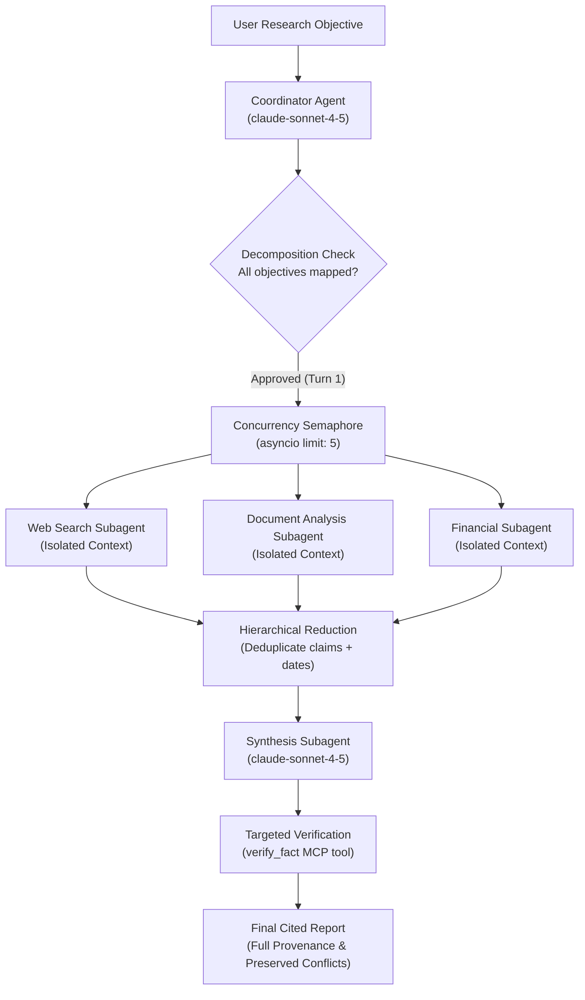
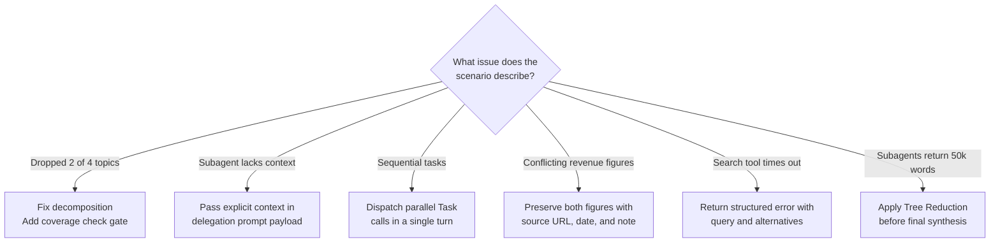

# Scenario 3: Multi-Agent Research System

## 1. In One Minute

**What it is.** A Hub-and-Spoke multi-agent system where a centralized Coordinator decomposes a broad research objective across specialized subagents (web search, document analysis, financial modeling, and synthesis). The deliverable is an auditable, cited report with complete source provenance and preserved conflicting viewpoints.

**Domains hit:** Domain 1 (Agentic Architecture & Orchestration), Domain 2 (Tool Design & MCP), Domain 5 (Context Management & Reliability).

**Key Task Statements:** TS 1.2 (Coordinator & Subagent topologies), TS 1.3 (Subagent spawning & explicit context passing), TS 1.6 (Task decomposition), TS 2.2 (Structured error contracts), TS 2.3 (Scoped tools), TS 5.3 (Error propagation & partial failure), TS 5.6 (Source provenance & conflict handling).

**Top 3 Traps:**
1. **The Subagent Scapegoat Trap**: Blaming a subagent for an incomplete final report when the root cause was the coordinator's overly narrow task decomposition.
2. **The Context Inheritance Assumption**: Assuming subagents automatically inherit the coordinator's conversation history or working memory. Subagents have isolated contexts; all required parameters must be explicitly passed in the prompt payload.
3. **The Data Synthesis Trap**: Hiding tool failures by treating network timeouts as "no records found", or synthesizing conflicting facts by averaging disparate numbers (e.g. averaging \$1.2B and \$1.4B into \$1.3B) rather than reporting both with source provenance and dates.

---

## 2. Architecture Diagram

---

## 3. How a Good Answer Thinks

Follow this decision sequence on the CCAR-F exam:

1. **Locate the fault plane**: If subagents executed their assigned tasks thoroughly, but the final deliverable has major topic blind spots, the failure lies in the **Coordinator's Task Decomposition**, not the subagents.
2. **Enforce Hub-and-Spoke Topology**: All communication routes through the coordinator. Subagents never communicate directly peer-to-peer (P2P mesh).
3. **Subagent Context Isolation**: Subagents run with pristine, isolated context windows. Always pass necessary entities, dates, and background facts explicitly in the delegation prompt.
4. **Parallel Fan-Out for Independent Work**: When tasks do not depend on each other, emit multiple `Task` calls in a single coordinator response turn, governed by an `asyncio.Semaphore` to protect API rate limits.
5. **Errors carry actionable context**: If an external service times out, return structured diagnostics (`failure_type: "timeout"`, `attempted_query`, `suggested_alternatives`). Never mask an error as "no data found".
6. **Distinguish Empty Results from Failure**:
   * A working search that returns 0 hits (`VALID_EMPTY`) is valid data.
   * A connection timeout or HTTP 503 (`UPSTREAM_FAILURE`) is a service outage requiring retry with backoff.
7. **Preserve Provenance and Discrepancies**: Every claim must carry its source URL and retrieval date. If Source A reports \$1.2B and Source B reports \$1.4B, state both sources with their dates. **Never average conflicting numbers.**
8. **Extended Thinking Continuity**: When extended thinking is enabled on the coordinator, the assistant's thinking blocks must be preserved with their cryptographic signatures across multi-turn delegation loops.

---

## 4. Task Statement Map

| Task Statement | How It Manifests in Scenario 3 | Exam Trap |
| :--- | :--- | :--- |
| **TS 1.2 Coordinator & Spokes** | Coordinator manages plan, dispatches workers, aggregates report. | Creating an unstructured peer-to-peer agent mesh. |
| **TS 1.3 Spawning & Context** | Coordinator constructs self-contained prompts for each subagent. | Assuming subagents inherit the coordinator's history. |
| **TS 1.6 Task Decomposition** | Systematic coverage check ensures all prompt goals have subtasks. | Overly narrow decomposition that silently drops entire domains. |
| **TS 2.2 Structured Errors** | Subagents return error classification, retryable flags, and alternatives. | Returning generic "Search failed" strings or empty lists. |
| **TS 2.3 Scoped Tooling** | Synthesis subagent receives only a scoped `verify_fact` tool. | Equipping synthesis with full unconstrained web scraping tools. |
| **TS 5.3 Error Propagation** | Final report includes a "Data Limitations" section for failed sources. | Hiding partial failures and pretending coverage was 100%. |
| **TS 5.6 Source Provenance** | Immutable tuple: `{claim, source_url, publication_date}`. | Averaging conflicting statistics or inventing citations from memory. |

---

## 5. Step-by-Step Worked Example

**Research Objective**: *"Analyze the impact of artificial intelligence on creative industries (music, film, visual arts, and writing)."*

1. **Decomposition & Coverage Validation**: The coordinator analyzes the prompt. A deterministic pre-flight check validates that 4 distinct subtasks are created:
   * Subtask A: Visual Arts AI generation tools and market share.
   * Subtask B: Film AI video generation and VFX automation.
   * Subtask C: Music AI composition and licensing litigation.
   * Subtask D: Literary AI writing tools and copyright cases.
2. **Parallel Fan-Out**: In a single turn, the coordinator emits 4 `Task` tool calls. The host orchestrator manages concurrency using `asyncio.Semaphore(4)`.
3. **Handling Transient Failures**: Subtask C (Music) queries a niche legal database that times out. The tool returns:
   `{"isError": true, "failure_type": "timeout", "attempted_query": "AI music licensing lawsuits 2026", "suggested_alternative": "search general legal court filings"}`.
   The coordinator retries with the alternative query, successfully retrieving lawsuit filings.
4. **Handling Conflicting Evidence**: Subtask B (Film) finds a trade report stating VFX cost savings are 30% (Variety, March 2026), while a studio earnings call reports VFX cost savings are 15% (Studio Filing, May 2026). The synthesis agent preserves both:
   *"VFX cost reductions are estimated between 15% (Studio Q1 Filing, May 2026) and 30% (Variety Industry Survey, March 2026)."*
5. **Hierarchical Tree Reduction**: Rather than passing 20,000 words of raw scraped text to the coordinator, intermediate reducer agents synthesize industry-level summaries. The coordinator produces a structured report with complete footnotes and a transparent "Data Coverage & Limitations" section.

---

## 6. Exam-Style Practice Questions with Distractor Teardowns

### Q1. Investigating Missing Report Sections
A multi-agent research report on "Global Renewable Energy Trends" covers solar power in depth, but completely omits wind, geothermal, and hydroelectric energy. Telemetry logs show that the solar research subagent executed without errors and returned thorough findings. What is the root cause?

- **A)** The synthesis subagent ran out of output tokens and discarded the other energy sources.
- **B)** The coordinator's task decomposition failed to create subtasks for wind, geothermal, and hydro.
- **C)** The web search tool API rate limit was exceeded.
- **D)** The coordinator model suffered from attention degradation due to context window limits.

**Correct Answer:** B

**Distractor Teardown:**
- **A is incorrect:** If tasks were never dispatched, the synthesis agent never received data to drop.
- **B is correct (Overly Narrow Decomposition):** If the subagent executed thoroughly on its assigned topic, but other requested topics are absent, the coordinator's initial planning phase omitted the missing topics.
- **C is incorrect:** Tool rate limits produce explicit HTTP 429 error logs, which are absent in the scenario description.
- **D is incorrect:** A standard planning prompt consumes only a few thousand tokens, well below context limits.

---

### Q2. Subagent Context Starvation
A document analysis subagent is spawned by the coordinator to summarize a technical whitepaper. The subagent returns a generic summary that completely ignores the specific evaluation constraints the coordinator established earlier with the user. Why did this occur?

- **A)** The subagent's tool schema was malformed.
- **B)** The subagent's `max_tokens` ceiling was too low.
- **C)** The coordinator failed to include the evaluation constraints in the subagent's delegation prompt.
- **D)** The subagent should have inspected the coordinator's conversation history directly.

**Correct Answer:** C

**Distractor Teardown:**
- **A is incorrect:** Schema errors prevent tool calls from executing; here the subagent ran and produced an answer.
- **B is incorrect:** Output token limits truncate responses, but do not cause semantic omission of constraints.
- **C is correct (Context Starvation):** Subagents run in isolated contexts and do not inherit parent memory. The coordinator must explicitly supply all relevant background facts in the subtask prompt.
- **D is incorrect (The Context Inheritance Assumption):** Subagents should never read the coordinator's full conversation history; doing so causes context pollution.

---

### Q3. Optimizing Concurrency in Multi-Agent Dispatch
A research pipeline requires gathering data from 4 independent, unrelated data sources (SEC filings, patent registries, news archives, academic papers). How should the coordinator dispatch these subtasks to minimize wall-clock latency?

- **A)** Dispatch them sequentially across 4 consecutive API turns, waiting for each result before starting the next.
- **B)** Emit 4 parallel `Task` delegation tool calls in a single response turn, executing them concurrently via an asynchronous pool.
- **C)** Have the first subagent spawn the second, which spawns the third, in a chain.
- **D)** Run them sequentially to save token costs.

**Correct Answer:** B

**Distractor Teardown:**
- **A is incorrect (Sequential Bottlenecking):** Serializing 4 independent tasks multiplies total latency by 4x.
- **B is correct (Parallel Fan-Out):** Independent operations should be emitted in a single turn and executed concurrently, reducing total latency to the duration of the slowest task.
- **C is incorrect (The Telephone Game):** Chaining subagents breaks Hub-and-Spoke governance and introduces cascading error risks.
- **D is incorrect:** Running sequentially consumes identical input and output tokens; it saves zero money while dramatically increasing execution time.

---

### Q4. Differentiating Zero Results from Technical Failures
Subagent A searches for patent records on a rare chemical compound and receives 0 matches (`status: 200 OK, matches: []`). Subagent B attempts to search academic papers, but the server times out (`status: 504 Gateway Timeout`). How should the orchestrator handle these outcomes?

- **A)** Treat both outcomes as system failures and terminate the workflow immediately.
- **B)** Treat both outcomes as "no records found" and synthesize the report.
- **C)** Record Subagent A's zero matches as a valid factual finding, and record Subagent B's timeout as an upstream failure, attempting a bounded retry with backoff.
- **D)** Automatically retry both queries indefinitely in an unbounded loop.

**Correct Answer:** C

**Distractor Teardown:**
- **A is incorrect:** A verified search returning 0 hits is valid data, not an infrastructure crash.
- **B is incorrect (The Silent Fallback Trap):** Masking a 504 timeout as "no records found" produces a false factual claim that no academic papers exist.
- **C is correct:** `VALID_EMPTY` (0 hits) is informative data. `UPSTREAM_FAILURE` (504 timeout) is a technical fault requiring retry or transparent limitation reporting.
- **D is incorrect:** Unbounded retries cause infinite loops and exhaust token budgets.

---

### Q5. Reconciling Conflicting Source Data
A research agent analyzes corporate revenue. Source 1 (audited SEC Form 10-K, filed February 2026) reports \$1.20B. Source 2 (financial press release, published January 2026) reports \$1.35B. How must the synthesis agent handle this discrepancy?

- **A)** Average the two numbers and report revenue as \$1.275B.
- **B)** Report only the higher number (\$1.35B) to be optimistic.
- **C)** Discard both figures and omit the revenue section entirely.
- **D)** Report both figures explicitly, citing each source, publication date, and explaining the discrepancy (e.g. preliminary release vs audited filing).

**Correct Answer:** D

**Distractor Teardown:**
- **A is incorrect (The Averaging Trap):** Averaging conflicting numbers manufactures an artificial figure that exists in zero source documents.
- **B is incorrect:** Cherry-picking numbers violates factual integrity.
- **C is incorrect:** Omitting revenue deprives the user of critical business context.
- **D is correct (Source Provenance Standard):** High-integrity research preserves data conflicts with explicit attribution, dates, and domain context.

---

### Q6. Eliminating Hallucinated Citations
A research system frequently generates reports with convincing text, but footnotes contain hallucinated URLs or misattributed quotes. What architectural enforcement resolves this?

- **A)** Instruct the synthesis agent to remember where it found facts from pre-training memory.
- **B)** Enforce a structured claim contract: subagents must return data as tuples of `{claim, source_url, publication_date, excerpt}`, and the synthesis engine must drop any claim lacking a verified provenance link.
- **C)** Append a generic list of 10 popular industry websites at the end of the report.
- **D)** Re-run an open web search across the entire completed report text.

**Correct Answer:** B

**Distractor Teardown:**
- **A is incorrect:** Relying on LLM internal memory for citations is the primary cause of hallucinated URLs.
- **B is correct (Strict Provenance Tracing):** Forcing data extraction into verifiable `{claim, source_url, date}` structures ensures that every sentence in the final report maps to a confirmed source.
- **C is incorrect:** An unlinked generic bibliography fails to provide claim-level traceability.
- **D is incorrect:** Post-hoc search over synthesized text is inefficient, slow, and prone to finding false corroborations.

---

## 7. Self-Check Checklist

- [ ] I check the Coordinator's task decomposition before blaming subagents for missing topics.
- [ ] I understand why subagents must receive explicit context rather than inherited history.
- [ ] I can distinguish between an empty search result (`VALID_EMPTY`) and an infrastructure failure (`UPSTREAM_FAILURE`).
- [ ] I know why conflicting statistics must never be averaged.
- [ ] I understand how Hierarchical Tree Reduction prevents aggregation bottlenecks.

**Memory Hook:** *"Split wide, pass context, fail loudly, cite everything."*

**Related Practice Bank Questions:**
* [Set 2 (Multi-Agent Topologies & Fan-Out): Q31, Q32, Q33, Q34, Q35, Q45, Q49](../../practice_exam_bank_300/set_02_domain1_multi_agent_topologies.md)
* [Set 3 (Extended Thinking & State): Q66, Q81, Q84, Q85](../../practice_exam_bank_300/set_03_domain1_extended_thinking_state.md)
