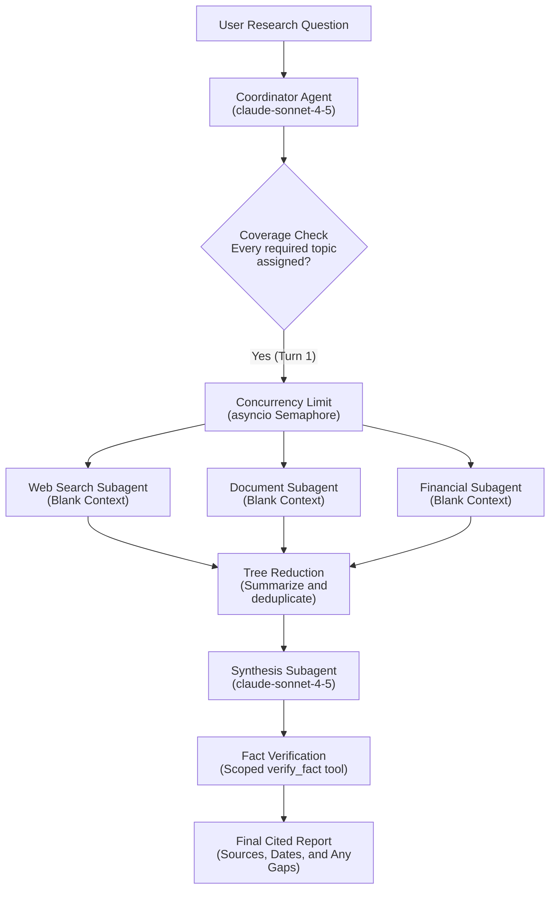
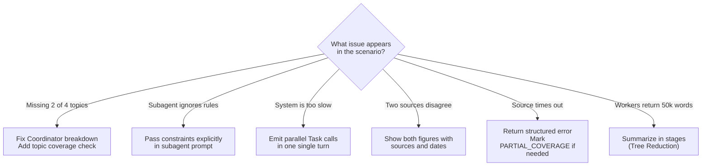

# Scenario 3: Multi-Agent Research System

## 1. The Big Picture (In Plain English)

Imagine building a research assistant that investigates a complex topic—such as a company's competitive position—by gathering data from SEC filings, patent registries, news feeds, and earnings reports, then producing a fully cited briefing. A single agent doing everything sequentially is slow and runs out of focus, so you split the work across a **central Coordinator** and specialized **subagents**.

**Everyday Analogy — The Air Traffic Control Tower:**
An air traffic control tower directs each plane separately so flights land safely and on schedule. Pilots do not open a free-for-all group radio channel to coordinate among themselves. In a multi-agent system, the Coordinator is the tower (**Hub-and-Spoke**), and subagents are isolated flights that report back to the tower—never directly to each other.

- **Domains Tested:** Domain 1 (Agentic Architecture & Orchestration, 27%), Domain 2 (Tool Design & MCP, 18%), Domain 5 (Context Management & Reliability, 15%).
- **Task Statements:** TS 1.2 (Coordinator-subagent topology), TS 1.3 (Parallel spawning & explicit context), TS 1.6 (Task decomposition), TS 2.2 (Structured tool errors), TS 2.3 (Tool scoping), TS 5.3 (Error propagation & partial coverage), TS 5.6 (Citations & conflicting facts).

### Top 3 Mistakes to Watch Out For
1. **Blaming subagents for missing topics:** If a report covers solar power well but completely misses wind and hydro—even though the solar subagent had zero errors—the bug is in the **Coordinator's task breakdown**, not the subagents.
2. **Assuming subagents share memory:** Every subagent starts with a blank context window. If you forget to pass dates, constraints, or entity IDs in the subagent's prompt, it will not know them.
3. **Hiding gaps or averaging conflicts:** Treating a 504 timeout as *"no records found"* invents false facts, and averaging conflicting revenues (`$1.2B` and `$1.4B` → `$1.3B`) invents a number that appears in zero real sources.

---

## 2. How the System Works



### Walkthrough of the Flow
1. **Break down the topic completely:** The Coordinator splits the user's question into clear subtasks and checks that every requested subtopic is covered before launching anything.
2. **Launch independent work in parallel:** In a single turn, the Coordinator emits multiple subagent calls (`Task` / `Agent`), bounded by an `asyncio.Semaphore` so workers do not overwhelm API rate limits.
3. **Keep each subagent isolated and explicit:** Each worker runs in its own blank context and receives all background facts, date windows, and formatting rules directly inside its delegation prompt.
4. **Distinguish empty searches from outages:** Each subagent reports whether it succeeded (`SUCCESS`), found zero matching records (`VALID_EMPTY`), or hit a technical error (`UPSTREAM_FAILURE`).
5. **Preserve citations and disagreements:** The Synthesis step combines verified findings into the final report, preserves conflicting numbers side by side with dates and sources, and discloses any failed sources under partial coverage.

---

## 3. Core Design Rules (Why Naive Fixes Fail)

1. **Check the Coordinator's task breakdown first:**
   When a final report leaves out major sections but the subagent logs look healthy, the Coordinator failed to assign those topics during task decomposition. Add a deterministic coverage check before dispatching workers.
2. **Use Hub-and-Spoke, not Peer-to-Peer meshes:**
   All requests and results flow through the Coordinator. Letting subagents message each other freely creates circular loops, runaway token costs, and untraceable citations.
3. **Pass context explicitly in every subagent prompt:**
   Subagents do not inherit the Coordinator's chat history. Include the target company, date range, and evaluation criteria directly in each worker's prompt.
4. **Spawn independent subagents in one turn:**
   Calling SEC, patent, and news subagents one after another across 3 turns multiplies latency. Emit all independent subagent tool calls in **one Coordinator response turn** so they run concurrently.
5. **Separate "zero matches" (`VALID_EMPTY`) from "server error" (`UPSTREAM_FAILURE`):**
   - A working USPTO search returning 0 patents (`200 OK, []`) is a valid finding (`isError: false`).
   - A `504 Gateway Timeout` is a failure (`isError: true`) that includes `attempted_query`, `is_retryable`, and suggested alternatives—and if retries fail, the final report marks `PARTIAL_COVERAGE` and names the missing source.
6. **Never average conflicting statistics:**
   If a preliminary Oct 1 filing states `$1.2B` and an audited Oct 15 release states `$1.4B`, list **both** numbers with their sources and dates, and note the difference.
7. **Give the Synthesis agent only what it needs:**
   Follow Least Privilege: give the final writer zero raw scraping tools (or at most one lightweight `verify_fact` tool), and summarize huge worker outputs in stages (**hierarchical tree reduction**) before final synthesis.



### Model & API Rules for This Scenario
- **Model choice:** Use `claude-sonnet-4-5` for the Coordinator and final synthesis; use `claude-haiku-4-5` for focused extraction or worker subtasks.
- **Extended Thinking continuity:** If Extended Thinking is active on the Coordinator, **omit `temperature`** and return the assistant's `thinking` blocks verbatim (with their signatures) across every multi-turn tool loop.

---

## 4. What the Exam Tests (Task Statement Map)

| Task Statement | How It Shows Up Here | Tempting Wrong Answer |
| :--- | :--- | :--- |
| **TS 1.2 Coordinator & Spokes** | Coordinator plans, dispatches workers, and compiles the report. | Letting subagents call each other directly in a peer-to-peer mesh. |
| **TS 1.3 Parallel Spawning & Context** | Multiple subagent calls in one turn; explicit facts passed in each prompt. | Running independent subagents sequentially, or assuming shared memory. |
| **TS 1.6 Task Decomposition** | Coverage check confirms every required subtopic has a subtask. | Blaming subagents when the Coordinator omitted half the topic. |
| **TS 2.2 Structured Errors** | Subagents return error category, query attempted, and retryable flag. | Returning `"Search failed"` or hiding a timeout as an empty list. |
| **TS 2.3 Scoped Tools** | Synthesis agent gets only `verify_fact` (or no tools). | Giving the synthesis writer all 28 web/database tools. |
| **TS 5.3 Partial Coverage** | Report explicitly notes any source that timed out (`PARTIAL_COVERAGE`). | Hiding failed sources and claiming 100% coverage. |
| **TS 5.6 Source Provenance** | Every claim keeps its URL and date; conflicting figures appear side by side. | Averaging conflicting numbers together or inventing citations. |

---

## 5. Realistic Walkthrough (End-to-End Example)

**Research Goal:** *"Analyze how AI is affecting creative industries across music, film, visual arts, and writing."*

1. **Check Decomposition Coverage:**
   Before spawning workers, the Coordinator checks its task list against all four requested areas (`music`, `film`, `visual arts`, `writing`). All four are mapped to separate subtasks.
2. **Parallel Dispatch in Turn 1:**
   The Coordinator emits all four subagent tool calls in a single turn, each containing the exact time window (`2024–2026`) and citation format required. An `asyncio.Semaphore` caps concurrency to protect API rate limits.
3. **Recovering from a Timeout:**
   The Music subagent hits a `504 Gateway Timeout` on a niche legal database. Instead of returning `[]`, the tool returns:
   `{"isError": true, "failure_type": "timeout", "attempted_query": "AI music licensing lawsuits", "is_retryable": true, "alternatives": ["search general court filings"]}`.
   The Coordinator retries using the alternative query and recovers the data. (If all retries fail, it marks the final report `PARTIAL_COVERAGE` and names the missing source.)
4. **Preserving Conflicting Figures:**
   The Film subagent finds a trade survey claiming `30%` VFX cost savings (Variety, March 2026) and a studio filing reporting `15%` savings (Studio Q1 Filing, May 2026). The synthesis agent prints **both** figures with their sources and dates rather than averaging them to `22.5%`.
5. **Tree Reduction for Clean Synthesis:**
   Intermediate reducers condense 20,000 words of raw excerpts per industry into crisp, cited summaries before the Coordinator builds the final briefing.

---

## 6. Practice Questions (Try Before Peeking!)

### Q1. Diagnosing Missing Report Sections
A multi-agent research report on *"Global Renewable Energy Trends"* covers solar power thoroughly, but completely omits wind, geothermal, and hydroelectric energy. Logs show the solar subagent ran with zero errors. What is the root cause?

- **A)** The synthesis agent ran out of output tokens and deleted the other sections.
- **B)** The Coordinator's task decomposition failed to create subtasks for wind, geothermal, and hydro.
- **C)** The search API hit a rate limit.
- **D)** The Coordinator ran out of context window space.

<details>
<summary>Show Answer & Explanation</summary>

**Correct Answer:** B

- **A is wrong:** If subtasks were never created, the synthesis agent never received wind or hydro data to drop.
- **B is right:** When active subagents succeed on what they were given, missing report topics point straight to an incomplete Coordinator breakdown.
- **C is wrong:** Rate limits show up as HTTP `429` errors in logs, which did not happen here.
- **D is wrong:** Planning prompts use only a few thousand tokens.

</details>

---

### Q2. Subagent Ignores User Constraints
A document subagent is spawned to summarize a whitepaper, but it returns a generic summary that ignores the strict evaluation rules the Coordinator agreed on with the user earlier. Why?

- **A)** The subagent's tool schema was invalid.
- **B)** The subagent's `max_tokens` setting was too low.
- **C)** The Coordinator forgot to include the evaluation rules in the subagent's prompt.
- **D)** The subagent failed to read the Coordinator's chat history directly.

<details>
<summary>Show Answer & Explanation</summary>

**Correct Answer:** C

- **A is wrong:** Invalid schemas block tool execution; here the subagent ran and produced a summary.
- **B is wrong:** Low `max_tokens` cuts off text mid-sentence; it does not make the agent ignore instructions.
- **C is right:** Subagents start in blank, isolated contexts and only know what you put inside their delegation prompt.
- **D is wrong:** Subagents should not read the Coordinator's full chat history, which causes context bloat.

</details>

---

### Q3. Speeding Up Independent Research Tasks
A pipeline must pull data from 4 unrelated sources (SEC filings, patents, news, academic papers). How should the Coordinator run them to minimize total waiting time?

- **A)** Call them one by one across 4 turns, waiting for each to finish before starting the next.
- **B)** Emit all 4 subagent calls in a single Coordinator turn so they execute concurrently.
- **C)** Have the first subagent spawn the second, which spawns the third, in a chain.
- **D)** Run them sequentially to reduce total token cost.

<details>
<summary>Show Answer & Explanation</summary>

**Correct Answer:** B

- **A is wrong:** Running 4 independent searches one after another multiplies waiting time by 4x.
- **B is right:** Issuing multiple subagent calls in one turn lets them run in parallel, cutting total time down to roughly the slowest single subtask.
- **C is wrong:** Chaining subagents breaks Hub-and-Spoke control and multiplies failure risk.
- **D is wrong:** Sequential calls use the same total tokens—they only add latency.

</details>

---

### Q4. Zero Hits vs. Server Outage
Subagent A searches a patent database and gets `200 OK` with `0` matches. Subagent B searches academic papers and hits a `504 Gateway Timeout`. How should the system handle both?

- **A)** Fail the entire pipeline immediately.
- **B)** Report both as `"no records found"` in the final briefing.
- **C)** Record Subagent A's zero hits as a valid factual finding, and record Subagent B's timeout as an upstream failure for bounded retry or partial-coverage disclosure.
- **D)** Retry both queries in an infinite loop until both return data.

<details>
<summary>Show Answer & Explanation</summary>

**Correct Answer:** C

- **A is wrong:** Finding zero patents in a healthy database is a valid, useful result, not a crash.
- **B is wrong:** Calling a `504` timeout `"no records found"` falsely claims no academic papers exist.
- **C is right:** `VALID_EMPTY` is real data, while `UPSTREAM_FAILURE` needs a bounded retry or an honest gap notice.
- **D is wrong:** Unbounded loops burn through token budgets and hang the job.

</details>

---

### Q5. Handling Disagreeing Sources
An audited SEC Form 10-K (February 2026) reports `$1.20B` in revenue, while an earlier January 2026 press release reports `$1.35B`. How should the Synthesis agent report this?

- **A)** Average them and report `$1.275B`.
- **B)** Report only `$1.35B`.
- **C)** Omit the revenue section altogether.
- **D)** State both figures explicitly with their sources, dates, and context (preliminary release vs. audited filing).

<details>
<summary>Show Answer & Explanation</summary>

**Correct Answer:** D

- **A is wrong:** Averaging invents `$1.275B`, a number that appears in neither source.
- **B is wrong:** Picking one number arbitrarily hides a real discrepancy.
- **C is wrong:** Dropping revenue removes core data the user asked for.
- **D is right:** Good synthesis preserves conflicting numbers with full source attribution and dates.

</details>

---

### Q6. Stopping Made-Up Citations
A research system writes smooth reports, but several footnote URLs turn out to be invented or mismatched. Which structural change fixes this?

- **A)** Tell the synthesis agent to recall URLs carefully from training memory.
- **B)** Require subagents to return structured `{claim, source_url, date, excerpt}` records, and drop any claim during synthesis that lacks a verified link.
- **C)** Append a generic list of 10 popular industry sites at the bottom of the report.
- **D)** Run a fresh open web search over the finished report text afterward.

<details>
<summary>Show Answer & Explanation</summary>

**Correct Answer:** B

- **A is wrong:** Asking an LLM to recall URLs from memory is what causes hallucinated links.
- **B is right:** Keeping source metadata attached to every claim guarantees claim-level traceability.
- **C is wrong:** A general bibliography does not prove which source backs which claim.
- **D is wrong:** Searching after writing is slow and often matches unrelated articles.

</details>

---

## 7. Hands-On Lab, Self-Check & Memory Hook

- **Inspect the code:** Read [`simulation.py`](simulation.py) to see `check_decomposition_coverage`, `SubagentTaskStatus.VALID_EMPTY` vs. `UPSTREAM_FAILURE`, and `merge_claims` (conflict preservation without averaging).
- **Run the interactive lab:** Open [`scenario_workbench.ipynb`](scenario_workbench.ipynb) and run all cells offline.
- **Run the unit tests (WSL Ubuntu-26.04):**
  ```bash
  uv run pytest scenarios/scenario_3_multi_agent_research/test_scenario_3_simulation.py
  ```

### Self-Check Checklist
- [ ] I check the Coordinator's task breakdown before blaming subagents for missing sections.
- [ ] I know why subagents start with blank context and need all parameters passed in their prompt.
- [ ] I can explain the difference between `VALID_EMPTY` (`0` hits) and `UPSTREAM_FAILURE` (timeout/outage).
- [ ] I know never to average conflicting figures and always to keep dates and sources attached.
- [ ] I understand why independent subagents should be spawned in a single turn.

**Exam-Day Memory Hook:** *"Split wide, pass context, fail loudly, cite everything."*

**Related Practice Bank Sets:**
- [Set 2 (Multi-Agent Topologies & Fan-Out): Q31, Q32, Q33, Q34, Q35, Q45, Q49](../../practice_exam_bank_300/set_02_domain1_multi_agent_topologies.md)
- [Set 3 (Extended Thinking & State): Q66, Q81, Q84, Q85](../../practice_exam_bank_300/set_03_domain1_extended_thinking_state.md)

---

[← Scenario 2](../scenario_2_code_generation/SCENARIO_GUIDE.md) · [Scenarios Overview](../README.md) · [Next: Scenario 4 →](../scenario_4_developer_productivity/SCENARIO_GUIDE.md)
