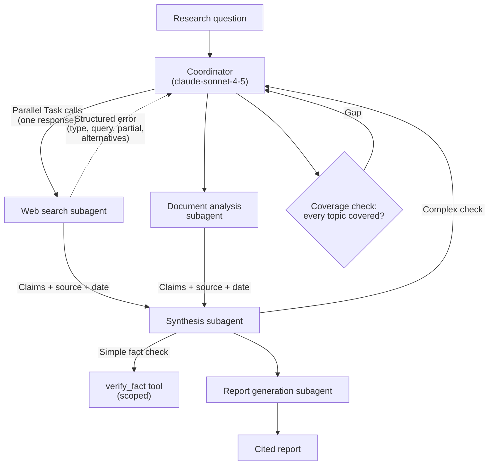

# Scenario 3: Multi-Agent Research System

## 1. In One Minute

**What it is.** A coordinator agent splits a research question across subagents (web search, document analysis, synthesis, report generation). The result is a cited report.

**Domains hit:** D1 Agentic Architecture, D2 Tool Design and MCP, D5 Context Management.

**Task statements:** TS 1.2 (coordinator and subagents), 1.3 (spawning and context passing), 1.6 (task decomposition), 2.2 (structured errors), 2.3 (scoped tools), 5.3 (error propagation), 5.6 (provenance).

**Top 3 traps**
1. Blaming a subagent when the coordinator split the topic too narrowly.
2. Assuming subagents inherit the coordinator's memory. They do not; pass context in the prompt.
3. Hiding failures: returning empty results for a timeout, or averaging conflicting numbers.

## 2. Architecture Diagram

## 3. How a Good Answer Thinks

1. **Find where the fault is.** Good subagent output, narrow final report: the coordinator's decomposition is the cause.
2. **Hub-and-spoke.** All communication goes through the coordinator. Subagents have isolated context.
3. **Pass context explicitly.** Include findings, sources, and constraints in each subagent prompt.
4. **Parallel when independent.** Emit multiple Task calls in one coordinator response.
5. **Errors carry context.** Failure type, attempted query, partial results, alternatives. Not "search unavailable".
6. **Empty is not failure.** A working search with zero hits is a valid result. A timeout is a failure.
7. **Provenance.** Keep claim, source, and date together. Keep conflicting values with attribution; never average.
8. **Least privilege.** Give synthesis a scoped `verify_fact`, not all web tools.

### Model and Sampling Notes
- Use `claude-sonnet-4-5` for coordinators and reasoning, `claude-haiku-4-5` for workers and extraction.
- With extended thinking on: omit `temperature`, leave `top_k` and `top_p` unset, and use only `tool_choice` `auto` or `none` (forced or `any` returns HTTP 400). Forced-tool extraction calls must not use thinking.
- In tool loops, return thinking blocks with their signature unchanged.
- Loops end on `stop_reason` only (`end_turn`, `tool_use`, `max_tokens`, `stop_sequence`, `pause_turn`, `refusal`). A max-iterations counter is a safety cap, not the stop rule.

## 4. Task Statement Map

| Task statement | How it shows up here | Trap |
|---|---|---|
| TS 1.2 Coordinator | Coordinator plans, delegates, merges | Subagents talking to each other directly |
| TS 1.3 Spawning | Parallel Task calls; context passed in the prompt | Assuming shared memory |
| TS 1.6 Decomposition | Check every required topic has a subtask | Narrow split that misses topics |
| TS 2.2 Errors | Structured error returned to coordinator | Generic error or empty success |
| TS 2.3 Scoped tools | `verify_fact` for simple checks | Giving synthesis every search tool |
| TS 5.3 Propagation | Report says which sources failed (partial coverage) | Silent gaps |
| TS 5.6 Provenance | Claim-source mapping; conflicts kept | Averaging or dropping a source |

## 5. Worked Example

**Question:** "Impact of AI on creative industries." The report only covers visual arts.

1. Check subagent logs: they did their assigned work well.
2. Check the coordinator's task list: visual arts only. Music, film, writing are missing.
3. Root cause: decomposition too narrow. Fix the coordinator, for example by adding a coverage check against the required topics.
4. Re-run with subtasks for each area, in parallel. The web search for music times out. It returns `failure_type: timeout`, the attempted query, and alternatives. The coordinator retries with a narrower query.
5. Two sources give different revenue figures. The report lists both, each with source and date.
6. The report notes any area still missing, so readers see partial coverage.

Try it offline: `scenarios/scenario_3_multi_agent_research/simulation.py` (`check_decomposition_coverage`, `merge_claims`, `structured_error`). The simulation uses SEC, patent, and market subagents as examples of the same pattern.

## 6. Exam-Style Practice Questions

**Q1.** A report on "renewable energy" covers only solar. Subagent logs show solar research was thorough. What is the root cause?
- A) The synthesis subagent dropped wind and hydro.
- B) The coordinator's decomposition did not include the other energy types.
- C) The web search tool is too slow.
- D) The model's context window is too small.

**Q2.** A document-analysis subagent summarizes a paper the coordinator already read, but ignores key constraints the coordinator knew. Why?
- A) The subagent has a bug in its tool schema.
- B) Subagents need a larger `max_tokens`.
- C) The coordinator did not include the needed context in the subagent's prompt.
- D) The subagent should read the coordinator's history directly.

**Q3.** Three independent source searches are needed. How should the coordinator launch them?
- A) One at a time, waiting for each.
- B) Emit several Task calls in a single response so they run in parallel.
- C) Ask one subagent to spawn the other two.
- D) Run them sequentially to reduce cost.

**Q4.** A search subagent finds no records for a niche query, and another one hits a timeout. How should the report treat them?
- A) Treat both as failures and discard the report.
- B) Treat both as "no data" and continue.
- C) Report the empty result as a valid finding, and report the timeout as a failed source with context.
- D) Retry both forever.

**Q5.** Two sources give different market sizes: `$1.2B` (filing) and `$1.4B` (analyst release). What should the report do?
- A) Average them as `$1.3B`.
- B) Pick the larger value.
- C) Drop both.
- D) Show both values with source, date, and a note about the conflict.

**Q6.** Final reports have claims without sources. What change best fixes this?
- A) Ask synthesis to add citations from memory.
- B) Require each subagent to return claim, source URL, and date, and carry those through synthesis.
- C) Put a generic bibliography at the end.
- D) Run another web search after the report is written.

### Answers

**Q1: B.** A fails: the logs show subagents did their assigned work; the topics were never assigned. C fails: speed does not cause missing topics. D fails: no sign of context overflow.

**Q2: C.** A fails: schema is not the issue. B fails: output length is unrelated. D fails: subagents have isolated context by design.

**Q3: B.** A fails: slow for independent work. C fails: breaks hub-and-spoke. D fails: parallel runs cost the same tokens and finish faster.

**Q4: C.** A fails: empty is valid. B fails: hides a real failure. D fails: unbounded retries; use structured errors and a retry policy.

**Q5: D.** A fails: invents a number no source reported. B fails: drops information without justification. C fails: loses evidence.

**Q6: B.** A fails: memory-based citations can be invented. C fails: not tied to claims. D fails: too late and mismatched.

## 7. Self-Check Checklist

- [ ] I check decomposition before blaming subagents.
- [ ] I know subagents do not inherit context.
- [ ] I can list the fields of a useful structured error.
- [ ] I separate "empty result" from "failure".
- [ ] I keep conflicting claims with sources, never averaging.

**Memory hook:** "Split wide, pass context, fail loudly, cite everything."
