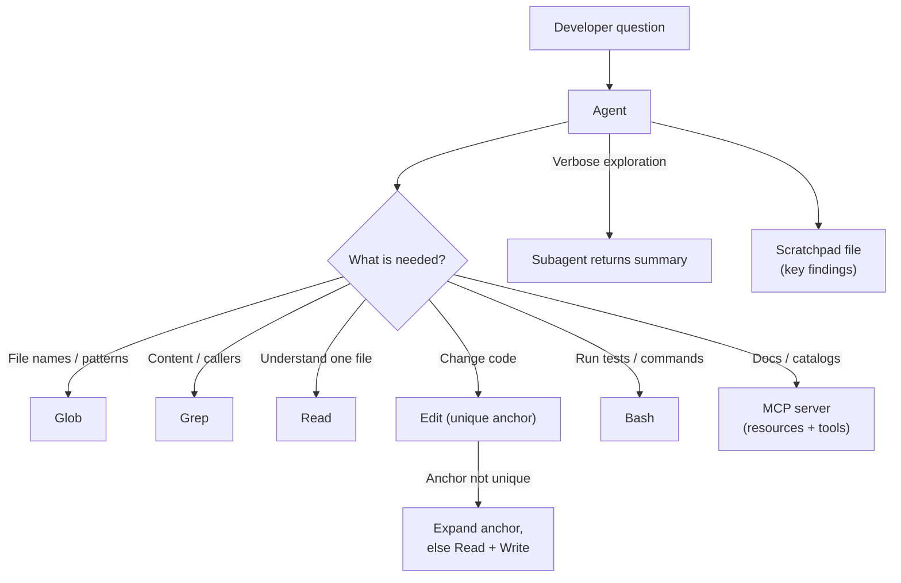

# Scenario 4: Developer Productivity with Claude

## 1. In One Minute

**What it is.** An Agent SDK agent helps developers explore unfamiliar codebases, understand legacy systems, and generate boilerplate. It uses built-in tools (Read, Write, Edit, Bash, Grep, Glob) and MCP servers.

**Domains hit:** D2 Tool Design and MCP, D3 Claude Code Configuration, D1 Agentic Architecture.

**Task statements:** TS 2.3 (tool distribution), 2.4 (MCP server integration), 2.5 (built-in tools), 3.1 (CLAUDE.md), 1.7 (session management), 5.1 (context).

**Top 3 traps**
1. Reading whole files or directories when Grep or Glob would find the target cheaply.
2. Putting secrets in `.mcp.json` instead of `${ENV_VAR}` expansion.
3. Doing verbose exploration in the main session instead of a subagent or scratchpad.

## 2. Architecture Diagram

## 3. How a Good Answer Thinks

1. **Match the tool to the question.** Names: Glob. Content: Grep. One known file: Read.
2. **Start narrow, then widen.** Grep for the symbol, Read the hits, follow callers. Do not read everything.
3. **Edit needs a unique anchor.** If it fails, expand the anchor. If still ambiguous, Read then Write.
4. **MCP configuration.** Shared team servers live in the project `.mcp.json`. Credentials use `${ENV_VAR}`. Personal servers stay in user config.
5. **Resources vs tools.** Static catalogs and docs fit MCP resources: the agent can see what exists without guessing.
6. **Protect context.** Send noisy exploration to a subagent and save key findings in a scratchpad file.
7. **Least privilege.** Give the agent only the tools the task needs.

### Model and Sampling Notes
- Use `claude-sonnet-4-5` for coordinators and reasoning, `claude-haiku-4-5` for workers and extraction.
- With extended thinking on: omit `temperature`, leave `top_k` and `top_p` unset, and use only `tool_choice` `auto` or `none` (forced or `any` returns HTTP 400). Forced-tool extraction calls must not use thinking.
- In tool loops, return thinking blocks with their signature unchanged.
- Loops end on `stop_reason` only (`end_turn`, `tool_use`, `max_tokens`, `stop_sequence`, `pause_turn`, `refusal`). A max-iterations counter is a safety cap, not the stop rule.

## 4. Task Statement Map

| Task statement | How it shows up here | Trap |
|---|---|---|
| TS 2.3 Distribution | Explorer agent gets read-only tools | Granting Write and Bash to a read-only task |
| TS 2.4 MCP integration | Project `.mcp.json` with `${ENV_VAR}`; resources for docs | Hardcoded tokens; one-off personal config for the team |
| TS 2.5 Built-in tools | Grep, Glob, Read, Edit, Write, Bash used in the right order | Reading every file; Bash `cat` instead of Read |
| TS 3.1 CLAUDE.md | Project conventions loaded at session start | Re-explaining conventions each time |
| TS 1.7 Sessions | Resume or fork a session to explore alternatives | Starting over and losing findings |
| TS 5.1 Context | Subagent summaries and scratchpad notes | One session full of raw search output |

## 5. Worked Example

**Task:** "Where is tax calculated in this legacy billing system, and can we change the rate safely?"

1. Glob `src/**/billing*` to see the layout.
2. Grep `calculate_tax|get_rate` to find definitions and callers.
3. Read only the hit files around those lines.
4. Read the billing API spec through the MCP resource, not by searching the wiki.
5. Edit `0.05` to a named constant. The anchor `return 0.05` matches two places, so the Edit fails. Expand the anchor with the function signature. It now matches once.
6. Run the tests with Bash. Save the finding "tax logic lives in `calc.py`, callers in `invoice.py`" to a scratchpad.

Try it offline: `scenarios/scenario_4_developer_productivity/simulation.py` (`execute_edit_with_fallback`, `read_mcp_resource`).

## 6. Exam-Style Practice Questions

**Q1.** You need every caller of `calculate_tax` in a large repo you have never seen. What is the best first step?
- A) Read every file under `src/`.
- B) Ask the user to list callers.
- C) Run `cat` on all Python files.
- D) Grep for `calculate_tax`, then Read only the matching files.

**Q2.** You need all test files matching `*.test.tsx`. Which tool?
- A) Grep for the text "test".
- B) Glob with the pattern.
- C) Read the root directory.
- D) Bash with `find` and parse the output.

**Q3.** An Edit fails because the target line appears three times. What is the best recovery?
- A) Retry the same Edit.
- B) Replace the entire repo.
- C) Expand the anchor with surrounding unique lines; if still ambiguous, Read then Write.
- D) Skip the change.

**Q4.** A team wants a shared Jira MCP server for everyone in the repo. The server needs an API token. What is the right setup?
- A) Put the server in each developer's personal config.
- B) Put the server in the repo's `.mcp.json` with the token as `${JIRA_TOKEN}`.
- C) Put the token directly in `.mcp.json`.
- D) Paste the token into the system prompt.

**Q5.** A long exploration fills the main session with raw search output, and the agent loses earlier findings. What helps most?
- A) Raise the token limit.
- B) Delete earlier findings.
- C) Run the exploration in a subagent that returns a summary, and keep key findings in a scratchpad file.
- D) Restart and avoid exploring.

**Q6.** Static API documentation should be easy for the agent to discover. What is a good design?
- A) Expose it as an MCP resource, so the agent can see what exists.
- B) Wrap it in a tool that needs a query guess for every lookup.
- C) Paste the full docs into every prompt.
- D) Keep it on a wiki the agent cannot reach.

### Answers

**Q1: D.** A fails: expensive and floods context. B fails: the agent should find it. C fails: same cost as A, and Read/Grep are the right tools.

**Q2: B.** A fails: Grep searches content, not names. C fails: lists only one directory level. D fails: Glob is the purpose-built tool.

**Q3: C.** A fails: same failure. B fails: absurd and destructive. D fails: gives up on a recoverable error.

**Q4: B.** A fails: not shared with the team. C fails: leaks a secret into version control. D fails: leaks the secret and wastes context.

**Q5: C.** A fails: more room, same clutter. B fails: loses data. D fails: gives up the task.

**Q6: A.** B fails: hides what exists. C fails: bloats every prompt. D fails: unreachable.

## 7. Self-Check Checklist

- [ ] I pick Glob, Grep, or Read from the question wording.
- [ ] I can describe the Edit failure recovery steps.
- [ ] I know where shared MCP config lives and how secrets are handled.
- [ ] I can explain resources vs tools in one line.
- [ ] I protect context with subagents and a scratchpad.

**Memory hook:** "Glob names, Grep content, Read last, Edit with a unique anchor."
